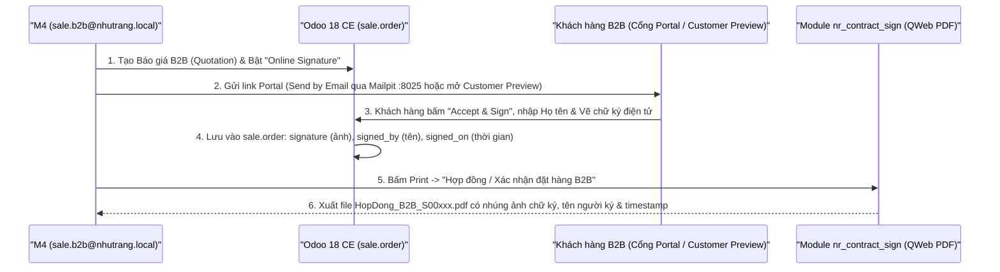

# Kế Hoạch Thực Hiện Task Chương 1 Cho Thành Viên M4 (Luồng S4 — Bán Hàng B2B & B2C)
### *Chủ đề: Hiện Trạng Đã Xử Lý, Giải Pháp Thay Thế Tính Năng Enterprise Bằng Module Tự Viết & Nghiệm Thu Ký Hợp Đồng B2B Trên Portal*

> **Dự án:** Triển khai Odoo 18.0 Community ERP (Tự host qua Docker) — Công ty TNHH Nhựt Rạng (MST: `3602329735`)
> **Nguồn đối chiếu:**
> 1. Tài liệu bàn giao: `NhutRang_ERP_BanGiao_CongViec_ConLai_va_UAT.docx` *(Chương 1 — Mục 1.1)*
> 2. Mã nguồn module trong repo [nntGinger/NhutRangOdoo](https://github.com/nntGinger/NhutRangOdoo/tree/main): `addons/nr_contract_sign`, `addons/nr_floorprice`, `addons/nr_sample`, `addons/nr_einvoice`, `addons/sale_tier_validation`

---

## PHẦN 1: TỔNG QUAN CHƯƠNG 1 DƯỚI GÓC NHÌN CỦA THÀNH VIÊN `M4`

Theo quyết định ngày **16–18/11/2026** trong Chương 1, dự án vận hành **100% trên Odoo 18.0 Community tự host qua Docker** (Database: `ERP-NhutRang`) và giả lập dữ liệu doanh nghiệp Nhựt Rạng để nghiệm thu UAT & trình bày Final (không dùng Odoo Enterprise / Odoo.sh và không kết nối API trả phí bên thứ ba).

### 1.1. Khung nền kỹ thuật thuộc phạm vi `M4` đã được thiết lập sẵn trong DB `ERP-NhutRang`
Trước khi `M4` bắt đầu thao tác, hệ thống đã nạp sẵn các cấu hình nền tảng cho phân hệ Bán hàng (`sale`):
1. **5 Bảng giá (`Pricelists`):** `PL-RETAIL` (Bán lẻ), `PL-DEALER-A` (Đại lý cấp 1: giảm 10% từ 20 cuộn, 15% từ 100 cuộn), `PL-OEM` (Gia công hợp đồng OEM), `Mẫu` / `PL-SAMPLE` (Đơn hàng mẫu 0đ), và bảng giá mặc định.
2. **18 Khách hàng giả lập ([data/6_customers.csv](file:///d:/KnowledgeLibrary/ERP/project/NhutRangOdoo/data/6_customers.csv)):** Gồm **15 doanh nghiệp B2B** (có đầy đủ MST, phân về đội `B2B`, hạn mức công nợ mẫu) và **3 khách lẻ B2C** (đội `B2C Online`, thanh toán ngay `PT-NOW`).
3. **40 Sản phẩm mẫu ([data/3_products.csv](file:///d:/KnowledgeLibrary/ERP/project/NhutRangOdoo/data/3_products.csv)) & 4 Phương thức giao hàng (`Delivery Methods`).**
4. **Quy trình duyệt đơn bán $> 100,000,000\text{ đ}$:** Đã cài và cấu hình qua bộ module OCA `base_tier_validation` + `sale_tier_validation` (`Tier Definition id=1`).
5. **Tài khoản vai trò của `M4` đã tạo sẵn:**
   * Nhân viên Kinh doanh B2B: `sale.b2b@nhutrang.local` (Mật khẩu: `NhutRang@2026!`)
   * Nhân viên Kinh doanh Online: `sale.online@nhutrang.local` (Mật khẩu: `NhutRang@2026!`)
   * Ban Giám đốc (Người duyệt): `director@nhutrang.local` (Mật khẩu: `NhutRang@2026!`)
   * Khách hàng Portal mẫu: `jesuisnguyenutragiang@gmail.com`

---

## PHẦN 2: BẢNG ĐỐI CHIẾU CÁC HẠNG MỤC TRONG CHƯƠNG 1 (MỤC 1.1) LIÊN QUAN ĐẾN `M4`

Trong bảng 1.1 (*"Quyết định dùng Odoo 18 Community: tính năng Enterprise được thay bằng module tự viết"*), có **1 hạng mục giao đích danh cho `M4`** và **4 hạng mục liên đới trực tiếp đến luồng Bán hàng B2B/B2C của `M4`**:

| STT | Nghiệp vụ (App Enterprise cũ) | Giải pháp Odoo 18 Community đã code & cài trong `addons/` | Việc `M4` cần làm tiếp theo Chương 1 (Dữ liệu giả lập / Demo Final) |
| :-: | :--- | :--- | :--- |
| **1** | **Sign** *(Ký điện tử báo giá / Hợp đồng B2B)* **[GIAO ĐÍCH DANH M4 & M1]** | • Dùng tính năng **Chữ ký online trên Portal (`Online Signature`)** có sẵn của Odoo Community. • Kết hợp module tự viết **`nr_contract_sign`**: tạo mẫu in QWeb PDF **`Hợp đồng / Xác nhận đặt hàng B2B`** (`HopDong_B2B_<Mã_SO>.pdf`) tự động nhúng hình ảnh chữ ký Portal (`doc.signature`), người ký (`doc.signed_by`) và ngày giờ ký (`doc.signed_on`). | • **`M4` & `M1` giữ chữ ký online trên Portal cho báo giá B2B để demo.** • Thực hiện ký mẫu trên Portal cho 1–2 đơn hàng B2B để khi bấm in PDF `Hợp đồng / Xác nhận đặt hàng B2B` hiển thị đầy đủ chữ ký điện tử của khách hàng. • **Bỏ qua** tích hợp chữ ký số USB Token / CA thật (không nằm trong phạm vi Final). |
| **2** | **Studio** *(Tùy biến trường dữ liệu & nút bấm trên Báo giá / Đơn bán)* | Thay toàn bộ việc kéo thả Studio bằng **code module chuẩn lưu trên Git**: • **`nr_floorprice`**: Thêm trường `floor_price`, `min_margin_percent` vào sản phẩm; thêm cờ `is_below_floor_price` và quy trình 3 nút (`Gửi duyệt giá sàn`, `Duyệt giá sàn`, `Từ chối`) vào `sale.order`. • **`nr_sample`**: Thêm cờ `is_sample_order`, trạng thái `Đánh giá mẫu` và nút tạo đơn mẫu 0đ từ CRM. | • **`M4` không tự sửa giao diện bằng công cụ ngoài Git.** • Kiểm tra và vận hành các trường/nút mới trên `sale.order` do `nr_floorprice` và `nr_sample` cung cấp để chạy `UAT-03` và `UAT-06`. |
| **3** | **Approvals trên Đơn bán** *(Duyệt đơn bán giá trị lớn $> 100\text{tr}$)* | Thay bằng 2 module chuẩn OCA đã đưa thẳng vào `addons/`: **`base_tier_validation`** + **`sale_tier_validation`** (cấu hình sẵn `Tier Definition id=1` chặn đơn bán $> 100,000,000\text{ đ}$). | • `M4` dùng tài khoản `sale.b2b@nhutrang.local` bấm **`Request Validation`** và phối hợp `director@nhutrang.local` bấm **`Validate`** khi demo đơn bán $> 100\text{ triệu}$ (`UAT-03`). |
| **4** | **Kiểm soát Xuất hóa đơn B2B & HĐĐT** *(Accounting Enterprise)* | Module tự viết **`nr_einvoice`**: Kiểm tra ràng buộc trực tiếp với đơn bán B2B của `M4` — **chặn cứng** không cho Kế toán vào sổ (`Confirm`) hóa đơn B2B nếu số lượng trên hóa đơn $>$ số lượng đã giao kho (`qty_delivered`). | • `M4` giữ chính sách xuất hóa đơn theo số lượng thực giao (`Delivered quantities`) trên các sản phẩm B2B chủ lực và phối hợp `M2` demo cảnh báo chặn ở `UAT-09`. |
| **5** | **Rule-Based Lead Assignment & Web Forms** *(Tự động chia Lead về đội Sales của M4)* | Module **`nr_crm_assign`** + **`nr_website_pages`**: Khi khách gửi form `/bao-gia-in-logo` hoặc `/dang-ky-dai-ly`, hệ thống tự động phân về **Sales Team `B2B`** hoặc **`B2C Online`** và gán cho nhân viên có ít việc mở nhất. | • `M4` đảm bảo 2 tài khoản `sale.b2b@nhutrang.local` và `sale.online@nhutrang.local` luôn nằm đúng trong 2 đội **`B2B`** và **`B2C Online`** để nhận Lead tự động. |

---

## PHẦN 3: PHÂN TÍCH KỸ THUẬT MODULE `nr_contract_sign` (TRỌNG TÂM CHƯƠNG 1 CỦA `M4`)

Để trình bày tự tin trước hội đồng về cách nhóm thay thế app **Odoo Sign (Enterprise)** bằng giải pháp **Community + `nr_contract_sign`**, `M4` cần nắm rõ cơ chế hoạt động của module [b2b_contract_report.xml](file:///d:/KnowledgeLibrary/ERP/project/NhutRangOdoo/addons/nr_contract_sign/report/b2b_contract_report.xml):

### Cấu trúc thông tin trên mẫu in `Hợp đồng / Xác nhận đặt hàng B2B`:
1. **Tiêu đề chứng từ:** `XÁC NHẬN ĐẶT HÀNG / HỢP ĐỒNG B2B: [Mã đơn S00xxx]`
2. **Thông tin pháp lý 2 bên:**
   * **BÊN BÁN:** `Công ty TNHH Nhựt Rạng` — MST: `3602329735` — Địa chỉ: `Phước Tân, Biên Hòa, Đồng Nai`.
   * **BÊN MUA:** Tên doanh nghiệp B2B (`partner_id.name`) — MST (`partner_id.vat`) — Ngày đơn (`date_order`) — Điều khoản thanh toán (`payment_term_id.name`, ví dụ `PT-30`).
3. **Bảng chi tiết hàng hóa:** Sản phẩm / Quy cách, Số lượng + Đơn vị tính, Đơn giá, Chiết khấu (%), Thành tiền, Tổng chưa thuế, Thuế GTGT 10%, Tổng cộng.
4. **Khung chữ ký tự động thích ứng (`ĐẠI DIỆN BÊN MUA (CHỮ KÝ PORTAL)`):**
   * **Khi khách CHƯA ký trên Portal (`doc.signature == False`):** Hiển thị dòng nhắc: *(Chờ khách hàng xác nhận & ký điện tử qua Portal)*.
   * **Khi khách ĐÃ ký trên Portal (`doc.signature != False`):** Tự động render hình ảnh chữ ký (`max-height: 3.5cm; max-width: 7cm`), dòng **`Đã ký bởi: [Tên người ký]`** và **`Thời gian: [Ngày giờ ký]`**.

---

## PHẦN 4: HƯỚNG DẪN THAO TÁC TỪNG BƯỚC CHO `M4` ĐỂ HOÀN THÀNH TASK CHƯƠNG 1

### Bước 1: Kiểm tra bật tính năng Chữ ký Online (`Online Signature`)
1. Đăng nhập `http://localhost:8069` bằng tài khoản `Administrator` (hoặc `director@nhutrang.local`).
2. Vào **Sales $\rightarrow$ Configuration $\rightarrow$ Settings**.
3. Tại mục **Quotations & Orders**, kiểm tra ô **Online Signature** đã được tích bật (nếu chưa thì tích chọn và bấm **Save**).

### Bước 2: Tạo Báo giá B2B mẫu và kiểm tra bản in trước khi ký
1. Đăng nhập tài khoản **`sale.b2b@nhutrang.local`** (Mật khẩu: `NhutRang@2026!`).
2. Vào **Sales $\rightarrow$ Orders $\rightarrow$ Quotations $\rightarrow$ New**:
   * **Customer:** Chọn **`Công ty TNHH Bao Bì An Phát`** (MST: `0301234567`, Bảng giá `PL-DEALER-A`, Điều khoản `PT-30`).
   * **Tab Order Lines:** Thêm **`60 cuộn`** sản phẩm **`[BKBV-DAW-500] Băng keo bảo vệ bề mặt trắng đen 500mm`** (đơn giá tự giảm 10% còn `288,000 đ`, thành tiền `17,280,000 đ`).
   * **Tab Other Info (Thông tin khác):** Tại mục *Online confirmation*, đảm bảo ô **`Online Signature`** đang được tích chọn (`True`).
   * Bấm **Save**.
3. Bấm biểu tượng bánh răng (**Action / Print**) ở góc trên $\rightarrow$ chọn **Print $\rightarrow$ `Hợp đồng / Xác nhận đặt hàng B2B`**.
4. Mở file PDF tải về: Xác nhận ở góc phải dưới hiển thị dòng chữ *(Chờ khách hàng xác nhận & ký điện tử qua Portal)*.

### Bước 3: Thực hiện Ký điện tử trực tiếp trên Portal (Giả lập vai Khách hàng B2B)
1. Ngay trên form Báo giá vừa tạo, bấm nút **`Customer Preview`** ở góc trên bên phải (hệ thống sẽ mở giao diện Portal của báo giá đó dưới góc nhìn khách hàng).
2. Trên giao diện Portal:
   * Bấm nút **`Sign & Pay`** (hoặc **`Accept & Sign`**).
   * Trong popup ký điện tử hiện ra:
     * **Full Name:** Nhập tên đại diện khách hàng, ví dụ: `Nguyễn Văn An - GĐ Công ty Bao Bì An Phát`.
     * **Signature:** Chọn **`Auto`** (tự tạo chữ ký theo tên) hoặc **`Draw`** (dùng chuột ký tay trực tiếp lên khung).
   * Bấm nút **`Accept & Sign`**.
3. Hệ thống tự động xác nhận báo giá thành **Sales Order** và ghi nhận chữ ký vào Chatter kèm thông báo đã ký.

### Bước 4: In lại PDF `Hợp đồng / Xác nhận đặt hàng B2B` đã có chữ ký để làm minh chứng
1. Quay lại giao diện Backend của đơn hàng vừa ký (`Back to edit mode`).
2. Kiểm tra tab **Customer Signature** (hoặc **Other Info**): Đã lưu đầy đủ `Signed By`, `Signed On` và hình ảnh `Signature`.
3. Bấm biểu tượng bánh răng $\rightarrow$ **Print $\rightarrow$ `Hợp đồng / Xác nhận đặt hàng B2B`**.
4. Mở file PDF **`HopDong_B2B_S00xxx.pdf`** vừa tải về:
   * Kiểm tra góc phải dưới tại mục **`ĐẠI DIỆN BÊN MUA (CHỮ KÝ PORTAL)`** đã hiển thị rõ **Hình ảnh chữ ký điện tử**, dòng **`Đã ký bởi: Nguyễn Văn An - GĐ Công ty Bao Bì An Phát`** và **`Thời gian: ...`**.
   * Lưu file PDF này lại để làm minh chứng nghiệm thu cho **Chương 1 (Mục 1.1 - Sign)**, **`UAT-07` (Bước 4)** và **`UAT-10` (Bước 5)**.

---

## PHẦN 5: CHECKLIST NGHIỆM THU CHƯƠNG 1 CỦA `M4` (ĐƯA VÀO SLIDE BÁO CÁO FINAL)

- [ ] **1. Giải pháp thay thế Odoo Sign (Enterprise):** Đã kiểm chứng luồng khách hàng B2B ký điện tử trực tiếp trên Portal và xuất ra file PDF `HopDong_B2B_S00xxx.pdf` có nhúng chữ ký qua module `nr_contract_sign` (không cần mua bản quyền Enterprise hay tích hợp USB Token thật).
- [ ] **2. Giải pháp thay thế Odoo Studio trên phân hệ Sales:** Đã nắm vững mã nguồn và cơ chế của `nr_floorprice` (kiểm soát giá sàn & biên lợi nhuận tối thiểu 10%), `nr_sample` (đơn hàng mẫu 0đ từ CRM), và `nr_einvoice` (chặn xuất hóa đơn B2B trước khi giao kho).
- [ ] **3. Giải pháp thay thế Odoo Approvals trên phân hệ Sales:** Đã nắm vững cơ chế duyệt đơn bán $> 100,000,000\text{ đ}$ bằng bộ module chuẩn OCA `base_tier_validation` + `sale_tier_validation`.
- [ ] **4. Đồng bộ tài liệu thuyết trình:** Ghi chú rõ trên Slide phần Bán hàng B2B rằng chữ ký điện tử Portal là giải pháp chuẩn của bản Demo Final trên Odoo 18 Community.
