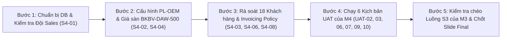

# Kế Hoạch Thực Hiện Task Chương 2 & UAT Final Cho Thành Viên M4 (Luồng S4 — Bán Hàng B2B & B2C)

> **Dự án:** Triển khai Odoo 18.0 Community ERP (Tự host qua Docker) — Công ty TNHH Nhựt Rạng (MST: `3602329735`)
> **Nguồn đối chiếu:**
> 1. Repository chính thức: [https://github.com/nntGinger/NhutRangOdoo/tree/main](https://github.com/nntGinger/NhutRangOdoo/tree/main) *(Commit `0a3c4bd`)*
> 2. Tài liệu bàn giao: `NhutRang_ERP_BanGiao_CongViec_ConLai_va_UAT.docx`
> 3. Hướng dẫn kiểm thử chi tiết: [Huong_Dan_Kiem_Thu_UAT.md](file:///d:/KnowledgeLibrary/ERP/project/NhutRangOdoo/Huong_Dan_Kiem_Thu_UAT.md), [NhutRang_ERP_config_tasks.md](file:///d:/KnowledgeLibrary/ERP/project/NhutRangOdoo/NhutRang_ERP_config_tasks.md), [NhutRang_ERP_check_tasks.md](file:///d:/KnowledgeLibrary/ERP/project/NhutRangOdoo/NhutRang_ERP_check_tasks.md)

---

## PHẦN 1: TỔNG QUAN HIỆN TRẠNG DỰ ÁN TRÊN REPO `NhutRangOdoo`

Hệ thống chuyển sang dùng **100% Odoo 18.0 Community tự host bằng Docker** (Database chuẩn: `ERP-NhutRang`), thay thế toàn bộ tính năng Enterprise bằng **11 module tự viết (`nr_*`)** và **2 module OCA** đặt trong thư mục `addons/`:

| Nhóm Module | Danh sách Module trong `addons/` | Liên quan trực tiếp tới `M4` (Luồng S4 Bán hàng B2B/B2C) |
| :--- | :--- | :--- |
| **Kiểm soát giá sàn & biên LN** | `nr_floorprice` | **Trọng tâm của M4:** Chặn xác nhận đơn bán có đơn giá thấp hơn `Giá sàn (chưa VAT)` (`floor_price`) hoặc `Biên lợi nhuận tối thiểu (%)` (`min_margin_percent` mặc định `10%`); luồng `Gửi duyệt giá sàn` $\rightarrow$ Giám đốc `Duyệt giá sàn`. |
| **Duyệt đơn bán giá trị lớn** | `base_tier_validation`, `sale_tier_validation` (OCA) | **Trọng tâm của M4:** Tự động chặn và yêu cầu Giám đốc duyệt (`Request Validation`) với mọi đơn bán B2B có tổng giá trị **$> 100,000,000\text{ đ}$** (Tier Definition `id=1`). |
| **Hợp đồng B2B & Chữ ký Portal** | `nr_contract_sign` | **Trọng tâm của M4:** Cung cấp mẫu in PDF **`Hợp đồng / Xác nhận đặt hàng B2B`** có đầy đủ thông tin công ty, khách hàng B2B, MST và vùng chữ ký điện tử Portal. |
| **Hóa đơn điện tử NĐ 254/2026** | `nr_einvoice` | **Phối hợp M2 & M4:** Chặn cứng việc vào sổ (`Confirm`) hóa đơn B2B khi số lượng hóa đơn lớn hơn số lượng đã giao kho (`Delivered quantities`); cấp số HĐĐT ký hiệu `1C26TNR`. |
| **Đơn hàng mẫu CRM (0đ)** | `nr_sample` | **Phối hợp M6 & M4:** Tạo đơn hàng mẫu từ Opportunity với bảng giá `Mẫu (0đ)`, tự động miễn kiểm tra giá sàn, và chặn gửi đơn mẫu lần 2 khi đơn mẫu lần 1 còn ở trạng thái `Chờ đánh giá`. |
| **Tự động chia Lead & Web Form** | `nr_crm_assign`, `nr_website_pages` | Tự động phân Lead B2B về Sales Team **`B2B`** (`sale.b2b@nhutrang.local`) và Lead mua lẻ về **`B2C Online`** (`sale.online@nhutrang.local`). |
| **Tài chính, Kho, Mua hàng** | `nr_finance_control`, `nr_accounting_reports`, `nr_quality_scrap`, `nr_warehouse_barcode`, `nr_purchase_control` | Phối hợp trong các kịch bản liên phân hệ (`UAT-08`, `UAT-09`, `UAT-10`, `UAT-11`) và việc kiểm tra chéo (`M4` kiểm Luồng S3 của `M3`). |

### Tài khoản phục vụ công việc của `M4`:
* **Nhân viên Kinh doanh B2B:** `sale.b2b@nhutrang.local` / Mật khẩu: `NhutRang@2026!`
* **Nhân viên Kinh doanh Online (B2C):** `sale.online@nhutrang.local` / Mật khẩu: `NhutRang@2026!`
* **Ban Giám đốc (Duyệt giá sàn & Tier > 100tr):** `director@nhutrang.local` / Mật khẩu: `NhutRang@2026!`
* **Tài khoản Portal Đại lý B2B:** `jesuisnguyenutragiang@gmail.com` *(hoặc cấp Portal Access cho `Công ty TNHH Bao Bì An Phát`)*.

---

## PHẦN 2: CHI TIẾT TASK CHƯƠNG 2 DÀNH CHO `M4` (CÁC GIẢ ĐỊNH NGHIỆP VỤ CẦN CẤU HÌNH & CHỐT SỐ LIỆU)

Trong **Chương 2** của tài liệu bàn giao (`NhutRang_ERP_BanGiao_CongViec_ConLai_va_UAT.docx`), nhóm đã chốt 9 hạng mục giả định nghiệp vụ để đồng nhất giữa Database `ERP-NhutRang` và Slide thuyết trình Final. Trong đó, **`M4` chịu trách nhiệm trực tiếp đối với 3 hạng mục cốt lõi sau**:

### 2.1. Hạng mục 1 của M4: Quy tắc chiết khấu đại lý `PL-DEALER-A` & Bảng giá hợp đồng `PL-OEM`
* **Giả định nghiệp vụ nhóm chốt:**
  1. **Biên lợi nhuận gộp cơ sở:** Giá bán lẻ (`PL-RETAIL`) $\approx \text{Giá vốn} \times 1.33$ (biên lãi gộp $\approx 25\%$), đảm bảo sau khi chiết khấu đại lý cấp 1 tối đa $15\%$ thì biên lãi vẫn $\ge 10\%$.
  2. **Bảng giá đại lý `PL-DEALER-A`:** Chốt bậc chiết khấu theo số lượng (không cộng dồn, thay thế hoàn toàn bậc $5\%/8\%$ cũ):
     * Từ **$20\text{ cuộn}$ trở lên**: Giảm **$10\%$** (VD: `BKBV-DAW-500` giá lẻ $320,000\text{ đ} \rightarrow$ còn **$288,000\text{ đ/cuộn}$**).
     * Từ **$100\text{ cuộn}$ trở lên**: Giảm **$15\%$** (VD: `BKBV-DAW-500` giá lẻ $320,000\text{ đ} \rightarrow$ còn **$272,000\text{ đ/cuộn}$** > giá vốn $240,000\text{ đ}$).
  3. **Bảng giá hợp đồng `PL-OEM`:** Áp dụng **Giá cố định (`Fixed Price`) bằng $84\%$ giá bán lẻ** (tức giảm $16\%$) cho khách hàng ký hợp đồng gia công OEM, thời hạn hiệu lực **`01/01/2027 – 31/12/2027`**.
* **Thao tác `M4` cần thực hiện ngay trong Odoo (`Task S4-02`):**
  * Đăng nhập `Administrator` hoặc `director@nhutrang.local` $\rightarrow$ vào **Sales $\rightarrow$ Products $\rightarrow$ Pricelists $\rightarrow$ mở bảng giá `PL-OEM`**.
  * Tại tab **Pricelist Rules**, bấm **Add a line** để nhập **2 dòng giá cố định mẫu** sau:

| Sản phẩm (`Product`) | Mã tham chiếu | Giá lẻ (`PL-RETAIL`) | Giá vốn (`Cost`) | Loại tính (`Computation`) | Giá cố định OEM (`Fixed Price` = 84% giá lẻ) | Biên lãi còn lại | Ngày bắt đầu (`Start Date`) | Ngày kết thúc (`End Date`) |
| :--- | :---: | :---: | :---: | :---: | :---: | :---: | :---: | :---: |
| **Băng keo bảo vệ bề mặt trắng đen 500mm** | `BKBV-DAW-500` | `320,000 đ` | `240,000 đ` | `Fixed Price` | **`268,800 đ`** | $10.71\% \ge 10\%$ | `2027-01-01` | `2027-12-31` |
| **Băng keo OPP có chỉ** | `BKDG-OPP-CHI` | `22,000 đ` | `15,000 đ` | `Fixed Price` | **`18,480 đ`** | $18.83\% \ge 10\%$ | `2027-01-01` | `2027-12-31` |

  * *(Lưu ý khi demo thử báo giá `PL-OEM` trong năm 2026: Có thể để trống `Start Date` hoặc đặt `2026-01-01 – 2027-12-31` nếu muốn tạo đơn thử ngay hôm nay mà vẫn nhảy giá `268,800 đ`, hoặc chọn `Order Date` trong năm 2027).*

---

### 2.2. Hạng mục 2 của M4: Ngưỡng giá sàn (`nr_floorprice`) & Duyệt đơn bán $> 100\text{ triệu}$ (`sale_tier_validation`)
* **Giả định nghiệp vụ nhóm chốt:**
  1. **Biên lợi nhuận tối thiểu chung (`min_margin_percent`):** Đặt mặc định = **`10.0%`** cho tất cả các nhóm hàng hóa (không chia tỷ lệ riêng từng nhóm). Công thức kiểm tra của module `nr_floorprice`:
     $$\text{Biên lợi nhuận (\%)} = \frac{\text{Đơn giá bán (chưa VAT)} - \text{Giá vốn}}{\text{Đơn giá bán (chưa VAT)}} \times 100\% < 10\% \implies \text{Bật cờ Chặn!}$$
  2. **Giá sàn cứng (`floor_price`) trên sản phẩm mẫu:** Riêng mã **`[BKBV-DAW-500] Băng keo bảo vệ bề mặt trắng đen 500mm`** đặt **`floor_price = 264,000 đ`** (chưa VAT) để minh họa trực quan tính năng chặn bán dưới giá sàn trong buổi bảo vệ Final.
  3. **Ngưỡng duyệt đơn bán giá trị lớn (`Tier Validation`):** Mọi đơn hàng bán có tổng tiền **$> 100,000,000\text{ đ}$** bắt buộc phải qua **Ban Giám đốc phê duyệt** (`Tier Definition id=1`) trước khi xác nhận thành Sales Order.
* **Thao tác `M4` cần thực hiện & kiểm tra trong Odoo (`Task S4-04`):**
  1. Vào **Sales $\rightarrow$ Products $\rightarrow$ Products** $\rightarrow$ tìm và mở **`[BKBV-DAW-500] Băng keo bảo vệ bề mặt trắng đen 500mm`**.
  2. Tại tab **General Information (Thông tin chung)**, ngay dưới trường `Cost` (`240,000 đ`), kiểm tra và nhập:
     * **`Giá sàn (chưa VAT)` (`floor_price`)**: **`264,000`**
     * **`Biên lợi nhuận tối thiểu (%)` (`min_margin_percent`)**: **`10.0`**
  3. Bấm **Save**.
  4. Vào **Settings $\rightarrow$ Technical $\rightarrow$ Tier Validations $\rightarrow$ Tier Definitions** (hoặc kiểm tra qua `UAT-03`): xác nhận Tier Definition `id=1` trên model `Sale Order` đang kích hoạt với điều kiện tổng tiền $> 100,000,000\text{ đ}$ và người duyệt thuộc nhóm Giám đốc / Quản lý.

---

### 2.3. Hạng mục 3 của M4 (Phối hợp M2): Hạn mức công nợ & Mã số thuế (MST) của 18 Khách hàng giả lập
* **Giả định nghiệp vụ nhóm chốt:**
  1. **Khách hàng B2B (15 doanh nghiệp trong [6_customers.csv](file:///d:/KnowledgeLibrary/ERP/project/NhutRangOdoo/data/6_customers.csv)):**
     * Bắt buộc `Is a Company = True` và **bắt buộc có Mã số thuế (`Tax ID`)** (nếu thiếu MST, module `nr_einvoice` sẽ chặn xuất hóa đơn B2B).
     * Được cấp **Hạn mức công nợ (`Credit Limit`) từ `30,000,000 đ` đến `150,000,000 đ`** (nhóm tiêu chuẩn `30–50 triệu đ`), điều khoản thanh toán **`PT-30`** (30 ngày) hoặc `PT-15` / `PT-50/50`.
     * Phân về đội bán hàng **`B2B`** và gắn bảng giá `PL-DEALER-A` (đại lý) hoặc `PL-OEM` (nhà máy OEM như *Fukuvi Việt Nam*, *Bao bì Bình Minh*, *Nhựa Đồng Nai*).
  2. **Khách hàng B2C (3 khách lẻ trong [6_customers.csv](file:///d:/KnowledgeLibrary/ERP/project/NhutRangOdoo/data/6_customers.csv)):**
     * `Is a Company = False`, không có MST, **không cấp hạn mức công nợ (`Credit Limit = 0`)**, điều khoản thanh toán ngay **`PT-NOW`**, bảng giá bán lẻ **`PL-RETAIL`**, thuộc đội **`B2C Online`**.
* **Thao tác `M4` cần thực hiện & kiểm tra trong Odoo (`Task S4-03`, `S4-04`, `S4-08`):**
  * **Không cần thu thập thêm khách hàng thật**: Sử dụng trọn bộ 18 khách hàng giả lập đã nạp sẵn trong DB.
  * Vào **Sales $\rightarrow$ Orders $\rightarrow$ Customers**, mở kiểm tra 3 khách hàng đại diện sẽ dùng trực tiếp khi bấm Demo UAT:
    1. **`Công ty TNHH Bao Bì An Phát`** (MST: `0301234567`, Đội `B2B`, Bảng giá `PL-DEALER-A`, Điều khoản `PT-30`, tab *Accounting* đã tích **`Partner Limit`** = **`50,000,000 đ`**).
    2. **`Xưởng Nội Thất Tân Phú`** (MST: `0302345678`, Đội `B2B`, Bảng giá `PL-RETAIL`, Điều khoản `PT-15`, Hạn mức **`30,000,000 đ`**).
    3. **`Công ty Cổ phần Nhựa Đồng Nai`** (MST: `3603291925`, Đội `B2B`, Bảng giá `PL-OEM`, Điều khoản `PT-30`, Hạn mức **`150,000,000 đ`** — dùng để test đơn $> 100\text{ triệu}$ ở `UAT-03`).

---

## PHẦN 3: KẾ HOẠCH HÀNH ĐỘNG STEP-BY-STEP CỦA `M4` ĐỂ HOÀN TẤT LUỒNG S4 & UAT FINAL

Dưới đây là lộ trình thực hiện theo thứ tự ưu tiên từ lúc mở máy đến khi hoàn thành 100% đầu việc của `M4`:

### Bước 1: Kiểm tra Đội Bán Hàng & Nhân sự (`Task S4-01`)
- [ ] Đăng nhập `Administrator` tại `http://localhost:8069`.
- [ ] Vào **Sales $\rightarrow$ Configuration $\rightarrow$ Sales Teams**:
  * Mở đội **`B2B`**: xác nhận đã có thành viên **`sale.b2b@nhutrang.local`** (*Kinh doanh B2B*).
  * Mở đội **`B2C Online`**: xác nhận đã có thành viên **`sale.online@nhutrang.local`** (*Kinh doanh Online*).

### Bước 2: Hoàn thiện Bảng giá `PL-OEM` & Giá sàn `nr_floorprice` (`Task S4-02`, `S4-04`)
- [ ] Vào **Sales $\rightarrow$ Products $\rightarrow$ Pricelists**:
  * Kiểm tra **`PL-DEALER-A`**: đã có đúng 2 dòng quy tắc trên *All Products* (`Min. Qty = 20` $\rightarrow$ `Discount 10%`; `Min. Qty = 100` $\rightarrow$ `Discount 15%`).
  * Mở **`PL-OEM`**: thêm 2 dòng `Fixed Price` theo đúng Chương 2:
    * `BKBV-DAW-500`: Fixed Price = **`268,800 đ`** (Hiệu lực `01/01/2027 – 31/12/2027`).
    * `BKDG-OPP-CHI`: Fixed Price = **`18,480 đ`** (Hiệu lực `01/01/2027 – 31/12/2027`).
- [ ] Vào **Sales $\rightarrow$ Products $\rightarrow$ Products** $\rightarrow$ mở **`BKBV-DAW-500`**:
  * Đặt `Giá sàn (chưa VAT)` (`floor_price`) = **`264,000`** và `Biên lợi nhuận tối thiểu (%)` = **`10.0`**.

### Bước 3: Kiểm tra Chính sách Xuất hóa đơn & Đổi trả (`Task S4-05`, `S4-06`, `S4-07`)
- [ ] **Chính sách xuất hóa đơn (`S4-06`):** Kiểm tra các sản phẩm chủ lực (`BKBV-DAW-500`, `BKBV-PEWB`, `BKDG-OPP-CHI`) có `Invoicing Policy = Delivered quantities` (hoặc thuộc đội `B2B`) để module `nr_einvoice` chặn xuất hóa đơn B2B khi chưa giao kho.
- [ ] **Mẫu in Hợp đồng B2B (`S4-05`):** Mở 1 đơn hàng B2B bất kỳ $\rightarrow$ bấm **Print $\rightarrow$ `Hợp đồng / Xác nhận đặt hàng B2B`** (`nr_contract_sign`) để kiểm tra bố cục PDF và khung chữ ký điện tử Portal.
- [ ] **Quy trình Trả hàng & Credit Note (`S4-07`):** Xác nhận quy trình bấm **Return** trên phiếu giao kho (`Delivery`) rồi lập **Credit Note** hoàn tiền (`320,000 đ` + `10% VAT` = `352,000 đ` cho 1 cuộn `BKBV-PEWB` / `BKBV-DAW-500`).

### Bước 4: Thực chiến 6 Kịch bản UAT có sự tham gia của `M4` (Chương 4)

> [!IMPORTANT]
> Trước khi chạy UAT xuất kho, nhắc `M3` (hoặc tự chạy bằng Admin) import file tồn kho đầu kỳ [4_opening_stock.csv](file:///d:/KnowledgeLibrary/ERP/project/NhutRangOdoo/data/4_opening_stock.csv) tại **Inventory $\rightarrow$ Operations $\rightarrow$ Physical Inventory $\rightarrow$ Import records $\rightarrow$ Apply All**.

| Mã UAT | Vai trò của `M4` | Nội dung thao tác trọng tâm của `M4` | Kết quả nghiệm thu cần chụp ảnh minh chứng |
| :---: | :---: | :--- | :--- |
| **`UAT-02`** | **Phụ trách chính** *(cùng M3)* | 1. Tạo Quotation cho `Công ty TNHH Bao Bì An Phát` (`PL-DEALER-A`), nhập **`60 cuộn`** `BKBV-DAW-500` $\rightarrow$ sửa lên **`120 cuộn`**. 2. Thêm dòng `BKDG-OPP-CHI`, chọn Packaging = **`Thùng (72 cuộn)`**, SL = `1` $\rightarrow$ Confirm. 3. Tạo đơn khách lẻ thử nút **Add Shipping** (`Xe công ty nội tỉnh` $< 3\text{tr}$ vs $\ge 3\text{tr}$ và `Giao theo trọng lượng`). | • `60 cuộn` giảm 10% còn **`288,000 đ`** (`17,280,000 đ`). • `120 cuộn` giảm 15% còn **`272,000 đ`** (`32,640,000 đ`). • Phiếu giao kho trừ đúng **`72 cuộn`**. • Phí ship `40,000 đ` ($<3\text{tr}$) và `0 đ` ($\ge 3\text{tr}$). |
| **`UAT-03`** | **Phụ trách chính** *(cùng GĐ)* | 1. Đăng nhập `sale.b2b@`, tạo Quotation cho `Xưởng Nội Thất Tân Phú`, nhập `10 cuộn` `BKBV-DAW-500` giá **`250,000 đ`** ($< 264,000\text{ đ}$) $\rightarrow$ bấm Confirm (bị chặn). 2. Bấm **`Gửi duyệt giá sàn`** $\rightarrow$ dùng `director@` bấm **`Duyệt giá sàn`** $\rightarrow$ Confirm. 3. Tạo đơn cho `Công ty CP Nhựa Đồng Nai` **`400 cuộn`** `BKBV-DAW-500` ($> 100\text{tr}$) $\rightarrow$ bấm **Request Validation** $\rightarrow$ `director@` bấm **Validate** $\rightarrow$ Confirm. 4. Tạo đơn cho `Bao Bì An Phát` **`250 cuộn`** ($> 50\text{tr}$ hạn mức). | • Hộp thoại lỗi chặn Confirm khi chưa duyệt giá sàn; nhân viên không thấy nút Duyệt. • Sau khi `director@` duyệt giá sàn $\rightarrow$ Confirm thành công. • Đơn $> 100\text{tr}$ qua Tier Validation thành công. • Hiện banner vàng cảnh báo vượt hạn mức `50,000,000 đ`. |
| **`UAT-06`** | **Phối hợp** *(cùng M6)* | 1. Mở Opportunity CRM $\rightarrow$ bấm **`Tạo đơn hàng mẫu`** (`nr_sample`) $\rightarrow$ thêm `2 cuộn` `BKBV-PEWB` giá `0 đ` $\rightarrow$ Confirm đơn mẫu 1. 2. Bấm **`Tạo đơn hàng mẫu`** lần 2 khi đơn 1 còn `Chờ đánh giá` $\rightarrow$ bấm Confirm (bị chặn). 3. Quay lại đơn mẫu 1 bấm **`Mẫu Đạt`** $\rightarrow$ Confirm đơn mẫu 2 thành công. | • Đơn mẫu giá `0 đ` không bị `nr_floorprice` chặn. • Chặn Confirm đơn mẫu 2 khi đơn mẫu 1 chưa đánh giá. • Bắt buộc chọn `Lost Reason` khi đóng Lost. |
| **`UAT-07`** | **Phối hợp** *(cùng M6, M2)* | 1. Mở trình duyệt ẩn danh vào `/shop` xem giá lẻ `PL-RETAIL` (`320,000 đ`) và sản phẩm giá `0 đ` (`BKDG-OPP-LOGO` hiện nút Liên hệ). 2. Đặt 1 đơn B2C $\rightarrow$ kiểm tra vào đúng đội **`B2C Online`**. 3. Đăng nhập Portal đại lý (`PL-DEALER-A`) xem giá sỉ và ký báo giá trong `/my/orders`. | • Khách lẻ thấy giá `PL-RETAIL`, đơn về đội `B2C Online`. • Đại lý đăng nhập thấy giá `PL-DEALER-A` và xem/ký được đơn trên `/my`. |
| **`UAT-09` (Phần B)** | **Phối hợp** *(cùng M2, GĐ)* | 1. Dùng `sale.b2b@` tạo & Confirm Sale Order B2B (`5 cuộn` `BKBV-DAW-500` cho `Bao Bì An Phát`), **chưa** Validate phiếu giao kho. 2. Tạo Invoice nháp $\rightarrow$ bấm Confirm (bị `nr_einvoice` chặn). 3. Validate giao đủ `5 cuộn` $\rightarrow$ Confirm Invoice $\rightarrow$ bấm **`Phát hành HĐĐT`**. | • Chặn vào sổ hóa đơn B2B khi chưa giao đủ hàng. • Sau khi giao xong: phát hành HĐĐT thành công (ký hiệu **`1C26TNR`**, số tự động, mã tra cứu). |
| **`UAT-10` (Bước 5)** | **Phối hợp** *(cùng M3, GĐ)* | Mở 1 Sale Order B2B đã xác nhận $\rightarrow$ bấm **Print $\rightarrow$ `Hợp đồng / Xác nhận đặt hàng B2B`** (`nr_contract_sign`). | • File PDF `HopDong_B2B_....pdf` hiển thị đầy đủ thông tin pháp lý 2 bên, bảng hàng hóa và ô **`ĐẠI DIỆN BÊN MUA (CHỮ KÝ PORTAL)`**. |

### Bước 5: Thực hiện Vai trò Người Kiểm Tra Chéo (`Checker`) của `M4`
Theo phân công vòng tròn trong [NhutRang_ERP_check_tasks.md](file:///d:/KnowledgeLibrary/ERP/project/NhutRangOdoo/NhutRang_ERP_check_tasks.md):
1. **`M4` kiểm tra đầu ra Luồng S3 (Kho & Vận chuyển) của `M3` (`CHK-S3-01` đến `CHK-S3-13`):**
   * Kiểm tra cây vị trí kho `NRBH` (có `NRBH/Không đạt`, `NRBH/Chờ thanh lý`), đóng gói `Thùng 72 cuộn`, định giá AVCO, số lô `YYMMDD-NN`, 4 phương thức giao hàng, Reordering Rule `OP/00001`, tồn kho đầu kỳ khớp TK 156, quét mã vạch `nr_warehouse_barcode`, và luồng QC/Thanh lý/Kiểm kê $\ge 5\text{tr}$ (`UAT-04`, `UAT-10`).
2. **`M4` bàn giao bằng chứng Luồng S4 (`S4-01` đến `S4-10`) cho `M5` kiểm tra (`CHK-S4-01` đến `CHK-S4-10`):**
   * Gửi ảnh chụp màn hình 3 bảng giá (`PL-RETAIL`, `PL-DEALER-A`, `PL-OEM`), cấu hình giá sàn `BKBV-DAW-500 = 264,000 đ`, kết quả chạy `UAT-02`, `UAT-03`, `UAT-09 (Phần B)`, `UAT-10 (Hợp đồng B2B)` để `M5` đánh dấu **Đạt**.
