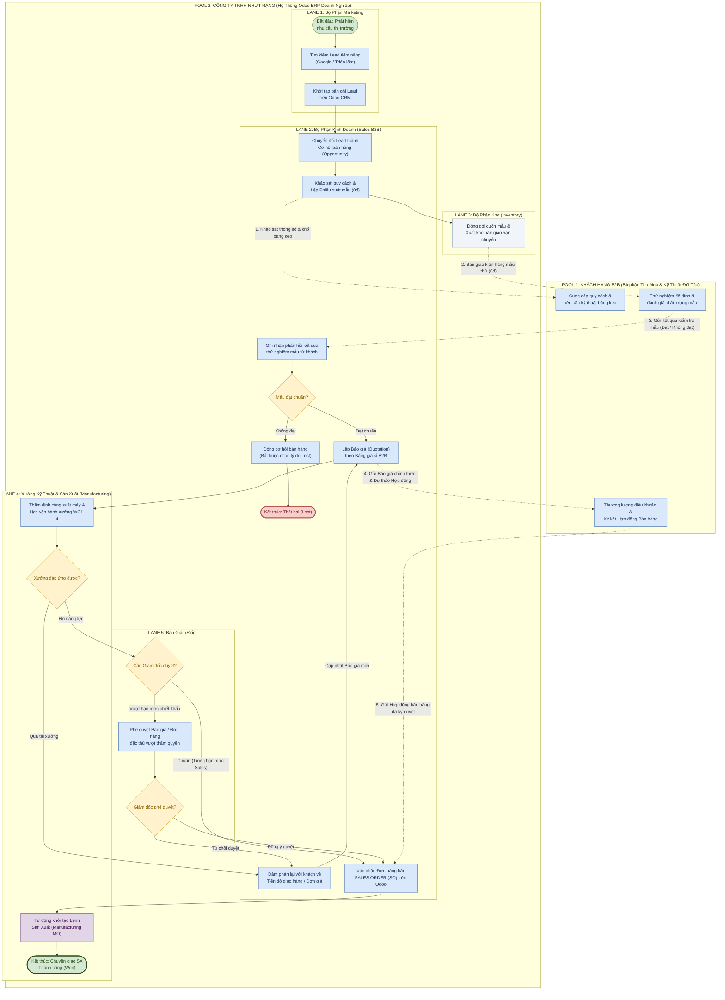

# Sơ Đồ Quy Trình BPMN 2.0 Phân Hệ CRM (Bản Vẽ Đối Chiếu Bằng Mermaid)

> **Dự án:** Triển khai Odoo 18.0 ERP cho Công ty TNHH Nhựt Rạng  
> **Phân hệ:** Marketing & Quản lý Cơ hội Bán hàng B2B (CRM Pipeline)  
> **Mục đích:** Tài liệu đối chiếu trực quan 1:1 với mã nguồn XML Draw.io tại [`bpmn_crm.md`](file:///d:/KnowledgeLibrary/ERP/project/sprint-1/bpmn_crm.md)  
> **Quy chuẩn:** Tuân thủ cấu trúc Pools & Swimlanes, 6 Cục chính và 5 cấp độ tránh sai lầm từ [`rule-BPMN.md`](file:///d:/KnowledgeLibrary/ERP/project/rule-BPMN.md)  

---

## 1. Sơ Đồ Quy Trình Tổng Thể (Mermaid BPMN Diagram)

---

## 2. Bảng Đối Chiếu 1:1 Giữa Bản Vẽ Mermaid Và Mã Nguồn XML Draw.io

Để bạn dễ dàng kiểm tra tính chính xác khi chuyển đổi giữa sơ đồ Mermaid và Draw.io XML tại [`bpmn_crm.md`](file:///d:/KnowledgeLibrary/ERP/project/sprint-1/bpmn_crm.md):

| Phần tử nghiệp vụ | ID trong mã XML Draw.io | ID trong mã Mermaid | Loại phần tử (BPMN Element) | Phân tầng Pool / Lane |
| :--- | :---: | :---: | :---: | :--- |
| **Bắt đầu nhu cầu thị trường** | `mkt_start` | `mkt_start` | Start Event | Lane 1: Marketing |
| **Tìm kiếm Lead tiềm năng** | `mkt_t1` | `mkt_t1` | User Task | Lane 1: Marketing |
| **Khởi tạo Lead trên Odoo** | `mkt_t2` | `mkt_t2` | User Task | Lane 1: Marketing |
| **Chuyển đổi thành Opportunity** | `sales_t1` | `sales_t1` | User Task | Lane 2: Sales B2B |
| **Lập Phiếu xuất mẫu (0đ)** | `sales_t2` | `sales_t2` | User Task | Lane 2: Sales B2B |
| **Tiếp nhận yêu cầu kỹ thuật** | `c_t1` | `c_t1` | User Task | Pool 1: Khách hàng B2B |
| **Xuất kho hàng mẫu thử** | `kho_t1` | `kho_t1` | Manual Task | Lane 3: Kho (Inventory) |
| **Thử nghiệm & Đánh giá mẫu** | `c_t2` | `c_t2` | User Task | Pool 1: Khách hàng B2B |
| **Ghi nhận phản hồi mẫu** | `sales_t3` | `sales_t3` | User Task | Lane 2: Sales B2B |
| **Cổng: Mẫu đạt chuẩn?** | `gw_sample` | `gw_sample` | Exclusive Gateway (XOR) | Lane 2: Sales B2B |
| **Đóng cơ hội (Ghi lý do Lost)** | `sales_t_lost` | `sales_t_lost` | User Task | Lane 2: Sales B2B |
| **Kết thúc: Thất bại (Lost)** | `sales_end_lost` | `sales_end_lost` | End Event (Lost) | Lane 2: Sales B2B |
| **Lập Báo giá theo Pricelist** | `sales_t4` | `sales_t4` | User Task | Lane 2: Sales B2B |
| **Thẩm định công suất xưởng** | `sx_t1` | `sx_t1` | User Task | Lane 4: Xưởng Sản Xuất |
| **Cổng: Xưởng đáp ứng được?** | `gw_capacity` | `gw_capacity` | Exclusive Gateway (XOR) | Lane 4: Xưởng Sản Xuất |
| **Đàm phán lại tiến độ / giá** | `sales_renego` | `sales_renego` | User Task (Loopback) | Lane 2: Sales B2B |
| **Cổng: Cần Giám đốc duyệt?** | `gw_appr_check` | `gw_appr_check` | Exclusive Gateway (XOR) | Lane 5: Ban Giám Đốc |
| **Phê duyệt báo giá vượt sàn** | `gd_t1` | `gd_t1` | User Task | Lane 5: Ban Giám Đốc |
| **Cổng: Giám đốc phê duyệt?** | `gw_gd_decision` | `gw_gd_decision` | Exclusive Gateway (XOR) | Lane 5: Ban Giám Đốc |
| **Ký kết hợp đồng thương mại** | `c_t3` | `c_t3` | User Task | Pool 1: Khách hàng B2B |
| **Xác nhận Sales Order (SO)** | `sales_t5` | `sales_t5` | User Task | Lane 2: Sales B2B |
| **Tự động tạo Lệnh Sản Xuất** | `sx_t2` | `sx_t2` | Service Task (Odoo) | Lane 4: Xưởng Sản Xuất |
| **Kết thúc: Thành công (Won)** | `sx_end_won` | `sx_end_won` | End Event (Won) | Lane 4: Xưởng Sản Xuất |

---

## 3. Bản Đồ Đối Chiếu 5 Luồng Thông Điệp Liên Pool (Message Flows)

Các đường nét đứt (`-.->`) kết nối giữa **Khách hàng** và **Nhựt Rạng** thể hiện chính xác các tương tác ngoài đời thực:

1. **`sales_t2` $\dashrightarrow$ `c_t1`:** Nhân viên Sales gửi phiếu khảo sát thông số băng keo (khổ màng, độ dính mic, quy cách cuộn) cho phòng Thu mua.
2. **`kho_t1` $\dashrightarrow$ `c_t2`:** Thủ kho xuất kiện hàng mẫu thử (SO-SAMPLE giá 0đ) giao cho đơn vị vận chuyển chuyển đến tận tay khách hàng.
3. **`c_t2` $\dashrightarrow$ `sales_t3`:** Bộ phận Kỹ thuật/Thu mua của khách gửi biên bản nghiệm thu chất lượng mẫu thử (Đạt / Không đạt) về cho Sales.
4. **`sales_t4` $\dashrightarrow$ `c_t3`:** Sales gửi Báo giá chính thức và Dự thảo Hợp đồng nguyên tắc sang khách đàm phán.
5. **`c_t3` $\dashrightarrow$ `sales_t5`:** Khách hàng gửi bản Hợp đồng đã ký đóng dấu về cho Sales để xác nhận chính thức đơn hàng trên Odoo ERP.

---

## 4. Ưu Điểm Khi Sử Dụng Cả 2 Định Dạng (Mermaid vs Draw.io XML)

| Tiêu chí | Sơ đồ Mermaid (`bpmn_crm_mermaid.md`) | Sơ đồ Draw.io XML (`bpmn_crm.md`) |
| :--- | :--- | :--- |
| **Khả năng xem trước (Preview)** | **Xem trực tiếp tức thì** trong giao diện Markdown / GitHub / VS Code mà không cần cài thêm phần mềm. | Cần copy dán vào Draw.io để xem và kéo chỉnh sửa chi tiết. |
| **Mục đích sử dụng** | Dùng để đối soát nhanh logic luồng, kiểm tra rẽ nhánh và báo cáo tiến độ tài liệu. | Dùng làm bản vẽ kỹ thuật chính thức, xuất file PDF/PNG độ phân giải cao nộp đồ án/khách hàng. |
| **Tính đồng nhất** | Chuẩn hóa tên Node, nhãn điều kiện và mã màu pastel 100% khớp với bản XML. | Căn chỉnh tọa độ pixel chính xác, không đè chữ, bẻ góc vuông vức. |
