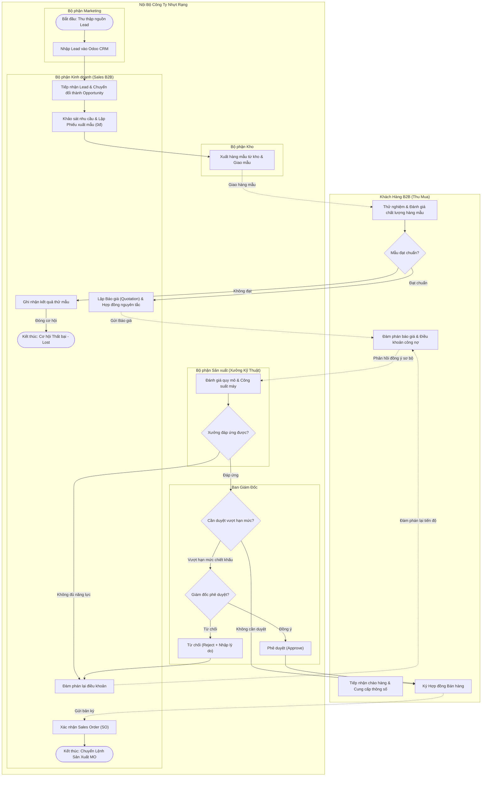

# Đặc Tả Yêu Cầu & Hướng Dẫn Vẽ Mô Hình BPMN 2.0 Cho Phân Hệ CRM

> **Dự án:** Triển khai Odoo 18.0 ERP cho Công ty TNHH Nhựt Rạng  
> **Phân hệ nghiệp vụ:** Marketing & Quản lý Quan hệ Khách hàng (CRM B2B)  
> **Tài liệu tham chiếu:** [`ERP.md`](file:///d:/KnowledgeLibrary/ERP/project/NhutRangOdoo/ERP.md) (Mục 1, 3, 4, 5, 6)  
> **Mục đích:** Hướng dẫn chi tiết cách xây dựng sơ đồ quy trình nghiệp vụ chuẩn **BPMN 2.0 (Business Process Model and Notation)** từ khâu tìm kiếm khách hàng tiềm năng đến khi phê duyệt đơn hàng chuyển sang sản xuất.

---

## 1. Mục Tiêu & Phạm Vi Nghiệp Vụ (Scope)

### 1.1. Mục tiêu mô hình hóa
* Chuẩn hóa toàn bộ dòng chảy thông tin và chứng từ giữa các bộ phận: **Marketing $\rightarrow$ Sales $\rightarrow$ Kho $\rightarrow$ Sản xuất $\rightarrow$ Ban Giám đốc $\rightarrow$ Khách hàng B2B**.
* Khắc phục triệt để các "điểm nghẽn" hiện trạng của Nhựt Rạng: giao dịch qua Zalo phân tán, thất thoát chi phí hàng mẫu, thiếu kiểm tra năng lực xưởng trước khi nhận đơn, và không đo lường được lý do thất bại (Lost Reason).
* Làm cơ sở để cấu hình các luồng tự động (Automated Workflows) và ma trận phê duyệt (Approval Matrix) trên Odoo 18.0.

### 1.2. Vòng đời dữ liệu CRM cốt lõi
$$\text{Lead} \longrightarrow \text{Opportunity} \longrightarrow \text{Sample Order (Hàng mẫu 0đ)} \longrightarrow \text{Quotation} \longrightarrow \text{Sales Order (SO)} \longrightarrow \text{Manufacturing Order (MO)}$$

---

## 2. Xác Định Pools & Swimlanes (Các Bên Tham Gia)

Để mô hình BPMN chuẩn chỉnh và chuyên nghiệp, bạn phân chia thành **2 Pool chính** (Khách hàng ngoài và Doanh nghiệp nội bộ):

### Pool 1: Khách hàng B2B (External Pool / Black-box Pool)
* Đại diện: **Bộ phận Thu mua / Kỹ thuật của Khách hàng**.
* Đóng vai trò đối tác bên ngoài gửi phản hồi yêu cầu kỹ thuật, tiếp nhận mẫu thử, đàm phán báo giá và ký hợp đồng.

### Pool 2: Công ty TNHH Nhựt Rạng (Internal Pool - Gồm 5 Swimlanes)
| Swimlane (Làn trách nhiệm) | Vai trò nghiệp vụ | Trách nhiệm chính trong quy trình |
| :--- | :--- | :--- |
| **1. Marketing** | Khảo sát & Khai thác Lead | Tìm kiếm thông tin doanh nghiệp (Google, triển lãm), lọc ngành nghề, nhập Lead vào CRM. |
| **2. Sales (Kinh doanh B2B)** | Tư vấn & Đàm phán | Chuyển Lead $\rightarrow$ Opportunity, đặt lịch hẹn, tạo yêu cầu xuất mẫu, lập báo giá (Quotation), đàm phán hợp đồng. |
| **3. Kho (Inventory)** | Quản lý Hàng mẫu | Tiếp nhận phiếu xuất mẫu (Sample Order 0đ), đóng gói và gửi mẫu thực tế cho khách. |
| **4. Sản xuất / Xưởng Kỹ thuật (Manufacturing / R&D)** | Đánh giá Khả thi & Công suất | Thẩm định yêu cầu kỹ thuật đặc thù (khổ màng, độ dính, màu in logo), kiểm tra công suất xưởng có kịp tiến độ. |
| **5. Ban Giám đốc / HĐQT** | Phê duyệt Cấp cao | Phê duyệt các đơn hàng vượt hạn mức chiết khấu, giá trị lớn hoặc đơn hàng MTO có rủi ro kỹ thuật. |

---

## 3. Các Thành Phần BPMN Cốt Lõi Cần Sử Dụng

### 3.1. Sự kiện (Events)
* **Start Event (Sự kiện bắt đầu):** Phát hiện nhu cầu thị trường / Tiếp nhận thông tin khách hàng từ Google Search, Website.
* **Intermediate Catch Event (Sự kiện trung gian chờ):** Chờ phản hồi đánh giá hàng mẫu từ bộ phận Thu mua của khách hàng.
* **End Event - Thành công (Won):** Hợp đồng/Sales Order được xác nhận $\rightarrow$ Kích hoạt lệnh sản xuất (MO).
* **End Event - Thất bại (Lost):** Đóng cơ hội bán hàng, bắt buộc nhập lý do thất bại (*Lỗi kỹ thuật mẫu, Giá cao, Không thống nhất điều khoản...*).

### 3.2. Cổng điều kiện (Gateways)
1. **Gateway 1 (XOR - Exclusive):** *Chất lượng hàng mẫu có đạt yêu cầu?*
   * Nhánh **Đạt**: Chuyển sang giai đoạn Lập báo giá & Hợp đồng nguyên tắc.
   * Nhánh **Không đạt**: Kích hoạt luồng ngoại lệ (R&D điều chỉnh công thức / Gửi lại mẫu lần 2 hoặc Đóng cơ hội).
2. **Gateway 2 (XOR - Exclusive):** *Năng lực sản xuất có đáp ứng quy mô/tiến độ?*
   * Nhánh **Đáp ứng**: Chuyển tiếp sang bước phê duyệt thương mại.
   * Nhánh **Quá tải / Không đáp ứng**: Đàm phán lại thời gian giao hàng hoặc từ chối đơn.
3. **Gateway 3 (XOR - Exclusive):** *Đơn hàng có cần Giám đốc phê duyệt?*
   * Nhánh **Cần duyệt** *(khi biên lợi nhuận < giá sàn hoặc đơn hàng > 200 triệu VND)*: Gửi thông báo đến Giám đốc.
   * Nhánh **Tự động duyệt** *(đơn hàng tiêu chuẩn, giá bán chuẩn)*: Sales tự xác nhận đơn.
4. **Gateway 4 (XOR - Exclusive):** *Giám đốc có phê duyệt?*
   * Nhánh **Duyệt (Approved)**: Xác nhận Sales Order $\rightarrow$ Chuyển qua phân hệ Sản xuất.
   * Nhánh **Từ chối (Rejected)**: Ghi lý do từ chối $\rightarrow$ Sales đàm phán lại với khách.

### 3.3. Dữ liệu & Chứng từ (Data Objects)
* `Lead Master Data`: Tên công ty, MST, SĐT Thu mua, Ngành nghề.
* `Sample Order (0đ)`: Phiếu xuất mẫu đính kèm mã Opportunity.
* `Quotation / Draft Contract`: Báo giá đính kèm điều khoản thanh toán và thông số kỹ thuật.
* `Sales Order (SO)`: Đơn đặt hàng chính thức có giá trị pháp lý.

---

## 4. Đặc Tả Chi Tiết Từng Bước Nghiệp Vụ (Happy Path & Exception)

### Giai đoạn 1: Khởi tạo & Đánh giá Tiềm năng (Marketing & Sales)
1. **[Marketing] Tìm kiếm thông tin khách hàng tiềm năng:** Quét thông tin trên mạng, trang vàng, website đối tác.
2. **[Marketing] Khởi tạo Lead trên Odoo CRM:** Nhập thông tin công ty, MST, thông tin liên hệ phòng Thu mua.
3. **[Sales] Chuyển đổi Lead thành Opportunity:** Đánh giá mức độ khả thi (Qualification), phân loại sản phẩm quan tâm (Băng keo bảo vệ PE, Màng stretch film, Hạt nhựa PP).

### Giai đoạn 2: Khảo sát Kỹ thuật & Xử lý Hàng mẫu (Sales - Kho - Khách hàng)
4. **[Sales] Hẹn gặp bộ phận Thu mua & Xác định thông số kỹ thuật:** Quy cách khổ cuộn, độ dày mic, độ bám dính, in thương hiệu logo mấy màu.
5. **[Sales] Tạo Phiếu yêu cầu xuất mẫu (Sample Order 0đ):** Tạo đơn xuất mẫu từ Opportunity để liên kết dữ liệu.
6. **[Kho] Xuất kho & Gửi hàng mẫu:** Trừ kho vật tư mẫu, giao cho bên vận chuyển/Sales mang đến khách.
7. **[Khách hàng] Đánh giá chất lượng hàng mẫu:**
   * **Nếu ĐẠT:** Khách hàng xác nhận đạt chuẩn thử nghiệm.
   * **Nếu KHÔNG ĐẠT (Ngoại lệ 1):** Sales ghi nhận biên bản lỗi kỹ thuật (độ dính yếu, rách mép, sai tone màu). Gửi yêu cầu R&D cân đối lại công thức keo/thổi màng để gửi mẫu lần 2 (tối đa 2 lần). Nếu vẫn không đạt $\rightarrow$ Đóng cơ hội (Mark as Lost: "Technical Specification Mismatch").

### Giai đoạn 3: Lập Báo Giá & Thẩm Định Năng Lực Xưởng (Sales & Sản xuất)
8. **[Sales] Lập Báo giá (Quotation):** Tra cứu bảng giá sỉ B2B (`Pricelists`), đề xuất số lượng đặt, điều khoản công nợ (ví dụ: *Tạm ứng 30%, thanh toán 70% sau khi nhận hàng 30 ngày*).
9. **[Sản xuất] Thẩm định năng lực xưởng & Tiến độ:** Kiểm tra tình trạng nguyên vật liệu hạt nhựa/keo và lịch chạy của các trung tâm sản xuất (`WC-100` Thổi màng, `WC-200` Tráng keo, `WC-300` In ấn, `WC-400` Cắt cuộn).
   * **Nếu Xưởng quá tải (Ngoại lệ 2):** Sản xuất gửi phản hồi đề xuất dời ngày giao hàng (Lead time) $\rightarrow$ Sales đàm phán lại ngày giao hàng với Thu mua khách hàng.

### Giai đoạn 4: Phê Duyệt Cấp Cao & Xác Nhận Đơn Hàng (Giám đốc & Sales)
10. **[Hệ thống Odoo] Kiểm tra Ma trận phê duyệt (Approval Matrix):**
    * Nếu giá thương lượng thấp hơn giá sàn hoặc khách nợ cũ chưa thanh toán $\rightarrow$ Khóa đơn, tự động kích hoạt thông báo gửi Giám đốc.
11. **[Giám đốc] Xét duyệt báo giá:**
    * **Nếu Từ chối:** Nhập lý do (ví dụ: *Biên lợi nhuận < 8%*) $\rightarrow$ Sales đàm phán tăng giá với khách.
    * **Nếu Đồng ý:** Giám đốc nhấn **Approve**.
12. **[Sales & Khách hàng] Ký hợp đồng bán hàng chính thức.**
13. **[Sales] Xác nhận Đơn bán hàng (Confirm Sales Order):** Chuyển trạng thái Opportunity sang **Won**. Hệ thống Odoo tự động kích hoạt tạo Lệnh sản xuất (**Manufacturing Order - MO**) và chuyển sang quy trình kế hoạch xưởng.

---

## 5. Sơ Đồ Quy Trình Tham Chiếu (Mermaid Diagram)

---

## 6. Hướng Dẫn Vẽ Mô Hình BPMN Bằng Công Cụ Chuẩn

Bạn có thể sử dụng các công cụ vẽ BPMN chuyên nghiệp hoàn toàn miễn phí sau:
1. **[bpmn.io / Camunda Modeler](https://demo.bpmn.io/):** Công cụ chuẩn nhất thế giới dành cho BPMN 2.0 (hỗ trợ đầy đủ cú pháp XML để nạp vào hệ thống).
2. **[Draw.io / diagrams.net](https://app.diagrams.net/):** Chọn thư viện hình ảnh `BPMN` ở cột trái để kéo thả dễ dàng.

### Các nguyên tắc đặt tên chuẩn BPMN 2.0:
* **Tên Hoạt động (Task):** Luôn theo cấu trúc **Động từ + Danh từ** (Ví dụ: `Nhập Lead vào CRM`, `Xuất hàng mẫu thử`, `Kiểm tra công suất xưởng`, `Phê duyệt báo giá`).
* **Tên Cổng điều kiện (Gateway):** Luôn là **Câu hỏi** (Ví dụ: `Mẫu đạt chất lượng?`, `Công suất đáp ứng?`, `Giám đốc phê duyệt?`).
* **Nhánh ra khỏi Gateway:** Ghi rõ điều kiện kết quả dạng **[Đạt / Không đạt]**, **[Có / Không]**, **[Đồng ý / Từ chối]**.
* **Sequence Flow (Mũi tên liền):** Nối các bước thực hiện tuần tự trong cùng một Pool.
* **Message Flow (Mũi tên nét đứt có hình tròn ở đuôi):** Nối giữa Pool Khách hàng và Pool Doanh nghiệp khi có trao đổi thư từ/hàng mẫu/báo giá.
