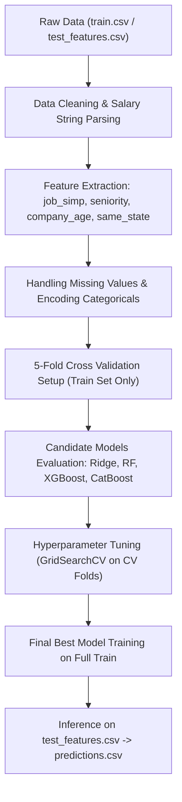
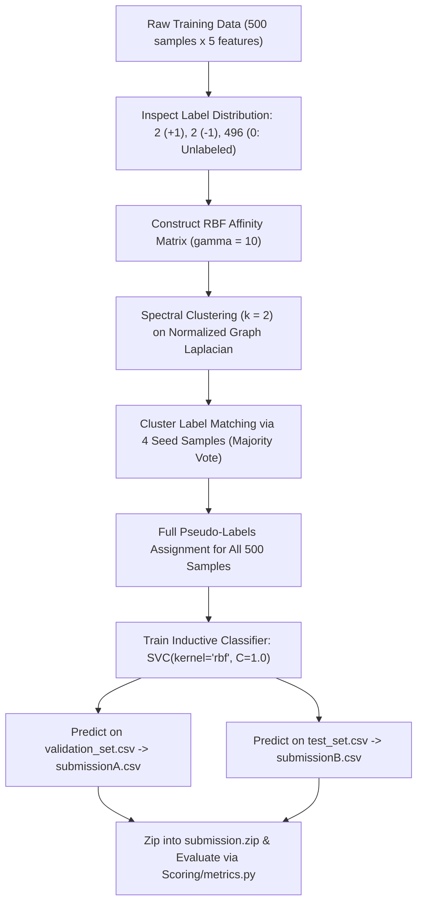

# BÁO CÁO PHÂN TÍCH VÀ THIẾT KẾ GIẢI PHÁP BÀI THỰC HÀNH 4 (TH4)
> **Học phần:** Học Máy và Thống Kê (HMTK)  
> **Chủ đề:** Xây dựng Mô hình Học máy cho Dự đoán Mức lương & Xác thực Tranh cổ  
> **Nguồn bài toán:** [BGOAI 2025 Day 2 Task 4](https://github.com/yonitoo/awesome-BGOAI-tasks/tree/main/2025/BG_Team_Selection/Day_2/Task_4) & [IOAI 2025 Individual Contest - Antique](https://github.com/IOAI-official/IOAI-2025/tree/main/Individual-Contest/Antique)

---

## MỤC LỤC ĐIỀU HƯỚNG
1. [Tổng quan Yêu cầu & Quy tắc Cốt lõi](#1-tổng-quan-yêu-cầu--quy-tắc-cốt-lõi)
2. [Phân tích Tác vụ 1: Dự đoán Mức lương (`salary_prediction.ipynb`)](#2-phân-tích-tác-vụ-1-dự-đoán-mức-lương-salary_predictionipynb)
   - [2.1. Bản chất bài toán](#21-bản-chất-bài-toán)
   - [2.2. Cấu trúc tập dữ liệu](#22-cấu-trúc-tập-dữ-liệu)
   - [2.3. Thang đo đánh giá (Evaluation Metric)](#23-thang-đo-đánh-giá-evaluation-metric)
   - [2.4. Đánh giá mô hình cơ sở (Baseline Analysis)](#24-đánh-giá-mô-hình-cơ-sở-baseline-analysis)
   - [2.5. Chiến lược Tiền xử lý & Kỹ nghệ Đặc trưng](#25-chiến-lược-tiền-xử-lý--kỹ-nghệ-đặc-trưng)
   - [2.6. Chiến lược Huấn luyện & Lựa chọn Mô hình](#26-chiến-lược-huấn-luyện--lựa-chọn-mô-hình)
3. [Phân tích Tác vụ 2: Xác thực Tranh cổ (`antique_paintings_classification.ipynb`)](#3-phân-tích-tác-vụ-2-xác-thực-tranh-cổ-antique_paintings_classificationipynb)
   - [3.1. Bản chất bài toán & Thách thức cực hiếm nhãn](#31-bản-chất-bài-toán--thách-thức-cực-hiếm-nhãn)
   - [3.2. Cấu trúc tập dữ liệu](#32-cấu-trúc-tập-dữ-liệu)
   - [3.3. Thang đo đánh giá (Evaluation Metric)](#33-thang-đo-đánh-giá-evaluation-metric)
   - [3.4. Đánh giá mô hình cơ sở & Phân tích lỗi](#34-đánh-giá-mô-hình-cơ-sở--phân-tích-lỗi)
   - [3.5. Cơ sở lý thuyết Giải thuật Phân cụm phổ & Gán nhãn mỏ neo](#35-cơ-sở-lý-thuyết-giải-thuật-phân-cụm-phổ--gán-nhãn-mỏ-neo)
   - [3.6. Huấn luyện Bộ phân loại Cảm nạp (Inductive Classifier)](#36-huấn-luyện-bộ-phân-loại-cảm-nạp-inductive-classifier)
4. [Bảng So sánh Tổng hợp Hai Tác vụ](#4-bảng-so-sánh-tổng-hợp-hai-tác-vụ)
5. [Thiết kế Cấu trúc Chi tiết cho Hai Notebook](#5-thiết-kế-cấu-trúc-chi-tiết-cho-hai-notebook)
   - [5.1. Cấu trúc `salary_prediction.ipynb`](#51-cấu-trúc-salary_predictionipynb)
   - [5.2. Cấu trúc `antique_paintings_classification.ipynb`](#52-cấu-trúc-antique_paintings_classificationipynb)
6. [Quy cách Đóng gói Bài nộp (`MSSV.zip`)](#6-quy-cách-đóng-gói-bài-nộp-mssvzip)
7. [Checklist Kiểm tra Chất lượng](#7-checklist-kiểm-tra-chất-lượng)

---

## 1. TỔNG QUAN YÊU CẦU & QUY TẮC CỐT LÕI

Bài thực hành yêu cầu nghiên cứu chuyên sâu và xây dựng giải pháp học máy cho hai bài toán tuyển chọn Olympic Trí tuệ nhân tạo (BGOAI 2025 và IOAI 2025). Kết quả bàn giao bao gồm hai tập tin Notebook độc lập được nén trong một tệp lưu trữ duy nhất.

> [!IMPORTANT]
> ### NGUYÊN TẮC BẮT BUỘC TRONG QUÁ TRÌNH HUẤN LUYỆN
> 1. **Chống rò rỉ dữ liệu (No Data Leakage):** Việc lựa chọn mô hình, tinh chỉnh siêu tham số tuyệt đối **không được dựa vào tập Test**. Mọi biến đổi dữ liệu (imputation, scaling, encoding) phải được fit trên tập Train rồi mới transform sang Test.
> 2. **Quy tắc sử dụng Validation Set:** Tập Validation (nếu có) **chỉ được dùng để chọn mô hình và tinh chỉnh ngưỡng**, không được dùng để huấn luyện trực tiếp các tham số trọng số của mô hình.
> 3. **Giải thích quyết định bằng Markdown:** Mọi bước tiền xử lý, biến đổi đặc trưng hoặc lựa chọn thuật toán cần có chú thích ngắn gọn, rõ ràng bằng các ô Markdown ngay trong Notebook.
> 4. **Tính tự chủ trong chú thích:** Có thể dùng công cụ AI để tham khảo lời giải, nhưng các phần giải thích, bình luận học thuật và phân tích kết quả phải do sinh viên tự biên soạn.

> [!NOTE]
> ### ĐỊNH DẠNG BÀI NỘP
> - Hai notebook độc lập: `salary_prediction.ipynb` và `antique_paintings_classification.ipynb`.
> - Tệp nén cuối cùng mang tên: `MSSV.zip` (chứa trực tiếp 2 file `.ipynb`).

---

## 2. PHÂN TÍCH TÁC VỤ 1: DỰ ĐOÁN MỨC LƯƠNG (`salary_prediction.ipynb`)

### 2.1. Bản chất bài toán
- **Nguồn bài toán:** [awesome-BGOAI-tasks (2025 / BG_Team_Selection / Day_2 / Task_4)](https://github.com/yonitoo/awesome-BGOAI-tasks/tree/main/2025/BG_Team_Selection/Day_2/Task_4).
- **Mục tiêu:** Dự đoán mức lương trung bình hàng năm (`Salary Estimate`) tính theo đơn vị nghìn USD/năm (\$K/năm) dựa trên thông tin bài đăng tuyển dụng Glassdoor trong lĩnh vực Khoa học Dữ liệu và AI.
- **Dạng bài toán:** Hồi quy trên dữ liệu dạng bảng (Tabular Regression) có sự pha trộn giữa thuộc tính số (numerical), thuộc tính phân loại (categorical) và văn bản tự do ngắn (job title, job description).



### 2.2. Cấu trúc tập dữ liệu
Tập dữ liệu bao gồm:
* `train.csv` (593 dòng, 15 cột): Tập dữ liệu huấn luyện có nhãn.
* `test_features.csv` (149 dòng, 14 cột): Tập dữ liệu kiểm tra không chứa cột `Salary Estimate`.
* `test_labels.csv` (145 dòng): Nhãn thực tế của tập test dùng để đối chiếu benchmark (sau khi loại 4 dòng khuyết dữ liệu quan trọng).

| Tên trường | Kiểu dữ liệu | Ý nghĩa & Tiềm năng khai thác |
| :--- | :--- | :--- |
| `Job Title` | Text (string) | Chức danh công việc; chứa tín hiệu quyết định về vị trí và cấp bậc. |
| `Job Description` | Text (string) | Bản mô tả công việc; chứa từ khóa về kỹ năng (Python, Spark, AWS, SQL...). |
| `Rating` | Float | Điểm đánh giá công ty (1.0 đến 5.0; giá trị $\le 0$ biểu thị dữ liệu khuyết). |
| `Company Name` | Text (string) | Tên doanh nghiệp tuyển dụng. |
| `Location` | Text (string) | Nơi làm việc (định dạng `City, State`, ví dụ: `New York, NY`). |
| `Headquarters` | Text (string) | Địa chỉ đặt trụ sở chính của doanh nghiệp. |
| `Size` | Categorical | Quy mô nhân sự (ví dụ: `10000+ employees`, `501 to 1000 employees`). |
| `Founded` | Integer | Năm thành lập công ty (giá trị `-1` là khuyết thiếu). |
| `Type of ownership` | Categorical | Loại hình sở hữu (Công ty cổ phần, tư nhân, phi lợi nhuận...). |
| `Industry` | Categorical | Ngành công nghiệp cụ thể (Biotech, IT Services...). |
| `Sector` | Categorical | Khối ngành kinh tế rộng (Information Technology, Healthcare...). |
| `Revenue` | Categorical | Khung doanh thu thường niên. |
| `Competitors` | Text (string) | Danh sách đối thủ cạnh tranh (tỷ lệ khuyết cao, thường là `-1`). |
| `Salary Estimate` | Text (Target) | Chuỗi mức lương (ví dụ: `'$47K-$85K (Glassdoor est.)'`). |

### 2.3. Thang đo đánh giá (Evaluation Metric)
Đánh giá chất lượng mô hình bằng **Sai số Tuyệt đối Trung bình (Mean Absolute Error - MAE)**:

$$
\text{MAE} = \frac{1}{N} \sum_{i=1}^{N} |y_i - \hat{y}_i|
$$

Trong đó:
* $y_i$: Mức lương thực tế tính theo đơn vị \$K/năm.
* $\hat{y}_i$: Mức lương do mô hình dự đoán (\$K/năm).
* *Ưu điểm:* MAE đo lường sai số trung bình trực tiếp theo đơn vị tiền tệ, ít bị nhạy cảm cực đoan bởi các điểm dị biệt (outliers) so với MSE/RMSE.

### 2.4. Đánh giá mô hình cơ sở (Baseline Analysis)
Mô hình cơ sở trong mã nguồn gốc:
```python
# Các đặc trưng cơ sở:
BASELINE_FEATURES = ['Rating', 'Size', 'Type of ownership', 'Industry', 'Sector', 'Revenue']
# Tiền xử lý: pd.get_dummies() -> Huấn luyện LinearRegression()
# MAE Baseline trên tập validation: ~28.415 ($28,415)
```

> [!WARNING]
> ### CÁC HẠN CHẾ CHÍNH CỦA MÔ HÌNH BASELINE
> 1. **Bỏ sót các thuộc tính quan trọng nhất:** Không khai thác `Job Title` (yếu tố quyết định chênh lệch lớn giữa cấp độ nhân viên, kỹ sư và giám đốc).
> 2. **Không xét đến vị trí địa lý:** Bỏ qua `Location` và `Headquarters`. Tại Mỹ, mức lương ở California hay New York thường cao hơn 30–50% so với các bang khác. Trụ sở chính cũng thường có mức chi trả cao hơn văn phòng vệ tinh.
> 3. **Hạn chế của mô hình tuyến tính:** `LinearRegression` không thể mô hình hóa các mối quan hệ tương tác phi tuyến tính phức tạp giữa quy mô công ty, thâm niên và ngành nghề.

### 2.5. Chiến lược Tiền xử lý & Kỹ nghệ Đặc trưng
Nhằm tối ưu hóa hiệu năng, quy trình tiền xử lý được thiết kế có hệ thống:

1. **Chuẩn hóa biến mục tiêu (`Salary Estimate`):**
   * Loại bỏ các dòng bị khuyết nhãn (`-1`).
   * Loại bỏ các ký tự phi số: `'$'`, `'K'`, `'per hour'`, `'employer provided salary:'`, `'(Glassdoor est.)'`.
   * Trích xuất cận dưới (`Min_Salary`) và cận trên (`Max_Salary`), tính lương trung bình:

   $$
   \text{Salary} = \frac{\text{Min\_Salary} + \text{Max\_Salary}}{2}
   $$

2. **Rút gọn chức danh công việc (`job_simp`):**
   * Phân loại tự động trường văn bản tự do `Job Title` về 7 nhóm chuẩn:
     * `data scientist`: Tiêu đề chứa "data scientist".
     * `data engineer`: Tiêu đề chứa "data engineer".
     * `analyst`: Tiêu đề chứa "analyst".
     * `mle`: Tiêu đề chứa "machine learning".
     * `manager`: Tiêu đề chứa "manager".
     * `director`: Tiêu đề chứa "director".
     * `na`: Các chức danh còn lại.
3. **Trích xuất cấp độ thâm niên (`seniority`):**
   * Gán `senior`: Chứa các từ khóa "sr", "senior", "lead", "principal".
   * Gán `jr`: Chứa từ khóa "jr", "junior".
   * Gán `na`: Không nêu rõ thâm niên (mặc định trung cấp / mid-level).
4. **Tính toán tuổi doanh nghiệp (`company_age`):**

   $$
   \text{company\_age} = 2024 - \text{Founded}
   $$

   * Với $\text{Founded} \le 0$, gán bằng giá trị trung vị của ngành tương ứng hoặc xem như giá trị khuyết để mô hình cây tự xử lý.
5. **So khớp địa lý trụ sở (`same_state` & `State`):**
   * Tách mã bang từ chuỗi `Location` (ví dụ: `CA`, `NY`).
   * Tạo đặc trưng nhị phân: `same_state = (Location == Headquarters)` phản ánh nhân sự làm việc tại trụ sở chính hay chi nhánh ngoài.
6. **Xử lý giá trị khuyết ở thuộc tính `Rating`:**
   * Thay thế giá trị $\le 0$ thành `NaN` và điền khuyết bằng trung vị (median imputation) theo khối ngành `Sector`.

### 2.6. Chiến lược Huấn luyện & Lựa chọn Mô hình
* **Chiến lược kiểm định (Cross-Validation Strategy):**
  * Áp dụng **5-Fold Cross Validation** trên toàn bộ tập `train.csv`.
  * Tính toán giá trị MAE trung bình và độ lệch chuẩn qua 5 fold để làm thước đo khách quan chọn mô hình.
* **So sánh các mô hình ứng viên:**
  1. *Ridge Regression:* Mô hình tuyến tính có điều chuẩn $L_2$ để kiểm soát đa cộng tuyến sau khi One-Hot Encoding.
  2. *Random Forest Regressor:* Mô hình Bagging cây quyết định giúp nắm bắt tương tác phi tuyến và giảm phương sai.
  3. *LightGBM / XGBoost:* Mô hình Gradient Boosting tối ưu tốc độ và độ chính xác.
  4. *CatBoost Regressor (Mô hình ưu tiên hàng đầu):* Xử lý xuất sắc các đặc trưng dạng bảng có nhiều biến phân loại (categorical features), cơ chế hoán vị đối xứng giúp chống overfitting vượt trội trên tập dữ liệu kích thước nhỏ (~600 dòng).
* **Tinh chỉnh siêu tham số:** Sử dụng `GridSearchCV` trên 5-fold CV với không gian tham số: `depth` $\in [6, 7, 8]$, `learning_rate` $\in [0.05, 0.1, 0.13]$, `iterations` $\in [1500, 2000, 2500]$.
* **Mục tiêu hiệu năng:** Hạ MAE từ **28.415** (baseline) xuống dưới **15.0 – 17.0** (\$K/năm).

---

## 3. PHÂN TÍCH TÁC VỤ 2: XÁC THỰC TRANH CỔ (`antique_paintings_classification.ipynb`)

### 3.1. Bản chất bài toán & Thách thức cực hiếm nhãn
- **Nguồn bài toán:** [IOAI 2025 Individual Contest - Antique Painting Authentication](https://github.com/IOAI-official/IOAI-2025/tree/main/Individual-Contest/Antique).
- **Mục tiêu:** Phân loại tranh cổ là tranh nguyên bản thật (`1 - Authentic`) hay tranh sao chép/giả mạo (`-1 - Replica`).
- **Dạng bài toán:** Học bán giám sát (Semi-Supervised Learning) kết hợp Học đa tạp phi tuyến (Manifold Learning) trên không gian số 5 chiều.



### 3.2. Cấu trúc tập dữ liệu
Bộ dữ liệu gồm 3 tập con độc lập (mỗi tập đúng 500 mẫu):
1. **`training_set.csv` (500 mẫu):**
   * 5 cột đầu tiên (`feature1` đến `feature5`): Các thuộc tính số liên tục đại diện cho cấu trúc ảnh số của bức tranh.
   * Cột thứ 6 (`Authenticated`): Nhãn xác thực với phân phối cực kỳ đặc thù:
     * Nhãn `1` (Authentic): **Chỉ có 2 mẫu**.
     * Nhãn `-1` (Replica): **Chỉ có 2 mẫu**.
     * Nhãn `0` (Unknown - chưa gán nhãn): **496 mẫu (chiếm 99.2%)**.
2. **`validation_set.csv` (500 mẫu):** Định dạng tương tự nhưng không có cột nhãn; dùng để tính điểm Public Leaderboard A (`submissionA.csv`).
3. **`test_set.csv` (500 mẫu):** Định dạng tương tự, không có cột nhãn; dùng để tính điểm Private Leaderboard B (`submissionB.csv`).
4. **`label.csv`:** Nhãn thật của tập validation và test, được lưu trong thư mục `Scoring/` chỉ phục vụ hệ thống tự động chấm điểm độc lập.

### 3.3. Thang đo đánh giá (Evaluation Metric)
Đánh giá bằng **Độ chính xác phân loại (Classification Accuracy)**:

$$
\text{Accuracy} = \frac{1}{N} \sum_{i=1}^{N} \mathbb{I}(y_i = \hat{y}_i)
$$

Các mốc điểm chuẩn của Hội đồng Khoa học IOAI 2025:
* Điểm Baseline công bố: **0.46** trên Leaderboard B.
* Điểm Kỷ lục cao nhất (Highest Benchmark): **0.98** trên Leaderboard B.

### 3.4. Đánh giá mô hình cơ sở & Phân tích lỗi
Trong baseline notebook của ban tổ chức:
```python
# Gán nhãn ngẫu nhiên cho 496 mẫu chưa biết:
np.random.seed(42)
y[y == 0] = np.random.choice([-1, 1], size=(y == 0).sum())

# Huấn luyện mô hình SVC cơ sở:
svm_binary_model = SVC(kernel='rbf', C=1.0, gamma='scale', random_state=42)
svm_binary_model.fit(X, y)
# Kết quả: Accuracy trên Test B chỉ đạt ~0.46
```

> [!WARNING]
> ### VÌ SAO BASELINE THẤT BẠI HOÀN TOÀN?
> - **Nhiễu nhãn cực đại (Maximum Label Noise):** Khi gán nhãn ngẫu nhiên cho 99.2% dữ liệu, mô hình học dựa trên nhãn giả ngẫu nhiên thuần túy, phá hủy cấu trúc hình học của biên phân chia thật.
> - **Thiếu dữ liệu có giám sát:** Nếu loại bỏ 496 mẫu chưa gán nhãn và chỉ huấn luyện trên 4 mẫu có nhãn, bộ phân loại giám sát thông thường hoàn toàn bất lực trong việc bao quát không gian 5 chiều.

### 3.5. Cơ sở lý thuyết Giải thuật Phân cụm phổ & Gán nhãn mỏ neo
Bài toán có bản chất cấu trúc đa tạp (structural manifold patterns) rất mạnh: hai phân lớp tranh thật và tranh giả nằm trên hai đa tạp phi tuyến tách biệt trong không gian 5D.

#### Bước 1: Phân cụm phổ (Spectral Clustering)
Xây dựng ma trận tương đồng (Affinity Matrix) $W$ sử dụng hàm nhân Gaussian RBF với tham số tỷ lệ $\gamma = 10$:

$$
W_{ij} = \exp\left(-\gamma \|x_i - x_j\|^2\right)
$$

Ma trận Laplacian chuẩn hóa đối xứng được tính theo công thức:

$$
L_{\text{sym}} = I - D^{-1/2} W D^{-1/2}
$$

Trong đó $D$ là ma trận đường chéo độ đỉnh ($D_{ii} = \sum_j W_{ij}$). Spectral Clustering phân rã các vector riêng của $L_{\text{sym}}$ để chiếu dữ liệu từ không gian 5D phi tuyến sang không gian phổ chiều thấp, nơi hai cụm tách rời tuyến tính.

#### Bước 2: Khớp nhãn qua mẫu mỏ neo (Anchor Matching)
Sau khi phân cụm 500 điểm thành 2 cụm $c \in \{0, 1\}$:
1. Lọc ra 4 mẫu có nhãn gốc ban đầu ($y \neq 0$).
2. Với mỗi cụm $c$, tập hợp các nhãn thực tế của những mẫu neo thuộc cụm đó.
3. Thực hiện biểu quyết đa số (Majority Vote) để xác định ánh xạ cụm $\rightarrow$ nhãn thực:

$$
\text{Cluster } c \longrightarrow \arg\max_{l \in \{-1, 1\}} \sum_{i \in \text{Seeds}, \, \text{cluster}_i = c} \mathbb{I}(y_i = l)
$$

4. Gán lại toàn bộ 500 mẫu huấn luyện bằng nhãn tương ứng của cụm, tạo ra tập nhãn giả (`pseudo_labels`) có độ chuẩn xác tiệm cận tuyệt đối.

### 3.6. Huấn luyện Bộ phân loại Cảm nạp (Inductive Classifier)
Do Spectral Clustering là phương pháp chuyển nạp (Transductive), nó không thể tự sinh hàm dự đoán cho các điểm dữ liệu mới ngoài tập train. Vì vậy:
* Lấy toàn bộ 500 mẫu $X$ cùng với `pseudo_labels` vừa tạo để huấn luyện một bộ phân loại biên cực đại:

$$
\text{SVC}\big(\text{kernel}=\text{'rbf'}, \, C=1.0, \, \gamma=\text{'scale'}, \, \text{random\_state}=42\big)
$$

* Mô hình RBF SVM đóng vai trò là hàm quyết định cảm nạp (Inductive Decision Boundary), dùng để suy luận nhãn cho `validation_set.csv` và `test_set.csv`.
* **Hiệu năng kỳ vọng:** Đạt $\text{Accuracy} \ge 0.96 - 0.98$ trên cả Leaderboard A và Leaderboard B.

---

## 4. BẢNG SO SÁNH TỔNG HỢP HAI TÁC VỤ

| Tiêu chí | Tác vụ 1: Dự đoán Mức lương | Tác vụ 2: Phân loại Tranh cổ |
| :--- | :--- | :--- |
| **Tên tập tin Notebook** | `salary_prediction.ipynb` | `antique_paintings_classification.ipynb` |
| **Nguồn bài thi** | BGOAI 2025 Team Selection (Day 2 / Task 4) | IOAI 2025 Individual Contest (Antique) |
| **Phân loại bài toán** | Hồi quy dạng bảng (Tabular Regression) | Học bán giám sát (Semi-Supervised Classification) |
| **Quy mô tập dữ liệu** | 593 train / 149 test / 145 test labels | 500 train (4 nhãn, 496 ẩn) / 500 val / 500 test |
| **Đặc trưng đầu vào** | 14 cột hỗn hợp (Số, Phân loại, Văn bản ngắn) | 5 đặc trưng số liên tục (Cấu trúc đa tạp phi tuyến) |
| **Thang đo đánh giá** | $\text{MAE} = \frac{1}{N}\sum \|y_i - \hat{y}_i\|$ (Thấp hơn là tốt hơn) | $\text{Accuracy} = \frac{1}{N}\sum \mathbb{I}(y_i = \hat{y}_i)$ (Cao hơn là tốt hơn) |
| **Hiệu năng Baseline** | $\text{MAE} \approx 28.415$ (\$K) | $\text{Accuracy} \approx 0.46$ |
| **Hiệu năng Mục tiêu** | $\text{MAE} < 16.0$ (\$K) | $\text{Accuracy} \ge 0.96 - 0.98$ |
| **Phương pháp mấu chốt** | Regex chức danh, thâm niên, tuổi cty, CatBoost | Spectral Clustering + Anchor Matching + RBF SVM |
| **Nguyên tắc Validation** | 5-Fold Cross Validation trên tập train | Đánh giá độc lập trên `validation_set.csv` |

---

## 5. THIẾT KẾ CẤU TRÚC CHI TIẾT CHO HAI NOTEBOOK

### 5.1. Cấu trúc `salary_prediction.ipynb`

* **Cell 1 (Markdown & Code):** Giới thiệu bài toán, thiết lập môi trường và nạp các thư viện:
  ```python
  import pandas as pd
  import numpy as np
  from sklearn.model_selection import KFold, cross_val_score, GridSearchCV
  from sklearn.linear_model import LinearRegression, Ridge
  from sklearn.ensemble import RandomForestRegressor
  from catboost import CatBoostRegressor
  from sklearn.metrics import mean_absolute_error
  ```
* **Cell 2 (Markdown & Code):** Tải và khám phá dữ liệu (`train.csv`, `test_features.csv`). Kiểm tra phân phối mức lương và tỷ lệ khuyết ở các cột.
* **Cell 3 (Markdown & Code - Tiền xử lý dữ liệu):**
  * *Markdown:* Giải thích phương pháp bóc tách chuỗi lương, loại bỏ nhiễu và tính trung bình khoảng lương.
  * *Code:* Định nghĩa hàm `clean_salary_string(df)`.
* **Cell 4 (Markdown & Code - Kỹ nghệ đặc trưng):**
  * *Markdown:* Giải thích ý nghĩa của việc rút gọn chức danh (`job_simp`), bóc tách cấp bậc (`seniority`), tuổi đời công ty (`company_age`) và so khớp vị trí (`same_state`).
  * *Code:* Áp dụng các hàm trích xuất trên tập train và test.
* **Cell 5 (Markdown & Code - Mô hình cơ sở):**
  * Tái hiện mô hình `LinearRegression` với 6 đặc trưng thô, ghi nhận mốc $\text{MAE} \approx 28.415$.
* **Cell 6 (Markdown & Code - Thử nghiệm mô hình ứng viên):**
  * Thiết lập 5-Fold Cross Validation trên tập train.
  * Đánh giá so sánh: Ridge, Random Forest, XGBoost, CatBoost. Xuất bảng tổng hợp kết quả CV MAE.
* **Cell 7 (Markdown & Code - Tinh chỉnh siêu tham số):**
  * Tinh chỉnh tham số cho CatBoost qua `GridSearchCV`.
* **Cell 8 (Markdown & Code - Đánh giá & Phân tích độ quan trọng):**
  * Vẽ biểu đồ Feature Importance của mô hình tốt nhất.
* **Cell 9 (Markdown & Code - Xuất kết quả kiểm tra):**
  * Huấn luyện mô hình tối ưu trên toàn bộ tập train, suy luận trên `test_features.csv`, xuất tệp `predictions.csv`.
  * Đối chiếu với `test_labels.csv` để xác nhận mức cải thiện.

---

### 5.2. Cấu trúc `antique_paintings_classification.ipynb`

* **Cell 1 (Markdown & Code):** Giới thiệu bài toán Art Authentication, bối cảnh dữ liệu khan hiếm nhãn và nạp thư viện:
  ```python
  import pandas as pd
  import numpy as np
  from sklearn.cluster import SpectralClustering
  from sklearn.svm import SVC
  from collections import Counter
  from sklearn.metrics import accuracy_score
  import zipfile, os
  ```
* **Cell 2 (Markdown & Code - Khám phá dữ liệu):**
  * Đọc `training_set.csv`. Thống kê phân phối nhãn ($+1$: 2 mẫu, $-1$: 2 mẫu, $0$: 496 mẫu).
  * Vẽ biểu đồ phân tán 2D (Pairplot hoặc PCA/t-SNE) minh họa cấu trúc cụm phi tuyến.
* **Cell 3 (Markdown & Code - Tái hiện Baseline):**
  * Gán nhãn ngẫu nhiên và huấn luyện RBF SVM cơ sở.
  * Phân tích lý do vì sao độ chính xác chỉ đạt ~0.46.
* **Cell 4 (Markdown & Code - Phân cụm phổ Spectral Clustering):**
  * *Markdown:* Giải thích nguyên lý ma trận tương đồng RBF Kernel và ma trận Laplacian chuẩn hóa giúp nhận diện đa tạp phi tuyến.
  * *Code:* Thực thi `SpectralClustering(n_clusters=2, affinity='rbf', gamma=10, random_state=42)`.
* **Cell 5 (Markdown & Code - Gán nhãn mỏ neo & Tạo Pseudo-labels):**
  * *Markdown:* Giải thích cơ chế ánh xạ cụm với 4 mẫu hạt giống có nhãn qua biểu quyết đa số.
  * *Code:* Xác lập từ điển ánh xạ `cluster_to_label` và sinh vector `pseudo_labels`.
* **Cell 6 (Markdown & Code - Huấn luyện Bộ phân loại Cảm nạp):**
  * Huấn luyện `SVC(kernel='rbf', C=1.0, gamma='scale', random_state=42)` trên toàn bộ 500 mẫu train kèm `pseudo_labels`.
* **Cell 7 (Markdown & Code - Suy luận & Đóng gói Submission):**
  * Dự đoán nhãn trên `validation_set.csv` $\rightarrow$ lưu `submissionA.csv`.
  * Dự đoán nhãn trên `test_set.csv` $\rightarrow$ lưu `submissionB.csv`.
  * Nén hai file trên vào `Scoring/submission.zip`.
* **Cell 8 (Markdown & Code - Chấm điểm độc lập):**
  * Thực thi `Scoring/metrics.py` để tính độ chính xác trên Leaderboard A và B (kỳ vọng $\ge 0.96$).

---

## 6. QUY CÁCH ĐÓNG GÓI BÀI NỘP (`MSSV.zip`)

Sau khi hoàn thành và chạy thành công cả hai Notebook, đóng gói vào tệp zip theo đúng cấu trúc:

```text
MSSV.zip
├── salary_prediction.ipynb
└── antique_paintings_classification.ipynb
```

> [!TIP]
> ### LỆNH NÉN BẰNG POWERSHELL HOẶC PYTHON
> **PowerShell:**
> ```powershell
> Compress-Archive -Path "salary_prediction.ipynb", "antique_paintings_classification.ipynb" -DestinationPath "MSSV.zip" -Force
> ```
> **Python:**
> ```python
> import zipfile
> 
> with zipfile.ZipFile("MSSV.zip", "w", zipfile.ZIP_DEFLATED) as zipf:
>     zipf.write("salary_prediction.ipynb", arcname="salary_prediction.ipynb")
>     zipf.write("antique_paintings_classification.ipynb", arcname="antique_paintings_classification.ipynb")
> ```

---

## 7. CHECKLIST KIỂM TRA CHẤT LƯỢNG

Trước khi bàn giao hoặc nộp bài, hãy kiểm tra danh sách tiêu chuẩn sau:

- [x] Đã tạo thư mục làm việc chuẩn `HMTK/TH4/` và tài liệu phân tích kỹ thuật hoàn chỉnh.
- [ ] Tập tin `salary_prediction.ipynb` chạy mượt mà từ đầu đến cuối không lỗi (thực hiện *Kernel -> Restart & Run All*).
- [ ] Tập tin `antique_paintings_classification.ipynb` thực thi trơn tru và sinh ra tệp `submission.zip` hợp lệ.
- [ ] Mọi quyết định tiền xử lý, gán nhãn, trích xuất đặc trưng đều có ô Markdown thuyết minh ngắn gọn, súc tích.
- [ ] Quá trình lựa chọn mô hình và tinh chỉnh siêu tham số tuyệt đối không sử dụng dữ liệu tập Test (đảm bảo No Data Leakage).
- [ ] Tập Validation chỉ được dùng để đánh giá độc lập / chọn mô hình, không tham gia vào huấn luyện trực tiếp trọng số.
- [ ] Các chú thích, giải thích học thuật trong cả hai Notebook được viết tự nhiên, chuẩn mực và đúng bản chất toán học.
- [ ] Đã nén thành công tệp `MSSV.zip` chứa đúng 2 notebook theo định dạng quy định.
