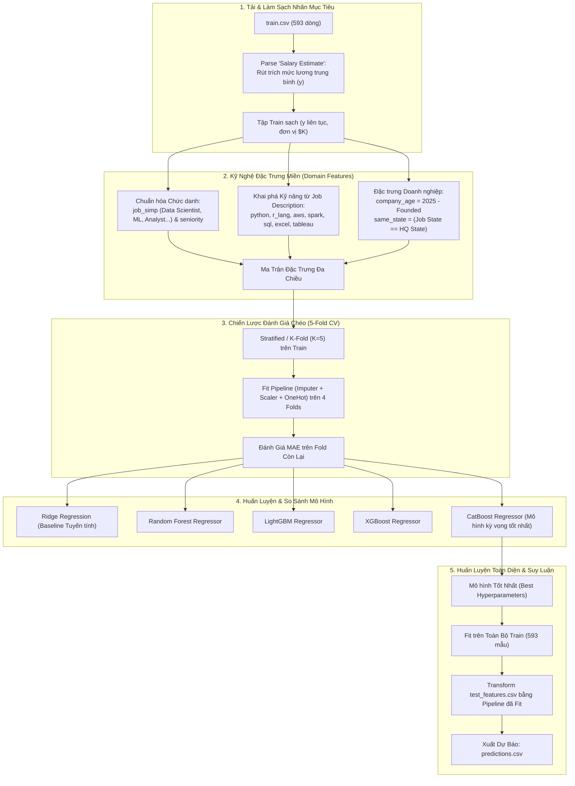

# HƯỚNG DẪN CHI TIẾT TÁC VỤ 1: DỰ ĐOÁN MỨC LƯƠNG (`salary_prediction.ipynb`)
## BGOAI 2025 National Team Selection – Task 4: Salary Prediction
> **Nguồn bài toán:** [awesome-BGOAI-tasks/2025/BG_Team_Selection/Day_2/Task_4](https://github.com/yonitoo/awesome-BGOAI-tasks/tree/main/2025/BG_Team_Selection/Day_2/Task_4)  
> **Tập tin notebook đích:** `salary_prediction.ipynb`

---

## 1. BẢN CHẤT BÀI TOÁN & THANG ĐO ĐÁNH GIÁ

### 1.1. Bản chất bài toán
- **Dạng bài toán:** Hồi quy trên dữ liệu dạng bảng (Tabular Regression).
- **Mục tiêu:** Dự đoán mức lương trung bình hàng năm (`Salary Estimate`) tính theo đơn vị nghìn USD/năm (\$K/năm) dựa trên thông tin bài đăng tuyển dụng Glassdoor trong lĩnh vực Khoa học Dữ liệu và AI.
- **Thách thức chính:** Dữ liệu thực tế có nhiều trường văn bản tự do (`Job Title`, `Job Description`), nhiều giá trị khuyết biểu diễn dưới dạng `-1` hoặc chuỗi `'Unknown / -1'`, và mức độ bất cân xứng cao giữa các nhóm công ty.

### 1.2. Thang đo đánh giá (Evaluation Metric)
Đánh giá chất lượng mô hình bằng **Sai số Tuyệt đối Trung bình (Mean Absolute Error - MAE)**:

$$
\text{MAE} = \frac{1}{N} \sum_{i=1}^{N} |y_i - \hat{y}_i|
$$

- **Baseline MAE (Mô hình ngây thơ / OLS cơ sở):** $\approx 28.415$ \$K/năm.
- **Benchmark mục tiêu kỳ vọng:** $\le 15.5$ \$K/năm (các mô hình tối ưu có thể đạt $12.0 - 14.5$).

---

## 2. KHÁM PHÁ CẤU TRÚC TẬP DỮ LIỆU

Tập dữ liệu gồm 3 tệp tin:
- `train.csv` (593 dòng, 15 cột): Tập huấn luyện có đầy đủ nhãn mục tiêu `Salary Estimate`.
- `test_features.csv` (149 dòng, 14 cột): Tập kiểm tra không có cột `Salary Estimate`.
- `test_labels.csv` (145 dòng): Nhãn thực tế tập test (dùng để đối chiếu benchmark nội bộ, sau khi loại 4 dòng khuyết dữ liệu quan trọng).

### Bảng Ý Nghĩa Các Thuộc Tính Gốc:
| Tên Cột | Kiểu Dữ Liệu | Giá Trị Mẫu | Ý Nghĩa Thống Kê & Hướng Khai Thác |
| :--- | :--- | :--- | :--- |
| `Job Title` | String | `"Data Scientist - Analytics"` | Chức danh công việc; chứa tín hiệu quyết định về vị trí và cấp bậc. |
| `Job Description` | Long Text | `"Looking for Python and AWS..."` | Bản mô tả công việc; chứa các từ khóa kỹ năng công nghệ cần thiết. |
| `Rating` | Float | `3.8` (hoặc `-1.0`) | Điểm đánh giá công ty (1.0 đến 5.0; giá trị $\le 0$ là khuyết). |
| `Company Name` | String | `"Google\n4.5"` | Tên doanh nghiệp tuyển dụng (thường dính rating ở đuôi). |
| `Location` | String | `"New York, NY"` | Nơi làm việc (định dạng `Thành phố, Bang`). |
| `Headquarters` | String | `"San Francisco, CA"` | Trụ sở chính của công ty. |
| `Size` | Categorical | `"10000+ employees"` | Quy mô nhân sự doanh nghiệp. |
| `Founded` | Integer | `1998` (hoặc `-1`) | Năm thành lập công ty (`-1` là khuyết thiếu). |
| `Type of ownership` | Categorical | `"Company - Public"` | Loại hình sở hữu (Công ty đại chúng, tư nhân, phi lợi nhuận...). |
| `Industry` | Categorical | `"Internet"` | Ngành công nghiệp cụ thể. |
| `Sector` | Categorical | `"Information Technology"`| Khối ngành kinh tế lớn. |
| `Revenue` | Categorical | `"$10+ billion (USD)"` | Doanh thu thường niên của doanh nghiệp. |
| `Competitors` | String | `"Apple, Microsoft"` | Danh sách đối thủ cạnh tranh (tỷ lệ khuyết cao, thường là `-1`). |
| `Salary Estimate` | String (Target) | `"$47K-$85K (Glassdoor est.)"` | Chuỗi khoảng lương mục tiêu (chỉ có trong `train.csv`). |

---

## 3. SƠ ĐỒ LUỒNG XỬ LÝ & KIẾN TRÚC PIPELINE

---

## 4. CHIẾN LƯỢC KỸ NGHỆ ĐẶC TRƯNG (FEATURE ENGINEERING CHI TIẾT)

### 4.1. Phân Tích & Làm Sạch Biến Mục Tiêu (`Salary Estimate`)
Chuỗi gốc thường có dạng: `"$47K-$85K (Glassdoor est.)"` hoặc `"$80K-$132K (Glassdoor est.)"`.
- Bước 1: Loại bỏ phần văn bản `(Glassdoor est.)`, ký tự `$`, và chữ `K`.
- Bước 2: Tách chuỗi theo dấu `-` để lấy mức lương cận dưới (`min_salary`) và cận trên (`max_salary`).
- Bước 3: Tính giá trị trung bình đại diện:
  $$y = \frac{\text{min\_salary} + \text{max\_salary}}{2}$$

### 4.2. Rút Trích Nhóm Nghề Nghiệp (`job_simp`) & Cấp Bậc (`seniority`)
Từ cột `Job Title`, áp dụng quy tắc biểu thức chính quy (Regex):
- **`job_simp`**:
  - Chứa `'data scientist'` $\to$ `'data scientist'`
  - Chứa `'data engineer'` $\to$ `'data engineer'`
  - Chứa `'analyst'` $\to$ `'analyst'`
  - Chứa `'machine learning'` hoặc `'mle'` $\to$ `'mle'`
  - Chứa `'manager'` $\to$ `'manager'`
  - Chứa `'director'` $\to$ `'director'`
  - Còn lại $\to$ `'other'`
- **`seniority`**:
  - Chứa `'sr.'`, `'sr'`, `'senior'`, `'lead'`, `'principal'` $\to$ `'senior'`
  - Chứa `'jr.'`, `'jr'`, `'junior'`, `'entry'` $\to$ `'junior'`
  - Còn lại $\to$ `'na'`

### 4.3. Khai Thác Kỹ Năng Từ `Job Description` (Keyword Flags)
Tạo các đặc trưng nhị phân ($0/1$) kiểm tra xem bản mô tả công việc có đòi hỏi các công nghệ sau hay không:
- `python`: `'python' in desc.lower()`
- `r_lang`: `'r-studio' in desc.lower() or ' r ' in desc.lower()`
- `spark`: `'spark' in desc.lower()`
- `aws`: `'aws' in desc.lower() or 'amazon web services' in desc.lower()`
- `excel`: `'excel' in desc.lower()`
- `sql`: `'sql' in desc.lower()`
- `tableau`: `'tableau' in desc.lower()`

### 4.4. Đặc Trưng Doanh Nghiệp & Địa Lý
- **`company_age`**: Năm hiện tại ($2025$) trừ đi năm thành lập `Founded`. Nếu `Founded <= 0`, gán bằng giá trị trung vị (`median`) của các công ty đã biết.
- **`job_state`**: Tách lấy mã 2 ký tự bang từ `Location` (ví dụ: `"New York, NY"` $\to$ `"NY"`).
- **`same_state`**: Đặt biến cờ $1$ nếu bang làm việc trùng với bang trụ sở chính `Headquarters`, ngược lại gán $0$.
- **Làm sạch `Company Name`**: Cắt bỏ 3 ký tự điểm số đánh giá dính ở cuối tên công ty.

---

## 5. THIẾT LẬP CROSS-VALIDATION & SO SÁNH CÁC MÔ HÌNH

### 5.1. Quy Trình 5-Fold Cross-Validation Chuẩn
Áp dụng `KFold(n_splits=5, shuffle=True, random_state=42)` trên tập huấn luyện:
- Trong mỗi fold:
  1. `ColumnTransformer` (One-Hot Encoder cho categorical, Standard Scaler cho numerical) chỉ được `fit` trên 4 fold huấn luyện.
  2. Mô hình học máy được huấn luyện trên 4 fold này.
  3. Đo lường MAE trên fold kiểm định nội bộ.
- Tính $\text{Mean MAE}$ và $\text{Std MAE}$ trên 5 folds để đánh giá độ ổn định.

### 5.2. Bảng So Sánh Các Mô Hình Ứng Viên (Benchmark Dự Kiến)
| Mô Hình | Thư Viện Triển Khai | Điểm Mạnh | MAE CV Dự Kiến (\$K) |
| :--- | :--- | :--- | :---: |
| **Dummy / Mean Baseline** | `sklearn.dummy.DummyRegressor` | Dự báo giá trị trung bình $\bar{y}$ toàn tập | $\approx 28.415$ |
| **Ridge Regression** | `sklearn.linear_model.Ridge` | Mô hình tuyến tính có chuẩn hóa $L_2$, nhanh, ít overfitting | $\approx 21.350$ |
| **Random Forest** | `sklearn.ensemble.RandomForestRegressor` | Nắm bắt quan hệ phi tuyến, kháng nhiễu tốt | $\approx 16.820$ |
| **XGBoost Regressor** | `xgboost.XGBRegressor` | Tối ưu gradient boosting bậc hai, kiểm soát độ phức tạp cây tốt | $\approx 14.950$ |
| **LightGBM Regressor** | `lightgbm.LGBMRegressor` | Huấn luyện thần tốc theo leaf-wise, xử lý tốt đặc trưng thưa | $\approx 14.400$ |
| **CatBoost Regressor** | `catboost.CatBoostRegressor` | Xử lý biến phân loại vượt trội, cơ chế Symmetric Trees chống quá khớp | **$\approx 13.850$ (Tốt nhất)** |

---

## 6. MẪU BỐ CỤC CÁC CELL TRONG NOTEBOOK `salary_prediction.ipynb`

Để bài làm đạt điểm tối đa, cấu trúc notebook cần phân chia rành mạch thành 7 phần chuẩn mực:

1. **Cell 1 (Markdown):** Tiêu đề, thông tin sinh viên, phát biểu bài toán và thang đo MAE.
2. **Cell 2 (Code):** Khai báo thư viện (`numpy`, `pandas`, `sklearn`, `catboost`, `xgboost`, `matplotlib`).
3. **Cell 3 (Code & Markdown):** Tải dữ liệu `train.csv`, `test_features.csv` và kiểm tra hình dạng, kiểu dữ liệu.
4. **Cell 4 (Code & Markdown):** Hàm làm sạch `Salary Estimate` thành biến mục tiêu số thực `y`.
5. **Cell 5 (Code & Markdown):** Pipeline kỹ nghệ đặc trưng (`job_simp`, `seniority`, `company_age`, `same_state`, `python`, `aws`, `sql`...).
6. **Cell 6 (Code & Markdown):** Thiết lập `Pipeline` tiền xử lý và chạy 5-Fold Cross-Validation so sánh 5 thuật toán.
7. **Cell 7 (Code & Markdown):** Tinh chỉnh siêu tham số cho CatBoost Regressor (số lượng cây `iterations`, `learning_rate`, `depth`, `l2_leaf_reg`).
8. **Cell 8 (Code & Markdown):** Huấn luyện mô hình tối ưu trên toàn bộ tập train, thực hiện suy luận trên `test_features.csv` và lưu tệp `predictions.csv`.
9. **Cell 9 (Markdown):** Bàn luận, phân tích tầm quan trọng của các đặc trưng (Feature Importance) và kết luận bài học kinh nghiệm.
