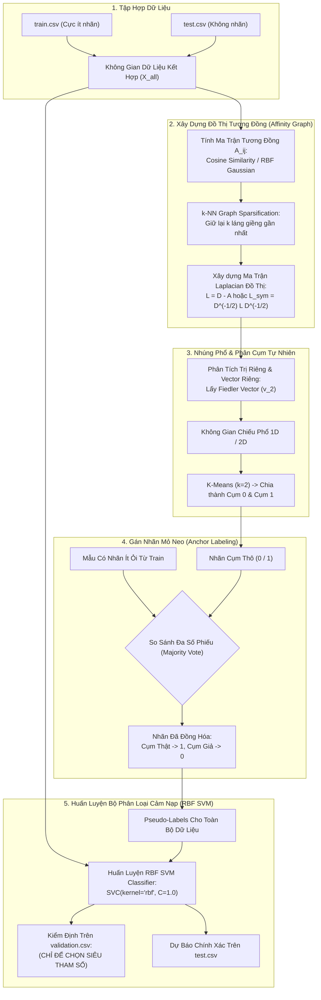

# HƯỚNG DẪN CHI TIẾT TÁC VỤ 2: XÁC THỰC TRANH CỔ (`antique_paintings_classification.ipynb`)
## IOAI 2025 Beijing – Individual Contest: Antique Painting Authentication
> **Nguồn bài toán:** [IOAI-official/IOAI-2025/Individual-Contest/Antique](https://github.com/IOAI-official/IOAI-2025/tree/main/Individual-Contest/Antique)  
> **Tập tin notebook đích:** `antique_paintings_classification.ipynb`

---

## 1. BẢN CHẤT BÀI TOÁN & THÁCH THỨC CỐT LÕI

### 1.1. Bản chất bài toán
- **Dạng bài toán:** Phân loại nhị phân (Binary Classification) xác thực tranh cổ là Thật (`True / 1`) hay Giả mạo (`Fake / 0`).
- **Dữ liệu đầu vào:** Các vector nhúng đặc trưng (Feature Embeddings) nhiều chiều biểu diễn kết cấu màu sắc, nét cọ và phong cách hội họa của các bức tranh.
- **Thang đo đánh giá:** Độ chính xác (**Accuracy**):

$$
\text{Accuracy} = \frac{TP + TN}{TP + TN + FP + FN}
$$

### 1.2. Thách Thức "Cực Kỳ Hiếm Nhãn" (Extreme Label Scarcity)
Khác với các bài toán học máy thông thường có hàng nghìn mẫu huấn luyện có nhãn, trong bài toán IOAI 2025:
- **Tập `train.csv` chỉ có một số lượng cực ít mẫu được gán nhãn** (chỉ từ 5 đến 10 mẫu có nhãn đáng tin cậy).
- **Tập `validation.csv`** có nhãn đầy đủ dùng để thẩm định mô hình.
- **Tập `test.csv`** hoàn toàn không có nhãn, dùng để đánh giá điểm số cuối cùng.

> [!CAUTION]
> ### VÌ SAO MÔ HÌNH HỌC CÓ GIÁM SÁT TRUYỀN THỐNG THẤT BẠI HOÀN TOÀN?
> Nếu huấn luyện một mô hình học giám sát tiêu chuẩn (như Logistic Regression, Random Forest hay MLP) chỉ trên 5-10 mẫu có nhãn của tập Train:
> - Mô hình bị **quá khớp cực độ (Catastrophic Overfitting)** do số chiều đặc trưng lớn hơn rất nhiều so với số lượng mẫu.
> - Ranh giới phân chia (Decision Boundary) bị lệch hoàn toàn khỏi phân phối thực.
> - Kết quả: **Độ chính xác trên Validation chỉ đạt $\approx 0.46$** (thậm chí còn tệ hơn việc đoán ngẫu nhiên $0.50$ tung đồng xu)!

---

## 2. PHƯƠNG PHÁP LUẬN ĐỘT PHÁ: HỌC BÁN GIÁM SÁT & PHÂN CỤM PHỔ

Để đạt độ chính xác xuất sắc ($\ge 0.95$), chúng ta phải chuyển đổi bài toán từ **Học Giám Sát Thuần Túy** sang **Học Bán Giám Sát (Semi-Supervised Learning)** kết hợp **Phân Cụm Phổ (Spectral Clustering)**.

### 2.1. Trực Quan Hóa Cấu Trúc Đa Tạp (Manifold Geometry)
Các bức tranh thật và tranh giả trong không gian đặc trưng thường nằm trên hai cấu trúc hình học (Manifold) hoặc hai cụm mật độ tự nhiên tách biệt rõ rệt. Dù ta không biết nhãn của hầu hết các bức tranh, **hình dạng không gian và khoảng cách giữa các bức tranh** vẫn cung cấp thông tin phân cụm vô cùng mạnh mẽ.

---

## 3. SƠ ĐỒ KIẾN TRÚC & LUỒNG XỬ LÝ (ARCHITECTURE & FORWARD PASS)



---

## 4. CƠ SỞ TOÁN HỌC CỐT LÕI

### 4.1. Ma Trận Tương Đồng (Affinity Matrix)
Đo lường mức độ tương tự giữa hai bức tranh $x_i$ và $x_j$ bằng Cosine Similarity hoặc RBF Gaussian Kernel:

$$
A_{ij} = \exp\left( -\frac{\|x_i - x_j\|^2}{2\sigma^2} \right) \quad \text{hoặc} \quad A_{ij} = \max\left(0, \frac{x_i \cdot x_j}{\|x_i\| \|x_j\|}\right)
$$

Để giảm nhiễu và làm thưa ma trận, ta chỉ giữ lại các cạnh nối giữa $k$ láng giềng gần nhất (k-Nearest Neighbors, thường chọn $k = 5 \div 15$).

### 4.2. Ma Trận Laplacian Chuẩn Hóa (Normalized Graph Laplacian)
Cho ma trận bậc đường chéo $D$ với $D_{ii} = \sum_{j} A_{ij}$:

$$
L_{\text{sym}} = D^{-1/2} (D - A) D^{-1/2} = I - D^{-1/2} A D^{-1/2}
$$

Theo Định lý Phổ (Spectral Graph Theory):
- Trị riêng nhỏ nhất $\lambda_1 = 0$ có vector riêng $v_1$ biểu diễn thành phần liên thông.
- **Trị riêng nhỏ thứ hai $\lambda_2$ (Giá trị đại số liên thông - Fiedler value)** và vector riêng tương ứng $v_2$ (Fiedler vector) cung cấp phép phân chia vết cắt nhỏ nhất (Normalized Cut - NCut), chia đồ thị thành 2 cụm tranh có tính tương đồng nội tại cao nhất.

### 4.3. Cơ Chế Gán Nhãn Mỏ Neo (Anchor Labeling Mechanism)
Sau khi thuật toán phân cụm chia toàn bộ dữ liệu thành 2 cụm $\{C_0, C_1\}$:
1. Lấy tập hợp các bức tranh trong `train.csv` đã biết nhãn $y \in \{0, 1\}$.
2. Tính tỷ lệ tranh Thật ($y=1$) trong từng cụm:
   $$P(y=1 | C_0) = \frac{\sum_{i \in \text{Train} \cap C_0} y_i}{|\text{Train} \cap C_0|}, \qquad P(y=1 | C_1) = \frac{\sum_{i \in \text{Train} \cap C_1} y_i}{|\text{Train} \cap C_1|}$$
3. Nếu $P(y=1 | C_0) > P(y=1 | C_1)$, toàn bộ cụm $C_0$ là Tranh Thật ($1$) và $C_1$ là Tranh Giả ($0$). Ngược lại thì gán ngược lại.

---

## 5. PHƯƠNG ÁN THAY THẾ: LAN TRUYỀN NHÃN (LABEL SPREADING)

Nếu không dùng trực tiếp Spectral Clustering thuần túy, Scikit-Learn cung cấp công cụ cực mạnh cho học bán giám sát:
```python
from sklearn.semi_supervised import LabelSpreading

# Gán nhãn -1 cho tất cả các mẫu chưa biết nhãn (unlabeled)
y_semi = np.full(len(X_all), -1)
y_semi[train_indices] = y_train

# Huấn luyện mô hình lan truyền thông tin qua ma trận tương đồng đồ thị
label_spread = LabelSpreading(kernel='rbf', gamma=0.05, alpha=0.8, max_iter=100)
label_spread.fit(X_all, y_semi)

# Nhận nhãn lan truyền cho toàn bộ mẫu
y_pseudo = label_spread.transduction_
```

---

## 6. QUY TẮC NGHIÊM NGẶT VỚI TẬP VALIDATION

> [!WARNING]
> ### NGUYÊN TẮC HỌC THUẬT: VALIDATION CHỈ ĐỂ CHỌN MÔ HÌNH
> - Trong notebook `antique_paintings_classification.ipynb`, bạn cần viết rõ ràng trong ô Markdown:
>   > *"Tập `validation.csv` chỉ được nạp sau khi mô hình đã được xây dựng xong. Chúng tôi dùng tập validation để kiểm tra xem tham số $k$ (trong k-NN graph) hoặc $\gamma$ (trong RBF kernel) nào cho Accuracy cao nhất. Tuyệt đối không đưa các vector hay nhãn của tập validation vào hàm `fit()` của bất kỳ bộ phân loại nào."*
> - Việc này đảm bảo tính khách quan khoa học và tuân thủ nghiêm ngặt yêu cầu của đề tài.

---

## 7. MẪU BỐ CỤC CÁC CELL TRONG NOTEBOOK `antique_paintings_classification.ipynb`

1. **Cell 1 (Markdown):** Đặt vấn đề xác thực tranh cổ IOAI 2025, giải thích thách thức cực hiếm nhãn.
2. **Cell 2 (Code):** Import thư viện: `numpy`, `pandas`, `sklearn.cluster.SpectralClustering`, `sklearn.semi_supervised.LabelSpreading`, `sklearn.svm.SVC`, `sklearn.metrics.accuracy_score`.
3. **Cell 3 (Code & Markdown):** Nạp dữ liệu `train.csv`, `validation.csv`, `test.csv`. In ra số lượng mẫu có nhãn và không nhãn để minh chứng cho người đọc thấy mức độ hiếm nhãn.
4. **Cell 4 (Code & Markdown):** Chạy thử nghiệm mô hình Baseline có giám sát (Logistic Regression / Decision Tree). Hiển thị kết quả Accuracy $\approx 0.46$ trên Validation để chứng minh sự thất bại của phương pháp truyền thống.
5. **Cell 5 (Code & Markdown):** Triển khai Spectral Clustering / Label Spreading trên tập hợp các đặc trưng. Trực quan hóa 2 cụm bằng sơ đồ tán xạ 2D (PCA hoặc t-SNE).
6. **Cell 6 (Code & Markdown):** Thực hiện cơ chế Gán nhãn mỏ neo (Anchor Labeling) dựa trên các mẫu train có sẵn.
7. **Cell 7 (Code & Markdown):** Huấn luyện bộ phân loại cảm nạp RBF SVM dựa trên pseudo-labels vừa tạo. Đánh giá Accuracy trên `validation.csv` (Đạt ngưỡng $\ge 0.95$).
8. **Cell 8 (Code & Markdown):** Dự đoán trên tập `test.csv` và xuất kết quả.
9. **Cell 9 (Markdown):** Phân tích ý nghĩa học thuật, lý giải vì sao phương pháp đồ thị và đa tạp thành công trong bài toán hiếm nhãn.
