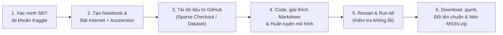

# HƯỚNG DẪN SETUP & THỰC HIỆN ĐỒ ÁN 3 TRÊN KAGGLE NOTEBOOKS
> **Áp dụng cho:** `salary_prediction.ipynb` (BGOAI 2025) & `antique_paintings_classification.ipynb` (IOAI 2025)  
> **Mục tiêu:** Tận dụng tài nguyên CPU/GPU miễn phí trên Kaggle, tải dữ liệu gọn nhẹ trực tiếp từ GitHub và xuất đúng định dạng `.ipynb` kèm đầy đủ kết quả đã chạy (`Run All Cells`).

---

## 1. CÓ NÊN DÙNG KAGGLE CHO ĐỒ ÁN NÀY KHÔNG?

**Câu trả lời là: CÓ, HOÀN TOÀN ĐƯỢC VÀ RẤT KHUYẾN KHÍCH.**

| Tiêu chí | Lợi ích khi làm trên Kaggle Notebooks |
| :--- | :--- |
| **Định dạng đầu ra chuẩn** | Kaggle xuất trực tiếp tệp `.ipynb` tương thích 100% với Jupyter / VS Code, lưu giữ trọn vẹn output, bảng biểu và đồ thị `matplotlib/seaborn`. |
| **Tài nguyên phần cứng miễn phí** | Cung cấp sẵn **CPU 4 nhân + 30GB RAM** và **GPU miễn phí (T4 x2 / P100 – 30 giờ/tuần)**. Cực kỳ hữu ích cho bài toán **Antique Paintings** nếu cần trích xuất đặc trưng ảnh bằng Deep Learning (DINOv2, CLIP, ResNet) hoặc chạy Tuning cho **CatBoost/XGBoost**. |
| **Môi trường cài sẵn** | Đã tích hợp sẵn `numpy`, `pandas`, `scikit-learn`, `xgboost`, `lightgbm`, `catboost`, `torch`, `timm`... không tốn công cấu hình môi trường cục bộ hay lo xung đột thư viện. |

---

## 2. QUY TRÌNH TỔNG QUAN TRÊN KAGGLE



---

## 3. HƯỚNG DẪN SETUP CHI TIẾT TỪNG BƯỚC

### Bước 1: Chuẩn bị tài khoản Kaggle
> [!IMPORTANT]
> **Bắt buộc xác minh số điện thoại (Phone Verification):**
> Kaggle chỉ cho phép bật **Internet** (để tải dữ liệu từ GitHub) và sử dụng **GPU** sau khi tài khoản đã xác minh số điện thoại tại `Account Settings → Phone Verification`.

1. Truy cập [kaggle.com/code](https://www.kaggle.com/code) → Chọn **+ New Notebook**.
2. Tạo 2 Notebook độc lập tương ứng với 2 tác vụ:
   - Notebook 1: đặt tên tạm là `salary-prediction`
   - Notebook 2: đặt tên tạm là `antique-paintings-classification`

---

### Bước 2: Cấu hình Session Options (Thanh công cụ bên phải)
Mở mục **Notebook options** (hoặc **Session options**) ở cột bên phải màn hình và thiết lập:

| Tùy chọn | Tác vụ 1 (`salary_prediction`) | Tác vụ 2 (`antique_paintings`) | Lý do |
| :--- | :--- | :--- | :--- |
| **Internet** | **ON** | **ON** | Để tải dữ liệu trực tiếp từ GitHub và cài gói bổ sung (nếu cần). |
| **Accelerator** | `None` (CPU) *(hoặc GPU T4 x2 nếu chạy CatBoost GPU)* | **`GPU T4 x2`** hoặc **`GPU P100`** | Bài tranh cổ cần GPU nếu trích xuất embedding ảnh; bài lương dữ liệu nhỏ nên CPU chạy rất nhanh và đỡ tốn quota GPU. |
| **Language** | `Python` | `Python` | Ngôn ngữ chuẩn của học phần. |
| **Persistence** | `No persistence` *(hoặc `Files only`)* | `Files only` | Giữ lại tệp dữ liệu đã tải trong `/kaggle/working/` khi khởi động lại session. |

---

### Bước 3: Cách nạp dữ liệu từ GitHub vào Kaggle

Có 2 cách nạp dữ liệu. **Cách 1** tiện lợi nhất vì Notebook tự chạy độc lập từ đầu đến cuối mà không cần thao tác thủ công bên ngoài.

#### Cách 1 (Khuyên dùng): Tải đúng thư mục bài toán bằng `git sparse-checkout`
Vì 2 repository gốc (`awesome-BGOAI-tasks` và `IOAI-2025`) chứa rất nhiều bài thi khác nhau, dùng `git sparse-checkout` giúp **chỉ tải duy nhất thư mục của tác vụ cần làm**, cực nhanh và nhẹ:

* **Cell đầu tiên cho `salary_prediction.ipynb`:**
```python
import os

DATA_DIR = "/kaggle/working/bgoai_task4"

if not os.path.exists(DATA_DIR):
    !git clone --depth 1 --filter=blob:none --sparse https://github.com/yonitoo/awesome-BGOAI-tasks.git {DATA_DIR}
    %cd {DATA_DIR}
    !git sparse-checkout set 2025/BG_Team_Selection/Day_2/Task_4
    %cd /kaggle/working

TASK_PATH = f"{DATA_DIR}/2025/BG_Team_Selection/Day_2/Task_4"
print("Danh sách tệp dữ liệu:", os.listdir(TASK_PATH))
```

* **Cell đầu tiên cho `antique_paintings_classification.ipynb`:**
```python
import os

DATA_DIR = "/kaggle/working/ioai_antique"

if not os.path.exists(DATA_DIR):
    !git clone --depth 1 --filter=blob:none --sparse https://github.com/IOAI-official/IOAI-2025.git {DATA_DIR}
    %cd {DATA_DIR}
    !git sparse-checkout set Individual-Contest/Antique
    %cd /kaggle/working

TASK_PATH = f"{DATA_DIR}/Individual-Contest/Antique"
print("Danh sách tệp dữ liệu:", os.listdir(TASK_PATH))
```

#### Cách 2 (Dự phòng khi mạng GitHub chậm): Tạo Private Kaggle Dataset
1. Tải dữ liệu của từng bài về máy cá nhân và nén lại.
2. Vào **Datasets → + New Dataset**, tải lên và để chế độ **Private**.
3. Trong Notebook, chọn **+ Add Input** ở thanh bên phải và chọn Dataset vừa tạo.
4. Dữ liệu sẽ nằm sẵn (chỉ đọc) tại đường dẫn `/kaggle/input/<ten-dataset>/`.

> [!NOTE]
> Nếu dùng Cách 2, khi giảng viên đọc code sẽ thấy đường dẫn `/kaggle/input/...`. Do đó **Cách 1 vẫn ưu tiên hơn** vì đảm bảo tính tái lập (reproducibility) ngay cả khi chạy lại ở môi trường khác (như Google Colab hay máy cục bộ).

---

### Bước 4: Kiểm tra & cài đặt thư viện bổ sung
Hầu hết các thư viện học máy đều đã có sẵn trên Kaggle. Bạn có thể kiểm tra nhanh ở cell import:

```python
# Kiểm tra nhanh các thư viện chính
import numpy as np
import pandas as pd
import sklearn
import xgboost
import lightgbm
import catboost

print("Scikit-learn:", sklearn.__version__)
print("CatBoost:", catboost.__version__)
```

Nếu cần cài thêm thư viện nào chưa có sẵn (ví dụ `optuna`), dùng cờ `-q` (quiet) để tránh in log cài đặt quá dài làm xấu Notebook khi nộp:
```python
!pip install -q optuna
```

---

### Bước 5: Quy trình `Run All Cells` và Xuất tệp `.ipynb` chuẩn để nộp

> [!CAUTION]
> ### CÁC LỖI THƯỜNG GẶP KHI TẢI NOTEBOOK TỪ KAGGLE
> 1. **Tên file bị Kaggle tự đổi:** Kaggle mặc định chuyển dấu gạch dưới `_` thành dấu gạch ngang `-` (ví dụ `salary-prediction.ipynb`). **Bắt buộc đổi lại tên chính xác** thành `salary_prediction.ipynb` và `antique_paintings_classification.ipynb` trước khi nén!
> 2. **Mất thứ tự thực thi cell:** Khi code thử nghiệm nhiều lần, số thứ tự cell sẽ bị nhảy lộn xộn (`[15]`, `[4]`, `[22]`). Phải khởi động lại kernel và chạy lại toàn bộ từ đầu.
> 3. **Dư log hệ thống quá dài:** Hạn chế để các cell `!pip install` hoặc `!git clone` in hàng trăm dòng rác không cần thiết.

#### Quy trình xuất file chuẩn (Làm lần lượt cho từng Notebook):
1. Trên thanh menu của Kaggle Notebook, chọn **`Run` → `Restart & Clear Cell Outputs`** (để xóa sạch trạng thái cũ trong RAM, đảm bảo không bị lỗi biến ẩn).
2. Chọn **`Run` → `Run All`** và chờ toàn bộ các cell chạy xong từ `[1]` đến cell cuối cùng.
3. Cuộn kiểm tra từ đầu đến cuối:
   - Không có bất kỳ cell nào báo lỗi (`Traceback / Error`).
   - Toàn bộ bảng số liệu, biểu đồ, kết quả CV / Validation đều hiển thị rõ ràng.
   - Các ô Markdown giải thích hiển thị đúng công thức toán học (LaTeX) và bố cục đẹp.
4. Tải tệp Notebook về máy bằng **1 trong 2 cách**:
   - **Cách nhanh (Trực tiếp):** Chọn **`File` → `Download Notebook`**.
   - **Cách an toàn (Lưu lịch sử phiên bản):** Bấm nút **`Save Version`** (góc trên bên phải) → Chọn **`Save & Run All (Commit)`** → Sau khi chạy nền xong, mở phiên bản vừa lưu → Bấm biểu tượng **`...`** góc phải → **`Download code`** (tệp `.ipynb` tải về sẽ chứa đầy đủ output đã chạy).

---

### Bước 6: Kiểm tra lại cục bộ & Đóng gói `MSSV.zip`

1. Đổi tên 2 tệp tải về từ Kaggle thành đúng yêu cầu đề bài:
   - `salary_prediction.ipynb`
   - `antique_paintings_classification.ipynb`
2. *(Khuyên làm)* Mở nhanh cả 2 tệp bằng VS Code (hoặc xem trước trên Jupyter) để xác nhận output và hình ảnh vẫn hiển thị đầy đủ khi offline.
3. Nén phẳng 2 tệp vào `MSSV.zip` (ví dụ trên PowerShell):

```powershell
Compress-Archive -Path .\salary_prediction.ipynb, .\antique_paintings_classification.ipynb -DestinationPath .\MSSV.zip -Force
```

---

## 4. MẸO TỐI ƯU KHI LÀM VIỆC TRÊN KAGGLE

- **Tắt phiên chạy khi không dùng:** Sau khi tải file xong, nhớ bấm nút **Power (Stop Session)** trên thanh công cụ để tránh lãng phí quota GPU hàng tuần (30 giờ/tuần).
- **Cố định hạt giống ngẫu nhiên (Reproducibility):** Luôn đặt `RANDOM_STATE = 42` cho `KFold`, `train_test_split`, `CatBoostRegressor`, `SpectralClustering`, `SVC`... để kết quả chạy trên Kaggle và khi chấm bài luôn nhất quán.
- **Không lưu nhầm file rác vào zip:** Chỉ nén duy nhất 2 file `.ipynb`, không nén kèm thư mục dữ liệu `train.csv`/`test.csv` vào trong `MSSV.zip`.
