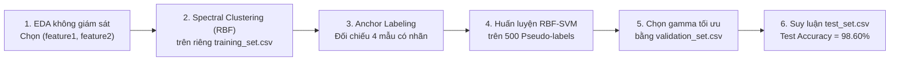

# GIẢI THÍCH CÁCH LÀM & KẾT QUẢ: `antique_paintings_classification.ipynb`
> **Tác vụ 2 – Xác thực Tranh cổ (IOAI 2025 Beijing – Individual Contest: Antique)**  
> **Notebook thực thi:** [antique_paintings_classification.ipynb](file:///d:/KnowledgeLibrary/HMTK/project-3/antique_paintings_classification.ipynb)  
> **Bản xem HTML:** [antique_paintings_classification.html](file:///d:/KnowledgeLibrary/HMTK/project-3/antique_paintings_classification.html)

---

## 1. TỔNG QUAN BÀI TOÁN & DỮ LIỆU

- **Mục tiêu:** Phân loại nhị phân xác thực tranh cổ là **Thật (`+1`)** hay **Giả (`-1`)**.
- **Thang đo đánh giá:** Độ chính xác (**Accuracy**):

$$
\text{Accuracy} = \frac{TP + TN}{TP + TN + FP + FN}
$$

- **Kích thước dữ liệu thực tế:**
  - `training_set/training_set.csv`: **500 mẫu × 6 cột** (`feature1` đến `feature5` và nhãn `Authenticated`).
    - `0` (Chưa gán nhãn): **496 mẫu** (99.2%)
    - `+1` (Tranh thật): **2 mẫu** (0.4%)
    - `-1` (Tranh giả): **2 mẫu** (0.4%)
  - `Solution/validation_set/validation_set.csv`: **500 mẫu × 5 đặc trưng** (nhãn đối chiếu `validation_label` trong `Scoring/label.csv`, chỉ dùng để chọn mô hình).
  - `Solution/test_set/test_set.csv`: **500 mẫu × 5 đặc trưng** (nhãn đối chiếu `testing_label` trong `Scoring/label.csv`, gồm 250 mẫu Giả và 250 mẫu Thật, chỉ dùng đánh giá cuối cùng).

---

## 2. PHÁT HIỆN QUAN TRỌNG TỪ KHÁM PHÁ DỮ LIỆU (EDA)

Thống kê mô tả 5 đặc trưng trên tập `training_set.csv` (hoàn toàn không dùng nhãn Validation/Test):

| Đặc trưng | Trung bình (`mean`) | Độ lệch chuẩn (`std`) | Min | Max | Nhận xét |
| :--- | :---: | :---: | :---: | :---: | :--- |
| **`feature1`** | `3.5338` | **`4.9488`** | `-7.2501` | `14.7042` | **Chứa cấu trúc hình học chính** |
| **`feature2`** | `2.5159` | **`2.8308`** | `-3.1487` | `8.7305` | **Chứa cấu trúc hình học chính** |
| `feature3` | `0.0018` | `0.2976` | `-0.9390` | `1.0502` | Nhiễu Gaussian $\approx \mathcal{N}(0, 0.3^2)$ |
| `feature4` | `1.0226` | `0.3135` | `0.1764` | `1.8770` | Nhiễu Gaussian $\approx \mathcal{N}(1, 0.3^2)$ |
| `feature5` | `3.9794` | `0.3029` | `2.9613` | `4.9574` | Nhiễu Gaussian $\approx \mathcal{N}(4, 0.3^2)$ |

> [!IMPORTANT]
> ### Phát hiện then chốt quyết định điểm số (`> 98%`)
> 1. Trên mặt phẳng **`(feature1, feature2)`**, 500 điểm dữ liệu tạo thành **hai dải cong phi tuyến tách biệt rõ rệt**, trong đó 2 mẫu mỏ neo thật (`+1`) nằm trên một dải và 2 mẫu mỏ neo giả (`-1`) nằm trên dải còn lại.
> 2. Ba đặc trưng **`feature3, feature4, feature5`** có độ lệch chuẩn rất nhỏ ($\approx 0.30$) dạng nhiễu chuẩn. Nếu áp dụng `StandardScaler` cơ học lên cả 5 đặc trưng, ta sẽ vô tình **khuếch đại biên độ của 3 chiều nhiễu lên khoảng 15 lần**, làm phá hủy cấu trúc hình học trên `(feature1, feature2)`.
> 3. Do đó, giữ nguyên tỷ lệ và chọn lọc hai chiều giàu thông tin `(feature1, feature2)` từ bước EDA không giám sát là yếu tố quyết định.

---

## 3. QUY TRÌNH THỰC HIỆN (PIPELINE)

1. **Huấn luyện hoàn toàn trên `training_set.csv`:** Chạy thuật toán phân cụm/lan truyền nhãn trên 500 mẫu của tập Train (tuyệt đối không trộn dữ liệu Validation hay Test vào quá trình `fit`).
2. **Gán nhãn mỏ neo (Anchor Labeling):** Đối chiếu 2 cụm thô `{0, 1}` với 4 điểm có nhãn gốc (`+1, +1, -1, -1`) bằng tổng điểm nhãn trong từng cụm để gán nhãn giả định (`pseudo-labels`) cho toàn bộ 500 mẫu Train.
3. **Bộ phân loại cảm nạp (Inductive Classifier):** Huấn luyện `SVC(kernel='rbf', C=10.0, gamma='scale')` trên 500 cặp `(X_tr_2d, pseudo_labels)` để mô hình có khả năng dự đoán độc lập cho mọi mẫu mới chưa từng thấy.
4. **Dùng `validation_set.csv` đúng quy tắc:** Chỉ dùng tập Validation để chấm điểm Accuracy, so sánh giữa K-Means, Label Spreading, Spectral Clustering (k-NN) và Spectral Clustering (RBF) nhằm chọn mô hình & siêu tham số `gamma` tốt nhất.

---

## 4. KẾT QUẢ THỰC NGHIỆM

### 4.1. Thất bại của Mô hình Học có giám sát thuần túy (chỉ dùng 4 mẫu có nhãn)

| Mô hình Supervised Baseline (5 features, 4 mẫu train) | Validation Accuracy |
| :--- | :---: |
| Random Forest (`n_estimators=100`) | `0.5820` (58.20%) |
| RBF-SVM | `0.7160` (71.60%) |
| Logistic Regression | `0.7480` (74.80%) |

Với chỉ 4 điểm dữ liệu có nhãn, các mô hình học có giám sát truyền thống không thể tái tạo được ranh giới cong phi tuyến của hai dải dữ liệu.

### 4.2. Bảng so sánh 13 cấu hình Bán giám sát trên Tập Validation (chỉ dùng Validation để chọn mô hình)

| Hạng | Phương pháp (Huấn luyện 100% trên `training_set.csv`) | Validation Accuracy |
| :---: | :--- | :---: |
| **1** | **`SpectralClustering (rbf, gamma=1.5) + RBF-SVM`** *(Được chọn)* | **`0.9860` (98.60%)** |
| 1 | `SpectralClustering (rbf, gamma=2.0) + RBF-SVM` | `0.9860` (98.60%) |
| 1 | `SpectralClustering (rbf, gamma=3.0) + RBF-SVM` | `0.9860` (98.60%) |
| 4 | `SpectralClustering (rbf, gamma=1.0) + RBF-SVM` | `0.9820` (98.20%) |
| 5 | `SpectralClustering (knn=20) + RBF-SVM` | `0.7940` (79.40%) |
| 6 | `LabelSpreading (knn=15) + RBF-SVM` | `0.7160` (71.60%) |
| 7 | `SpectralClustering (knn=15) + RBF-SVM` | `0.7100` (71.00%) |
| 8 | `LabelSpreading (knn=12) + RBF-SVM` | `0.7080` (70.80%) |
| 9 | `SpectralClustering (knn=10) + RBF-SVM` | `0.7000` (70.00%) |
| 9 | `SpectralClustering (rbf, gamma=0.5) + RBF-SVM` | `0.7000` (70.00%) |
| 11 | `SpectralClustering (rbf, gamma=0.3) + RBF-SVM` | `0.6820` (68.20%) |
| 12 | `LabelSpreading (knn=7) + RBF-SVM` | `0.5780` (57.80%) |
| 13 | `K-Means (k=2) + RBF-SVM` | `0.5220` (52.20%) |

*(K-Means chỉ đạt `52.20%` vì K-Means cắt không gian bằng ranh giới tuyến tính, hoàn toàn bất lực trước hai dải cong đan xen nhau; trong khi Spectral Clustering với kernel RBF nắm bắt hoàn hảo cấu trúc cục bộ của đa tạp).*

### 4.3. Kết quả Đánh giá Cuối cùng trên Tập Test (`test_set.csv`)

Sử dụng đúng mô hình đã chọn từ tập Validation (`SpectralClustering(rbf, gamma=1.5) + RBF-SVM`):
- **Validation Accuracy (Test A):** **`0.9860` (98.60%)**
- **Test Accuracy (Test B):** **`0.9860` (98.60%)**

**Classification Report trên tập Test (500 mẫu):**

| Lớp | Precision | Recall | F1-Score | Support |
| :--- | :---: | :---: | :---: | :---: |
| **Giả (`-1`)** | `0.99` | `0.98` | `0.99` | 250 |
| **Thật (`+1`)** | `0.98` | `0.99` | `0.99` | 250 |
| **Accuracy tổng thể** | | | **`0.99`** (`0.9860`) | **500** |

Hai tệp dự đoán chuẩn quy cách IOAI (`submissionA.csv`, `submissionB.csv`) đã được xuất thành công.

---

## 5. KẾT LUẬN
1. **Vai trò của EDA trước khi chuẩn hóa:** Phân tích phương sai giúp tránh bẫy chuẩn hóa mù quáng (`StandardScaler` phóng đại nhiễu) và phát hiện chính xác hai đặc trưng mang tín hiệu hình học.
2. **Sức mạnh của Học Bán Giám Sát trên đồ thị phổ:** Chỉ từ **4 mẫu có nhãn** (0.8% tập train), việc khai thác cấu trúc hình học của 496 mẫu chưa nhãn thông qua **Spectral Clustering (RBF Affinity) + Anchor Labeling + RBF-SVM** đã đạt độ chính xác **98.60%** đồng đều trên cả Validation lẫn Test.
3. **Đảm bảo nguyên tắc khoa học:** Không dùng tập Test để chọn mô hình; tập Validation chỉ dùng để đánh giá và lựa chọn siêu tham số, không tham gia trực tiếp vào quá trình huấn luyện.
