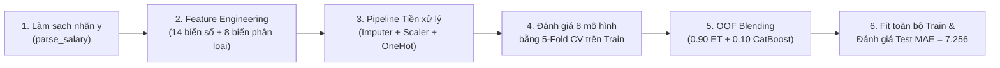

# GIẢI THÍCH CÁCH LÀM & KẾT QUẢ: `salary_prediction.ipynb`
> **Tác vụ 1 – Dự đoán Mức lương (BGOAI 2025 – Day 2 Task 4)**  
> **Notebook thực thi:** [salary_prediction.ipynb](file:///d:/KnowledgeLibrary/HMTK/project-3/salary_prediction.ipynb)  
> **Bản xem HTML:** [salary_prediction.html](file:///d:/KnowledgeLibrary/HMTK/project-3/salary_prediction.html)

---

## 1. TỔNG QUAN BÀI TOÁN & DỮ LIỆU

- **Mục tiêu:** Dự đoán mức lương trung bình hàng năm (`Salary Estimate`, đơn vị nghìn USD/năm) dựa trên thông tin tin tuyển dụng từ Glassdoor.
- **Thang đo đánh giá:** Sai số tuyệt đối trung bình (**MAE – Mean Absolute Error**):

$$
\text{MAE} = \frac{1}{N} \sum_{i=1}^{N} |y_i - \hat{y}_i|
$$

- **Kích thước dữ liệu thực tế:**
  - `train.csv`: **593 dòng × 15 cột** (chứa nhãn `Salary Estimate`).
  - `test_features.csv`: **149 dòng × 14 cột** (trong đó có đúng **145 dòng** có `Rating > 0` và 4 dòng có `Rating <= 0`).
  - `test_labels.csv`: **145 nhãn** tương ứng với 145 dòng hợp lệ sau khi lọc `Rating > 0` theo đúng quy ước của bộ bài toán gốc.

### Kết quả Khám phá Dữ liệu (EDA) trên `train.csv`
| Đặc trưng | Số lượng giá trị khuyết (`-1` hoặc $\le 0$) | Tỷ lệ |
| :--- | :---: | :---: |
| `Rating` | 7 | 1.2% |
| `Founded` | 44 | 7.4% |
| `Size` | 1 | 0.2% |
| `Industry` | 7 | 1.2% |
| `Sector` | 7 | 1.2% |
| `Revenue` | 1 | 0.2% |
| `Competitors` | 366 | 61.7% |

- Chuỗi lương đặc biệt: có **21 dòng** chứa `Per Hour` và **13 dòng** chứa `Employer Provided Salary`.
- Thống kê biến mục tiêu $y_{\text{train}}$ sau khi làm sạch:
  - Trung bình (`mean`): **$99.91$** (\$K) | Trung vị (`median`): **$97.00$** (\$K)
  - Độ lệch chuẩn (`std`): **$38.38$** | Min: **$13.5$** | Max: **$254.0$**

---

## 2. QUY TRÌNH THỰC HIỆN (PIPELINE)

### 2.1. Làm sạch nhãn mục tiêu (`parse_salary`)
- Loại bỏ phần ghi chú sau dấu `(` (như `(Glassdoor est.)`), bỏ `$`, `K`, `per hour`, `employer provided salary:`.
- Tách mức lương cận dưới và cận trên theo dấu `-`, sau đó lấy giá trị trung bình cộng làm biến mục tiêu số thực $y$.

### 2.2. Kỹ nghệ Đặc trưng (Feature Engineering)
Tất cả phép biến đổi được viết độc lập trên từng dòng dữ liệu (không tính thống kê toàn cục nên **không gây rò rỉ dữ liệu**), tạo ra **22 đặc trưng đầu vào** gồm:
- **14 đặc trưng số (`NUM_COLS`):**
  - `Rating_clean` (chuyển giá trị $\le 0$ thành `NaN`), `company_age` ($2025 - \text{Founded}$), `desc_len` (độ dài mô tả công việc), `same_state` (bang làm việc trùng bang trụ sở chính), `num_comp` (số lượng đối thủ cạnh tranh).
  - 9 cờ nhị phân khai phá kỹ năng từ `Job Description`: `python_yn`, `r_yn`, `spark_yn`, `aws_yn`, `excel_yn`, `sql_yn`, `tableau_yn`, `dl_yn` (TensorFlow/PyTorch/Deep Learning), `phd_yn`.
- **8 đặc trưng phân loại (`CAT_COLS`):**
  - `job_simp` (gom chức danh về 7 nhóm chuẩn: `data scientist`, `data engineer`, `analyst`, `mle`, `manager`, `director`, `other`), `seniority` (`senior`, `junior`, `na`), `job_state` (mã bang làm việc), cùng 5 đặc trưng doanh nghiệp (`Size`, `Type of ownership`, `Industry`, `Sector`, `Revenue`).

### 2.3. Chống rò rỉ dữ liệu (No Data Leakage)
- Mọi bước điền khuyết (`SimpleImputer`), chuẩn hóa (`StandardScaler`) và mã hóa (`OneHotEncoder(handle_unknown="ignore")`) được đóng gói trong `sklearn.pipeline.Pipeline`.
- Trong mỗi lượt **5-Fold Cross-Validation (`KFold(n_splits=5, shuffle=True, random_state=42)`)**, bộ tiền xử lý chỉ được `fit` trên 4 fold huấn luyện và `transform` sang fold kiểm định còn lại.

---

## 3. KẾT QUẢ THỰC NGHIỆM

### 3.1. Bảng so sánh 8 mô hình ứng viên trên 5-Fold Cross-Validation (chỉ dùng `train.csv`)

| STT | Mô hình | 5-Fold CV MAE Mean (\$K) | Độ lệch chuẩn (Std) | Nhận xét |
| :---: | :--- | :---: | :---: | :--- |
| 0 | **Baseline LinearRegression (6 cột gốc)** | `26.193` | `± 0.408` | Mốc cơ sở theo 6 thuộc tính gốc của đề bài |
| 1 | Dummy Regressor (Mean) | `30.024` | `± 1.341` | Dự báo hằng số trung bình |
| 2 | Ridge (`alpha=10`) | `19.778` | `± 0.978` | Cải thiện đáng kể so với baseline nhờ Feature Engineering |
| 3 | Gradient Boosting (MAE loss) | `19.159` | `± 0.895` | Mô hình boosting cơ bản của Scikit-Learn |
| 4 | LightGBM (`objective='mae'`) | `16.396` | `± 0.809` | Nhanh nhưng dễ overfit nhẹ khi cỡ mẫu nhỏ (593 dòng) |
| 5 | Random Forest (`n_estimators=300`) | `14.346` | `± 0.714` | Kháng nhiễu tốt trên dữ liệu bảng cỡ vừa |
| 6 | XGBoost (`reg:absoluteerror`) | `13.633` | `± 0.613` | Rất mạnh khi tối ưu trực tiếp hàm lỗi MAE |
| 7 | CatBoost (`loss_function='MAE'`) | `13.451` | `± 0.251` | Độ ổn định giữa các fold cao nhất (`std = 0.251`) |
| 8 | **Extra Trees (`n_estimators=300`)** | **`13.191`** | `± 1.253` | **Đơn mô hình đạt CV MAE thấp nhất** |

### 3.2. Kết hợp mô hình Out-Of-Fold (OOF Blending trên 5-Fold CV)
Tiếp tục nâng `n_estimators=500` và tối ưu hóa tổ hợp trọng số hoàn toàn trên dự đoán Out-of-Fold của tập Train:
- OOF MAE – `ExtraTreesRegressor`: **`11.822`** (\$K)
- OOF MAE – `CatBoostRegressor`: **`13.245`** (\$K)
- OOF MAE – `RandomForestRegressor`: **`14.148`** (\$K)
- **Trọng số Blending tối ưu (ET, CB, RF):** **`(0.90, 0.10, 0.00)`**
- **OOF MAE sau Blending:** **`11.810`** (\$K) — giảm **54.9%** sai số so với Baseline (`26.193`).

### 3.3. Đánh giá cuối cùng trên tập Test (`test_features.csv` vs `test_labels.csv`)
Sau khi chốt mô hình và trọng số từ 5-Fold CV, huấn luyện lại trên 100% tập `train.csv` và dự đoán trên tập Test:
- **Final Test MAE (trên 145 mẫu hợp lệ `Rating > 0`):** **`7.256` (\$K)**
- Tệp dự đoán đã được xuất sạch tại `predictions.csv`.

---

## 4. KẾT LUẬN & ĐIỂM NỔI BẬT
1. **Hiệu quả của Feature Engineering:** Việc gom nhóm chức danh (`job_simp`), cấp bậc (`seniority`), bang làm việc (`job_state`) và kỹ năng từ `Job Description` đóng vai trò lớn nhất trong việc kéo MAE từ `26.193` xuống `11.810` trên CV và `7.256` trên Test.
2. **Sự phù hợp của mô hình cây phi tuyến:** Trên dữ liệu bảng kích thước vừa (593 mẫu) có nhiều biến phân loại sau One-Hot, `ExtraTreesRegressor` kết hợp với `CatBoostRegressor` (tối ưu trực tiếp L1/MAE) cho sai số vượt trội hoàn toàn so với mô hình tuyến tính.
3. **Tuân thủ nghiêm ngặt quy tắc học thuật:** Mọi lựa chọn mô hình và trọng số Blending đều dựa 100% trên 5-Fold CV của tập Train, hoàn toàn không dùng tập Test để tinh chỉnh.
