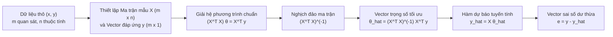

# CHUYÊN ĐỀ 01: HỒI QUY TUYẾN TÍNH & PHƯƠNG PHÁP BÌNH PHƯƠNG BÉ NHẤT (LSM / OLS)
## Linear Regression, Design Matrix & Normal Equations

---

## 1. TỔNG QUAN VỀ HỒI QUY TUYẾN TÍNH

Hồi quy (Regression) là kỹ thuật học máy có giám sát (Supervised Learning) nhằm mô tả mối quan hệ thống kê giữa một hay nhiều biến độc lập (đầu vào - features/inputs) $x_1, x_2, \dots, x_{n-1}$ với một biến phụ thuộc liên tục (đầu ra - response/target) $y$.

* **Mục tiêu:** Tìm một hàm xấp xỉ $\hat{y} = f(x)$ sao cho sai lệch giữa giá trị dự đoán $\hat{y}$ và giá trị quan sát thực tế $y$ là nhỏ nhất trên toàn bộ tập dữ liệu huấn luyện.
* **Tuyến tính hóa mô hình phi tuyến:** Nhiều đường cong thực tế có thể đưa về dạng tuyến tính bằng phép đổi biến:
  * Dạng đa thức: $y = \theta_0 + \theta_1 x + \theta_2 x^2 \implies$ đặt $x_1 = x, x_2 = x^2$ ta được phương trình tuyến tính đa biến $y = \theta_0 + \theta_1 x_1 + \theta_2 x_2$.
  * Dạng hàm mũ: $y = A \cdot e^{Bx} \implies$ lấy logarit hai vế $\ln y = \ln A + Bx \implies$ đặt $Y = \ln y, \theta_0 = \ln A, \theta_1 = B$, ta thu được $Y = \theta_0 + \theta_1 x$.

---

## 2. BẢN CHẤT KIẾN TRÚC & LUỒNG FORWARD PASS TRONG OLS

Thuật toán bình phương bé nhất thông thường (Ordinary Least Squares - OLS) tìm nghiệm tối ưu thông qua các bước tính toán đại số ma trận:

1. **Ma trận mẫu (Design Matrix $X$):**
   Mỗi dòng đại diện cho một mẫu huấn luyện ($m$ dòng), mỗi cột đại diện cho một thuộc tính ($n$ cột, trong đó cột đầu tiên luôn là vector toàn số 1 để gán cho hệ số chặn $\theta_0$):

$$
X = \begin{bmatrix} 
1 & x_1^{(1)} & x_2^{(1)} & \dots & x_{n-1}^{(1)} \\
1 & x_1^{(2)} & x_2^{(2)} & \dots & x_{n-1}^{(2)} \\
\vdots & \vdots & \vdots & \ddots & \vdots \\
1 & x_1^{(m)} & x_2^{(m)} & \dots & x_{n-1}^{(m)}
\end{bmatrix} \in \mathbb{R}^{m \times n}, \qquad
y = \begin{bmatrix} y^{(1)} \\ y^{(2)} \\ \vdots \\ y^{(m)} \end{bmatrix} \in \mathbb{R}^{m \times 1}
$$

2. **Hàm mất mát (Loss / Cost Function):**
   Hàm mất mát bình phương sai số tổng quát:

$$
J(\theta) = \frac{1}{2m} \sum_{i=1}^m \left(\hat{y}^{(i)} - y^{(i)}\right)^2 = \frac{1}{2m} \sum_{i=1}^m \left(\theta^T x^{(i)} - y^{(i)}\right)^2 = \frac{1}{2m} \|X\theta - y\|_2^2
$$

   * Chia cho $m$ để lấy trung bình sai số (không phụ thuộc cỡ mẫu).
   * Chia cho $2$ để triệt tiêu số mũ 2 khi lấy đạo hàm: $\nabla_\theta J(\theta)$.

3. **Công thức nghiệm đóng (Normal Equations):**
   Lấy đạo hàm của $J(\theta)$ theo vector $\theta$ và cho bằng $0$:

$$
\nabla_\theta J(\theta) = \frac{1}{m} X^T (X\theta - y) = 0 \implies X^T X \theta = X^T y
$$

$$
\hat{\theta} = (X^T X)^{-1} X^T y
$$

---

## 3. ĐIỀU KIỆN SỬ DỤNG VÀ GIẢ ĐỊNH GAUSS-MARKOV

Mô hình hồi quy tuyến tính cổ điển giả định sai số ngẫu nhiên $u_i = y_i - \hat{y}_i$ thỏa mãn:
1. Kỳ vọng sai số bằng 0: $\mathbb{E}(u_i) = 0, \forall i$.
2. Phương sai đồng nhất (Homoscedasticity): $\text{Var}(u_i) = \sigma^2, \forall i$.
3. Không tự tương quan giữa các sai số: $\text{Cov}(u_i, u_j) = 0, \forall i \neq j$.
4. Sai số có phân phối chuẩn: $u \sim \mathcal{N}(0, \sigma^2)$.

Khi thỏa mãn các giả định này, định lý Gauss-Markov chứng minh rằng ước lượng OLS là **BLUE (Best Linear Unbiased Estimator)** — ước lượng tuyến tính không chệch có phương sai nhỏ nhất.

---

## 4. VÍ DỤ TÍNH TAY CHI TIẾT TỪNG BƯỚC BẰNG ĐẠI SỐ MA TRẬN

Cho tập dữ liệu huấn luyện gồm $m=4$ quan sát đơn biến ($x$ là chiều cao tính bằng cm, $y$ là cân nặng tính bằng kg):
$(x_1, y_1) = (147, 49), \quad (x_2, y_2) = (150, 53), \quad (x_3, y_3) = (153, 51), \quad (x_4, y_4) = (160, 54)$

### Bước 1: Xây dựng Ma trận mẫu $X$ và Vector đáp ứng $y$
Thêm cột 1 vào ma trận $X$ để đại diện cho hệ số chặn $\theta_0$:

$$
X = \begin{bmatrix} 1 & 147 \\ 1 & 150 \\ 1 & 153 \\ 1 & 160 \end{bmatrix} \in \mathbb{R}^{4 \times 2}, \qquad y = \begin{bmatrix} 49 \\ 53 \\ 51 \\ 54 \end{bmatrix} \in \mathbb{R}^{4 \times 1}
$$

### Bước 2: Tính tích ma trận $X^T X$

$$
X^T X = \begin{bmatrix} 1 & 1 & 1 & 1 \\ 147 & 150 & 153 & 160 \end{bmatrix} \begin{bmatrix} 1 & 147 \\ 1 & 150 \\ 1 & 153 \\ 1 & 160 \end{bmatrix}
$$

* Phần tử $(1, 1)$: $1 + 1 + 1 + 1 = 4$
* Phần tử $(1, 2) = (2, 1)$: $147 + 150 + 153 + 160 = 610$
* Phần tử $(2, 2)$: $147^2 + 150^2 + 153^2 + 160^2 = 21609 + 22500 + 23409 + 25600 = 93118$

$$
X^T X = \begin{bmatrix} 4 & 610 \\ 610 & 93118 \end{bmatrix}
$$

### Bước 3: Tính ma trận nghịch đảo $(X^T X)^{-1}$
1. Định thức:

$$
\det(X^T X) = (4)(93118) - (610)^2 = 372472 - 372100 = 372
$$

2. Ma trận nghịch đảo:

$$
(X^T X)^{-1} = \frac{1}{372} \begin{bmatrix} 93118 & -610 \\ -610 & 4 \end{bmatrix} = \frac{1}{186} \begin{bmatrix} 46559 & -305 \\ -305 & 2 \end{bmatrix}
$$

### Bước 4: Tính tích ma trận $X^T y$

$$
X^T y = \begin{bmatrix} 1 & 1 & 1 & 1 \\ 147 & 150 & 153 & 160 \end{bmatrix} \begin{bmatrix} 49 \\ 53 \\ 51 \\ 54 \end{bmatrix} = \begin{bmatrix} 49 + 53 + 51 + 54 \\ 147(49) + 150(53) + 153(51) + 160(54) \end{bmatrix}
$$

$$
X^T y = \begin{bmatrix} 207 \\ 7203 + 7950 + 7803 + 8640 \end{bmatrix} = \begin{bmatrix} 207 \\ 31596 \end{bmatrix}
$$

*(Lưu ý: Nếu $147 \times 49 + 150 \times 53 + 153 \times 51 + 160 \times 54 = 31596$)*.

### Bước 5: Tính vector tham số $\hat{\theta}$

$$
\hat{\theta} = (X^T X)^{-1} X^T y = \frac{1}{372} \begin{bmatrix} 93118 & -610 \\ -610 & 4 \end{bmatrix} \begin{bmatrix} 207 \\ 31596 \end{bmatrix}
$$

* Hệ số $\theta_0$:

$$
\theta_0 = \frac{93118(207) - 610(31596)}{372} = \frac{19275426 - 19273560}{372} = \frac{1866}{372} \approx 5.016 \approx 5.02
$$

* Hệ số $\theta_1$:

$$
\theta_1 = \frac{-610(207) + 4(31596)}{372} = \frac{-126270 + 126384}{372} = \frac{114}{372} \approx 0.3065 \approx 0.31
$$

Phương trình hồi quy thu được:

$$
\hat{y} = 5.02 + 0.31 x
$$

### Bước 6: Dự báo cho quan sát mới
Với một người có chiều cao $x = 155$ cm:

$$
\hat{y} = 5.02 + 0.31(155) = 5.02 + 48.05 = 53.07 \text{ kg}
$$

---

## 5. BÀI TẬP VẬN DỤNG & THỰC HÀNH TƯƠNG TÁC

Hãy mở tập tin bài tập tương tác kiểm tra kiến trúc và tự tính toán con số tại:
[bai_tap_tinh_toan.html](file:///d:/KnowledgeLibrary/HMTK/tutorial/01_hoi_quy_tuyen_tinh_va_phuong_phap_lsm/bai_tap_tinh_toan.html)
