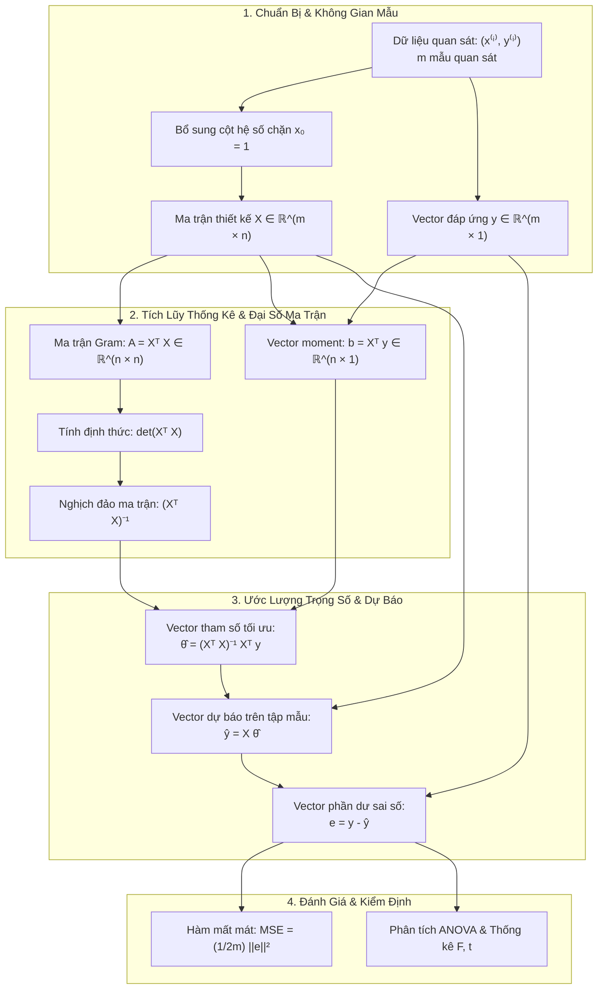
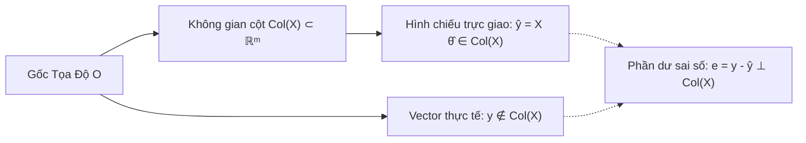

# CHUYÊN ĐỀ 01: HỒI QUY TUYẾN TÍNH & PHƯƠNG PHÁP BÌNH PHƯƠNG BÉ NHẤT (LSM / OLS)
> **Học phần:** Học Máy và Thống Kê (DS102)  
> **Chủ đề:** Hồi quy tuyến tính, Ma trận thiết kế, Hệ phương trình chuẩn (Normal Equations) & Phép chiếu trực giao  
> **Tài liệu tham khảo:** Giáo trình DS102 UIT - Chương 4: Hồi quy tuyến tính

---

## MỤC LỤC ĐIỀU HƯỚNG
1. [Tổng Quan Về Hồi Quy Tuyến Tính](#1-tổng-quan-về-hồi-quy-tuyến-tính)
   - [1.1. Khái niệm và Mục tiêu](#11-khái-niệm-và-mục-tiêu)
   - [1.2. Tuyến tính hóa các mô hình phi tuyến](#12-tuyến-tính-hóa-các-mô-hình-phi-tuyến)
2. [Kiến Trúc & Luồng Tính Toán (Architecture & Forward Pass)](#2-kiến-trúc--luồng-tính-toán-architecture--forward-pass)
3. [Nguồn Gốc Giải Tích & Hệ Phương Trình Chuẩn (Normal Equations)](#3-nguồn-gốc-giải-tích--hệ-phương-trình-chuẩn-normal-equations)
   - [3.1. Thiết lập Ma trận Thiết kế (Design Matrix)](#31-thiết-lập-ma-trận-thiết-kế-design-matrix)
   - [3.2. Hàm mất mát bình phương sai số (MSE)](#32-hàm-mất-mát-bình-phương-sai-số-mse)
   - [3.3. Chứng minh đạo hàm ma trận & Nghiệm đóng](#33-chứng-minh-đạo-hàm-ma-trận--nghiệm-đóng)
   - [3.4. Bản chất hình học: Phép chiếu trực giao (Orthogonal Projection)](#34-bản-chất-hình-học-phép-chiếu-trực-giao-orthogonal-projection)
4. [Điều Kiện Sử Dụng & Giả Định Gauss-Markov (Định Lý BLUE)](#4-điều-kiện-sử-dụng--giả-định-gauss-markov-định-lý-blue)
5. [Ví Dụ Tính Tay Chi Tiết Từng Bước Bằng Đại Số Ma Trận](#5-ví-dụ-tính-tay-chi-tiết-từng-bước-bằng-đại-số-ma-trận)
   - [Bước 1: Thiết lập ma trận mẫu X và vector đáp ứng y](#bước-1-thiết-lập-ma-trận-mẫu-x-và-vector-đáp-ứng-y)
   - [Bước 2: Tính tích ma trận Gram X^T X](#bước-2-tính-tích-ma-trận-gram-xt-x)
   - [Bước 3: Nghịch đảo ma trận (X^T X)^(-1)](#bước-3-nghịch-đảo-ma-trận-xt-x-1)
   - [Bước 4: Tính tích vector X^T y](#bước-4-tính-tích-vector-xt-y)
   - [Bước 5: Tính vector trọng số tối ưu θ_hat](#bước-5-tính-vector-trọng-số-tối-ưu-hattheta)
   - [Bước 6: Dự báo quan sát mới và tính sai số dư thừa](#bước-6-dự-báo-quan-sát-mới-và-tính-sai-số-dư-thừa)
6. [Ưu Điểm, Hạn Chế & So Sánh](#6-ưu-điểm-hạn-chế--so-sánh)
7. [Bài Tập Vận Dụng & Thực Hành Tương Tác](#7-bài-tập-vận-dụng--thực-hành-tương-tác)

---

## 1. TỔNG QUAN VỀ HỒI QUY TUYẾN TÍNH

### 1.1. Khái niệm và Mục tiêu
Hồi quy (Regression) là kỹ thuật học máy có giám sát (Supervised Learning) nhằm mô tả mối quan hệ định lượng giữa:
* Tập hợp các biến độc lập (đầu vào - features/regressors): $x_1, x_2, \dots, x_{n-1}$.
* Một biến phụ thuộc liên tục (đầu ra - response/target): $y \in \mathbb{R}$.

> [!NOTE]
> **Mục tiêu tối ưu:** Tìm một hàm giả thuyết tuyến tính $\hat{y} = f(x) = \theta_0 + \theta_1 x_1 + \dots + \theta_{n-1} x_{n-1}$ sao cho tổng sai lệch bình phương giữa giá trị dự đoán $\hat{y}$ và giá trị quan sát thực tế $y$ trên toàn bộ tập dữ liệu mẫu đạt mức nhỏ nhất.

---

### 1.2. Tuyến tính hóa các mô hình phi tuyến
Trong thực tế, nhiều hiện tượng tự nhiên và kinh tế không có mối quan hệ tuyến tính trực tiếp. Tuy nhiên, nếu hàm số là **tuyến tính đối với các tham số $\theta$**, ta hoàn toàn có thể áp dụng các phép biến đổi biến để đưa về bài toán hồi quy tuyến tính chuẩn tắc:

| Dạng Mô Hình Gốc | Phương Trình Gốc | Phép Biến Đổi | Dạng Tuyến Tính Tương Đương |
| :--- | :--- | :--- | :--- |
| **Đa thức (Polynomial)** | $y = \theta_0 + \theta_1 x + \theta_2 x^2$ | Đặt $x_1 = x, x_2 = x^2$ | $y = \theta_0 + \theta_1 x_1 + \theta_2 x_2$ |
| **Hàm mũ (Exponential)** | $y = A \cdot e^{B x}$ | Lấy logarit tự nhiên: $\ln y = \ln A + B x$ | Đặt $Y = \ln y, \theta_0 = \ln A, \theta_1 = B \implies Y = \theta_0 + \theta_1 x$ |
| **Lũy thừa (Power Law)** | $y = A \cdot x^B$ | Lấy logarit tự nhiên: $\ln y = \ln A + B \ln x$ | Đặt $Y = \ln y, X = \ln x, \theta_0 = \ln A, \theta_1 = B \implies Y = \theta_0 + \theta_1 X$ |
| **Logarit (Logarithmic)** | $y = \theta_0 + \theta_1 \ln x$ | Đặt $X = \ln x$ | $y = \theta_0 + \theta_1 X$ |
| **Nghịch đảo (Reciprocal)** | $y = \frac{1}{\theta_0 + \theta_1 x}$ | Lấy nghịch đảo: $\frac{1}{y} = \theta_0 + \theta_1 x$ | Đặt $Y = \frac{1}{y} \implies Y = \theta_0 + \theta_1 x$ |

---

## 2. KIẾN TRÚC & LUỒNG TÍNH TOÁN (ARCHITECTURE & FORWARD PASS)

Quy trình giải bài toán Hồi quy tuyến tính bằng Phương pháp Bình phương Bé nhất Thông thường (Ordinary Least Squares - OLS) được biểu diễn chi tiết qua sơ đồ kiến trúc sau:

---

## 3. NGUỒN GỐC GIẢI TÍCH & HỆ PHƯƠNG TRÌNH CHUẨN (NORMAL EQUATIONS)

### 3.1. Thiết lập Ma trận Thiết kế (Design Matrix)
Giả sử bài toán có $m$ mẫu dữ liệu quan sát và mỗi mẫu có $n-1$ đặc trưng độc lập. Ta bổ sung thêm thuộc tính giả $x_0 = 1$ để tính toán hệ số chặn (bias / intercept) $\theta_0$:

$$
X = \begin{bmatrix} 
1 & x_1^{(1)} & x_2^{(1)} & \dots & x_{n-1}^{(1)} \\
1 & x_1^{(2)} & x_2^{(2)} & \dots & x_{n-1}^{(2)} \\
\vdots & \vdots & \vdots & \ddots & \vdots \\
1 & x_1^{(m)} & x_2^{(m)} & \dots & x_{n-1}^{(m)}
\end{bmatrix} \in \mathbb{R}^{m \times n}, \qquad
y = \begin{bmatrix} y^{(1)} \\ y^{(2)} \\ \vdots \\ y^{(m)} \end{bmatrix} \in \mathbb{R}^{m \times 1}, \qquad
\theta = \begin{bmatrix} \theta_0 \\ \theta_1 \\ \vdots \\ \theta_{n-1} \end{bmatrix} \in \mathbb{R}^{n \times 1}
$$

Khi đó, toàn bộ phép dự báo tuyến tính cho $m$ mẫu được viết gọn dưới dạng phép nhân ma trận:

$$
\hat{y} = X \theta
$$

---

### 3.2. Hàm mất mát bình phương sai số (MSE)
Sai số của mô hình được định nghĩa bằng hàm mất mát tổng bình phương sai số trung bình:

$$
J(\theta) = \frac{1}{2m} \sum_{i=1}^m \left(\hat{y}^{(i)} - y^{(i)}\right)^2 = \frac{1}{2m} \|X\theta - y\|_2^2 = \frac{1}{2m} (X\theta - y)^T (X\theta - y)
$$

> [!NOTE]
> * Thừa số $\frac{1}{m}$ giúp hàm mất mát đại diện cho giá trị trung bình, không phụ thuộc vào việc tập dữ liệu có $10$ hay $100{,}000$ mẫu.
> * Thừa số $\frac{1}{2}$ là hằng số triệt tiêu thuận tiện để khi lấy đạo hàm cấp 1, số mũ 2 bị khử gọn gàng.

---

### 3.3. Chứng minh đạo hàm ma trận & Nghiệm đóng
Khai triển biểu thức hàm mất mát $J(\theta)$:

$$
J(\theta) = \frac{1}{2m} \left( \theta^T X^T X \theta - 2 y^T X \theta + y^T y \right)
$$

Áp dụng các quy tắc đạo hàm theo vector:
* $\nabla_\theta (\theta^T A \theta) = 2 A \theta$ (với ma trận đối xứng $A = X^T X$).
* $\nabla_\theta (b^T \theta) = b$.

Ta tính gradient của $J(\theta)$ theo $\theta$:

$$
\nabla_\theta J(\theta) = \frac{1}{m} \left( X^T X \theta - X^T y \right)
$$

Để tìm điểm cực tiểu toàn cục, ta giải phương trình đạo hàm triệt tiêu $\nabla_\theta J(\theta) = 0$:

$$
X^T X \theta = X^T y \quad \text{(Hệ Phương Trình Chuẩn - Normal Equations)}
$$

Nếu ma trận Gram $X^T X$ không suy biến ($\det(X^T X) \neq 0$), tồn tại duy nhất ma trận nghịch đảo $(X^T X)^{-1}$, cho ta **công thức nghiệm đóng (Closed-form Solution)**:

$$
\hat{\theta} = (X^T X)^{-1} X^T y
$$

---

### 3.4. Bản chất hình học: Phép chiếu trực giao (Orthogonal Projection)

> [!IMPORTANT]
> **Ý nghĩa hình học của OLS:**
> - Vector đáp ứng thực tế $y \in \mathbb{R}^m$ thường nằm ngoài không gian cột $\text{Col}(X)$ do ảnh hưởng của nhiễu.
> - Vector dự báo $\hat{y} = X\hat{\theta}$ bắt buộc phải thuộc không gian con sinh bởi các cột của $X$: $\hat{y} \in \text{Col}(X)$.
> - Khoảng cách Euclid $\|y - \hat{y}\|$ nhỏ nhất khi và chỉ khi vector sai số phần dư $e = y - \hat{y}$ **vuông góc (trực giao)** với toàn bộ không gian cột $\text{Col}(X)$.
> - Điều kiện trực giao nghĩa là tích vô hướng của từng cột trong $X$ với $e$ phải bằng $0$:
> 
> $$
> X^T e = 0 \iff X^T (y - X\hat{\theta}) = 0 \iff X^T X \hat{\theta} = X^T y
> $$
> 
> Ma trận chiếu (Hat Matrix) biến vector $y$ thành hình chiếu $\hat{y}$ là:
> 
> $$
> H = X(X^T X)^{-1} X^T \implies \hat{y} = H y
> $$

---

## 4. ĐIỀU KIỆN SỬ DỤNG & GIẢ ĐỊNH GAUSS-MARKOV (ĐỊNH LÝ BLUE)

Để phương pháp LSM cho ra kết quả ước lượng tin cậy và không chệch, mô hình cần thỏa mãn 4 giả định cổ điển Gauss-Markov:

1. **Kỳ vọng sai số ngẫu nhiên bằng 0:**
   $$\mathbb{E}(u_i | X) = 0, \quad \forall i = 1, \dots, m$$
2. **Phương sai sai số đồng nhất (Homoscedasticity):**
   $$\text{Var}(u_i | X) = \sigma^2, \quad \forall i = 1, \dots, m$$
   (Không có hiện tượng phương sai thay đổi Heteroscedasticity).
3. **Không tự tương quan giữa các sai số (No Autocorrelation):**
   $$\text{Cov}(u_i, u_j | X) = 0, \quad \forall i \neq j$$
4. **Không có hiện tượng đa cộng tuyến hoàn hảo (No Multicollinearity):**
   Ma trận $X$ có hạng đầy đủ cột (Full column rank): $\text{rank}(X) = n$, đảm bảo $X^T X$ luôn khả nghịch.

> [!TIP]
> **Định lý Gauss-Markov:** Khi 4 giả định trên được thỏa mãn, ước lượng $\hat{\theta}_{\text{OLS}}$ là ước lượng **BLUE (Best Linear Unbiased Estimator)** — nghĩa là trong tất cả các ước lượng tuyến tính không chệch, $\hat{\theta}_{\text{OLS}}$ có **phương sai nhỏ nhất**.

---

## 5. VÍ DỤ TÍNH TAY CHI TIẾT TỪNG BƯỚC BẰNG ĐẠI SỐ MA TRẬN

Xét ví dụ chuẩn mực từ slide bài giảng DS102 UIT: Dự đoán cân nặng ($y$, đơn vị kg) dựa trên chiều cao ($x$, đơn vị cm) với $m = 4$ quan sát:

| Mẫu quan sát ($i$) | Chiều cao $x^{(i)}$ (cm) | Cân nặng $y^{(i)}$ (kg) |
| :---: | :---: | :---: |
| 1 | 147 | 49 |
| 2 | 150 | 53 |
| 3 | 153 | 51 |
| 4 | 160 | 54 |

---

### Bước 1: Thiết lập ma trận mẫu $X$ và vector đáp ứng $y$
Bổ sung cột 1 đại diện cho hệ số chặn $\theta_0$:

$$
X = \begin{bmatrix} 
1 & 147 \\ 
1 & 150 \\ 
1 & 153 \\ 
1 & 160 
\end{bmatrix} \in \mathbb{R}^{4 \times 2}, \qquad
y = \begin{bmatrix} 
49 \\ 
53 \\ 
51 \\ 
54 
\end{bmatrix} \in \mathbb{R}^{4 \times 1}
$$

---

### Bước 2: Tính tích ma trận Gram $X^T X$

$$
X^T X = \begin{bmatrix} 
1 & 1 & 1 & 1 \\ 
147 & 150 & 153 & 160 
\end{bmatrix}
\begin{bmatrix} 
1 & 147 \\ 
1 & 150 \\ 
1 & 153 \\ 
1 & 160 
\end{bmatrix}
$$

Tính toán từng phần tử của ma trận $2 \times 2$:
* Phần tử $(1, 1)$: $1 + 1 + 1 + 1 = 4$
* Phần tử $(1, 2) = (2, 1)$: $147 + 150 + 153 + 160 = 610$
* Phần tử $(2, 2)$:
  $$147^2 + 150^2 + 153^2 + 160^2 = 21{,}609 + 22{,}500 + 23{,}409 + 25{,}600 = 93{,}118$$

Kết quả thu được:

$$
X^T X = \begin{bmatrix} 4 & 610 \\ 610 & 93118 \end{bmatrix}
$$

---

### Bước 3: Nghịch đảo ma trận $(X^T X)^{-1}$

1. **Tính định thức $\det(X^T X)$:**
   $$\det(X^T X) = (4)(93{,}118) - (610)^2 = 372{,}472 - 372{,}100 = 372$$

2. **Áp dụng công thức nghịch đảo ma trận cấp 2:**
   $$\begin{bmatrix} a & b \\ c & d \end{bmatrix}^{-1} = \frac{1}{ad - bc} \begin{bmatrix} d & -b \\ -c & a \end{bmatrix}$$

   $$(X^T X)^{-1} = \frac{1}{372} \begin{bmatrix} 93118 & -610 \\ -610 & 4 \end{bmatrix}$$

---

### Bước 4: Tính tích vector $X^T y$

$$
X^T y = \begin{bmatrix} 
1 & 1 & 1 & 1 \\ 
147 & 150 & 153 & 160 
\end{bmatrix}
\begin{bmatrix} 
49 \\ 
53 \\ 
51 \\ 
54 
\end{bmatrix}
$$

* Phần tử dòng 1:
  $$\sum y_i = 49 + 53 + 51 + 54 = 207$$
* Phần tử dòng 2:
  $$\sum x_i y_i = 147(49) + 150(53) + 153(51) + 160(54) = 7{,}203 + 7{,}950 + 7{,}803 + 8{,}640 = 31{,}596$$

Kết quả thu được:

$$
X^T y = \begin{bmatrix} 207 \\ 31596 \end{bmatrix}
$$

---

### Bước 5: Tính vector trọng số tối ưu $\hat{\theta}$

$$
\hat{\theta} = (X^T X)^{-1} X^T y = \frac{1}{372} \begin{bmatrix} 93118 & -610 \\ -610 & 4 \end{bmatrix} \begin{bmatrix} 207 \\ 31596 \end{bmatrix}
$$

* **Hệ số chặn $\theta_0$:**
  $$\theta_0 = \frac{93{,}118 \times 207 - 610 \times 31{,}596}{372} = \frac{19{,}275{,}426 - 19{,}273{,}560}{372} = \frac{1{,}866}{372} \approx 5.016 \approx 5.02$$

* **Hệ số góc $\theta_1$:**
  $$\theta_1 = \frac{-610 \times 207 + 4 \times 31{,}596}{372} = \frac{-126{,}270 + 126{,}384}{372} = \frac{114}{372} \approx 0.3065 \approx 0.31$$

Phương trình đường thẳng hồi quy tối ưu:

$$
\hat{y} = 5.02 + 0.31 x
$$

---

### Bước 6: Dự báo quan sát mới và tính sai số dư thừa

#### 1. Dự báo cho đối tượng mới:
Một người có chiều cao $x = 155\text{ cm}$:
$$\hat{y} = 5.02 + 0.31(155) = 5.02 + 48.05 = 53.07\text{ kg}$$

#### 2. Tính giá trị dự báo và phần dư trên các mẫu huấn luyện:
* Với mẫu thứ 1 ($x_1 = 147, y_1 = 49$):
  $$\hat{y}_1 = 5.02 + 0.31(147) = 50.59\text{ kg}$$
  $$e_1 = y_1 - \hat{y}_1 = 49 - 50.59 = -1.59\text{ kg}$$
* Với mẫu thứ 2 ($x_2 = 150, y_2 = 53$):
  $$\hat{y}_2 = 5.02 + 0.31(150) = 51.52\text{ kg}$$
  $$e_2 = y_2 - \hat{y}_2 = 53 - 51.52 = +1.48\text{ kg}$$

---

## 6. ƯU ĐIỂM, HẠN CHẾ & SO SÁNH

| Tiêu Chí Đánh Giá | Hồi Quy Tuyến Tính (OLS) | Thuật Toán Tối Ưu Lặp (Gradient Descent) |
| :--- | :--- | :--- |
| **Bản chất tìm nghiệm** | Nghiệm giải tích chính xác đóng: $(X^T X)^{-1} X^T y$ | Nghiệm số xấp xỉ qua các vòng lặp (Epochs) |
| **Siêu tham số (Hyperparameters)**| Không cần chọn Learning rate ($\eta$) | Phải tinh chỉnh Learning rate, số epochs, batch size |
| **Tốc độ với dữ liệu lớn** | Chậm khi $n > 10{,}000$ vì nghịch đảo ma trận tốn chi phí $\mathcal{O}(n^3)$ | Rất nhanh và phù hợp với $n$ lớn, dữ liệu streaming |
| **Độ nhạy cảm với ngoại lai (Outliers)**| Nhạy cảm cao (do bình phương sai số phóng đại lỗi lớn)| Có thể dùng hàm mất mát Huber hoặc MAE để giảm tác động |
| **Hiện tượng đa cộng tuyến** | Gặp lỗi khi ma trận $X^T X$ không khả nghịch (cần Ridge/Lasso) | Vẫn hội tụ nhưng có thể dao động mạnh |

---

## 7. BÀI TẬP VẬN DỤNG & THỰC HÀNH TƯƠNG TÁC

Để kiểm tra năng lực tự nhớ công thức và tự tay thực hiện các phép tính đại số ma trận, hãy mở tệp bài tập tương tác HTML:

👉 [Mở Bài Tập Tính Toán Điền Khuyết Chuyên Đề 01](file:///d:/KnowledgeLibrary/HMTK/tutorial/01_hoi_quy_tuyen_tinh_va_phuong_phap_lsm/bai_tap_tinh_toan.html)
