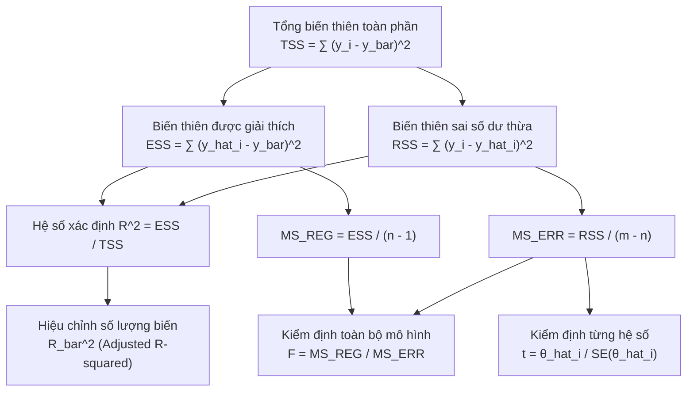

# CHUYÊN ĐỀ 02: ĐÁNH GIÁ & KIỂM ĐỊNH MÔ HÌNH HỒI QUY
## Model Evaluation, Adjusted R-squared, ANOVA & Hypothesis Testing (F-test, t-test)

---

## 1. TỔNG QUAN VỀ ĐÁNH GIÁ MÔ HÌNH HỒI QUY

Sau khi ước lượng được vector tham số $\hat{\theta}$ bằng phương pháp OLS, ta cần đánh giá chất lượng mô hình:
1. **Mức độ giải thích:** Mô hình giải thích được bao nhiêu phần trăm sự biến thiên của biến phụ thuộc $y$?
2. **Ý nghĩa toàn bộ mô hình (F-test):** Có thực sự tồn tại mối quan hệ giữa tập biến độc lập và biến mục tiêu hay chỉ là ngẫu nhiên do mẫu dữ liệu?
3. **Ý nghĩa của từng hệ số (t-test):** Biến độc lập nào thực sự đóng góp vào mô hình và biến nào có thể loại bỏ?



---

## 2. CÁC THƯỚC ĐO TỔNG BÌNH PHƯƠNG & HỆ SỐ XÁC ĐỊNH $R^2$

### 2.1. Đẳng thức phân rã biến thiên (Sum of Squares Decomposition)
* **Tổng bình phương toàn phần (Total Sum of Squares - $TSS$):** Đo lường tổng biến thiên của các giá trị quan sát $y_i$ xung quanh giá trị trung bình mẫu $\bar{y}$:

$$
TSS = \sum_{i=1}^m (y_i - \bar{y})^2 \quad (\text{Bậc tự do: } df = m - 1)
$$

* **Tổng bình phương hồi quy (Explained / Regression Sum of Squares - $ESS$ hay $SS_{REG}$):** Phần biến thiên được mô hình giải thích:

$$
ESS = \sum_{i=1}^m (\hat{y}_i - \bar{y})^2 \quad (\text{Bậc tự do: } df = n - 1)
$$

* **Tổng bình phương sai số dư thừa (Residual Sum of Squares - $RSS$ hay $SS_{ERR}$):** Phần biến thiên do nhiễu ngẫu nhiên hoặc các yếu tố chưa được đưa vào mô hình:

$$
RSS = \sum_{i=1}^m (y_i - \hat{y}_i)^2 = \sum_{i=1}^m e_i^2 \quad (\text{Bậc tự do: } df = m - n)
$$

* **Đẳng thức bảo toàn cơ bản:**

$$
TSS = ESS + RSS
$$

---

### 2.2. Hệ số xác định $R^2$ (R-squared)
Được định nghĩa là tỷ lệ phần trăm biến thiên của $y$ được giải thích bởi các biến độc lập trong mô hình:

$$
R^2 = \frac{ESS}{TSS} = 1 - \frac{RSS}{TSS}
$$

* Miền giá trị: $0 \le R^2 \le 1$.
* Ví dụ: $R^2 = 0.85$ nghĩa là các biến độc lập giải thích được $85\%$ sự thay đổi của biến phụ thuộc, $15\%$ còn lại do các yếu tố ngẫu nhiên ngoài mô hình gây ra.

---

### 2.3. Hệ số xác định hiệu chỉnh (Adjusted R-squared - $\bar{R}^2$)
> [!WARNING]
> **Nhược điểm nguy hiểm của $R^2$:** Mỗi khi đưa thêm một biến độc lập mới vào mô hình (dù biến đó hoàn toàn vô nghĩa), $RSS$ không bao giờ tăng và $R^2$ **luôn luôn tăng hoặc giữ nguyên**, không bao giờ giảm! Điều này dễ dẫn đến việc thêm quá nhiều biến gây ra hiện tượng quá khớp (Overfitting).

Để khắc phục, $\bar{R}^2$ đưa bậc tự do vào để **phạt số lượng biến**:

$$
\bar{R}^2 = 1 - \frac{RSS / (m - n)}{TSS / (m - 1)} = R^2 + (1 - R^2) \frac{1 - n}{m - n}
$$

Trong đó:
* $m$: Cỡ mẫu (số lượng dòng quan sát).
* $n$: Số tham số trong mô hình (bao gồm cả hệ số chặn $\theta_0$, tức số thuộc tính $n-1$ cộng $1$).
* Biến mới đưa vào chỉ thực sự có giá trị nếu nó làm tăng $\bar{R}^2$.
* Lưu ý: $\bar{R}^2$ có thể nhận giá trị âm nếu mô hình quá tồi, khi đó quy ước gán bằng 0.

---

## 3. BẢNG PHÂN TÍCH PHƯƠNG SAI (ANOVA) & KIỂM ĐỊNH $F$

Bảng ANOVA (Analysis of Variance) phân rã tổng biến thiên thành các nguồn độc lập:

| Nguồn biến thiên (Source) | Tổng bình phương (Sum of Squares) | Bậc tự do (Degrees of Freedom) | Phương sai trung bình (Mean Squares) | Thống kê $F$ (F-statistic) |
|:---|:---:|:---:|:---:|:---:|
| **Hồi quy (Model / Regression)** | $SS_{REG} = ESS$ | $n - 1$ | $MS_{REG} = \frac{SS_{REG}}{n - 1}$ | $F = \frac{MS_{REG}}{MS_{ERR}}$ |
| **Sai số (Residual / Error)** | $SS_{ERR} = RSS$ | $m - n$ | $MS_{ERR} = \frac{SS_{ERR}}{m - n}$ | |
| **Toàn phần (Total)** | $SS_{TOT} = TSS$ | $m - 1$ | | |

### Kiểm định giả thuyết mức ý nghĩa toàn bộ mô hình (F-test):
* **Giả thuyết vô hiệu $H_0$:** $\theta_1 = \theta_2 = \dots = \theta_{n-1} = 0$ (Tất cả các biến độc lập đều không có tác dụng giải thích $y$, mô hình vô nghĩa).
* **Đối thuyết $H_1$:** Tồn tại ít nhất một hệ số $\theta_j \ne 0$ ($j \ge 1$).
* Thống kê $F$ tuân theo phân phối Fisher-Snedecor với bậc tự do $(n - 1, m - n)$.
* **Quy tắc quyết định:** Nếu $P\text{-value} < \alpha$ (thường chọn $\alpha = 0.05$) hoặc $F > F_{\text{critical}}$, ta **bác bỏ giả thuyết $H_0$**, kết luận mô hình hồi quy có ý nghĩa thống kê.

---

## 4. KIỂM ĐỊNH Ý NGHĨA TỪNG HỆ SỐ RIÊNG LẺ ($t$-test)

Để xem một biến độc lập $x_i$ cụ thể có thực sự tác động lên $y$ hay không, ta kiểm định:
* $H_0: \theta_i = 0$ (Biến $x_i$ không có ý nghĩa).
* $H_1: \theta_i \ne 0$ (Biến $x_i$ có ý nghĩa thống kê).

### Công thức tính toán:
1. **Phương sai sai số mẫu ($s^2$):**

$$
s^2 = MS_{ERR} = \frac{RSS}{m - n}
$$

2. **Ma trận hiệp phương sai của vector trọng số:**

$$
\text{Var}(\hat{\theta}) = s^2 (X^T X)^{-1}
$$

3. **Sai số chuẩn của hệ số $\theta_i$ (Standard Error):**

$$
S(\hat{\theta}_i) = \text{SE}(\hat{\theta}_i) = \sqrt{\text{Var}(\hat{\theta})[i, i]} = s \sqrt{[(X^T X)^{-1}]_{ii}}
$$

4. **Thống kê kiểm định Student $t$:**

$$
t = \frac{|\hat{\theta}_i|}{S(\hat{\theta}_i)}
$$

* Thống kê $t$ tuân theo phân phối Student với $m - n$ bậc tự do.
* **Quy tắc:** Nếu $t \ge t(m - n, \alpha/2)$ hoặc $P\text{-value} \le \alpha$ (thường là $0.05$), ta **bác bỏ $H_0$**, kết luận hệ số $\theta_i$ có ý nghĩa thống kê.

---

## 5. HƯỚNG DẪN ĐỌC BẢNG BÁO CÁO HỒI QUY PYTHON (`statsmodels`)

Khi sử dụng lệnh `smf.ols('y ~ X', data=df).fit().summary()` trong Python, bảng kết quả xuất ra các thông số chuẩn:

```text
==============================================================================
Dep. Variable:              y   R-squared:                       0.733
Model:                    OLS   Adj. R-squared:                  0.730
Method:         Least Squares   F-statistic:                     268.6
Prob (F-statistic):          7.88e-30
No. Observations:         100   Df Residuals:                       98
Df Model:                   1
==============================================================================
                 coef    std err          t      P>|t|      [0.025      0.975]
------------------------------------------------------------------------------
Intercept      4.1648      0.203     20.503      0.000       3.762       4.568
X              2.9328      0.179     16.389      0.000       2.578       3.288
==============================================================================
```

* `R-squared = 0.733`: Mô hình giải thích được $73.3\%$ biến thiên của $y$.
* `Prob (F-statistic) = 7.88e-30 < 0.05`: Mô hình tổng thể có ý nghĩa thống kê cực kỳ cao.
* Hệ số của $X$: `coef = 2.9328`, `std err = 0.179`, giá trị $t = 2.9328 / 0.179 = 16.389$, `P>|t| = 0.000 < 0.05` $\implies$ Biến $X$ có ý nghĩa thống kê mạnh mẽ.

---

## 6. VÍ DỤ TÍNH TAY CHI TIẾT TỪNG BƯỚC (WORKED NUMERICAL EXAMPLES)

### 6.1. Bài toán: Đánh giá mô hình hồi quy đa biến
Một bài toán hồi quy đa biến có cỡ mẫu $m = 10$ quan sát và $n = 3$ hệ số ($\theta_0, \theta_1, \theta_2$).
Các tổng bình phương thu được từ tính toán:
* Tổng biến thiên toàn phần: $TSS = 200.0$
* Tổng bình phương sai số: $RSS = 40.0$
* Phần tử đường chéo ma trận nghịch đảo: $[(X^T X)^{-1}]_{11} = 0.04$
* Hệ số ước lượng: $\hat{\theta}_1 = 2.40$

Yêu cầu tính toán:
1. Tính $ESS$, hệ số $R^2$ và hệ số hiệu chỉnh $\bar{R}^2$.
2. Lập các chỉ số bảng ANOVA và tính giá trị thống kê kiểm định $F$.
3. Tính sai số chuẩn $\text{SE}(\hat{\theta}_1)$ và giá trị thống kê $t$ của hệ số $\theta_1$.

---

### 6.2. Các bước tính toán cụ thể

#### Bước 1: Tính $ESS$, $R^2$ và $\bar{R}^2$
1. Tổng biến thiên giải thích:

$$
ESS = TSS - RSS = 200.0 - 40.0 = 160.0
$$

2. Hệ số xác định $R^2$:

$$
R^2 = 1 - \frac{RSS}{TSS} = 1 - \frac{40.0}{200.0} = 1 - 0.20 = 0.80 \quad (80\%)
$$

3. Hệ số xác định hiệu chỉnh $\bar{R}^2$ ($m = 10, n = 3$):
   * Bậc tự do mẫu số: $m - n = 10 - 3 = 7$
   * Bậc tự do tử số: $m - 1 = 10 - 1 = 9$

$$
\bar{R}^2 = 1 - \frac{RSS / (m - n)}{TSS / (m - 1)} = 1 - \frac{40.0 / 7}{200.0 / 9} = 1 - \frac{5.71429}{22.22222} = 1 - 0.25714 = 0.74286 \approx 0.743
$$

---

#### Bước 2: Tính toán các thông số bảng ANOVA và thống kê $F$
1. Phương sai trung bình hồi quy ($MS_{REG}$ với $df = n - 1 = 2$):

$$
MS_{REG} = \frac{SS_{REG}}{n - 1} = \frac{160.0}{2} = 80.0
$$

2. Phương sai trung bình sai số ($MS_{ERR}$ với $df = m - n = 7$):

$$
MS_{ERR} = \frac{SS_{ERR}}{m - n} = \frac{40.0}{7} \approx 5.71429
$$

3. Giá trị thống kê $F$:

$$
F = \frac{MS_{REG}}{MS_{ERR}} = \frac{80.0}{5.71429} = 14.00
$$

*(Nhận xét: Giá trị $F = 14.0$ lớn hơn nhiều so với ngưỡng tới hạn $F_{0.05}(2, 7) = 4.74$, do đó mô hình có ý nghĩa thống kê)*.

---

#### Bước 3: Tính sai số chuẩn và kiểm định $t$ cho hệ số $\theta_1$
1. Ước lượng phương sai sai số:

$$
s^2 = MS_{ERR} = 5.71429
$$

2. Phương sai của hệ số $\hat{\theta}_1$:

$$
\text{Var}(\hat{\theta}_1) = s^2 \times [(X^T X)^{-1}]_{11} = 5.71429 \times 0.04 \approx 0.22857
$$

3. Sai số chuẩn $\text{SE}(\hat{\theta}_1)$:

$$
\text{SE}(\hat{\theta}_1) = \sqrt{\text{Var}(\hat{\theta}_1)} = \sqrt{0.22857} \approx 0.47809
$$

4. Thống kê kiểm định $t$:

$$
t = \frac{|\hat{\theta}_1|}{\text{SE}(\hat{\theta}_1)} = \frac{2.40}{0.47809} \approx 5.02
$$

*(Nhận xét: $t = 5.02 > t_{0.025, 7} = 2.365 \implies$ Biến $x_1$ có ý nghĩa thống kê cao đối với biến đáp ứng $y$)*.

---

## 7. BÀI TẬP VẬN DỤNG & THỰC HÀNH TƯƠNG TÁC

Hãy mở tập tin bài tập tương tác kiểm tra kiến trúc và tự tính toán con số tại:
[bai_tap_tinh_toan.html](file:///d:/KnowledgeLibrary/HMTK/tutorial/02_danh_gia_kiem_dinh_mo_hinh_anova_va_r2/bai_tap_tinh_toan.html)
