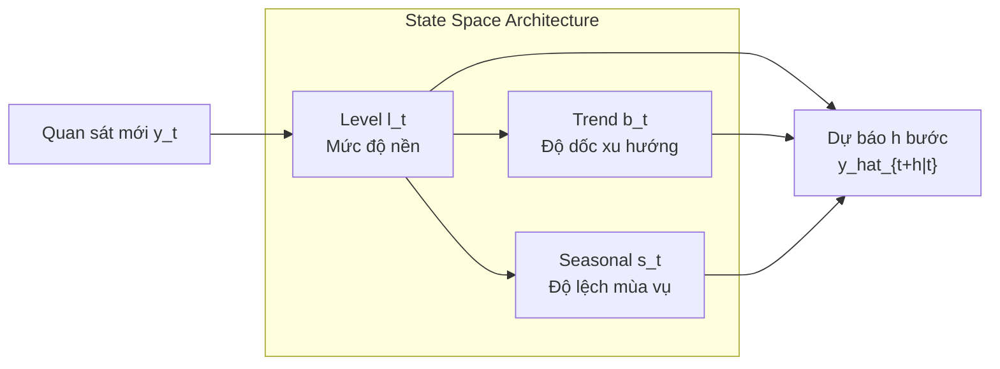

# CHUYÊN ĐỀ 02: CÁC PHƯƠNG PHÁP SAN BẰNG HÀM MŨ
## Exponential Smoothing Methods: SES, Holt's Linear & Holt-Winters

---

## 1. TỔNG QUAN VỀ SAN BẰNG HÀM MŨ

San bằng hàm mũ (Exponential Smoothing) là một trong những họ phương pháp dự báo thành công và được ứng dụng rộng rãi nhất trong kinh tế, tài chính và quản trị chuỗi cung ứng. Điểm cốt lõi của phương pháp là:
* **Nguyên lý suy giảm hàm mũ:** Các quan sát gần nhất trong quá khứ được gán trọng số lớn nhất, các quan sát càng xa trong quá khứ thì trọng số suy giảm dần theo quy luật hàm mũ.
* **Tốc độ tính toán tức thời (Recurrent State-Space):** Không đòi hỏi lưu trữ toàn bộ lịch sử dài, mô hình liên tục cập nhật theo công thức đệ quy (recursive updates) thông qua các biến trạng thái nội tại.

---

## 2. BẢN CHẤT KIẾN TRÚC & LUỒNG FORWARD PASS

Trong không gian trạng thái (State-Space Formulation) của san bằng hàm mũ, hệ thống duy trì tối đa 3 biến bộ nhớ:
1. **Mức độ nền (Level - $l_t$):** Giá trị trung tâm đã được khử nhiễu tại thời điểm $t$.
2. **Độ dốc xu hướng (Trend - $b_t$):** Tốc độ tăng hoặc giảm bình quân của chuỗi sau mỗi bước thời gian.
3. **Chỉ số mùa vụ (Seasonal - $s_t$):** Hệ số điều chỉnh lặp lại theo chu kỳ $m$ thời điểm.

Mỗi khi có quan sát thực tế mới $y_t$, luồng Forward Pass thực hiện:
* **Nội suy tuyến tính (Linear Interpolation):** Cập nhật trạng thái bằng cách cân bằng giữa *thông tin mới tức thời* và *kỳ vọng tích lũy từ quá khứ*.
* **Dự báo tương lai ($h$ bước):** Cố định trạng thái tại thời điểm $t$, tịnh tiến mức nền theo xu hướng $h \times b_t$ và áp dụng chỉ số mùa vụ của chu kỳ tương ứng.

---

## 3. SAN BẰNG HÀM MŨ ĐƠN (SIMPLE EXPONENTIAL SMOOTHING - SES)

### 3.1. Điều kiện áp dụng
Áp dụng cho chuỗi thời gian **không có xu hướng rõ rệt (no trend)** và **không có tính mùa vụ (no seasonality)**.

### 3.2. Phương trình mô hình
Dự báo cho thời điểm $t+1$ dựa trên quan sát thực tế $y_t$ và dự báo trước đó $\hat{y}_t$:

$$
\hat{y}_{t+1|t} = \alpha y_t + (1 - \alpha) \hat{y}_{t|t-1}
$$

Trong đó:
* $\alpha \in [0, 1]$ là **hệ số san bằng (smoothing parameter)**.
  * Nếu $\alpha \to 1$: Dự báo phụ thuộc gần như toàn bộ vào quan sát mới nhất (phản ứng rất nhạy với biến động ngắn hạn).
  * Nếu $\alpha \to 0$: Dự báo phụ thuộc vào toàn bộ quá khứ lịch sử (đường dự báo phẳng và mịn).

### 3.3. Dạng phương trình Thành phần (Component Form)
Biểu diễn qua biến trạng thái mức độ (Level $l_t$):

$$
l_t = \alpha y_t + (1 - \alpha) l_{t-1}
$$

$$
\hat{y}_{t+h|t} = l_t \quad (\forall h \ge 1)
$$

### 3.4. Dạng hiệu chỉnh theo sai số (Error Correction Form)
Đặt sai số dự báo một bước là $e_t = y_t - \hat{y}_{t|t-1} = y_t - l_{t-1}$, ta có:

$$
l_t = \alpha y_t + (1 - \alpha) l_{t-1} = l_{t-1} + \alpha (y_t - l_{t-1})
$$

$$
l_t = l_{t-1} + \alpha e_t
$$

> [!NOTE]
> **Bản chất điều khiển sai số:** Mức nền mới chính là mức nền cũ cộng thêm một tỷ lệ điều chỉnh $\alpha$ nhân với sai số vừa mắc phải $e_t$. Nếu thực tế cao hơn dự báo ($e_t > 0$), mô hình sẽ kéo mức nền mới tăng lên một lượng $\alpha e_t$.

---

## 4. PHƯƠNG PHÁP HOLT TUYẾN TÍNH (HOLT'S LINEAR TREND METHOD)

### 4.1. Điều kiện áp dụng
Áp dụng cho chuỗi thời gian **có xu hướng tăng hoặc giảm**, nhưng **không có mùa vụ**.

### 4.2. Hệ phương trình cập nhật trạng thái
Holt mở rộng SES bằng cách duy trì hai biến trạng thái: Mức (Level $l_t$) và Xu hướng (Trend $b_t$):

1. **Phương trình Mức (Level Equation):**

$$
l_t = \alpha y_t + (1 - \alpha)(l_{t-1} + b_{t-1})
$$

Trong đó biểu thức $(l_{t-1} + b_{t-1})$ là mức dự kiến cho thời điểm $t$ được tính từ bước trước.

2. **Phương trình Xu hướng (Trend Equation):**

$$
b_t = \beta (l_t - l_{t-1}) + (1 - \beta) b_{t-1}
$$

Trong đó $(l_t - l_{t-1})$ là độ biến thiên mức thực tế vừa quan sát được ở bước $t$. Hệ số $\beta \in [0, 1]$ điều tiết tốc độ thích nghi của xu hướng.

3. **Phương trình Dự báo $h$ bước tới (Forecast Equation):**

$$
\hat{y}_{t+h|t} = l_t + h \cdot b_t
$$

Độ lệch xu hướng $b_t$ được nhân tỷ lệ với số bước dự báo $h$ để phóng chiếu mức nền vào tương lai.

---

## 5. PHƯƠNG PHÁP HOLT-WINTERS (TRIPLE EXPONENTIAL SMOOTHING)

Áp dụng cho chuỗi thời gian đồng thời có cả **xu hướng** và **yếu tố mùa vụ** với chu kỳ độ dài $m$.

### 5.1. Holt-Winters Mô hình Cộng (Additive Seasonality)
Áp dụng khi biên độ dao động mùa vụ ổn định và không phụ thuộc vào độ lớn của xu hướng:

1. **Level:**

$$
l_t = \alpha (y_t - s_{t-m}) + (1 - \alpha)(l_{t-1} + b_{t-1})
$$

2. **Trend:**

$$
b_t = \beta (l_t - l_{t-1}) + (1 - \beta) b_{t-1}
$$

3. **Seasonal:**

$$
s_t = \gamma (y_t - l_t) + (1 - \gamma) s_{t-m}
$$

4. **Forecast ($h$ bước tới):**

$$
\hat{y}_{t+h|t} = l_t + h \cdot b_t + s_{t+h - m(k+1)}
$$

*(với $k$ là phần nguyên của $(h-1)/m$)*.

### 5.2. Holt-Winters Mô hình Nhân (Multiplicative Seasonality)
Áp dụng khi biên độ dao động mùa vụ tỷ lệ thuận với độ lớn của xu hướng (chuỗi càng tăng thì độ vung mùa vụ càng lớn):

1. **Level:**

$$
l_t = \alpha \left(\frac{y_t}{s_{t-m}}\right) + (1 - \alpha)(l_{t-1} + b_{t-1})
$$

2. **Trend:**

$$
b_t = \beta (l_t - l_{t-1}) + (1 - \beta) b_{t-1}
$$

3. **Seasonal:**

$$
s_t = \gamma \left(\frac{y_t}{l_t}\right) + (1 - \gamma) s_{t-m}
$$

4. **Forecast ($h$ bước tới):**

$$
\hat{y}_{t+h|t} = (l_t + h \cdot b_t) \times s_{t+h - m(k+1)}
$$

> [!IMPORTANT]
> **Điểm khác biệt cốt lõi:**
> * Trong mô hình cộng: Các thành phần liên kết với nhau bằng phép cộng ($+$). Chỉ số mùa vụ $s_t$ có đơn vị gốc và tổng trung bình xấp xỉ 0.
> * Trong mô hình nhân: Chỉ số mùa vụ liên kết bằng phép nhân ($\times$). Chỉ số $s_t$ là tỷ lệ phần trăm (quanh 1.0 hay 100%). Ví dụ $s = 1.20$ nghĩa là mùa vụ đẩy doanh số tăng thêm 20%; $s = 0.80$ nghĩa là mùa thấp điểm chỉ đạt 80% mức nền.

---

## 6. VÍ DỤ TÍNH TAY CHI TIẾT TỪNG BƯỚC (WORKED NUMERICAL EXAMPLES)

Dưới đây là 3 bài toán tính toán cụ thể tương ứng trực tiếp với các bài tập trong bài thực hành kiểm tra.

### 6.1. Bài toán 1: Tính toán San bằng hàm mũ đơn (SES)
Cho chuỗi quan sát: $y_1 = 20, y_2 = 24, y_3 = 22, y_4 = 28$.
Thiết lập hệ số san bằng $\alpha = 0.4$, khởi tạo dự báo ban đầu $\hat{y}_{1|0} = 20.0$.

#### Bước 1: Thời điểm $t=1$
* Dự báo đã biết: $\hat{y}_{1|0} = 20.0$.
* Quan sát $y_1 = 20$.
* Dự báo cho bước tiếp theo $t=2$:

$$
\hat{y}_{2|1} = \alpha y_1 + (1 - \alpha)\hat{y}_{1|0} = 0.4(20) + 0.6(20) = 8.0 + 12.0 = 20.0
$$

#### Bước 2: Thời điểm $t=2$ ($y_2 = 24$)
* Sai số một bước:

$$
e_2 = y_2 - \hat{y}_{2|1} = 24 - 20.0 = 4.0
$$

* Dự báo cho thời điểm $t=3$ theo dạng hiệu chỉnh sai số (hoặc dạng trọng số):

$$
\hat{y}_{3|2} = \hat{y}_{2|1} + \alpha e_2 = 20.0 + 0.4(4.0) = 20.0 + 1.6 = 21.6
$$

*(Tương đương: $\hat{y}_{3|2} = 0.4(24) + 0.6(20) = 9.6 + 12.0 = 21.6$)*.

#### Bước 3: Thời điểm $t=3$ ($y_3 = 22$) và $t=4$ ($y_4 = 28$)
* Tại $t=3$:

$$
\hat{y}_{4|3} = 0.4(y_3) + 0.6(\hat{y}_{3|2}) = 0.4(22) + 0.6(21.6) = 8.8 + 12.96 = 21.76
$$

* Tại $t=4$:

$$
\hat{y}_{5|4} = 0.4(y_4) + 0.6(\hat{y}_{4|3}) = 0.4(28) + 0.6(21.76) = 11.2 + 13.056 = 24.256
$$

---

### 6.2. Bài toán 2: Tính toán Phương pháp Holt Tuyến tính
Khởi tạo ban đầu tại $t=0$:
* Level $l_0 = 80$
* Trend $b_0 = 5$
* Siêu tham số: $\alpha = 0.2, \beta = 0.1$

#### Bước 1: Cập nhật tại $t=1$ khi quan sát $y_1 = 90$
* Mức dự kiến trước khi có $y_1$: $l_0 + b_0 = 80 + 5 = 85$.
* Cập nhật Level $l_1$:

$$
l_1 = \alpha y_1 + (1 - \alpha)(l_0 + b_0) = 0.2(90) + 0.8(85) = 18.0 + 68.0 = 86.0
$$

* Cập nhật Trend $b_1$:

$$
b_1 = \beta(l_1 - l_0) + (1 - \beta)b_0 = 0.1(86.0 - 80) + 0.9(5) = 0.1(6.0) + 4.5 = 0.6 + 4.5 = 5.1
$$

* Dự báo cho thời điểm $t=2$ ($h=1$):

$$
\hat{y}_{2|1} = l_1 + 1 \cdot b_1 = 86.0 + 5.1 = 91.1
$$

#### Bước 2: Cập nhật tại $t=2$ khi quan sát $y_2 = 94$
* Mức dự kiến: $l_1 + b_1 = 86.0 + 5.1 = 91.1$.
* Cập nhật Level $l_2$:

$$
l_2 = 0.2(94) + 0.8(91.1) = 18.8 + 72.88 = 91.68
$$

* Cập nhật Trend $b_2$:

$$
b_2 = 0.1(l_2 - l_1) + 0.9(b_1) = 0.1(91.68 - 86.0) + 0.9(5.1) = 0.1(5.68) + 4.59 = 0.568 + 4.59 = 5.158
$$

* Dự báo tương lai tại $t=2$:
  * Cho thời điểm $t=3$ ($h=1$):

  $$
  \hat{y}_{3|2} = l_2 + 1 \cdot b_2 = 91.68 + 5.158 = 96.838
  $$

  * Cho thời điểm $t=4$ ($h=2$):

  $$
  \hat{y}_{4|2} = l_2 + 2 \cdot b_2 = 91.68 + 2(5.158) = 91.68 + 10.316 = 101.996
  $$

---

### 6.3. Bài toán 3: Tính toán Holt-Winters Mô hình Nhân
Tại thời điểm cuối năm $t=12$, mô hình đã ước lượng được:
* Level $l_{12} = 200.0$ triệu VNĐ.
* Trend $b_{12} = 8.0$ triệu VNĐ / quý.
* Chỉ số mùa vụ của 4 quý gần nhất:
  * $s_9 = 0.80$ (Quý 1)
  * $s_{10} = 1.10$ (Quý 2)
  * $s_{11} = 0.90$ (Quý 3)
  * $s_{12} = 1.20$ (Quý 4)

#### Bước 1: Dự báo Quý 1 năm sau ($t=13$, tức $h=1$)
* Chỉ số mùa vụ tương ứng chu kỳ trước là $s_9 = 0.80$.
* Áp dụng công thức nhân:

$$
\hat{y}_{13} = (l_{12} + 1 \cdot b_{12}) \times s_9 = (200.0 + 8.0) \times 0.80 = 208.0 \times 0.80 = 166.4 \text{ triệu VNĐ}
$$

#### Bước 2: Dự báo Quý 2 năm sau ($t=14$, tức $h=2$)
* Chỉ số mùa vụ tương ứng chu kỳ trước là $s_{10} = 1.10$.
* Áp dụng công thức nhân:

$$
\hat{y}_{14} = (l_{12} + 2 \cdot b_{12}) \times s_{10} = (200.0 + 16.0) \times 1.10 = 216.0 \times 1.10 = 237.6 \text{ triệu VNĐ}
$$

---

## 7. BÀI TẬP VẬN DỤNG & THỰC HÀNH TƯƠNG TÁC

Hãy mở tập tin bài tập tương tác điền khuyết công thức và tự tính toán con số tại:
[bai_tap_tinh_toan.html](file:///d:/KnowledgeLibrary/HMTK/tutorial/02_san_bang_ham_mu_exponential_smoothing/bai_tap_tinh_toan.html)
