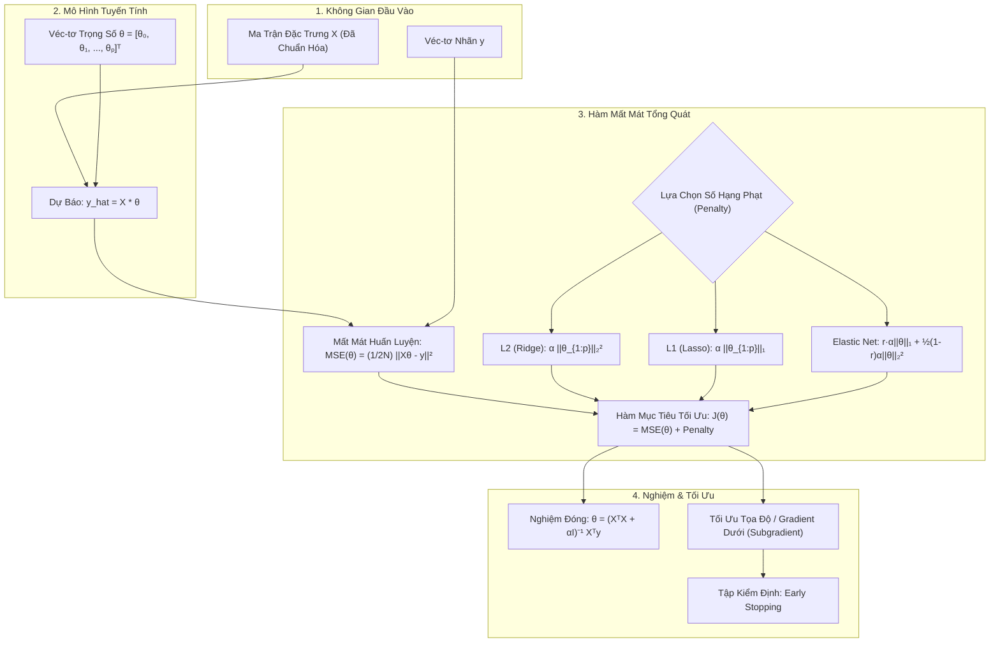

# Chuyên Đề 3: Hồi Quy Quy Tắc Hóa – Ridge, Lasso, Elastic Net & Early Stopping

---

## 1. Giới Thiệu & Trực Quan Hóa Hiện Tượng Quá Khớp (Overfitting)

Trong học máy thống kê, khi một mô hình hồi quy có quá nhiều đặc trưng ($p$ lớn) so với số lượng mẫu quan sát ($N$), hoặc các đặc trưng có hiện tượng đa cộng tuyến cao (multicollinearity), ma trận $X^T X$ thường ở trạng thái gần suy biến ($\det(X^T X) \approx 0$).

Hậu quả là:
- Các hệ số hồi quy $\hat{\theta}_j$ bị phóng đại lên giá trị cực lớn cả về độ lớn dương lẫn âm.
- Phương sai (variance) của mô hình rất cao: mô hình khớp từng điểm nhiễu trong tập huấn luyện nhưng sai số tăng đột biến trên tập kiểm thử (overfitting).

**Quy tắc hóa (Regularization)** là kỹ thuật đưa thêm một số hạng phạt (penalty term) vào hàm mất mát gốc nhằm kiểm soát và thu nhỏ (shrink) độ lớn của véc-tơ trọng số $\theta$, đánh đổi một lượng nhỏ độ lệch (bias) để giảm đáng kể phương sai, giúp mô hình tổng quát hóa tốt hơn trên dữ liệu mới.

---

## 2. Kiến Trúc & Luồng Tính Toán (Architecture & Forward Pass)

Sơ đồ sau minh họa quy trình từ dữ liệu đầu vào chuẩn hóa đến việc tối ưu hàm mục tiêu có số hạng quy tắc hóa:

> [!IMPORTANT]
> **Chuẩn hóa dữ liệu (Feature Scaling):** Trước khi áp dụng bất kỳ mô hình hồi quy quy tắc hóa nào, bắt buộc phải chuẩn hóa các đặc trưng (chuẩn hóa Z-score: mean = 0, std = 1 hoặc MinMax). Nếu không chuẩn hóa, đặc trưng nào có thang đo lớn hơn sẽ vô tình bị phạt bất công hoặc không đồng đều. Đồng thời, hệ số chặn $\theta_0$ (bias) **không bị phạt** trong hàm mục tiêu.

---

## 3. Hồi Quy Ridge (L2 Regularization)

### 3.1. Hàm Mục Tiêu
Hồi quy Ridge (hay Tikhonov regularization) bổ sung số hạng phạt bằng chuẩn $L_2$ bậc 2 của các trọng số $\theta_1, \theta_2, \dots, \theta_p$:

$$J(\theta) = \text{MSE}(\theta) + \alpha \frac{1}{2} \sum_{j=1}^p \theta_j^2 = \frac{1}{2N} \|X\theta - y\|_2^2 + \frac{\alpha}{2} \|\theta_{1:p}\|_2^2$$

Trong đó:
- $\alpha \ge 0$ là siêu tham số kiểm soát mức độ phạt (đôi khi được ký hiệu là $\lambda$ trong thống kê cổ điển).
- Khi $\alpha = 0$: Mô hình trở về OLS (Ordinary Least Squares) tiêu chuẩn.
- Khi $\alpha \to \infty$: Tất cả các trọng số $\theta_j \to 0$ (mô hình dự báo đường nằm ngang phẳng đi qua giá trị trung bình $\bar{y}$).

### 3.2. Nghiệm Đóng Của Ridge (Closed-Form Solution)
Đạo hàm của $J(\theta)$ theo $\theta$ bằng 0 dẫn đến phương trình chuẩn hiệu chỉnh:

$$\hat{\theta}_{\text{Ridge}} = (X^T X + \alpha I^*)^{-1} X^T y$$

Trong đó $I^*$ là ma trận đơn vị kích thước $(p+1) \times (p+1)$ nhưng phần tử đầu tiên tương ứng với hệ số chặn $\theta_0$ bằng 0:

$$I^* = \begin{bmatrix} 0 & 0 & \dots & 0 \\ 0 & 1 & \dots & 0 \\ \vdots & \vdots & \ddots & \vdots \\ 0 & 0 & \dots & 1 \end{bmatrix}$$

Nếu dữ liệu đã trừ trung bình sẵn (centered data, loại bỏ bias), ta dùng ma trận đơn vị thuần $I$:
$$\hat{\theta}_{\text{Ridge}} = (X^T X + \alpha I)^{-1} X^T y$$

> [!TIP]
> Việc cộng thêm $\alpha I$ giúp ma trận $(X^T X + \alpha I)$ luôn khả nghịch (strictly positive definite), giải quyết triệt để vấn đề ma trận suy biến do đa cộng tuyến!

---

## 4. Hồi Quy Lasso (L1 Regularization) & Lựa Chọn Đặc Trưng Tự Động

### 4.1. Hàm Mục Tiêu
Hồi quy Lasso (Least Absolute Shrinkage and Selection Operator) sử dụng chuẩn $L_1$ của véc-tơ trọng số:

$$J(\theta) = \text{MSE}(\theta) + \alpha \sum_{j=1}^p |\theta_j| = \frac{1}{2N} \|X\theta - y\|_2^2 + \alpha \|\theta_{1:p}\|_1$$

### 4.2. Bản Chất Triệt Tiêu Trọng Số (Sparsity)
Khác với Ridge chỉ thu nhỏ trọng số tiến về 0 mà không bao giờ bằng 0 tuyệt đối, Lasso có khả năng đưa chính xác nhiều trọng số $\theta_j$ về bằng **0**. Do đó, Lasso đóng vai trò như một thuật toán **lựa chọn đặc trưng tự động (Automatic Feature Selection)**.

#### Trực Quan Hình Học:
Vùng giới hạn của chuẩn $L_1$ ($\sum |\theta_j| \le t$) là một khối hình thoi (diamond) có các đỉnh nhọn nằm ngay trên các trục tọa độ. Các đường mức viền elip của hàm lỗi bình phương OLS có xu hướng tiếp xúc với hình thoi tại các đỉnh nhọn này trước tiên, khiến cho một số tọa độ $\theta_j$ bằng đúng 0. Trong khi đó, vùng giới hạn của $L_2$ ($\sum \theta_j^2 \le t^2$) là hình cầu/hình tròn trơn, điểm tiếp xúc hầu như không bao giờ rơi trúng trục tọa độ.

### 4.3. Phương Pháp Tối Ưu
Do chuẩn $L_1$ không khả vi tại $\theta_j = 0$, ta không thể tìm nghiệm đóng bằng đại số ma trận. Thay vào đó, Lasso được tối ưu bằng:
- **Gradient dưới (Subgradient Descent):**
  $$g(\theta_j) = \frac{\partial \text{MSE}}{\partial \theta_j} + \alpha \cdot \text{sign}(\theta_j) \quad (\theta_j \neq 0)$$
  Tại $\theta_j = 0$, đạo hàm dưới nhận bất kỳ giá trị nào trong đoạn $[-\alpha, \alpha]$.
- **Hạ Tọa Độ (Coordinate Descent):** Tối ưu hóa từng trọng số $\theta_j$ tại một thời điểm trong khi cố định các trọng số còn lại (thuật toán mặc định trong thư viện Scikit-Learn).

---

## 5. Hồi Quy Elastic Net

### 5.1. Khi Nào Cần Elastic Net?
- Khi số đặc trưng $p > N$ (số chiều lớn hơn số mẫu), Lasso chỉ có thể chọn tối đa $N$ đặc trưng trước khi bão hòa.
- Khi một nhóm biến có tương quan mạnh với nhau (high collinearity), Lasso có xu hướng chọn ngẫu nhiên 1 biến và bỏ qua toàn bộ các biến còn lại. Ridge lại giữ tất cả các biến với trọng số san đều.
- **Elastic Net** kết hợp cả hai để tận dụng ưu điểm: vừa chọn lọc đặc trưng vừa duy trì tính ổn định của nhóm biến tương quan.

### 5.2. Hàm Mục Tiêu
Hàm mục tiêu Elastic Net là tổ hợp lồi giữa hình phạt $L_1$ và $L_2$:

$$J(\theta) = \text{MSE}(\theta) + r \cdot \alpha \|\theta_{1:p}\|_1 + \frac{1 - r}{2} \cdot \alpha \|\theta_{1:p}\|_2^2$$

Trong đó:
- $\alpha \ge 0$: Cường độ quy tắc hóa tổng thể.
- $r \in [0, 1]$: Tỷ lệ pha trộn $L_1$ (trong `scikit-learn` gọi là tham số `l1_ratio`).
  - $r = 1$: Trở về Lasso hoàn toàn.
  - $r = 0$: Trở về Ridge hoàn toàn.
  - $0 < r < 1$: Vừa thu nhỏ trọng số (L2) vừa tạo độ thưa (L1).

---

## 6. Dừng Sớm (Early Stopping)

Một kỹ thuật quy tắc hóa rất đặc biệt cho các thuật toán học lặp (như Gradient Descent) là **Early Stopping**:

- Khi lặp qua các vòng huấn luyện (epochs), sai số huấn luyện (training error) luôn có xu hướng giảm dần.
- Sai số trên tập kiểm định (validation error) ban đầu giảm, nhưng sau đó sẽ đạt điểm cực tiểu (sweet spot) rồi bắt đầu tăng ngược trở lại (bắt đầu overfitting).
- **Thuật toán Early Stopping:** Giám sát liên tục sai số trên tập kiểm định; ngay khi sai số này bắt đầu tăng liên tục qua một số vòng quy định (gọi là `patience`), quá trình huấn luyện dừng lại và các trọng số tại thời điểm sai số kiểm định nhỏ nhất được khôi phục.

---

## 7. Bảng So Sánh Tổng Hợp

| Tiêu Chí | Ordinary Least Squares (OLS) | Ridge Regression ($L_2$) | Lasso Regression ($L_1$) | Elastic Net |
| :--- | :--- | :--- | :--- | :--- |
| **Hàm phạt (Penalty)** | Không có ($0$) | $\frac{\alpha}{2} \sum \theta_j^2$ | $\alpha \sum \|\theta_j\|$ | $r\alpha\|\theta\|_1 + \frac{1-r}{2}\alpha\|\theta\|_2^2$ |
| **Nghiệm đóng** | $\hat{\theta} = (X^T X)^{-1} X^T y$ | $\hat{\theta} = (X^T X + \alpha I)^{-1} X^T y$ | Không có (Tối ưu số) | Không có (Tối ưu số) |
| **Thu nhỏ trọng số** | Không | Có (tiến dần về 0) | Có (triệt tiêu về 0) | Có (vừa triệt tiêu vừa co cụm) |
| **Chọn lọc đặc trưng**| Không | Không | **Có (Sparsity)** | **Có (Group feature selection)**|
| **Xử lý đa cộng tuyến**| Kém (phương sai lớn) | Rất tốt (luôn khả nghịch) | Tốt (chọn đại diện) | Xuất sắc (chọn nhóm đại diện) |
| **Khi nào sử dụng?** | $N \gg p$, ít đa cộng tuyến | Nhiều biến liên quan, đa cộng tuyến | Cần loại bỏ biến dư thừa | $p > N$ hoặc nhóm biến tương quan |

---

## 8. Ví Dụ Tính Toán Chi Tiết Bằng Số (Step-by-Step Numerical Example)

### Bài Toán Ví Dụ:
Xét một bài toán hồi quy đơn giản với ma trận hiệp phương sai mẫu sau khi đã chuẩn hóa biến:
Cho ma trận $X^T X$ và véc-tơ $X^T y$ đối với 2 hệ số $\theta_1, \theta_2$:

$$X^T X = \begin{bmatrix} 4 & 2 \\ 2 & 5 \end{bmatrix}, \quad X^T y = \begin{bmatrix} 8 \\ 14 \end{bmatrix}$$

#### Bước 1: Tính nghiệm OLS chuẩn ($\alpha = 0$)
- Định thức:
  $$\det(X^T X) = (4)(5) - (2)(2) = 20 - 4 = 16$$
- Ma trận nghịch đảo:
  $$(X^T X)^{-1} = \frac{1}{16} \begin{bmatrix} 5 & -2 \\ -2 & 4 \end{bmatrix}$$
- Hệ số OLS:
  $$\hat{\theta}_{\text{OLS}} = \frac{1}{16} \begin{bmatrix} 5 & -2 \\ -2 & 4 \end{bmatrix} \begin{bmatrix} 8 \\ 14 \end{bmatrix} = \frac{1}{16} \begin{bmatrix} 5(8) - 2(14) \\ -2(8) + 4(14) \end{bmatrix} = \frac{1}{16} \begin{bmatrix} 40 - 28 \\ -16 + 56 \end{bmatrix} = \frac{1}{16} \begin{bmatrix} 12 \\ 40 \end{bmatrix} = \begin{bmatrix} 0.75 \\ 2.5 \end{bmatrix}$$

#### Bước 2: Tính nghiệm Ridge với $\alpha = 2$
- Cộng thêm lượng phạt $\alpha I$:
  $$A_{\text{Ridge}} = X^T X + \alpha I = \begin{bmatrix} 4 & 2 \\ 2 & 5 \end{bmatrix} + \begin{bmatrix} 2 & 0 \\ 0 & 2 \end{bmatrix} = \begin{bmatrix} 6 & 2 \\ 2 & 7 \end{bmatrix}$$
- Định thức mới:
  $$\det(A_{\text{Ridge}}) = (6)(7) - (2)(2) = 42 - 4 = 38$$
- Ma trận nghịch đảo:
  $$A_{\text{Ridge}}^{-1} = \frac{1}{38} \begin{bmatrix} 7 & -2 \\ -2 & 6 \end{bmatrix}$$
- Nghiệm Ridge:
  $$\hat{\theta}_{\text{Ridge}} = \frac{1}{38} \begin{bmatrix} 7 & -2 \\ -2 & 6 \end{bmatrix} \begin{bmatrix} 8 \\ 14 \end{bmatrix} = \frac{1}{38} \begin{bmatrix} 7(8) - 2(14) \\ -2(8) + 6(14) \end{bmatrix} = \frac{1}{38} \begin{bmatrix} 56 - 28 \\ -16 + 84 \end{bmatrix} = \frac{1}{38} \begin{bmatrix} 28 \\ 68 \end{bmatrix} \approx \begin{bmatrix} 0.7368 \\ 1.7895 \end{bmatrix}$$

**Nhận xét:** Cả hai hệ số $\theta_1$ và $\theta_2$ đều co nhỏ lại so với OLS ($\theta_1: 0.75 \to 0.7368$, $\theta_2: 2.5 \to 1.7895$).

---

## 9. Bài Tập Thực Hành Điền Khuyết Tính Toán

Để kiểm tra và rèn luyện kỹ năng tự tính toán các số liệu của Ridge, Lasso và Elastic Net mà không bị phụ thuộc vào công thức hiển thị sẵn, hãy thực hành tại tệp tương tác HTML:
👉 [Mở Bài Tập Tính Toán Điền Khuyết](file:///d:/KnowledgeLibrary/HMTK/tutorial/03_hoi_quy_quy_tac_hoa_ridge_lasso_elastic_net/bai_tap_tinh_toan.html)
