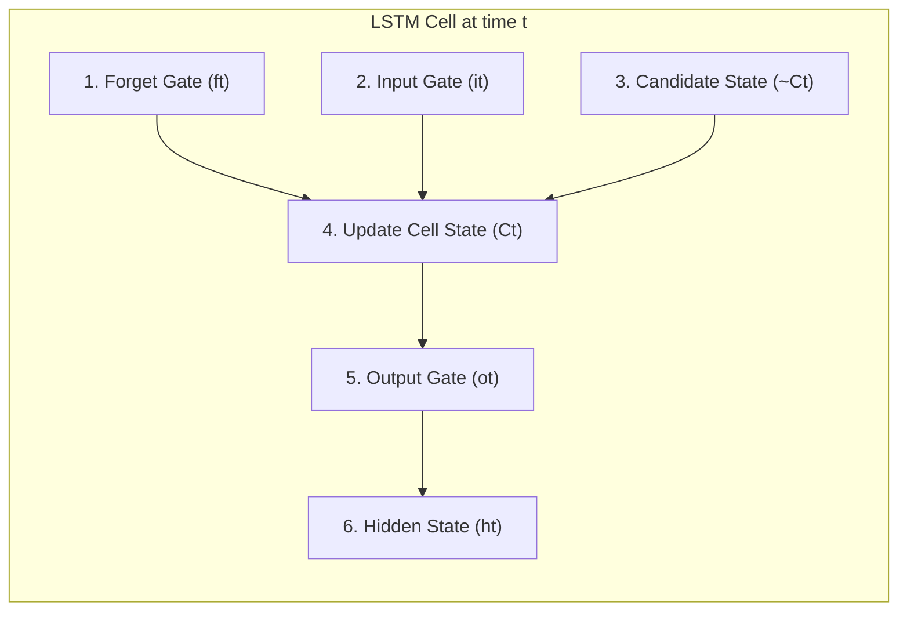

# CHUYÊN ĐỀ 05: HỌC SÂU CHO DỰ BÁO CHUỖI THỜI GIAN
## Deep Learning: Recurrent Neural Networks & LSTM Forward Pass

---

## 1. MẠNG NƠ-RON HỒI QUY CƠ BẢN (VANILLA RNN)

### 1.1. Cấu trúc mạng RNN
Không giống như mạng truyền thẳng (Feedforward Neural Networks), mạng nơ-ron hồi quy có vòng lặp phản hồi cho phép truyền thông tin qua từng bước thời gian:

$$
h_t = \tanh(W_{xh} x_t + W_{hh} h_{t-1} + b_h)
$$

$$
\hat{y}_t = W_{hy} h_t + b_y
$$

Trong đó:
* $x_t \in \mathbb{R}^d$: Vector đầu vào tại thời điểm $t$.
* $h_t \in \mathbb{R}^k$: Vector trạng thái ẩn (Hidden state) lưu giữ ngữ cảnh quá khứ.
* $W_{xh}, W_{hh}, W_{hy}$: Các ma trận trọng số được chia sẻ chung qua tất cả các bước thời gian (Weight sharing).

### 1.2. Hạn chế: Bài toán Triệt tiêu Đạo hàm (Vanishing Gradient Problem)
Khi lan truyền ngược qua thời gian (Backpropagation Through Time - BPTT) trên chuỗi dài, đạo hàm gradient bị nhân liên tiếp qua nhiều ma trận trọng số $W_{hh}^T$ và đạo hàm hàm $\tanh'$. Nếu các giá trị riêng nhỏ hơn 1, gradient suy giảm theo cấp số mũ về 0, khiến mạng **mất khả năng ghi nhớ các phụ thuộc thời gian dài (Long-term dependencies)**.

---

## 2. KIẾN TRÚC BỘ NHỚ DÀI-NGẮN HẠN (LONG SHORT-TERM MEMORY - LSTM)

Được đề xuất bởi Hochreiter & Schmidhuber (1997), LSTM giải quyết triệt để bài toán triệt tiêu đạo hàm nhờ bổ sung **Đường truyền trạng thái ô nhớ (Cell State Highway)** được điều phối bởi 3 cổng logic (Gates).

### 2.1. Chi tiết 6 bước tính toán xuôi (Forward Pass Equations)

#### 1. Cổng quên (Forget Gate - $f_t$):
Quyết định bao nhiêu phần trăm thông tin trong ô nhớ cũ $C_{t-1}$ sẽ được giữ lại (giá trị từ 0 đến 1):

$$
f_t = \sigma(W_f x_t + U_f h_{t-1} + b_f)
$$

#### 2. Cổng vào (Input Gate - $i_t$):
Quyết định mức độ thông tin mới được phép nạp vào ô nhớ:

$$
i_t = \sigma(W_i x_t + U_i h_{t-1} + b_i)
$$

#### 3. Trạng thái ứng viên mới (Candidate State - $\tilde{C}_t$):
Tạo ra vector thông tin mới từ đầu vào $x_t$ và trạng thái ẩn trước $h_{t-1}$:

$$
\tilde{C}_t = \tanh(W_c x_t + U_c h_{t-1} + b_c)
$$

#### 4. Cập nhật Trạng thái ô nhớ (Cell State Update - $C_t$):
Kết hợp thông tin cũ đã lọc và thông tin mới qua phép nhân Hadamard ($\odot$):

$$
C_t = f_t \odot C_{t-1} + i_t \odot \tilde{C}_t
$$

#### 5. Cổng ra (Output Gate - $o_t$):
Quyết định phần nào của ô nhớ sẽ được xuất ra trạng thái ẩn:

$$
o_t = \sigma(W_o x_t + U_o h_{t-1} + b_o)
$$

#### 6. Trạng thái ẩn đầu ra (Hidden State - $h_t$):

$$
h_t = o_t \odot \tanh(C_t)
$$

### 2.2. Các hàm kích hoạt phi tuyến
* **Hàm Sigmoid:** $\sigma(z) = \frac{1}{1 + e^{-z}} \in (0, 1)$ (đóng vai trò như công tắc van điều tiết).
* **Hàm Tanh:** $\tanh(z) = \frac{e^z - e^{-z}}{e^z + e^{-z}} \in (-1, 1)$ (chuẩn hóa giá trị về khoảng đối xứng).

---

## 3. VÍ DỤ TÍNH TAY CHI TIẾT TỪNG BƯỚC (WORKED NUMERICAL EXAMPLE)

### 3.1. Thiết lập bài toán
Xét một tế bào LSTM đơn biến (Scalar LSTM) tại bước thời gian $t$:
* Đầu vào hiện tại: $x_t = 1.0$
* Trạng thái ẩn trước đó: $h_{t-1} = 0.5$
* Trạng thái ô nhớ trước đó: $C_{t-1} = 2.0$

Các thông số trọng số đã huấn luyện:
* Forget Gate: $W_f = 0.8, U_f = 0.4, b_f = -0.5$
* Input Gate: $W_i = 0.5, U_i = 0.6, b_i = -0.8$
* Candidate: $W_c = 1.0, U_c = 0.2, b_c = -0.1$
* Output Gate: $W_o = 0.4, U_o = 0.8, b_o = -0.6$

### 3.2. Tính toán cụ thể từng bước

#### Bước 1: Tính toán Cổng quên ($f_t$)
1. Giá trị tuyến tính đầu vào:

$$
z_f = W_f x_t + U_f h_{t-1} + b_f = 0.8(1.0) + 0.4(0.5) - 0.5 = 0.8 + 0.2 - 0.5 = 0.5
$$

2. Qua hàm Sigmoid:

$$
f_t = \sigma(0.5) = \frac{1}{1 + e^{-0.5}} = \frac{1}{1 + 0.60653} = \frac{1}{1.60653} \approx 0.62246
$$

*(Ô nhớ cũ được giữ lại khoảng 62.25% giá trị)*.

#### Bước 2: Tính toán Cổng vào ($i_t$)
1. Giá trị tuyến tính:

$$
z_i = W_i x_t + U_i h_{t-1} + b_i = 0.5(1.0) + 0.6(0.5) - 0.8 = 0.5 + 0.3 - 0.8 = 0.0
$$

2. Qua hàm Sigmoid:

$$
i_t = \sigma(0.0) = \frac{1}{1 + e^{0}} = \frac{1}{2} = 0.50000
$$

#### Bước 3: Tính toán Trạng thái ứng viên ($\tilde{C}_t$)
1. Giá trị tuyến tính:

$$
z_c = W_c x_t + U_c h_{t-1} + b_c = 1.0(1.0) + 0.2(0.5) - 0.1 = 1.0 + 0.1 - 0.1 = 1.0
$$

2. Qua hàm Tanh:

$$
\tilde{C}_t = \tanh(1.0) = \frac{e^1 - e^{-1}}{e^1 + e^{-1}} = \frac{2.71828 - 0.36788}{2.71828 + 0.36788} = \frac{2.35040}{3.08616} \approx 0.76159
$$

#### Bước 4: Cập nhật Trạng thái ô nhớ ($C_t$)

$$
C_t = f_t \times C_{t-1} + i_t \times \tilde{C}_t
$$

$$
C_t = 0.62246 \times 2.0 + 0.50000 \times 0.76159 = 1.24492 + 0.38080 = 1.62572
$$

#### Bước 5: Tính toán Cổng ra ($o_t$)
1. Giá trị tuyến tính:

$$
z_o = W_o x_t + U_o h_{t-1} + b_o = 0.4(1.0) + 0.8(0.5) - 0.6 = 0.4 + 0.4 - 0.6 = 0.2
$$

2. Qua hàm Sigmoid:

$$
o_t = \sigma(0.2) = \frac{1}{1 + e^{-0.2}} = \frac{1}{1 + 0.81873} = \frac{1}{1.81873} \approx 0.54983
$$

#### Bước 6: Tính toán Trạng thái ẩn đầu ra ($h_t$)
1. Chuẩn hóa $C_t$ qua hàm Tanh:

$$
\tanh(C_t) = \tanh(1.62572) \approx 0.92546
$$

2. Tính $h_t$:

$$
h_t = o_t \times \tanh(C_t) = 0.54983 \times 0.92546 \approx 0.50884
$$
