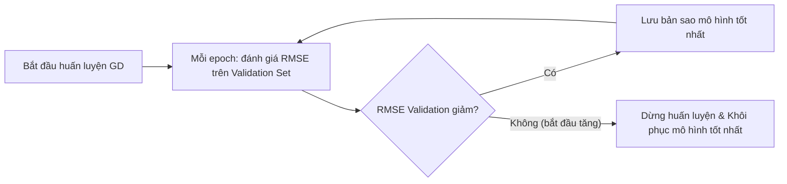

# 2. Các mô hình hồi quy tuyến tính quy tắc hóa (Regularized Linear Models)

[⬅ Trước: Hồi quy tuyến tính & LSM](01_hoi_quy_tuyen_tinh_lsm.md) · [Mục lục](README.md) · [Tiếp: Thuật toán Gradient Descent ➡](03_thuat_toan_gradient_descent.md)

---

## 2.1. Tổng quan về Quy tắc hóa (Regularization)

- Khi mô hình quá phức tạp (chẳng hạn hồi quy đa thức bậc cao hoặc có quá nhiều thuộc tính), mô hình rất dễ bị **quá khớp (overfitting)**: đạt $R^2$ rất cao trên tập huấn luyện nhưng sai số dự báo trên tập kiểm thử (test set) lại lớn.
- **Quy tắc hóa (Regularization)** một mô hình hồi quy là kỹ thuật **ràng buộc (thu nhỏ) các hệ số hồi quy** trong quá trình huấn luyện nhằm giảm số bậc tự do hiệu dụng của mô hình, giúp tránh hiện tượng quá khớp.
- Với mô hình hồi quy đa thức $y = \theta_0 + \theta_1 x^1 + \dots + \theta_k x^k$, một cách đơn giản để quy tắc hóa là giảm bậc $k$ của đa thức. Với mô hình tuyến tính tổng quát, cách phổ biến nhất là cộng thêm một **thành phần phạt (penalty term)** dựa trên độ lớn của các trọng số $\theta_1, \dots, \theta_n$ vào hàm mất mát.

> ⚠️ **Lưu ý quan trọng:**
> 1. Chỉ quy tắc hóa các trọng số thuộc tính $\theta_1, \theta_2, \dots, \theta_n$ (**không** phạt hệ số chặn/bias $\theta_0$).
> 2. Các mô hình quy tắc hóa rất nhạy cảm với thang đo của các thuộc tính, do đó **cần chuẩn hóa dữ liệu (Feature Scaling)** (ví dụ dùng `StandardScaler`) trước khi huấn luyện.

---

## 2.2. Mô hình hồi quy Ridge (Ridge Regression – Chuẩn $L_2$)

### 2.2.1. Định nghĩa và Hàm mất mát
**Hồi quy Ridge** (còn gọi là *Hồi quy sườn đồi* hay *quy tắc hóa Tikhonov*) là mô hình hồi quy tuyến tính với ràng buộc tổng bình phương các hệ số (bình phương chuẩn $L_2$):

$$\theta_1^2 + \theta_2^2 + \dots + \theta_n^2 = \sum_{j=1}^{n} \theta_j^2 = \|\boldsymbol{\theta}\|_2^2$$

Sử dụng phương pháp nhân tử Lagrange, hàm mất mát của hồi quy Ridge được viết dưới dạng:

$$J(\boldsymbol{\theta}) = \frac{1}{2m} \sum_{i=1}^{m} \left(\boldsymbol{\theta}^T \mathbf{x}^{(i)} - y^{(i)}\right)^2 + \alpha \sum_{j=1}^{n} \theta_j^2 \quad (\alpha \ge 0) \qquad (15)$$

*(Nếu viết theo ký hiệu $\text{MSE}(\boldsymbol{\theta}) = \frac{1}{m}\sum (\boldsymbol{\theta}^T\mathbf{x}^{(i)} - y^{(i)})^2$ thì đôi khi thành phần phạt được viết là $\frac{1}{2}\alpha \sum_{j=1}^n \theta_j^2$).*

### 2.2.2. Ý nghĩa của siêu tham số $\alpha$
Thành phần thứ hai $\alpha \sum_{j=1}^n \theta_j^2$ được gọi là **thành phần phạt (penalty term)**, trong đó $\alpha \ge 0$ điều khiển mức độ quy tắc hóa:
- **Khi $\alpha = 0$:** Thành phần phạt triệt tiêu, hồi quy Ridge trở thành **hồi quy tuyến tính thông thường (OLS)**.
- **Khi $\alpha \to +\infty$:** Để hàm mất mát đạt cực tiểu, tổng $\sum_{j=1}^n \theta_j^2$ buộc phải tiến về $0$, suy ra $\theta_j \approx 0 \ (\forall j = 1, \dots, n)$. Kết quả là đường hồi quy trở thành một **đường thẳng nằm ngang (hằng số)** đi qua giá trị trung bình của dữ liệu.

### 2.2.3. Công thức nghiệm đóng của hồi quy Ridge
Gọi $\mathbf{I}_{n+1}$ là ma trận đơn vị cấp $n + 1$ ($n$ là số thuộc tính, quy ước phần tử góc trên cùng bên trái ứng với $\theta_0$ bằng $0$ nếu không phạt $\theta_0$). Lấy đạo hàm của $J(\boldsymbol{\theta})$ theo $\boldsymbol{\theta}$ và giải phương trình đạo hàm bằng $\mathbf{0}$, ta thu được công thức nghiệm:

$$\hat{\boldsymbol{\theta}} = \left(\mathbf{X}^T \mathbf{X} + \alpha \mathbf{I}_{n+1}\right)^{-1} \mathbf{X}^T \mathbf{Y} \qquad (16)$$

> 💡 **Ưu điểm đại số của Ridge:** Cộng thêm $\alpha \mathbf{I}$ ($\alpha > 0$) vào $\mathbf{X}^T\mathbf{X}$ đảm bảo ma trận $(\mathbf{X}^T\mathbf{X} + \alpha \mathbf{I})$ **luôn khả nghịch** ngay cả khi $m < n$ hoặc dữ liệu bị đa cộng tuyến hoàn hảo!

---

## 2.3. Mô hình hồi quy LASSO (Lasso Regression – Chuẩn $L_1$)

### 2.3.1. Định nghĩa và Hàm mất mát
**LASSO** (*Least Absolute Shrinkage and Selection Operator*) tương tự như hồi quy Ridge, nhưng thay ràng buộc các hệ số hồi quy bằng **chuẩn $L_1$**:

$$\|\boldsymbol{\theta}\|_1 = \sum_{j=1}^{n} |\theta_j|$$

Hàm mất mát của hồi quy Lasso có dạng:

$$J(\boldsymbol{\theta}) = \frac{1}{2m} \sum_{i=1}^{m} \left(\boldsymbol{\theta}^T \mathbf{x}^{(i)} - y^{(i)}\right)^2 + \alpha \sum_{j=1}^{n} |\theta_j| \quad (\alpha \ge 0) \qquad (17)$$

### 2.3.2. Tối ưu hóa bằng Subgradient (Đạo hàm dưới)
Khác với Ridge, hồi quy Lasso **không có công thức nghiệm tường minh (dạng đóng)** vì hàm giá trị tuyệt đối $|\theta_j|$ không khả vi tại $\theta_j = 0$. Do đó, ta dùng các phương pháp lặp xấp xỉ như Gradient Descent với véc-tơ **subgradient** $g(\boldsymbol{\theta}, J)$:

$$g(\boldsymbol{\theta}, J) = \nabla_{\boldsymbol{\theta}} \text{MSE}(\boldsymbol{\theta}) + \alpha \begin{bmatrix} \text{sign}(\theta_1) \\ \text{sign}(\theta_2) \\ \vdots \\ \text{sign}(\theta_n) \end{bmatrix}, \quad \text{với } \text{sign}(\theta_i) = \begin{cases} -1 & \text{nếu } \theta_i < 0 \\ 0 & \text{nếu } \theta_i = 0 \\ +1 & \text{nếu } \theta_i > 0 \end{cases}$$

> ⚠️ **Lưu ý hội tụ khi dùng GD cho Lasso:**
> Vì đạo hàm của $|\theta_j|$ đổi dấu đột ngột giữa $-1$ và $+1$ tại $0$, quỹ đạo Gradient Descent của Lasso thường bị nảy qua lại (dao động) xung quanh điểm cực tiểu. Để thuật toán hội tụ tới đúng điểm cực tiểu, ta cần **giảm dần tốc độ học (learning rate schedule)** trong quá trình huấn luyện.

### 2.3.3. Đặc điểm chọn lọc thuộc tính tự động (Sparse Model)
- **Đặc điểm quan trọng nhất của hồi quy Lasso:** Nó có xu hướng **triệt tiêu hoàn toàn các trọng số của những thuộc tính ít quan trọng (gán $\theta_j = 0$)**.
- Điều này đồng nghĩa với việc hồi quy Lasso **tự động chọn lọc thuộc tính (Feature Selection)** và tạo ra một **mô hình thưa (sparse model)** — tức mô hình chỉ có một vài hệ số khác $0$.
- **Giải thích hình học:**
  - Miền ràng buộc chuẩn $L_1$ ($|\theta_1| + |\theta_2| \le t$) có dạng **hình thoi** với các đỉnh nhọn nằm ngay trên các trục tọa độ ($\theta_1 = 0$ hoặc $\theta_2 = 0$). Khi các đường đồng mức elip của hàm MSE mở rộng ra, chúng rất dễ tiếp xúc với miền ràng buộc tại các đỉnh nhọn trên trục tọa độ $\rightarrow$ làm cho một số tọa độ $\theta_j = 0$.
  - Ngược lại, miền ràng buộc chuẩn $L_2$ của Ridge ($\theta_1^2 + \theta_2^2 \le t$) có dạng **hình tròn** trơn không có góc nhọn trên trục, nên nghiệm tiếp xúc thường chỉ tiến gần $0$ chứ hiếm khi bằng $0$ tuyệt đối.

---

## 2.4. Mô hình hồi quy Elastic Net

### 2.4.1. Định nghĩa và Hàm mất mát
**Elastic Net** là mô hình lai ghép (hỗn hợp) ở giữa hồi quy Ridge và hồi quy Lasso, kết hợp cả thành phần phạt $L_1$ và $L_2$ thông qua **tỷ lệ trộn (mix ratio)** $r \in [0, 1]$:

$$J(\boldsymbol{\theta}) = \frac{1}{2m} \sum_{i=1}^{m} \left(\boldsymbol{\theta}^T \mathbf{x}^{(i)} - y^{(i)}\right)^2 + r\alpha \sum_{j=1}^{n} |\theta_j| + \frac{1 - r}{2}\alpha \sum_{j=1}^{n} \theta_j^2 \quad (\alpha \ge 0) \qquad (18)$$

- Khi $r = 0$: Elastic Net trở thành **Hồi quy Ridge**.
- Khi $r = 1$: Elastic Net trở thành **Hồi quy Lasso**.

### 2.4.2. Khi nào nên dùng OLS, Ridge, Lasso hay Elastic Net?

| Mô hình | Đặc điểm & Khi nào nên sử dụng |
|---------|-------------------------------|
| **Linear Regression (OLS)** | Ít thuộc tính, nhiều dữ liệu, không bị đa cộng tuyến hay quá khớp. Tuy nhiên trên thực tế hầu như luôn nên có ít nhất một chút quy tắc hóa. |
| **Ridge ($L_2$)** | **Mặc định tốt nhất** khi hầu hết các thuộc tính đều có ích (đều đóng góp vào dự báo). |
| **Lasso ($L_1$)** | Khi nghi ngờ chỉ có **một vài thuộc tính thực sự quan trọng**, muốn loại bỏ các thuộc tính dư thừa và thu được mô hình gọn nhẹ, dễ diễn giải. |
| **Elastic Net ($L_1 + L_2$)** | **Được ưu tiên hơn Lasso** khi: (1) số thuộc tính lớn hơn số mẫu ($n > m$), hoặc (2) có nhiều thuộc tính tương quan mạnh với nhau (đa cộng tuyến) — vì trong trường hợp đó Lasso thường chọn ngẫu nhiên 1 thuộc tính và hoạt động thiếu ổn định. |

---

## 2.5. Kỹ thuật dừng sớm (Early Stopping)

Một cách rất khác để quy tắc hóa các mô hình học lặp (như Gradient Descent) là **dừng việc huấn luyện ngay khi sai số trên tập kiểm định (Validation set) đạt giá trị nhỏ nhất** — kỹ thuật này được gọi là **Dừng sớm (Early Stopping)**.

- Trong quá trình huấn luyện theo từng *epoch*, sai số dự báo (ví dụ **RMSE**) trên tập huấn luyện (*Training set*) liên tục giảm.
- Sai số RMSE trên tập kiểm định (*Validation set*) ban đầu cũng giảm theo, nhưng sau khi đạt điểm thấp nhất (**Best model**), nếu tiếp tục huấn luyện thì RMSE trên tập kiểm định sẽ **bắt đầu tăng trở lại** — đây là dấu hiệu cho thấy mô hình bắt đầu **quá khớp (overfit)** với dữ liệu huấn luyện.
- Với Early Stopping, ta lưu lại bộ trọng số tại thời điểm sai số kiểm định đạt cực tiểu và dừng thuật toán.



---

## 2.6. 💻 Minh họa Python với `scikit-learn`

```python
import numpy as np
from sklearn.linear_model import Ridge, Lasso, ElasticNet, SGDRegressor
from sklearn.preprocessing import PolynomialFeatures, StandardScaler
from sklearn.pipeline import Pipeline
from sklearn.metrics import mean_squared_error
from sklearn.model_selection import train_test_split
from copy import deepcopy

# Tạo dữ liệu mẫu phi tuyến có nhiễu
np.random.seed(42)
m = 100
X = 6 * np.random.rand(m, 1) - 3
y = 0.5 * X**2 + X + 2 + np.random.randn(m, 1)

# 1. Hồi quy Ridge (dùng công thức nghiệm đóng Cholesky)
ridge_reg = Ridge(alpha=1.0, solver="cholesky")
ridge_reg.fit(X, y)
print("Ridge pred at x=1.5     :", ridge_reg.predict([[1.5]])[0])

# 2. Hồi quy Lasso
lasso_reg = Lasso(alpha=0.1)
lasso_reg.fit(X, y)
print("Lasso pred at x=1.5     :", lasso_reg.predict([[1.5]]))

# 3. Hồi quy Elastic Net (r = l1_ratio = 0.5)
elastic_net = ElasticNet(alpha=0.1, l1_ratio=0.5)
elastic_net.fit(X, y)
print("ElasticNet pred at x=1.5:", elastic_net.predict([[1.5]]))

# 4. Cài đặt Early Stopping cho hồi quy đa thức bậc cao
X_train, X_val, y_train, y_val = train_test_split(X, y.ravel(), test_size=0.5, random_state=42)

poly_scaler = Pipeline([
    ("poly_features", PolynomialFeatures(degree=20, include_bias=False)),
    ("std_scaler", StandardScaler())
])
X_train_poly_scaled = poly_scaler.fit_transform(X_train)
X_val_poly_scaled = poly_scaler.transform(X_val)

sgd_reg = SGDRegressor(max_iter=1, tol=None, warm_start=True,
                       penalty=None, learning_rate="constant", eta0=0.0005, random_state=42)

minimum_val_error = float("inf")
best_epoch = None
best_model = None

for epoch in range(1000):
    sgd_reg.fit(X_train_poly_scaled, y_train)  # Tiếp tục từ nơi dừng lại nhờ warm_start=True
    y_val_predict = sgd_reg.predict(X_val_poly_scaled)
    val_error = mean_squared_error(y_val, y_val_predict)
    if val_error < minimum_val_error:
        minimum_val_error = val_error
        best_epoch = epoch
        best_model = deepcopy(sgd_reg)

print(f"Early Stopping: Best epoch = {best_epoch}, Min Validation MSE = {minimum_val_error:.4f}")
```

---

[⬅ Trước: Hồi quy tuyến tính & LSM](01_hoi_quy_tuyen_tinh_lsm.md) · [Mục lục](README.md) · [Tiếp: Thuật toán Gradient Descent ➡](03_thuat_toan_gradient_descent.md)
