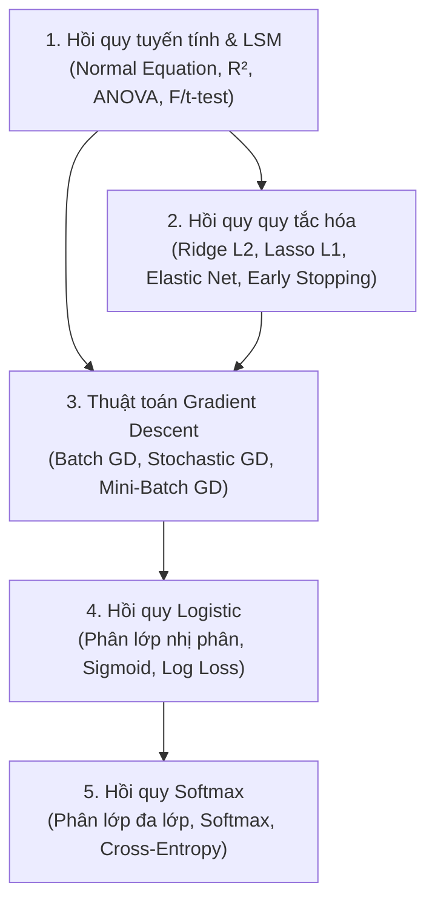

# Chương 4: Mô hình Hồi quy & Tối ưu hóa (Regression & Optimization)

> Tài liệu tổng hợp & chuyên đề chi tiết từ bài giảng **Học máy thống kê (Statistical Machine Learning – DS102)**
> Trường Đại học Công nghệ Thông tin, ĐHQG TP.HCM (UIT)

## Nội dung chuyên đề

| # | Chuyên đề | Nội dung chính | Tài liệu gốc |
|---|-----------|----------------|--------------|
| 1 | [Hồi quy tuyến tính & Phương pháp bình phương bé nhất (LSM)](01_hoi_quy_tuyen_tinh_lsm.md) | Khái niệm hồi quy, tuyến tính hóa, LSM, công thức nghiệm ma trận $(\mathbf{X}^T\mathbf{X})^{-1}\mathbf{X}^T\mathbf{y}$, điều kiện Gauss-Markov, $R^2$, Adjusted $R^2$, ANOVA, kiểm định $F$ & $t$, thực hành `statsmodels` | `Chương 4-1` (Phần 1) |
| 2 | [Hồi quy tuyến tính quy tắc hóa (Ridge, Lasso, Elastic Net)](02_hoi_quy_quy_tac_hoa_ridge_lasso_elastic_net.md) | Overfitting, quy tắc hóa $L_2$ (Ridge), quy tắc hóa $L_1$ (Lasso & tính chất chọn lọc thuộc tính sparse model), Elastic Net, kỹ thuật dừng sớm (Early Stopping) | `Chương 4-1` (Phần 2) |
| 3 | [Thuật toán Gradient giảm (Gradient Descent)](03_thuat_toan_gradient_descent.md) | Giải tích nhiều biến, GD 1 biến & nhiều biến, tốc độ học $\eta$, Feature Scaling, Batch GD (BGD), Stochastic GD (SGD), Mini-batch GD, bảng so sánh thuật toán & xấp xỉ đạo hàm | `Chương 4-2-GD` |
| 4 | [Hồi quy Logistic (Logistic Regression)](04_hoi_quy_logistic.md) | Bài toán phân lớp nhị phân, xác suất có điều kiện, hàm Sigmoid, tỉ lệ Odds & Logit, biên quyết định (Decision Boundary), hợp lý cực đại (MLE), hàm mất mát Log Loss & đạo hàm, giải bài tập | `Chương 4-3-LogisticReg` |
| 5 | [Hồi quy Softmax (Softmax Regression)](05_hoi_quy_softmax.md) | Phân lớp đa lớp (Multiclass vs Multioutput), hàm Softmax, hàm đo Cross-Entropy (so sánh với MSE), hàm mất mát Cross-Entropy & vector gradient, thực hành phân lớp hoa Iris | `Chương 4-4-SoftmaxReg` |

## Lộ trình học gợi ý

## Tổng kết chương

1. **Hồi quy tuyến tính (Linear Regression)**: Dự báo biến mục tiêu liên tục bằng phương pháp bình phương bé nhất (LSM), giải bằng công thức nghiệm đóng hoặc tối ưu lặp, đánh giá qua $R^2$, $\bar{R}^2$, bảng ANOVA và các kiểm định thống kê ($F$-test, $t$-test).
2. **Quy tắc hóa (Regularization)**: Kiểm soát hiện tượng quá khớp (Overfitting) bằng cách thêm thành phần phạt vào hàm mất mát — **Ridge** ($L_2$) thu nhỏ hệ số đều đặn, **Lasso** ($L_1$) triệt tiêu hệ số của các thuộc tính dư thừa (*feature selection*), **Elastic Net** kết hợp cả hai, cùng kỹ thuật **Early Stopping**.
3. **Gradient Descent (GD)**: Phương pháp tối ưu lặp nền tảng của Học máy dựa trên chiều ngược vector đạo hàm riêng, với 3 biến thể chính: **Batch GD** (toàn bộ tập dữ liệu), **Stochastic GD** (từng mẫu ngẫu nhiên) và **Mini-Batch GD** (theo từng bó mẫu $2^k$).
4. **Hồi quy Logistic (Logistic Regression)**: Mô hình phân lớp nhị phân ước lượng xác suất qua hàm **Sigmoid**, định nghĩa biên quyết định tuyến tính $\boldsymbol{\theta}^T\mathbf{x} = 0$ và tối ưu hàm mất mát **Log Loss** (suy ra từ ước lượng hợp lý cực đại MLE).
5. **Hồi quy Softmax (Softmax Regression)**: Tổng quát hóa hồi quy Logistic cho bài toán phân lớp đa lớp (Multiclass) bằng hàm **Softmax** và tối ưu hàm mất mát **Cross-Entropy**.

## Tài liệu tham khảo

1. Aurélien Géron, *Hands-on Machine Learning with Scikit-Learn, Keras & TensorFlow*, 2nd Edition, O'Reilly Media, 2019.
2. Robert Tibshirani, *Regression Shrinkage and Selection via the Lasso*, Journal of the Royal Statistical Society, Series B (Methodological), Vol. 58, No. 1, pp. 267–288, 1996.
