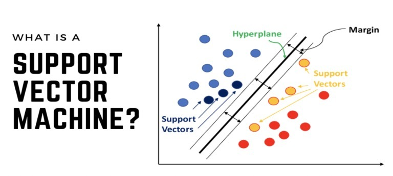
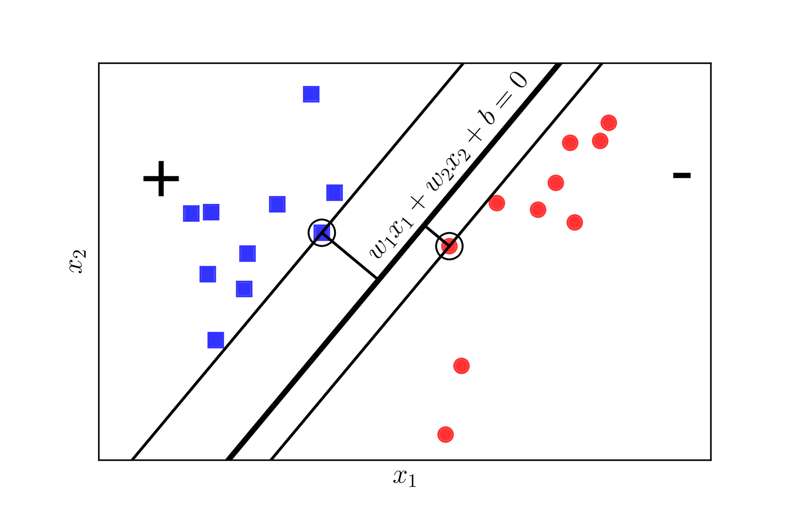
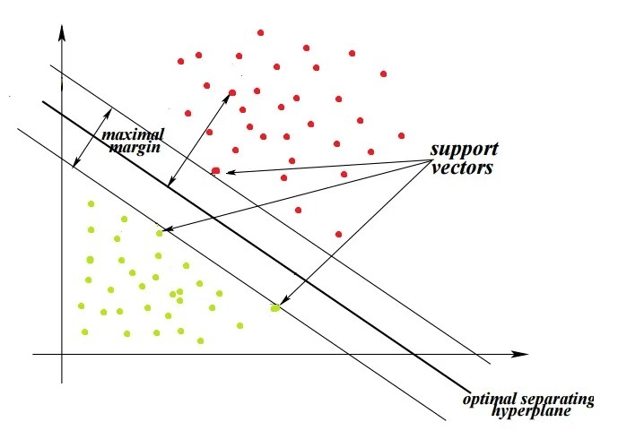
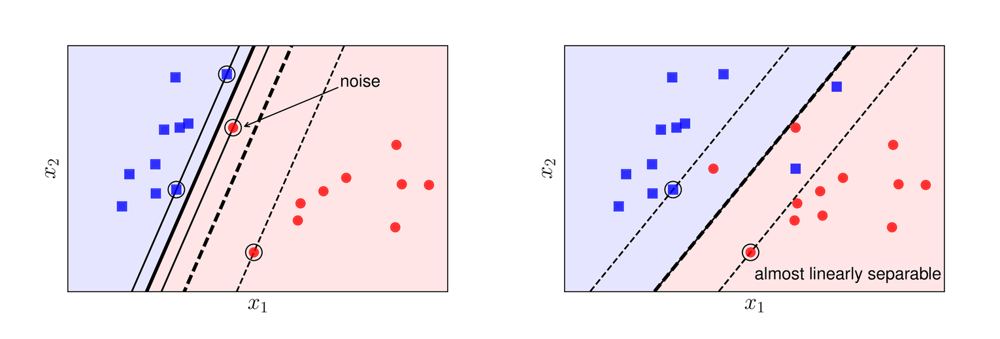
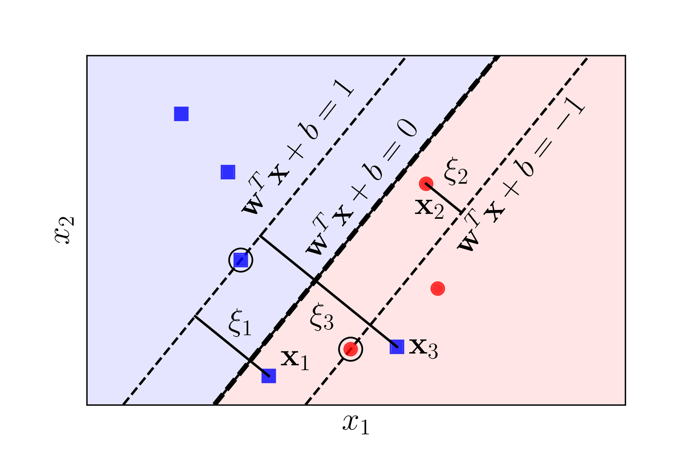
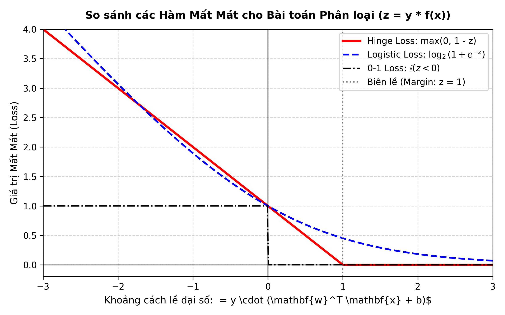
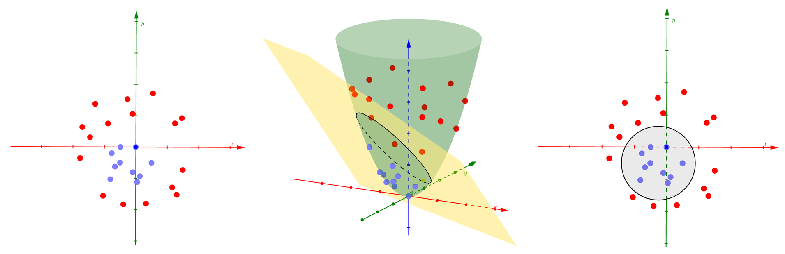
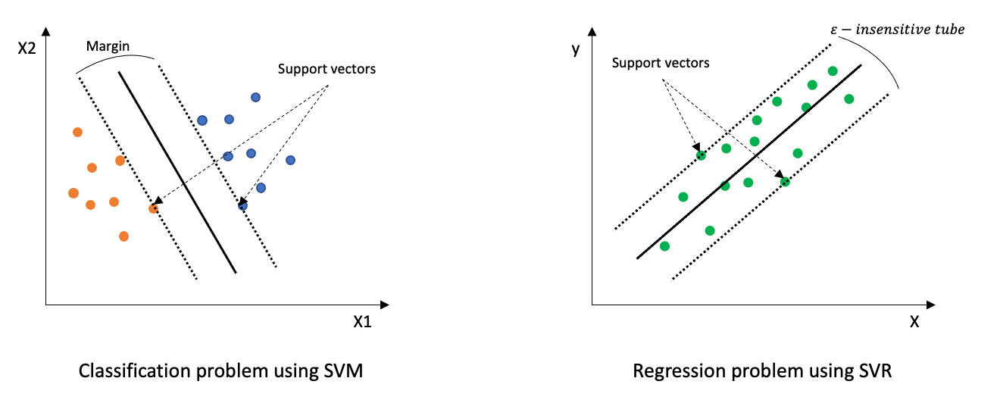
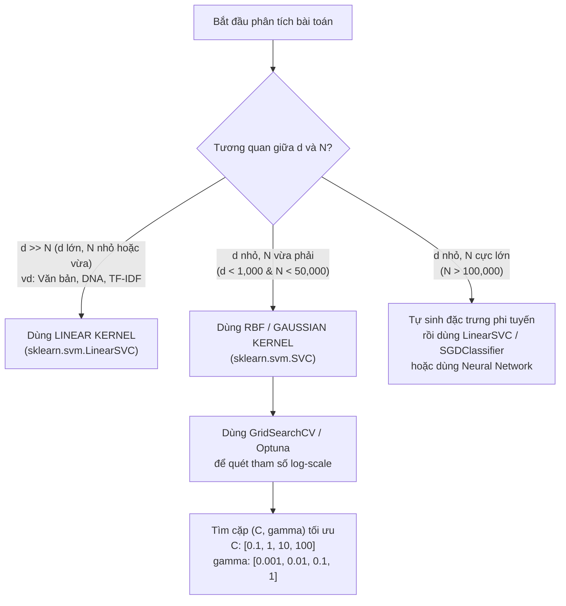

# Chuyên đề: Support Vector Machine (Máy Vector Hỗ Trợ – SVM)

> **Môn học:** Học Máy Thống Kê (Statistical Machine Learning – HMTK / DS102)  
> **Khoa:** Khoa học và Kỹ thuật Thông tin – Trường ĐH Công nghệ Thông tin, ĐHQG TP.HCM (UIT)  
> **Chủ đề:** Mô hình phân lớp & hồi quy biên cực đại (Maximum Margin Classifier), Không gian đối ngẫu Lagrangian, và Kỹ thuật Kernel phi tuyến.  
> 💡 **Thực hành tương tác:** [Bộ Bài Tập Tính Toán Tương Tác SVM (HTML)](bai_tap_tinh_toan_svm.html) – Cho phép tự nhập số liệu, giải từng bước và tự kiểm tra đáp số.

---

## Mục Lục
1. [Giới thiệu tổng quan & Động lực hình thành SVM](#1-giới-thiệu-tổng-quan--động-lực-hình-thành-svm)
   - 1.1. Giới hạn của Perceptron và Logistic Regression
   - 1.2. Ý tưởng cốt lõi: Phân loại biên cực đại (Maximum Margin)
   - 1.3. Các khái niệm nền tảng: Siêu phẳng, Lề, và Vector hỗ trợ
2. [SVM Tuyến tính với Lề cứng (Hard-Margin SVM)](#2-svm-tuyến-tính-với-lề-cứng-hard-margin-svm)
   - 2.1. Thiết lập bài toán hình học & Khoảng cách tới siêu phẳng
   - 2.2. Bài toán tối ưu hóa nguyên thủy (Primal Optimization Problem)
   - 2.3. Bài toán đối ngẫu Lagrange (Dual Formulation)
   - 2.4. Điều kiện Karush-Kuhn-Tucker (KKT) và bản chất Support Vectors
3. [SVM Tuyến tính với Lề mềm (Soft-Margin SVM)](#3-svm-tuyến-tính-với-lề-mềm-soft-margin-svm)
   - 3.1. Động lực: Xử lý dữ liệu nhiễu và ngoại lai (Outliers)
   - 3.2. Biến nới lỏng (Slack Variables) & Siêu tham số phạt $C$
   - 3.3. Dưới góc nhìn hàm mất mát: Hinge Loss và Quy tắc hóa L2
   - 3.4. Bài toán đối ngẫu với ràng buộc hộp (Box Constraints)
4. [SVM Phi tuyến & Kỹ thuật Kernel (Kernel Trick)](#4-svm-phi-tuyến--kỹ-thuật-kernel-kernel-trick)
   - 4.1. Định lý Cover & Ánh xạ lên không gian nhiều chiều
   - 4.2. Bản chất "mẹo" Kernel (Kernel Trick)
   - 4.3. Định lý Mercer & Ma trận Gram
   - 4.4. Các hàm Kernel kinh điển (Linear, Polynomial, RBF, Sigmoid)
   - 4.5. Phân tích trực quan tác động của $\gamma$ và $C$
5. [Mở rộng: SVM cho Hồi quy (SVR) và Đa lớp (Multi-class SVM)](#5-mở-rộng-svm-cho-hồi-quy-svr-và-đa-lớp-multi-class-svm)
   - 5.1. Support Vector Regression (SVR) & $\varepsilon$-Insensitive Loss
   - 5.2. Chiến lược phân loại đa lớp: One-vs-Rest (OvR) và One-vs-One (OvO)
6. [Cài đặt & Thực nghiệm bằng Python](#6-cài-đặt--thực-nghiệm-bằng-python)
   - 6.1. Tự cài đặt Linear SVM từ đầu bằng NumPy (Gradient Descent trên Hinge Loss)
   - 6.2. Ứng dụng thực tế với Scikit-Learn (`LinearSVC`, `SVC`, `SVR`)
   - 6.3. Trực quan hóa ranh giới phân lớp, lề và Support Vectors
7. [So sánh, Ưu nhược điểm & Best Practices](#7-so-sánh-ưu-nhược-điểm--best-practices)
   - 7.1. Bảng so sánh SVM với Logistic Regression & Deep Learning
   - 7.2. Tầm quan trọng sống còn của Chuẩn hóa dữ liệu (Feature Scaling)
   - 7.3. Cẩm nang lựa chọn Kernel và Tinh chỉnh siêu tham số

---

## 1. Giới thiệu tổng quan & Động lực hình thành SVM

### 1.1. Giới hạn của Perceptron và Logistic Regression

Trong bài toán phân loại nhị phân có giám sát, giả sử tập huấn luyện gồm $N$ mẫu dữ liệu $\mathcal{D} = \{(\mathbf{x}_i, y_i)\}_{i=1}^N$, với $\mathbf{x}_i \in \mathbb{R}^d$ và nhãn $y_i \in \{-1, +1\}$:

1. **Thuật toán Perceptron (PLA):**
   - Nếu dữ liệu khả phân tuyến tính (*linearly separable*), PLA hội tụ và tìm được một siêu phẳng phân tách hai lớp.
   - **Nhược điểm:** PLA có vô số nghiệm thỏa mãn. Nghiệm tìm được phụ thuộc hoàn toàn vào điểm bắt đầu và thứ tự nạp dữ liệu. Nhiều siêu phẳng nằm rất sát các điểm dữ liệu, khiến mô hình có độ nhạy rất cao với nhiễu và khả năng tổng quát hóa (*generalization*) kém trên tập kiểm thử (Test set).

2. **Hồi quy Logistic (Logistic Regression):**
   - Tối ưu hàm mất mát Log Loss trên toàn bộ tập dữ liệu dựa trên mô hình xác suất điều kiện:
     $$P(y = 1 \mid \mathbf{x}) = \sigma(\mathbf{w}^T \mathbf{x} + b) = \frac{1}{1 + e^{-(\mathbf{w}^T \mathbf{x} + b)}}$$
   - **Đặc điểm:** Mọi điểm dữ liệu (kể cả những điểm nằm rất xa ranh giới) đều đóng góp vào hàm mất mát và gradient. Khi tập dữ liệu có các điểm ngoại lai (*outliers*), siêu phẳng nghiệm có thể bị kéo lệch đáng kể.

<div align="center">
  
  <p><em>Hình 1.1: Trực quan hóa hình học: Perceptron tìm một siêu phẳng bất kỳ (dễ sát điểm dữ liệu), trong khi SVM tìm siêu phẳng có khoảng cách lề (margin) lớn nhất tới các điểm gần nhất.</em></p>
</div>

### 1.2. Ý tưởng cốt lõi: Phân loại biên cực đại (Maximum Margin)

Vladimir Vapnik và Alexey Chervonenkis (1963, 1995) đã đề xuất mô hình **Support Vector Machine (SVM)** dựa trên nguyên lý **Giảm thiểu Rủi ro Cấu trúc (Structural Risk Minimization - SRM)** thay vì Giảm thiểu Rủi ro Kinh nghiệm (Empirical Risk Minimization - ERM):
- Thay vì chỉ tìm một siêu phẳng phân tách bất kỳ, SVM tìm một siêu phẳng **cách xa các điểm dữ liệu gần nhất của cả hai lớp một khoảng lớn nhất có thể**.
- Khoảng cách này được gọi là **Lề (Margin)**.
- Khi lề đạt giá trị cực đại, vùng an toàn không có dữ liệu giữa hai lớp là rộng nhất, giúp mô hình đạt sai số tổng quát hóa nhỏ nhất khi gặp dữ liệu mới chưa từng thấy.

<div align="center">
  
  <p><em>Hình 1.2: Các thành phần cốt lõi của SVM: Siêu phẳng quyết định, hai siêu phẳng lề biên, và các Vector hỗ trợ (Support Vectors).</em></p>
</div>

### 1.3. Các khái niệm nền tảng: Siêu phẳng, Lề, và Vector hỗ trợ

1. **Siêu phẳng quyết định (Decision Hyperplane):**
   Trong không gian $d$ chiều, một siêu phẳng được xác định bởi vector pháp tuyến $\mathbf{w} \in \mathbb{R}^d$ và hệ số chệch $b \in \mathbb{R}$:
   $$\mathbf{w}^T \mathbf{x} + b = 0 \qquad (1)$$

2. **Hàm quyết định phân lớp (Decision Function):**
   Dự đoán nhãn $\hat{y}$ cho điểm $\mathbf{x}$ bằng hàm dấu (*signum*):
   $$\hat{y} = f(\mathbf{x}) = \text{sign}(\mathbf{w}^T \mathbf{x} + b) = \begin{cases} +1 & \text{nếu } \mathbf{w}^T \mathbf{x} + b \ge 0 \\ -1 & \text{nếu } \mathbf{w}^T \mathbf{x} + b < 0 \end{cases} \qquad (2)$$

3. **Vector hỗ trợ (Support Vectors):**
   Là các điểm dữ liệu nằm sát siêu phẳng nhất, nằm ngay trên hai mặt lề song song. Toàn bộ vị trí và góc nghiêng của siêu phẳng quyết định **chỉ phụ thuộc duy nhất vào các Support Vectors này**. Nếu ta di chuyển, thêm hoặc xóa các điểm dữ liệu khác (không phải support vectors), siêu phẳng quyết định hoàn toàn không đổi.

---

## 2. SVM Tuyến tính với Lề cứng (Hard-Margin SVM)

Áp dụng cho bài toán **dữ liệu phân tách tuyến tính hoàn hảo** (không có nhiễu, không có điểm nào bị gán nhãn sai).

### 2.1. Thiết lập bài toán hình học & Khoảng cách tới siêu phẳng

Khoảng cách hình học đại số từ một điểm $\mathbf{x}_i$ bất kỳ đến siêu phẳng $\mathbf{w}^T \mathbf{x} + b = 0$ được tính theo hình chiếu trực giao:

$$\gamma_i = \frac{|\mathbf{w}^T \mathbf{x}_i + b|}{\|\mathbf{w}\|_2} \qquad (3)$$

<div align="center">
  
  <p><em>Hình 2.1: Trực giác hình học về khoảng cách từ một điểm tới siêu phẳng phân tách trong không gian đặc trưng.</em></p>
</div>

Vì dữ liệu phân tách đúng nên $y_i(\mathbf{w}^T \mathbf{x}_i + b) > 0$ với mọi $i$. Do đó:

$$\gamma_i = \frac{y_i(\mathbf{w}^T \mathbf{x}_i + b)}{\|\mathbf{w}\|_2} \qquad (4)$$

Khoảng cách từ siêu phẳng đến điểm gần nó nhất trên toàn tập dữ liệu là:

$$\gamma = \min_{i=1,\dots,N} \frac{y_i(\mathbf{w}^T \mathbf{x}_i + b)}{\|\mathbf{w}\|_2} \qquad (5)$$

**Chuẩn hóa tỷ lệ (Scaling freedom):**  
Nếu nhân cả $\mathbf{w}$ và $b$ với một hằng số dương $k > 0$, phương trình siêu phẳng không thay đổi, và khoảng cách $\gamma_i$ cũng không đổi. Ta có thể tự do chọn tỉ lệ sao cho giá trị nhỏ nhất của tử số bằng $1$:

$$\min_{i=1,\dots,N} y_i(\mathbf{w}^T \mathbf{x}_i + b) = 1 \qquad (6)$$

Khi đó:
- Các điểm gần nhất thỏa mãn: $y_i(\mathbf{w}^T \mathbf{x}_i + b) = 1$ (chính là các **Support Vectors**).
- Hai siêu phẳng lề biên đi qua các Support Vectors là:
  $$\begin{cases} \mathbf{w}^T \mathbf{x} + b = +1 & \text{(Lớp dương)} \\ \mathbf{w}^T \mathbf{x} + b = -1 & \text{(Lớp âm)} \end{cases} \qquad (7)$$
- Chiều rộng của lề (khoảng cách giữa 2 siêu phẳng lề):
  $$\text{Margin} = \frac{1}{\|\mathbf{w}\|_2} - \left(-\frac{1}{\|\mathbf{w}\|_2}\right) = \frac{2}{\|\mathbf{w}\|_2} \qquad (8)$$

### 2.2. Bài toán tối ưu hóa nguyên thủy (Primal Optimization Problem)

Mục tiêu là cực đại hóa độ rộng lề $\dfrac{2}{\|\mathbf{w}\|}$, tương đương với việc cực tiểu hóa $\|\mathbf{w}\|$ hay $\dfrac{1}{2}\|\mathbf{w}\|^2$ (để thuận tiện cho việc lấy đạo hàm), với điều kiện tất cả các điểm đều được phân lớp chính xác ngoài lề:

$$\begin{aligned}
\min_{\mathbf{w}, b} \quad & \frac{1}{2} \|\mathbf{w}\|_2^2 = \frac{1}{2} \mathbf{w}^T \mathbf{w} \\
\text{thỏa mãn} \quad & y_i(\mathbf{w}^T \mathbf{x}_i + b) \ge 1, \quad \forall i = 1, \dots, N
\end{aligned} \qquad (9)$$

> [!NOTE]
> Đây là bài toán **Quy hoạch Toàn phương Lồi (Convex Quadratic Programming - QP)** với hàm mục tiêu lồi toàn phương và các ràng buộc bất đẳng thức affine tuyến tính. Do đó, bài toán luôn tồn tại **duy nhất một điểm cực tiểu toàn cục**.

### 2.3. Bài toán đối ngẫu Lagrange (Dual Formulation)

Để giải bài toán có ràng buộc (9), ta đưa vào các nhân tử Lagrange không âm $\alpha_i \ge 0$ ứng với từng ràng buộc $1 - y_i(\mathbf{w}^T \mathbf{x}_i + b) \le 0$.

Hàm Lagrange nguyên thủy:

$$\mathcal{L}_P(\mathbf{w}, b, \boldsymbol{\alpha}) = \frac{1}{2} \|\mathbf{w}\|^2 - \sum_{i=1}^N \alpha_i \Big[ y_i(\mathbf{w}^T \mathbf{x}_i + b) - 1 \Big] \qquad (10)$$

Lấy đạo hàm riêng theo các biến nguyên thủy $\mathbf{w}$ và $b$ rồi cho bằng $0$:

$$\frac{\partial \mathcal{L}_P}{\partial \mathbf{w}} = \mathbf{w} - \sum_{i=1}^N \alpha_i y_i \mathbf{x}_i = 0 \implies \mathbf{w} = \sum_{i=1}^N \alpha_i y_i \mathbf{x}_i \qquad (11)$$

$$\frac{\partial \mathcal{L}_P}{\partial b} = -\sum_{i=1}^N \alpha_i y_i = 0 \implies \sum_{i=1}^N \alpha_i y_i = 0 \qquad (12)$$

Thay (11) và (12) ngược trở lại (10):

$$\begin{aligned}
\mathcal{L}_D(\boldsymbol{\alpha}) &= \frac{1}{2}\left(\sum_{i=1}^N \alpha_i y_i \mathbf{x}_i\right)^T \left(\sum_{j=1}^N \alpha_j y_j \mathbf{x}_j\right) - \sum_{i=1}^N \alpha_i y_i \left(\sum_{j=1}^N \alpha_j y_j \mathbf{x}_j\right)^T \mathbf{x}_i - b\underbrace{\sum_{i=1}^N \alpha_i y_i}_{=0} + \sum_{i=1}^N \alpha_i \\
&= \sum_{i=1}^N \alpha_i - \frac{1}{2} \sum_{i=1}^N \sum_{j=1}^N \alpha_i \alpha_j y_i y_j (\mathbf{x}_i^T \mathbf{x}_j) \qquad (13)
\end{aligned}$$

Ta thu được **Bài toán đối ngẫu Lagrange (Dual Problem)** chỉ phụ thuộc vào $\boldsymbol{\alpha}$:

$$\begin{aligned}
\max_{\boldsymbol{\alpha}} \quad & \sum_{i=1}^N \alpha_i - \frac{1}{2} \sum_{i=1}^N \sum_{j=1}^N \alpha_i \alpha_j y_i y_j \mathbf{x}_i^T \mathbf{x}_j \\
\text{thỏa mãn} \quad & \alpha_i \ge 0, \quad \forall i = 1, \dots, N \\
& \sum_{i=1}^N \alpha_i y_i = 0
\end{aligned} \qquad (14)$$

### 2.4. Điều kiện Karush-Kuhn-Tucker (KKT) và bản chất Support Vectors

Vì bài toán thỏa mãn điều kiện Slater (ràng buộc affine lồi khả thi), tính chất đối ngẫu mạnh (*Strong Duality*) được đảm bảo. Bộ nghiệm $(\mathbf{w}^*, b^*, \boldsymbol{\alpha}^*)$ thỏa mãn hệ điều kiện KKT:

1. **Khả thi nguyên thủy (Primal Feasibility):**
   $$y_i({\mathbf{w}^*}^T \mathbf{x}_i + b^*) - 1 \ge 0, \quad \forall i = 1, \dots, N$$
2. **Khả thi đối ngẫu (Dual Feasibility):**
   $$\alpha_i^* \ge 0, \quad \forall i = 1, \dots, N$$
3. **Bù lỏng (Complementary Slackness):**
   $$\alpha_i^* \Big[ y_i({\mathbf{w}^*}^T \mathbf{x}_i + b^*) - 1 \Big] = 0, \quad \forall i = 1, \dots, N \qquad (15)$$

> [!IMPORTANT]
> **Ý nghĩa hình học của Điều kiện bù lỏng (15):**  
> Đối với mỗi điểm mẫu thứ $i$, xảy ra một trong hai khả năng:
> - **$\alpha_i^* = 0$:** Điểm dữ liệu thỏa mãn $y_i({\mathbf{w}^*}^T \mathbf{x}_i + b^*) > 1$, tức là nằm an toàn phía ngoài lề. Điểm này **hoàn toàn không tham gia** vào việc xây dựng $\mathbf{w}^*$ (xem công thức 11).
> - **$\alpha_i^* > 0$:** Bắt buộc $y_i({\mathbf{w}^*}^T \mathbf{x}_i + b^*) = 1$, tức là điểm dữ liệu nằm **chính xác trên siêu phẳng lề**. Đây chính là các **Support Vectors**!

<div align="center">
  
  <p><em>Hình 2.2: Các Support Vectors (điểm khoanh tròn) nằm trực tiếp trên hai siêu phẳng lề, trực tiếp quyết định vị trí siêu phẳng phân tách.</em></p>
</div>

Sau khi giải được $\boldsymbol{\alpha}^*$:
- Vector trọng số $\mathbf{w}^*$:
  $$\mathbf{w}^* = \sum_{i \in \text{SV}} \alpha_i^* y_i \mathbf{x}_i \qquad (16)$$
- Hệ số chệch $b^*$: Lấy một điểm Support Vector $s \in \text{SV}$ bất kỳ (có $\alpha_s^* > 0$), do $y_s({\mathbf{w}^*}^T \mathbf{x}_s + b^*) = 1$ (nhân 2 vế với $y_s \in \{-1, +1\}$ vì $y_s^2 = 1$):
  $$b^* = y_s - {\mathbf{w}^*}^T \mathbf{x}_s = y_s - \sum_{i \in \text{SV}} \alpha_i^* y_i (\mathbf{x}_i^T \mathbf{x}_s) \qquad (17)$$
  *(Trong thực hành, để tránh sai số số học, ta lấy trung bình cộng $b^*$ qua toàn bộ tập các Support Vectors).*

- **Hàm dự đoán nhãn cho mẫu mới $\mathbf{x}^*$:**
  $$f(\mathbf{x}^*) = \text{sign}\left({\mathbf{w}^*}^T \mathbf{x}^* + b^*\right) = \text{sign}\left( \sum_{i \in \text{SV}} \alpha_i^* y_i (\mathbf{x}_i^T \mathbf{x}^*) + b^* \right) \qquad (18)$$

---

## 3. SVM Tuyến tính với Lề mềm (Soft-Margin SVM)

### 3.1. Động lực: Xử lý dữ liệu nhiễu và ngoại lai (Outliers)

Trong các bài toán thực tế:
1. Dữ liệu thường có nhiễu hoặc các phân bố chồng lấn, **không thể phân tách tuyến tính hoàn hảo**. Khi đó Hard-Margin SVM không có nghiệm khả thi.
2. Ngay cả khi tách được, sự xuất hiện của một điểm ngoại lai nằm sâu sang lãnh thổ đối phương sẽ khiến lề bị thu hẹp đột ngột, dẫn đến hiện tượng **quá khớp (Overfitting)**.

<div align="center">
  
  <p><em>Hình 3.1: So sánh Hard-Margin (lề bị bóp nghẹt vì 1 ngoại lai đơn lẻ) và Soft-Margin (cho phép vi phạm nhẹ để giữ vùng đệm an toàn rộng).</em></p>
</div>

Cortes và Vapnik (1995) đã đề xuất **Lề mềm (Soft-Margin)** để cho phép mô hình phạm phải một số sai sót có kiểm soát trên tập huấn luyện.

### 3.2. Biến nới lỏng (Slack Variables) & Siêu tham số phạt $C$

Đưa vào các **biến nới lỏng (slack variables)** $\xi_i \ge 0$ cho từng mẫu dữ liệu:
- Ràng buộc mới:
  $$y_i(\mathbf{w}^T \mathbf{x}_i + b) \ge 1 - \xi_i, \quad \forall i = 1, \dots, N \qquad (19)$$

<div align="center">
  
  <p><em>Hình 3.2: Ý nghĩa hình học của biến nới lỏng $\xi_i$: $\xi_i = 0$ (ngoài lề), $0 < \xi_i \le 1$ (trong lề nhưng đúng lớp), và $\xi_i > 1$ (phân loại sai sang lớp đối diện).</em></p>
</div>

**Ý nghĩa của giá trị $\xi_i$:**
- $\xi_i = 0$: Điểm được phân loại đúng và nằm an toàn trên hoặc ngoài lề.
- $0 < \xi_i \le 1$: Điểm nằm giữa siêu phẳng quyết định và siêu phẳng lề, nhưng vẫn được phân loại đúng nhãn.
- $\xi_i > 1$: Điểm nằm vượt qua siêu phẳng quyết định sang phần lớp đối diện $\implies$ **Phân loại sai (Misclassified)**.

**Bài toán tối ưu nguyên thủy lề mềm:**

$$\begin{aligned}
\min_{\mathbf{w}, b, \boldsymbol{\xi}} \quad & \frac{1}{2} \|\mathbf{w}\|^2 + C \sum_{i=1}^N \xi_i \\
\text{thỏa mãn} \quad & y_i(\mathbf{w}^T \mathbf{x}_i + b) \ge 1 - \xi_i, \quad \forall i = 1, \dots, N \\
& \xi_i \ge 0, \quad \forall i = 1, \dots, N
\end{aligned} \qquad (20)$$

Trong đó $C > 0$ là **siêu tham số đánh đổi (Trade-off hyperparameter)** giữa độ rộng của lề và tổng sai số chấp nhận:
- **$C$ lớn:** Phạt rất nặng các điểm vi phạm lề. Mô hình cố gắng giảm tối đa $\sum \xi_i \implies$ Lề hẹp hơn, ít chịu lỗi trên tập train $\to$ Nguy cơ **Overfitting**.
- **$C$ nhỏ:** Phạt nhẹ các điểm vi phạm. Mô hình ưu tiên làm cho $\|\mathbf{w}\|$ nhỏ $\implies$ Lề rộng hơn, chấp nhận nhiều điểm vi phạm hơn $\to$ Nguy cơ **Underfitting**, nhưng tăng tính tổng quát hóa khi dữ liệu nhiễu cao.

### 3.3. Dưới góc nhìn hàm mất mát: Hinge Loss và Quy tắc hóa L2

Từ điều kiện ràng buộc $y_i(\mathbf{w}^T \mathbf{x}_i + b) \ge 1 - \xi_i$ và $\xi_i \ge 0$, ta có:
$$\xi_i \ge \max\big(0, 1 - y_i(\mathbf{w}^T \mathbf{x}_i + b)\big)$$

Tại điểm tối ưu, $\xi_i$ sẽ nhận giá trị nhỏ nhất có thể, tức là đúng bằng vế phải. Khi đó bài toán (20) có thể viết lại dưới dạng bài toán tối ưu **không ràng buộc** tương đương:

$$\min_{\mathbf{w}, b} \left[ \sum_{i=1}^N \underbrace{\max\big(0, 1 - y_i(\mathbf{w}^T \mathbf{x}_i + b)\big)}_{\text{Hàm mất mát Hinge (Hinge Loss)}} + \underbrace{\frac{1}{2C} \|\mathbf{w}\|^2}_{\text{Thành phần quy tắc hóa } L_2} \right] \qquad (21)$$

<div align="center">
  
  <p><em>Hình 3.3: So sánh hàm mất mát Hinge Loss của SVM với Logistic Loss và hàm 0-1 Loss theo khoảng cách lề đại số $z = y \cdot (\mathbf{w}^T \mathbf{x} + b)$.</em></p>
</div>

- Khi $y_i f(\mathbf{x}_i) \ge 1$: Điểm nằm đúng phía và ngoài lề $\implies$ Mất mát bằng $0$.
- Khi $y_i f(\mathbf{x}_i) < 1$: Mất mát tăng tuyến tính theo khoảng cách xâm lấn vào lề.

### 3.4. Bài toán đối ngẫu với ràng buộc hộp (Box Constraints)

Áp dụng nhân tử Lagrange $\alpha_i \ge 0$ và $\beta_i \ge 0$:

$$\mathcal{L}_P(\mathbf{w}, b, \boldsymbol{\xi}, \boldsymbol{\alpha}, \boldsymbol{\beta}) = \frac{1}{2}\|\mathbf{w}\|^2 + C\sum_{i=1}^N \xi_i - \sum_{i=1}^N \alpha_i \big[y_i(\mathbf{w}^T \mathbf{x}_i + b) - 1 + \xi_i\big] - \sum_{i=1}^N \beta_i \xi_i \qquad (22)$$

Triệt tiêu các đạo hàm riêng:
- $\dfrac{\partial \mathcal{L}_P}{\partial \mathbf{w}} = 0 \implies \mathbf{w} = \sum_{i=1}^N \alpha_i y_i \mathbf{x}_i$
- $\dfrac{\partial \mathcal{L}_P}{\partial b} = 0 \implies \sum_{i=1}^N \alpha_i y_i = 0$
- $\dfrac{\partial \mathcal{L}_P}{\partial \xi_i} = 0 \implies C - \alpha_i - \beta_i = 0 \implies \alpha_i \le C$ (do $\beta_i \ge 0$)

**Bài toán đối ngẫu Soft-Margin:**

$$\begin{aligned}
\max_{\boldsymbol{\alpha}} \quad & \sum_{i=1}^N \alpha_i - \frac{1}{2} \sum_{i=1}^N \sum_{j=1}^N \alpha_i \alpha_j y_i y_j (\mathbf{x}_i^T \mathbf{x}_j) \\
\text{thỏa mãn} \quad & 0 \le \alpha_i \le C, \quad \forall i = 1, \dots, N \quad \text{(Ràng buộc hộp - Box constraint)} \\
& \sum_{i=1}^N \alpha_i y_i = 0
\end{aligned} \qquad (23)$$

**Phân loại các điểm qua giá trị $\alpha_i$:**
1. $\alpha_i = 0$: Điểm nằm ngoài lề, phân loại đúng ($\xi_i = 0$).
2. $0 < \alpha_i < C$: Điểm là Support Vector **nằm chính xác trên đường lề** ($\xi_i = 0$, $y_i(\mathbf{w}^T \mathbf{x}_i + b) = 1$). Các điểm này được dùng để tính hệ số chệch $b^*$.
3. $\alpha_i = C$: Điểm là Support Vector **nằm lấn vào trong lề** hoặc phân loại sai ($\xi_i > 0$).

---

## 4. SVM Phi tuyến & Kỹ thuật Kernel (Kernel Trick)

### 4.1. Định lý Cover & Ánh xạ lên không gian nhiều chiều

Khi dữ liệu không thể phân tách tuyến tính trong không gian gốc $\mathbb{R}^d$ (ví dụ: bài toán XOR, các vòng tròn đồng tâm):

> [!NOTE]
> **Định lý Cover (Cover's Theorem on Separability of Patterns):**  
> Một không gian dữ liệu không phân tách tuyến tính sẽ có xác suất rất cao trở thành **phân tách tuyến tính được** khi được chiếu (ánh xạ phi tuyến) lên một không gian đặc trưng mới có **số chiều cao hơn đáng kể**.

Gọi $\phi(\mathbf{x})$ là hàm ánh xạ:
$$\mathbf{x} \in \mathbb{R}^d \mapsto \phi(\mathbf{x}) \in \mathcal{H} \quad (\text{với } \dim(\mathcal{H}) = D \gg d)$$

Khi đó phương trình siêu phẳng trong không gian mới $\mathcal{H}$ là:
$$\mathbf{w}^T \phi(\mathbf{x}) + b = 0 \qquad (24)$$

<div align="center">
  
  <p><em>Hình 4.1: Định lý Cover & Trực giác hình học: Dữ liệu 2D phi tuyến được ánh xạ lên paraboloid 3D $z = x_1^2 + x_2^2$ để phân tách bằng siêu phẳng, tương ứng đường cong phân tách trong không gian ban đầu.</em></p>
</div>

### 4.2. Bản chất "mẹo" Kernel (Kernel Trick)

Nếu tính toán trực tiếp:
1. Chiếu từng điểm: $\mathbf{x} \mapsto \phi(\mathbf{x})$. Nếu $D$ là hàng triệu chiều hoặc vô hạn chiều, vector $\phi(\mathbf{x})$ sẽ làm tràn bộ nhớ (*Curse of Dimensionality*).
2. Tính tích vô hướng $\phi(\mathbf{x}_i)^T \phi(\mathbf{x}_j)$.

**Quan sát then chốt:** Trong bài toán đối ngẫu (23) và hàm dự đoán (18), dữ liệu **chỉ xuất hiện dưới dạng tích vô hướng giữa hai điểm**:
$$\langle \phi(\mathbf{x}_i), \phi(\mathbf{x}_j) \rangle = \phi(\mathbf{x}_i)^T \phi(\mathbf{x}_j)$$

> [!IMPORTANT]
> **Định nghĩa Hàm Kernel:**  
> Một hàm số $K(\mathbf{x}, \mathbf{z})$ được gọi là **Kernel** nếu nó có thể tính trực tiếp tích vô hướng trong không gian chiều cao bằng các phép toán ngay tại không gian chiều thấp ban đầu:
> $$K(\mathbf{x}, \mathbf{z}) = \langle \phi(\mathbf{x}), \phi(\mathbf{z}) \rangle \qquad (25)$$
> Nhờ đó, ta **hoàn toàn không cần phải biết dạng tường minh của hàm ánh xạ $\phi(\mathbf{x})$ là gì**, cũng không cần lưu trữ tọa độ trong không gian chiều cao!

<div align="center">
  
  <p><em>Hình 4.2: Hàm Kernel $K(\mathbf{x}, \mathbf{z})$ đóng vai trò đường tắt tính toán (shortcut), cho ra kết quả tương đương tích vô hướng ở không gian vô số chiều.</em></p>
</div>

### 4.3. Định lý Mercer & Ma trận Gram

Một hàm $K(\mathbf{x}, \mathbf{z})$ được đảm bảo tương ứng với tích vô hướng của một không gian Hilbert nào đó khi và chỉ khi thỏa mãn **Định lý Mercer**:
1. **Tính đối xứng:** $K(\mathbf{x}, \mathbf{z}) = K(\mathbf{z}, \mathbf{x})$.
2. **Ma trận Gram (Kernel Matrix) $\mathbf{K} \in \mathbb{R}^{N \times N}$ với $K_{ij} = K(\mathbf{x}_i, \mathbf{x}_j)$ là nửa xác định dương (Positive Semi-Definite - PSD):**
   $$\forall \mathbf{c} \in \mathbb{R}^N, \quad \mathbf{c}^T \mathbf{K} \mathbf{c} = \sum_{i=1}^N \sum_{j=1}^N c_i c_j K(\mathbf{x}_i, \mathbf{x}_j) \ge 0 \qquad (26)$$

Tính chất nửa xác định dương đảm bảo bài toán tối ưu đối ngẫu vẫn là **bài toán QP lồi**, luôn có cực tiểu toàn cục duy nhất.

### 4.4. Các hàm Kernel kinh điển

| Tên Kernel | Công thức toán học $K(\mathbf{x}, \mathbf{z})$ | Không gian đặc trưng | Các siêu tham số chính |
| :--- | :--- | :--- | :--- |
| **Linear** | $\mathbf{x}^T \mathbf{z}$ | Bằng không gian gốc ($d$) | Không có thêm ngoài $C$ |
| **Polynomial** | $(\gamma \mathbf{x}^T \mathbf{z} + r)^d$ | Hữu hạn $\binom{d+n}{n}$ | Bậc $d$, hệ số $\gamma$, hệ số chệch $r$ (`coef0`) |
| **RBF (Gaussian)** | $\exp\left(-\gamma \|\mathbf{x} - \mathbf{z}\|^2\right)$ | **Vô hạn chiều ($\infty$)** | Hệ số co giãn $\gamma = \dfrac{1}{2\sigma^2}$ |
| **Sigmoid** | $\tanh(\gamma \mathbf{x}^T \mathbf{z} + r)$ | Tùy biến (mạng nơ-ron) | $\gamma, r$ (chú ý: chỉ PSD với một số giá trị) |

#### Khám phá RBF Kernel (Radial Basis Function):
Ánh xạ RBF tương ứng với một không gian có **vô hạn chiều**. Thật vậy, xét trường hợp $1$-D và $\sigma = 1$:

$$\begin{aligned}
K(x, z) &= \exp\left(-\frac{(x - z)^2}{2}\right) = \exp\left(-\frac{x^2}{2}\right) \exp\left(-\frac{z^2}{2}\right) \exp(xz) \\
&= \exp\left(-\frac{x^2}{2}\right) \exp\left(-\frac{z^2}{2}\right) \sum_{k=0}^{\infty} \frac{(xz)^k}{k!} \\
&= \sum_{k=0}^{\infty} \left[ e^{-\frac{x^2}{2}} \frac{x^k}{\sqrt{k!}} \right] \left[ e^{-\frac{z^2}{2}} \frac{z^k}{\sqrt{k!}} \right] = \phi(x)^T \phi(z)
\end{aligned}$$

Vector $\phi(x) = e^{-\frac{x^2}{2}} \left( 1, \frac{x}{\sqrt{1!}}, \frac{x^2}{\sqrt{2!}}, \dots, \frac{x^k}{\sqrt{k!}}, \dots \right)^T$ có vô hạn phần tử!

### 4.5. Phân tích trực quan tác động của $\gamma$ và $C$

Trong RBF Kernel $K(\mathbf{x}, \mathbf{z}) = \exp(-\gamma \|\mathbf{x} - \mathbf{z}\|^2)$:
- $\gamma$ (gamma) xác định **bán kính ảnh hưởng** của từng Support Vector riêng lẻ:
  - **$\gamma$ nhỏ:** Bán kính rộng, hình chuông Gaussian thoải $\implies$ Mô hình mượt mà, ranh giới quyết định gần như phẳng $\to$ Có thể **Underfitting**.
  - **$\gamma$ lớn:** Bán kính hẹp, hình chuông nhọn $\implies$ Mô hình uốn lượn ôm sát từng điểm dữ liệu $\to$ Dễ **Overfitting**.

| Tham số | $\gamma$ Nhỏ (Bán kính rộng) | $\gamma$ Lớn (Bán kính hẹp) |
| :--- | :--- | :--- |
| **$C$ Nhỏ** (Ưu tiên lề rộng, chấp nhận lỗi) | **Lề rất rộng, ranh giới phẳng**<br>Cho phép nhiều sai lệch dữ liệu.<br>⚠️ *Nguy cơ:* **Underfitting** | **Ranh giới linh hoạt, mềm mại**<br>Đề phòng nhiễu ngoại lai tốt.<br>✅ *Trạng thái:* **Cân bằng tốt** |
| **$C$ Lớn** (Phạt lỗi gắt gao, lề hẹp) | **Ranh giới có xu hướng phẳng**<br>Phạt lỗi nghiêm ngặt.<br>🔹 *Phù hợp nếu dữ liệu gần như tuyến tính* | **Ranh giới uốn lượn cục bộ**<br>Tạo các "ốc đảo" bao bọc từng điểm train.<br>🚨 *Nguy cơ:* **Overfitting nặng** |

---

## 5. Mở rộng: SVM cho Hồi quy (SVR) và Đa lớp (Multi-class SVM)

### 5.1. Support Vector Regression (SVR) & $\varepsilon$-Insensitive Loss

Không chỉ phân loại, SVM còn được mở rộng giải quyết bài toán hồi quy (ước lượng giá trị thực liên tục $y \in \mathbb{R}$):
- Ý tưởng: Tìm một dải băng ống có bề rộng $2\varepsilon$ bao quanh hàm hồi quy $f(\mathbf{x}) = \mathbf{w}^T \mathbf{x} + b$.
- Mọi điểm dữ liệu rơi **bên trong ống sai số $\pm \varepsilon$ đều không bị tính tổn thất** (loss = 0).
- Chỉ những điểm **nằm ngoài dải băng ống** mới bị phạt theo khoảng cách lệch, gọi là hàm mất mát $\varepsilon$-không nhạy ($\varepsilon$-insensitive loss function):
  $$\mathcal{L}_\varepsilon(y, f(\mathbf{x})) = \max(0, |y - f(\mathbf{x})| - \varepsilon) \qquad (27)$$

<div align="center">
  
  <p><em>Hình 5.1: Nguyên lý dải băng sai số $\pm \varepsilon$ trong Support Vector Regression (SVR): các mẫu nằm trong vùng đệm sai số có tổn thất bằng 0.</em></p>
</div>

<div align="center">
  
  <p><em>Hình 5.2: Minh họa biến nới lỏng $\xi_i, \xi_i^*$ đối với các điểm vượt ra ngoài dải băng trên hoặc dưới.</em></p>
</div>

### 5.2. Chiến lược phân loại đa lớp: One-vs-Rest (OvR) và One-vs-One (OvO)

Vốn là bộ phân loại nhị phân nguyên bản, SVM xử lý bài toán $K$ lớp ($K > 2$) qua hai chiến lược:

1. **One-vs-Rest (OvR / One-vs-All):**
   - Huấn luyện $K$ mô hình SVM nhị phân độc lập. Mô hình thứ $k$ phân biệt giữa Lớp $k$ với tất cả các lớp còn lại gộp lại.
   - Khi dự báo: Chọn lớp có giá trị hàm quyết định lớn nhất: $\hat{y} = \arg\max_{k=1,\dots,K} (\mathbf{w}_k^T \mathbf{x} + b_k)$.
   - **Ưu điểm:** Cần ít mô hình ($K$ bộ phân loại), chạy nhanh.

2. **One-vs-One (OvO):**
   - Huấn luyện $\dfrac{K(K-1)}{2}$ mô hình SVM nhị phân cho mọi cặp $(k_i, k_j)$ phân biệt.
   - Khi dự báo: Cho mỗi mẫu chạy qua toàn bộ các bộ phân loại nhị phân, tiến hành bỏ phiếu (*voting*), nhãn nhận được nhiều phiếu bầu nhất sẽ thắng cuộc.
   - **Ưu điểm:** Mỗi bộ phân loại chỉ cần học trên tập con gồm 2 lớp nên dữ liệu huấn luyện nhỏ hơn, giải quyết tốt hiện tượng mất cân bằng mẫu khi dùng kernel phi tuyến. (Mặc định trong `sklearn.svm.SVC`).

---

## 6. Cài đặt & Thực nghiệm bằng Python

### 6.1. Tự cài đặt Linear SVM từ đầu bằng NumPy (Gradient Descent trên Hinge Loss)

Dưới đây là mã nguồn cài đặt lớp `LinearSVMScratch` thuần túy sử dụng **Subgradient Descent** trên hàm mục tiêu lề mềm (21):

```python
import numpy as np

class LinearSVMScratch:
    """
    Cài đặt Linear SVM từ đầu bằng phương pháp Subgradient Descent
    trên hàm mất mát Hinge Loss kết hợp Regularization L2.
    """
    def __init__(self, learning_rate=0.001, C=1.0, n_iters=1000):
        self.lr = learning_rate
        self.C = C
        self.n_iters = n_iters
        self.w = None
        self.b = None

    def fit(self, X, y):
        # Đảm bảo nhãn nhận giá trị {-1, +1}
        y_ = np.where(y <= 0, -1, 1)
        n_samples, n_features = X.shape

        # Khởi tạo trọng số
        self.w = np.zeros(n_features)
        self.b = 0.0

        for epoch in range(self.n_iters):
            for idx, x_i in enumerate(X):
                # Kiểm tra điều kiện lề: y_i * (w^T x_i + b) >= 1
                condition = y_[idx] * (np.dot(x_i, self.w) + self.b) >= 1
                
                if condition:
                    # Nằm ngoài lề: Chỉ phạt L2 regularization
                    # Gradient của 1/2 ||w||^2 là w
                    grad_w = self.w / (self.C * n_samples)
                    grad_b = 0.0
                else:
                    # Vi phạm lề: Phạt cả L2 và Hinge loss
                    grad_w = self.w / (self.C * n_samples) - y_[idx] * x_i
                    grad_b = -y_[idx]

                # Cập nhật tham số theo hướng ngược gradient
                self.w -= self.lr * grad_w
                self.b -= self.lr * grad_b

    def decision_function(self, X):
        return np.dot(X, self.w) + self.b

    def predict(self, X):
        approx = self.decision_function(X)
        return np.where(approx >= 0, 1, 0)
```

### 6.2. Ứng dụng thực tế với Scikit-Learn (`LinearSVC`, `SVC`, `SVR`)

Thư viện Scikit-learn cung cấp 3 bộ công cụ SVM cốt lõi:
1. `LinearSVC`: Dựa trên thư viện C/C++ `liblinear`, tối ưu hóa chuyên biệt cho SVM tuyến tính trên tập dữ liệu lớn ($O(N)$).
2. `SVC`: Dựa trên `libsvm`, hỗ trợ đầy đủ các hàm Kernel phi tuyến (Polynomial, RBF, Sigmoid) với độ phức tạp tính toán giữa $O(N^2)$ và $O(N^3)$.
3. `SVR`: Dành cho bài toán hồi quy vector hỗ trợ.

```python
import numpy as np
import matplotlib.pyplot as plt
from sklearn import datasets
from sklearn.model_selection import train_test_split
from sklearn.preprocessing import StandardScaler
from sklearn.svm import SVC, LinearSVC
from sklearn.metrics import classification_report, accuracy_score

# 1. Tải bộ dữ liệu mẫu (Breast Cancer Wisconsin)
cancer = datasets.load_breast_cancer()
X, y = cancer.data, cancer.target

# 2. Phân chia tập huấn luyện và kiểm thử
X_train, X_test, y_train, y_test = train_test_split(
    X, y, test_size=0.25, random_state=42, stratify=y
)

# 3. BẮT BUỘC: Chuẩn hóa dữ liệu (StandardScaler)
scaler = StandardScaler()
X_train_scaled = scaler.fit_transform(X_train)
X_test_scaled = scaler.transform(X_test)

# 4. Huấn luyện SVM với Kernel RBF
svm_clf = SVC(kernel='rbf', C=1.0, gamma='scale', random_state=42)
svm_clf.fit(X_train_scaled, y_train)

# 5. Đánh giá chất lượng mô hình
y_pred = svm_clf.predict(X_test_scaled)
print(f"Accuracy trên Test set: {accuracy_score(y_test, y_pred) * 100:.2f}%")
print(f"Tổng số Support Vectors: {len(svm_clf.support_)}")
print(f"Số SV theo từng lớp: {svm_clf.n_support_}")
print("\nBáo cáo phân loại chi tiết:")
print(classification_report(y_test, y_pred, target_names=cancer.target_names))
```

### 6.3. Trực quan hóa ranh giới phân lớp, lề và Support Vectors

Đoạn mã sau vẽ chính xác siêu phẳng quyết định, 2 siêu phẳng lề $(\pm 1)$ và đánh dấu các vector hỗ trợ:

```python
def plot_svm_decision_boundary(clf, X, y, title="SVM Decision Boundary"):
    plt.figure(figsize=(9, 6))
    
    # Vẽ các điểm dữ liệu
    scatter = plt.scatter(X[:, 0], X[:, 1], c=y, cmap=plt.cm.coolwarm, s=50, edgecolors='k')
    
    # Tạo lưới tọa độ
    ax = plt.gca()
    xlim = ax.get_xlim()
    ylim = ax.get_ylim()
    
    xx = np.linspace(xlim[0], xlim[1], 200)
    yy = np.linspace(ylim[0], ylim[1], 200)
    YY, XX = np.meshgrid(yy, xx)
    xy = np.vstack([XX.ravel(), YY.ravel()]).T
    
    # Tính giá trị hàm quyết định trên lưới
    Z = clf.decision_function(xy).reshape(XX.shape)
    
    # Vẽ siêu phẳng quyết định (Z = 0) và hai biên lề (Z = -1, Z = +1)
    ax.contour(XX, YY, Z, colors=['blue', 'black', 'red'], levels=[-1, 0, 1],
               alpha=0.8, linestyles=['--', '-', '--'], linewidths=[1.5, 2.5, 1.5])
    
    # Khoanh tròn các Support Vectors
    if hasattr(clf, "support_vectors_"):
        ax.scatter(clf.support_vectors_[:, 0], clf.support_vectors_[:, 1], s=180,
                   linewidth=2, facecolors='none', edgecolors='gold', label='Support Vectors')
    
    plt.title(title, fontsize=14, fontweight='bold')
    plt.xlabel("Thuộc tính 1 (Đã chuẩn hóa)")
    plt.ylabel("Thuộc tính 2 (Đã chuẩn hóa)")
    plt.legend()
    plt.grid(True, linestyle=':', alpha=0.6)
    plt.show()

# Minh họa trên 2 đặc trưng đầu tiên
from sklearn.datasets import make_moons
X_moons, y_moons = make_moons(n_samples=150, noise=0.2, random_state=42)
rbf_svm = SVC(kernel='rbf', C=5.0, gamma=1.0)
rbf_svm.fit(X_moons, y_moons)
plot_svm_decision_boundary(rbf_svm, X_moons, y_moons, "RBF Kernel SVM trên Dữ liệu Hình Bán Nguyệt")
```

---

## 7. So sánh, Ưu nhược điểm & Best Practices

### 7.1. Bảng so sánh SVM với Logistic Regression & Deep Learning

| Tiêu chí so sánh | Hồi quy Logistic (Logistic Regression) | Máy Vector Hỗ Trợ (SVM) | Mạng nơ-ron sâu (Deep Learning) |
| :--- | :--- | :--- | :--- |
| **Nguyên lý cốt lõi** | Tối đa hóa xác suất hợp lý (MLE) | Cực đại hóa khoảng cách lề (SRM) | Tối ưu lan truyền ngược (Backprop) |
| **Bản chất hàm mất mát** | Log Loss (Binary Cross Entropy) | Hinge Loss + $L_2$ Regularization | Cross-Entropy, MSE, Huber... |
| **Điểm quyết định mô hình** | Toàn bộ dữ liệu đều ảnh hưởng | **Chỉ các Support Vectors** | Toàn bộ dữ liệu qua các mini-batch |
| **Bài toán tối ưu** | Lồi (Convex), giải bằng Gradient Descent | Quy hoạch toàn phương lồi (QP Convex) | Phi lồi (Non-convex), nhiều Local Minima |
| **Độ nhạy ngoại lai** | Dễ bị lệch do các điểm ở rất xa | Rất trơ với điểm nằm ngoài lề | Phụ thuộc vào kỹ thuật regularize/batching |
| **Xử lý phi tuyến** | Phải tự tạo đặc trưng thủ công | **Tự động qua Kernel Trick** | Học biểu diễn đặc trưng tự động |
| **Kích thước dữ liệu lý tưởng** | Phù hợp mọi kích cỡ dữ liệu | Hiệu quả nhất khi mẫu vừa ($N < 50,000$) | Yêu cầu dữ liệu lớn ($N > 100,000$) |
| **Giải thích kết quả** | Rất tốt (trọng số biểu diễn Log-Odds) | Trung bình (Linear) đến Rất khó (RBF) | Hộp đen (Black box) |

### 7.2. Tầm quan trọng sống còn của Chuẩn hóa dữ liệu (Feature Scaling)

> [!CAUTION]
> **Quy tắc bất di bất dịch:**  
> SVM tính toán trực tiếp khoảng cách Euclid và tích vô hướng giữa các điểm dữ liệu. Nếu một thuộc tính có biên độ lớn (ví dụ: Lương $10,000,000 - 50,000,000\text{ VNĐ}$) và một thuộc tính có biên độ nhỏ (ví dụ: Tuổi $18 - 60$), khoảng cách sẽ bị thuộc tính lớn chi phối hoàn toàn:
> - Siêu phẳng sẽ bị méo mó, lề trở nên không chính xác.
> - Thuật toán tối ưu QP hội tụ cực kỳ chậm hoặc không hội tụ.
> **Giải pháp:** Luôn sử dụng `StandardScaler` (hoặc `MinMaxScaler`) đưa tất cả các đặc trưng về cùng một phân bố trước khi truyền vào SVM.

### 7.3. Cẩm nang lựa chọn Kernel và Tinh chỉnh siêu tham số

Dựa trên số lượng mẫu ($N$) và số lượng đặc trưng ($d$):



#### Quy trình 4 bước tinh chỉnh SVM trong thực tế:
1. **Bước 1 (Tiền xử lý):** Loại bỏ ngoại lai cực đoan $\to$ Chuẩn hóa thang đo bằng `StandardScaler`.
2. **Bước 2 (Baseline):** Thử nghiệm trước với `LinearSVC(C=1.0)`. Nếu độ chính xác đã đủ cao, ưu tiên giữ lại vì tốc độ suy luận nhanh và dễ giải thích.
3. **Bước 3 (Nâng cao):** Chuyển sang `SVC(kernel='rbf')`.
4. **Bước 4 (Dò tham số):** Sử dụng `GridSearchCV` hoặc `RandomizedSearchCV` kết hợp với $K$-Fold Cross Validation trên dải số mũ:
   $$C \in \{0.01, 0.1, 1, 10, 100, 1000\}$$
   $$\gamma \in \{0.0001, 0.001, 0.01, 0.1, 1, 10\}$$
