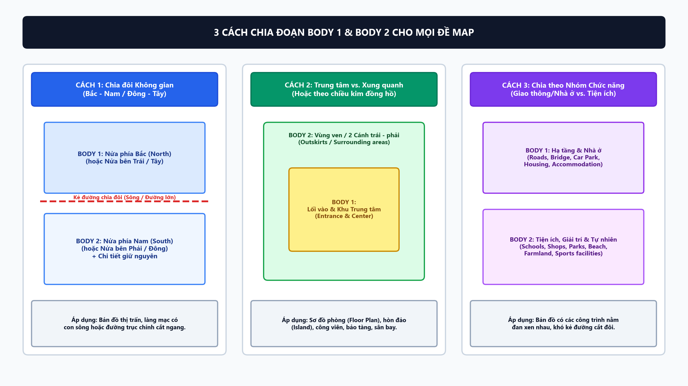
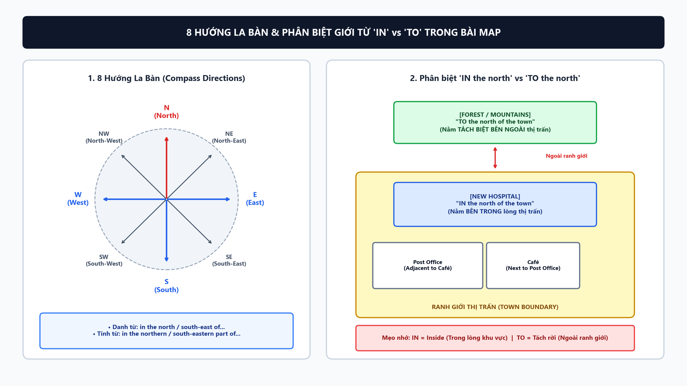
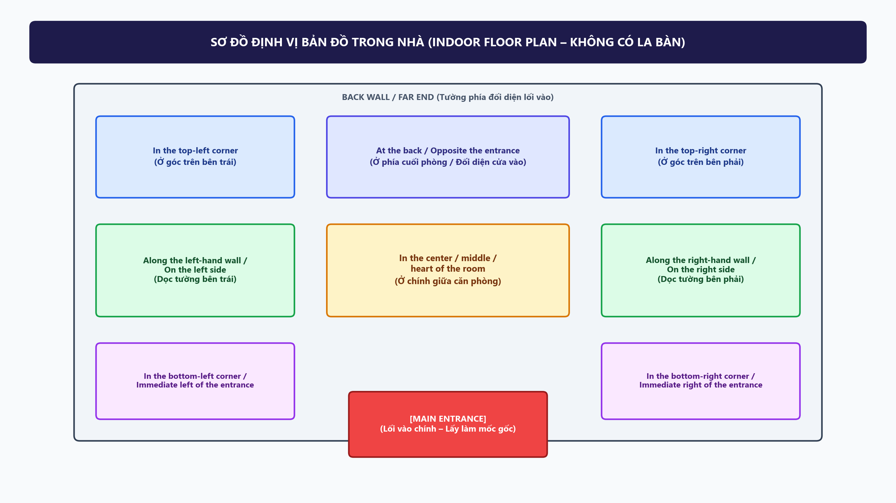
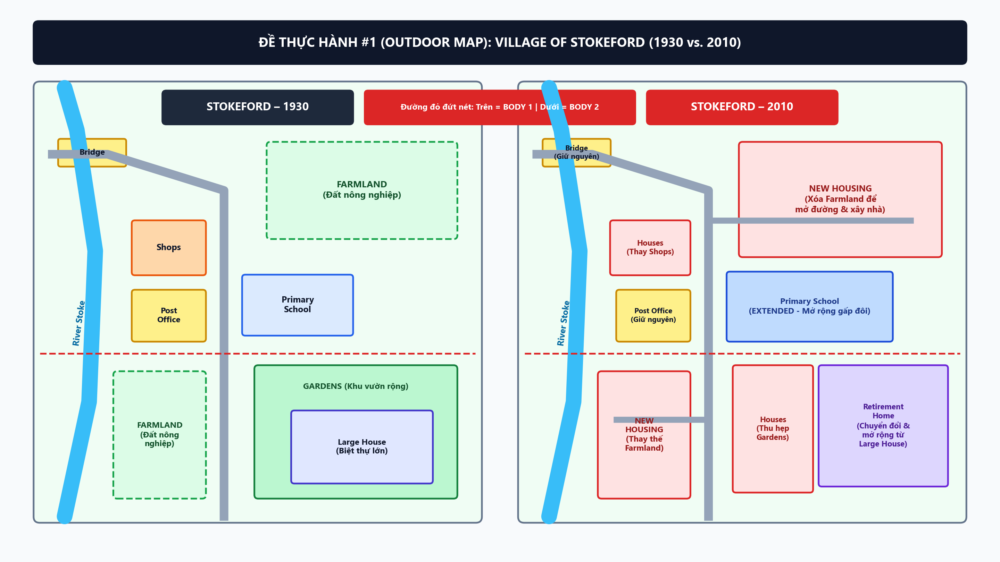
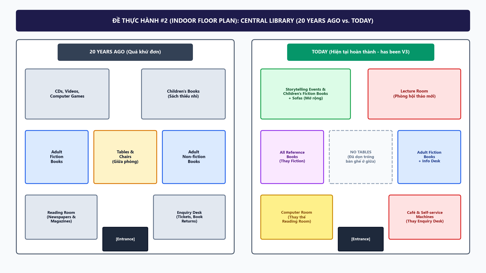

# 🎬 [VIDEO #01 – ALL-IN-ONE] Toàn tập IELTS Writing Task 1 MAP & FLOOR PLAN (Aim 7.5+)

> **Tài liệu gốc**: [01_Task1_Map_Mastery.md](../03_Writing/01_Task1_Map_Mastery.md)
> **Thư mục ảnh gắn vào Slide Canva**: [`assets/map_video/`](assets/map_video/) *(Tất cả ảnh đã được xuất sẵn chuẩn tỷ lệ 16:9 Full HD, bạn có thể tải về kéo thả trực tiếp vào Canva)*
> **Phong cách**: Đi thẳng vào kiến thức trọng tâm ngay từ câu đầu tiên, bao quát **100% mọi ngóc ngách của dạng bài Map** (cả Bản đồ Ngoài trời lẫn Sơ đồ Trong nhà).

---

## 📁 Danh sách 5 File Ảnh có sẵn để gắn vào Slide Canva

1. [`01_compass_and_prepositions.png`](assets/map_video/01_compass_and_prepositions.png) $\rightarrow$ Gắn vào **Slide 5** (8 hướng la bàn & phân biệt `IN` vs `TO`).
2. [`02_indoor_floor_plan_positions.png`](assets/map_video/02_indoor_floor_plan_positions.png) $\rightarrow$ Gắn vào **Slide 6** (Sơ đồ định vị bản đồ trong nhà – không có la bàn).
3. [`03_grouping_strategies.png`](assets/map_video/03_grouping_strategies.png) $\rightarrow$ Gắn vào **Slide 3** (3 Chiến thuật chia đoạn Body 1 & Body 2).
4. [`04_example1_stokeford_1930_2010.png`](assets/map_video/04_example1_stokeford_1930_2010.png) $\rightarrow$ Gắn vào **Slide 9 & Slide 10** (Đề thực hành #1: Bản đồ ngoài trời Làng Stokeford 1930 – 2010).
5. [`05_example2_library_floorplan_past_now.png`](assets/map_video/05_example2_library_floorplan_past_now.png) $\rightarrow$ Gắn vào **Slide 11** (Đề thực hành #2: Sơ đồ trong nhà Thư viện 20 năm trước – Hiện tại).

---

## 🎞️ Kịch bản chi tiết 11 Slides (Copy vào Canva & Đọc)

---

### 🔹 SLIDE 1: Phần 1 – Phân loại toàn diện các dạng bài Map (0:00 – 1:25)

#### 🖥️ Nội dung copy vào Slide Canva:
- **Tiêu đề**: **1. PHÂN LOẠI TẤT CẢ CÁC DẠNG BÀI MAP TRONG IELTS**
- **A. Theo Không gian (Quyết định từ vựng chỉ vị trí)**:
  1. **Outdoor Map (Ngoài trời)**: Làng, Thị trấn, Đảo $\rightarrow$ Có la bàn (**Đông, Tây, Nam, Bắc**).
  2. **Indoor Floor Plan (Trong nhà)**: Thư viện, Bảo tàng, Sân bay $\rightarrow$ Không có la bàn (**Lối vào, Trái/Phải, 4 Góc, Chính giữa**).
- **B. Theo Thời gian (Quyết định Thì - Tenses)**:
  1. **Quá khứ $\rightarrow$ Quá khứ** (`1930` – `2010`): **Quá khứ đơn** (`was constructed`, `was cleared`).
  2. **Quá khứ $\rightarrow$ Hiện tại** (`20 years ago` – `Now/Today`): **Hiện tại hoàn thành** (`has been converted`, `have been removed`).
  3. **Hiện tại $\rightarrow$ Tương lai** (`Now` – `2035 / Plan`): **Cấu trúc dự phóng** (`is planned/projected to be built`).
  4. **Static Map (1 bản đồ so sánh S1 vs. S2)**: **Hiện tại đơn** (`is located`, `lies`).

#### 🎙️ Lời đọc (Script):
> "Chào các bạn, đây là video tổng hợp toàn bộ kiến thức từ A đến Z về dạng bài **Map trong IELTS Writing Task 1**, bao gồm: Phân loại dạng bài, 4 tiêu chí chấm điểm, cấu trúc & cách chia đoạn, bộ từ vựng – ngữ pháp cho từng phần, và giải chi tiết 2 đề thực tế. `[nghỉ 1s]`
> Đầu tiên là **Phân loại các dạng bài Map**. Khi nhận đề, bạn cần nhìn ngay 2 yếu tố: **Không gian** và **Thời gian**.
> - Về **Không gian**, có 2 loại:
>   - Một là **Outdoor Map – Bản đồ ngoài trời** như ngôi làng, thị trấn, hòn đảo: Luôn có mũi tên la bàn, nên ta dùng 8 hướng Đông – Tây – Nam – Bắc.
>   - Hai là **Indoor Floor Plan – Sơ đồ mặt bằng trong nhà** như thư viện, bảo tàng, sân bay: Thường **không có la bàn**, nên ta phải định vị dựa vào cửa chính (*Entrance*), bên trái, bên phải, 4 góc phòng và chính giữa. `[nghỉ 1s]`
> - Về **Thời gian**, có 4 trường hợp quyết định **Thì** của toàn bài:
>   - Một: Cả 2 mốc đều ở quá khứ (như 1930 và 2010) $\rightarrow$ chia **Quá khứ đơn** (*was/were V3*).
>   - Hai: Từ quá khứ đến *Now* hoặc *Today* $\rightarrow$ bắt buộc chia **Hiện tại hoàn thành** (*has/have been V3*).
>   - Ba: Bản đồ thứ hai có chữ *Future, Plan* hoặc *Proposed* $\rightarrow$ dùng cấu trúc dự phóng như **is planned/projected to be V3**.
>   - Bốn: Dạng 1 bản đồ duy nhất so sánh 2 vị trí S1 và S2 $\rightarrow$ dùng **Hiện tại đơn**."

---

### 🔹 SLIDE 2: Phần 2 – 4 Tiêu chí đánh giá áp dụng riêng cho Map (1:25 – 2:35)

#### 🖥️ Nội dung copy vào Slide Canva:
- **Tiêu đề**: **2. BỐN TIÊU CHÍ CHẤM ĐIỂM BÀI MAP (AIM 7.5+)**
- **1. Task Achievement (TA – 25%)**:
  - Có **Overview** khái quát rõ bản chất biến đổi của khu vực.
  - Đầy đủ các thay đổi chính **và không bỏ sót những chi tiết giữ nguyên** (`remained unchanged`).
- **2. Coherence & Cohesion (CC – 25%)**:
  - Chia đoạn theo vùng không gian rõ ràng, không nhảy vị trí lộn xộn.
- **3. Lexical Resource (LR – 25%)**:
  - Đa dạng động từ theo 5 nhóm + Chính xác giới từ (`in` vs `to`, `adjacent to`, `opposite`).
- **4. Grammatical Range & Accuracy (GRA – 25%)**:
  - Kết hợp **Câu bị động (Passive)** + **Danh từ hóa (Nominalization)** + **Mệnh đề phân từ** + **Đảo ngữ**.

#### 🎙️ Lời đọc (Script):
> `[chuyển slide]` "Sang phần 2: **Làm sao để bài Map thỏa mãn cả 4 tiêu chí chấm điểm ở mức 7.5+?** `[nghỉ 1s]`
> - Tiêu chí 1 là **Task Achievement**: Bạn phải có đoạn Overview chỉ ra bức tranh tổng thể. Đặc biệt lưu ý: ở phần thân bài, ngoài những thứ mới xây, bạn **bắt buộc phải nhắc đến những chi tiết giữ nguyên không đổi** – bỏ quên phần giữ nguyên là lỗi khiến rất nhiều bài bị giới hạn ở Band 6.0.
> - Tiêu chí 2 là **Coherence & Cohesion**: Người đọc phải hình dung được bản đồ trong đầu theo một trật tự không gian hợp lý, không nhảy cóc từ góc Bắc xuống góc Nam rồi lại vòng lên Bắc. `[nghỉ 1s]`
> - Tiêu chí 3 là **Lexical Resource**: Không lặp lại từ *built* hay *changed*, biết phân biệt từ dùng cho nhà cửa (*demolished*) và từ dùng cho cây cối (*cleared/chopped down*).
> - Tiêu chí 4 là **Ngữ pháp (GRA)**: Phải kết hợp linh hoạt câu bị động, danh từ hóa, mệnh đề quan hệ rút gọn và câu ghép đối lập."

---

### 🔹 SLIDE 3: Phần 3 – Cấu trúc 4 Đoạn & 3 Cách chia Body (2:35 – 3:45)

#### 🖼️ Ảnh gắn vào Slide Canva:

#### 🖥️ Nội dung chữ trên Slide Canva (Nếu bạn muốn thêm ghi chú):
- **Khung 4 đoạn (9–11 câu | 160–190 từ)**: `Intro (1 câu)` $\rightarrow$ `Overview (2 câu)` $\rightarrow$ `Body 1 (3–4 câu)` $\rightarrow$ `Body 2 (3–4 câu)`.
- **3 Chiến thuật chia đoạn Body 1 & Body 2**: (Hiển thị trực tiếp trên hình `03_grouping_strategies.png`).

#### 🎙️ Lời đọc (Script):
> `[chuyển slide]` "Sang phần 3: **Cấu trúc bài viết 4 đoạn và 3 chiến thuật chia đoạn Body cho mọi đề Map**. `[nghỉ 1s]`
> Bài viết của chúng ta luôn cố định 4 đoạn: **Introduction** (1 câu), **Overview** (2 câu), **Body 1** (3–4 câu) và **Body 2** (3–4 câu). Câu hỏi lớn nhất khi vào phòng thi là: *Làm sao chia đôi bản đồ cho Body 1 và Body 2?* Các bạn nhìn vào 3 cách trên màn hình: `[nghỉ 1s]`
> - **Cách 1 – Chia đôi Không gian (Bắc – Nam hoặc Trái – Phải)**: Nếu bản đồ là ngôi làng, thị trấn có con sông hoặc đường lớn cắt ngang, bạn chỉ cần kẻ 1 đường chia đôi. Body 1 tả nửa phía Bắc, Body 2 tả nửa phía Nam.
> - **Cách 2 – Chia Trung tâm và Vùng ven (Hoặc theo chiều kim đồng hồ)**: Cực kỳ hiệu quả cho **Sơ đồ phòng (Floor Plan)** hoặc **Hòn đảo**. Body 1 bạn tả từ Lối vào chính (*Main Entrance*) đi thẳng vào khu Trung tâm (*Center*); còn Body 2 bạn quét một vòng các phòng ở 2 cánh và phía cuối phòng. `[nghỉ 1s]`
> - **Cách 3 – Chia theo Nhóm chức năng**: Khi các chi tiết nằm đan xen nhau, bạn gom Hạ tầng giao thông & Nhà ở vào Body 1; còn Tiện ích giải trí, Trường học & Tự nhiên vào Body 2."

---

### 🔹 SLIDE 4: Phần 4A – Bộ từ vựng cho Introduction & Overview (3:45 – 4:50)

#### 🖥️ Nội dung copy vào Slide Canva:
- **Tiêu đề**: **4A. KHUNG CÂU & TỪ VỰNG CHO INTRODUCTION & OVERVIEW**
- **📌 1. Introduction (Chọn 1 trong 3 tùy đề)**:
  - *Bản đồ ngoài trời*: `The two maps illustrate how [Địa điểm] developed over a [X]-year period from [Năm 1] to [Năm 2].`
  - *Sơ đồ trong nhà*: `The two floor plans compare the layout of [Tòa nhà] [X] years ago with its current configuration.`
  - *Đề tương lai*: `The maps depict the current layout of [Địa điểm] and the proposed plans for its future redevelopment.`
- **📌 2. Overview (2 câu)**:
  - *Câu 1 (Tổng quát)*: `Overall, the area underwent a dramatic transformation from a [rural village] into a [modern residential / tourist-oriented hub].` *(Hoặc: `has been significantly modernized and reorganized...`)*
  - *Câu 2 (Điểm nhấn)*: `The most notable changes include the complete clearance of [A], the expansion of [B], and the introduction of [C].`

#### 🎙️ Lời đọc (Script):
> `[chuyển slide]` "Sang phần 4: **Bộ từ vựng lắp ghép cho từng phần**. Đầu tiên là bộ khung viết nhanh **Introduction và Overview** trong 3 phút đầu tiên: `[nghỉ 1s]`
> - Ở **Introduction**, mình chia sẵn 3 câu mẫu cho 3 loại đề:
>   - Nếu là bản đồ ngoài trời qua các năm: *The two maps illustrate how [Địa điểm] developed over a [X]-year period from [Năm 1] to [Năm 2].*
>   - Nếu là sơ đồ mặt bằng trong nhà: Bạn đổi chữ *maps* thành **floor plans** và chữ *layout* thành **current configuration**.
>   - Nếu là đề quy hoạch tương lai: Dùng cụm **the proposed plans for its future redevelopment**. `[nghỉ 1s]`
> - Ở **Overview**, câu đầu tiên bạn dùng cụm ăn điểm: **underwent a dramatic transformation from A into B** (với đề quá khứ), hoặc **has been significantly modernized and reorganized** (với sơ đồ trong nhà hiện tại). Câu thứ hai bạn bắt đầu bằng **The most notable changes include...** cộng với các cụm danh từ hóa như *the clearance of, the expansion of, the introduction of*."

---

### 🔹 SLIDE 5: Phần 4B – Từ vựng Định vị Bản đồ Ngoài trời (4:50 – 5:50)

#### 🖼️ Ảnh gắn vào Slide Canva:

#### 🎙️ Lời đọc (Script):
> `[chuyển slide]` "Tiếp theo là từ vựng định vị cho **Bản đồ ngoài trời (Outdoor Map)** trên màn hình. `[nghỉ 1s]`
> - Nhìn vào khung bên trái: Ngoài 4 hướng chính Bắc – Nam – Đông – Tây, bạn cần nhớ 4 hướng góc là **North-East (Đông Bắc), North-West (Tây Bắc), South-East (Đông Nam) và South-West (Tây Nam)**. Khi muốn đổi gió không lặp lại danh từ *in the north of*, bạn hãy đổi sang tính từ thêm đuôi *-ern*: **in the northern / south-eastern part of...** `[nghỉ 1s]`
> - Nhìn sang khung bên phải là lỗi sai kinh điển nhất ở Band 6.0: Phân biệt **IN** và **TO**.
>   - Bạn dùng **IN** (*in the north of the town*) khi bệnh viện đó nằm **bên trong ranh giới** của thị trấn.
>   - Còn bạn dùng **TO** (*to the north of the town*) khi khu rừng hoặc tòa nhà đó nằm **tách biệt hẳn ra bên ngoài** ranh giới.
>   - Ngoài ra, nếu 2 công trình nằm sát vách nhau, hãy dùng **adjacent to** thay cho *next to*."

---

### 🔹 SLIDE 6: Phần 4C – Từ vựng Định vị Bản đồ Trong nhà (Floor Plan) (5:50 – 6:50)

#### 🖼️ Ảnh gắn vào Slide Canva:

#### 🎙️ Lời đọc (Script):
> `[chuyển slide]` "Vậy nếu đề thi ra **Sơ đồ mặt bằng trong nhà (Floor Plan)** không có mũi tên Đông – Tây – Nam – Bắc thì tả vị trí bằng từ gì? Bạn chỉ cần lưu lại đúng tấm sơ đồ trên màn hình: `[nghỉ 1s]`
> - Quy tắc vàng là luôn lấy **Cửa chính (Main Entrance)** làm mốc gốc:
>   - Ngay bên trái/phải lối vào là: **To the immediate left / right of the entrance** (hoặc **in the bottom-left / bottom-right corner**).
>   - Đi thẳng vào chính giữa căn phòng là: **In the center / middle / heart of the room**.
>   - Dọc hai bức tường hai bên là: **Along the left-hand / right-hand wall**.
>   - Phía cuối phòng, đối diện cửa vào là: **At the back / far end of the room (opposite the entrance)**.
>   - Và 2 góc trên cùng là: **In the top-left corner** và **In the top-right corner**. Có tấm bản đồ vị trí này, bất kỳ đề thư viện, bảo tàng hay sân bay nào bạn cũng định vị chính xác 100%!"

---

### 🔹 SLIDE 7: Phần 4D – 5 Nhóm Động từ & Danh từ hóa mô tả sự thay đổi (6:50 – 8:00)

#### 🖥️ Nội dung copy vào Slide Canva:
- **Tiêu đề**: **4D. BẢNG 5 NHÓM TỪ VỰNG MÔ TẢ SỰ THAY ĐỔI (BAND 7.5+)**

| Nhóm thay đổi | Động từ Bị động / Chủ động | Danh từ hóa (Nominalization) |
| :--- | :--- | :--- |
| **1. Xây mới / Thêm vào** | `be constructed / erected` *(nhà)* `be added / introduced / installed` *(tiện ích)* | `the construction / erection / addition / introduction of...` |
| **2. Phá bỏ / Dọn trống** | `be demolished / knocked down` *(nhà)* `be cleared / chopped down` *(cây/nông trại)* `be removed` *(bàn ghế/đồ đạc trong phòng)* | `the demolition / clearance / removal of...` |
| **3. Thay thế / Dời chỗ** | `be converted into / turned into / replaced by` `be relocated to` *(dời sang vị trí khác)* Chủ động: **`give way to` / `make way for`** | `the conversion of A into B` `the relocation of A to B` |
| **4. Mở rộng / Thu hẹp** | `be expanded / extended / enlarged / doubled in size` `be reduced in size / narrowed / shrunk` | `the expansion / extension / enlargement / reduction of...` |
| **5. Giữ nguyên** | Chủ động: **`remained unchanged` / `stayed intact`** Bị động: `be left untouched / preserved` | — |

#### 🎙️ Lời đọc (Script):
> `[chuyển slide]` "Sau khi chỉ xong vị trí, bạn kết hợp với **Bảng 5 nhóm động từ và danh từ hóa** trên màn hình để tả sự thay đổi: `[nghỉ 1s]`
> - **Nhóm 1 – Xây mới**: Công trình lớn dùng **was constructed / erected**; tiện ích hoặc đồ đạc trong phòng dùng **was added / introduced / installed**.
> - **Nhóm 2 – Phá bỏ**: Nhớ phân biệt 3 từ: Nhà cửa bị đập bỏ dùng **demolished / knocked down**; cây cối và đất ruộng bị giải tỏa dùng **cleared / chopped down**; còn bàn ghế trong phòng được dọn đi thì dùng **removed**. `[nghỉ 1s]`
> - **Nhóm 3 – Thay thế và Dời chỗ**: Khi chuyển đổi công năng, dùng **was converted into** hoặc chủ động **gave way to / made way for**. Đặc biệt trong sơ đồ phòng, khi một kệ sách chuyển từ bên trái sang bên phải, bạn dùng từ ăn điểm là **was relocated to**.
> - **Nhóm 4 – Mở rộng và Thu hẹp**: Dùng **expanded, extended, enlarged** hoặc **reduced in size**.
> - **Nhóm 5 – Giữ nguyên**: Dùng **remained unchanged** hoặc **stayed intact**."

---

### 🔹 SLIDE 8: Phần 4E – 4 Cấu trúc Ngữ pháp nâng cấp lên Band 7.5 – 8.0+ (8:00 – 9:10)

#### 🖥️ Nội dung copy vào Slide Canva:
- **Tiêu đề**: **4E. BỐN CẤU TRÚC NGỮ PHÁP ĂN ĐIỂM GRA 7.5 – 8.0+**
- **1. Mệnh đề phân từ rút gọn đứng đầu câu (`Located / Situated...`)**:
  - ✅ ***Located to the east of the main road**, the primary school was significantly extended.*
- **2. Đảo ngữ cụm giới từ chỉ nơi chốn (`In the [Vị trí] stands/lies [Danh từ]`)**:
  - ✅ ***In the top-right corner of the library now stands** a newly constructed lecture room.*
- **3. Gộp câu chỉ mục đích & đánh đổi (`to make way for` / `at the expense of`)**:
  - ✅ *The farmland **was cleared to make way for** new houses.*
  - ✅ *The retirement home was expanded **at the expense of** the surrounding gardens.*
- **4. Danh từ hóa với `witnessed / saw` (`witnessed the conversion of`)**:
  - ✅ *The bottom-right corner **witnessed the conversion of** the enquiry desk **into** a café.*

#### 🎙️ Lời đọc (Script):
> `[chuyển slide]` "Để điểm Ngữ pháp (GRA) bật hẳn lên 7.5 hoặc 8.0, thay vì chỉ viết câu đơn *S + was + V3*, bạn hãy cài 4 cấu trúc ngữ pháp nâng cao này vào bài: `[nghỉ 1s]`
> - **Cấu trúc 1 – Mệnh đề phân từ mở đầu câu**: Đưa cụm định vị *Located...* lên đầu câu: ***Located to the east of the main road**, the primary school was significantly extended.*
> - **Cấu trúc 2 – Đảo ngữ nơi chốn**: Đưa cụm giới từ chỉ vị trí lên đầu rồi đảo động từ *stands* hoặc *lies* lên trước chủ ngữ: ***In the top-right corner of the library now stands** a newly constructed lecture room.* `[nghỉ 1s]`
> - **Cấu trúc 3 – Gộp câu bằng `to make way for` hoặc `at the expense of`**: Cụm **at the expense of** cực kỳ hay khi cái A mở rộng làm cái B bị thu hẹp lại – ví dụ: Viện dưỡng lão được mở rộng *với cái giá là lấn vào* phần diện tích khu vườn xung quanh (*at the expense of the surrounding gardens*).
> - **Cấu trúc 4 – Danh từ hóa**: *The bottom-right corner **witnessed the conversion of** the enquiry desk **into** a café.*"

---

### 🔹 SLIDE 9: Phần 5A – Ứng dụng Đề #1 (Outdoor Map): Intro & Overview (9:10 – 10:20)

#### 🖼️ Ảnh gắn vào Slide Canva:

#### 🖥️ Nội dung chữ trên Slide Canva:
- **✍️ Introduction**:
  > *The two maps illustrate how the village of Stokeford developed over an 80-year period from 1930 to 2010.*
- **✍️ Overview**:
  > *Overall, the village underwent a dramatic transformation from a rural agricultural community into a densely populated residential area. The most notable changes include the complete clearance of farmland to construct new housing and the expansion of educational and care facilities.*

#### 🎙️ Lời đọc (Script):
> `[chuyển slide]` "Bây giờ chúng ta bước sang phần 5: **Ứng dụng giải chi tiết 2 đề thực chiến** – gồm 1 đề Bản đồ ngoài trời và 1 đề Sơ đồ trong nhà. `[nghỉ 1s]`
> Nhìn vào hình ảnh **Đề số 1 trên màn hình: Ngôi làng Stokeford năm 1930 và năm 2010**.
> Vì cả 2 mốc năm đều ở quá khứ, ta dùng **Quá khứ đơn**. Mình đã kẻ sẵn một đường đứt nét màu đỏ chia đôi bản đồ: Phần phía trên vạch đỏ là **Body 1**, phần phía dưới vạch đỏ là **Body 2**. `[nghỉ 1s]`
> Áp dụng viết ngay **Introduction và Overview**:
> - **Intro**: *The two maps illustrate how the village of Stokeford developed over an 80-year period from 1930 to 2010.*
> - **Overview**: Câu 1 nêu sự lột xác từ làng nông nghiệp thành khu dân cư đông đúc: *Overall, the village underwent a dramatic transformation from a rural agricultural community into a densely populated residential area.* Câu 2 dùng danh từ hóa điểm tên 2 thay đổi lớn nhất: *The most notable changes include the complete clearance of farmland to construct new housing and the expansion of educational and care facilities.*"

---

### 🔹 SLIDE 10: Phần 5B – Ứng dụng Đề #1 (Outdoor Map): Body 1 & Body 2 (10:20 – 11:40)

#### 🖼️ Ảnh gắn vào Slide Canva (Để góc nhỏ hoặc chia đôi màn hình):

#### 🖥️ Nội dung chữ trên Slide Canva:
- **✍️ Body 1 (Phía trên vạch đỏ – Bắc & Trung tâm)**:
  > *Looking first at the northern and central sections, the River Stoke running from north to south and the bridge at the northern end **remained unchanged** throughout the period. However, the vast farmland **in the north-east** **was completely cleared to make way for** new roads lined with residential houses. Along the main road, while the post office **stayed intact**, the two shops **adjacent to** it **were demolished and replaced by** additional housing units.*
- **✍️ Body 2 (Phía dưới vạch đỏ – Phía Nam)**:
  > *Turning to the southern half of the village, **located to the east of** the main road, the primary school **was significantly extended** with two new building wings. Further south, the large house **was converted into** a retirement home and expanded **at the expense of** the surrounding gardens, which **were reduced in size** to construct more houses. Furthermore, the farmland **in the south-west** also **gave way to** new residential developments.*

#### 🎙️ Lời đọc (Script):
> `[chuyển slide]` "Tiếp tục nhìn vào bản đồ Stokeford để viết **Body 1 và Body 2**: `[nghỉ 1s]`
> - **Body 1 (Tả nửa trên vạch đỏ)**: Đầu tiên nhắc ngay sông Stoke và cây cầu giữ nguyên bằng **remained unchanged**. Tiếp theo, khu đất nông nghiệp ở góc Đông Bắc bị giải tỏa hoàn toàn để nhường chỗ cho đường mới và nhà dân: *the vast farmland in the north-east **was completely cleared to make way for** new roads lined with residential houses*. Dọc trục đường chính, trong khi bưu điện giữ nguyên (**stayed intact**), thì 2 cửa hàng sát cạnh nó (**adjacent to it**) bị phá bỏ và thay bằng nhà ở (**were demolished and replaced by additional housing units**). `[nghỉ 1s]`
> - **Body 2 (Tả nửa dưới vạch đỏ)**: Mở đầu bằng mệnh đề phân từ: ***Located to the east of the main road**, the primary school **was significantly extended*** (trường tiểu học được mở rộng gấp đôi). Đi xuống phía Nam, căn biệt thự lớn được chuyển thành viện dưỡng lão và mở rộng lấn vào diện tích khu vườn: *the large house **was converted into** a retirement home and expanded **at the expense of** the surrounding gardens*. Cuối cùng, mảnh đất nông nghiệp ở góc Tây Nam cũng nhường chỗ cho nhà mới (**gave way to new residential developments**)."

---

### 🔹 SLIDE 11: Phần 5C – Ứng dụng Đề #2 (Indoor Floor Plan – Hiện tại hoàn thành) (11:40 – Kết thúc)

#### 🖼️ Ảnh gắn vào Slide Canva:

#### 🖥️ Nội dung chữ trên Slide Canva:
- **✍️ Intro & Overview**:
  > *The two floor plans compare the layout of Central Library 20 years ago with its current configuration. Overall, the library **has been significantly modernized** to incorporate more digital facilities, event spaces, and a café, while the central area **has been opened up** by removing the seating.*
- **✍️ Body 1 (Lối vào, Trung tâm & 2 cánh giữa)**:
  > *Looking first at the entrance and central section, the main entrance at the bottom **has remained in the same location**, whereas the tables and chairs **in the middle of the library** **have been completely removed**. **To the immediate left of the entrance**, the reading room **has been replaced by** a computer room, while on the bottom-right side, the enquiry desk **has given way to** a café and self-service machines. Along the side walls, adult fiction books **have been relocated** from the left to the right-hand section alongside a new information desk, whereas the left side now houses all reference books.*
- **✍️ Body 2 (Hai góc phía cuối phòng)**:
  > *Turning to the back of the library, the room **in the top-left corner** **has been enlarged and converted into** a space for storytelling events equipped with sofas. Finally, **in the top-right corner now stands** a dedicated lecture room in place of the former children's book section.*

#### 🎙️ Lời đọc (Script):
> `[chuyển slide]` "Và để các bạn tự tin 100% với cả dạng bản đồ trong nhà, chúng ta xem nhanh **Đề thực hành số 2 trên màn hình: Sơ đồ Thư viện trung tâm cách đây 20 năm và Hiện tại (Today)**. `[nghỉ 1s]`
> Lưu ý hai điểm khác biệt lớn nhất ở đề này: Thứ nhất, vì mốc thứ 2 là *Today*, toàn bộ động từ phải chia ở **Hiện tại hoàn thành (`has/have been + V3`)**. Thứ hai, vì không có la bàn, ta áp dụng đúng sơ đồ định vị trong nhà và **Cách chia nhóm số 2 (Trung tâm & Vùng ven)**: `[nghỉ 1s]`
> - **Overview**: Thư viện đã được hiện đại hóa đáng kể (**has been significantly modernized**) để thêm tiện ích công nghệ và quán cà phê, trong khi khu vực trung tâm được giải phóng không gian bằng cách dọn bỏ bàn ghế.
> - **Body 1 (Tả Lối vào, Trung tâm và 2 bên tường giữa)**: Lối vào ở cạnh dưới giữ nguyên, trong khi bàn ghế ở chính giữa phòng đã được dọn sạch (**have been completely removed**). Ngay bên trái lối vào (**To the immediate left of the entrance**), phòng đọc báo được thay bằng phòng máy tính; còn góc dưới bên phải, quầy lễ tân nhường chỗ cho quán cà phê và máy tự phục vụ (**has given way to a café and self-service machines**). Dọc hai bức tường giữa, kệ sách tiểu thuyết người lớn được dời từ bên trái sang bên phải (**have been relocated**), nhường bên trái cho sách tham khảo. `[nghỉ 1s]`
> - **Body 2 (Tả 2 góc cuối thư viện)**: Ở góc trên bên trái (**in the top-left corner**), phòng đĩa CD cũ được mở rộng và chuyển đổi thành khu kể chuyện có ghế sofa. Cuối cùng, áp dụng cấu trúc đảo ngữ cho góc trên bên phải: ***in the top-right corner now stands** a dedicated lecture room* thay thế cho khu sách thiếu nhi cũ. `[nghỉ 1s]`
> Toàn bộ 5 tấm hình sơ đồ chất lượng cao, bảng từ vựng và 2 bài mẫu Band 7.5+ này mình đã để sẵn trong link GitHub dưới phần mô tả. Chúc các bạn ôn tập thật tốt và hẹn gặp lại ở video tiếp theo!"
