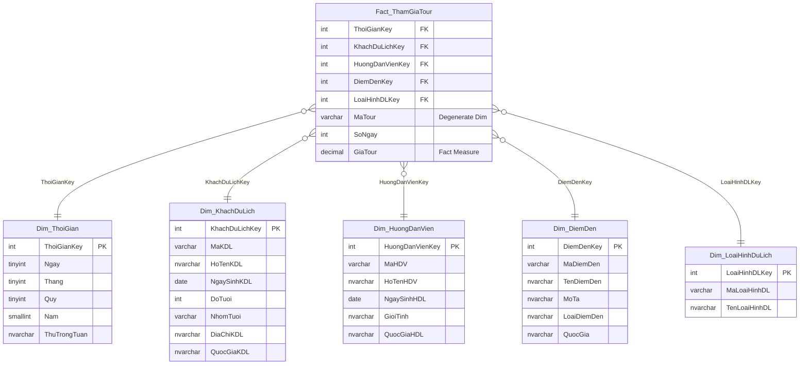

# ĐỀ THI CUỐI KỲ - HỌC KỲ 2, NĂM HỌC 2023 - 2024
## MÔN: KHO DỮ LIỆU & OLAP (DATA WAREHOUSE & OLAP)
**Trường Đại học Công nghệ Thông tin – ĐHQG-HCM**  
**Khoa Hệ thống Thông tin**  
*Thời gian làm bài: 90 phút (Không được phép sử dụng tài liệu)*  
*Nguồn đề gốc: `C:\Users\GIGA\Downloads\DeThiCuoiKy_KhoDLOLAP_HK2-20232024.pdf`*

---

## I. TÓM TẮT ĐỀ BÀI VÀ CƠ SỞ DỮ LIỆU NGUỒN (OLTP)

Một công ty du lịch tổ chức các chuyến đi có hướng dẫn cho khách du lịch thuộc các quốc tịch khác nhau. Cơ quan này muốn biết các xu hướng chính về các chuyến đi cả về **địa điểm đã ghé thăm** và **loại người tham gia**.

Lược đồ cơ sở dữ liệu quan hệ ban đầu (OLTP):
- **KHACHDULICH** (<ins>MaKDL</ins>, HoTenKDL, NgaySinhKDL, DiaChiKDL, QuocGiaKDL)  
  *Tân từ:* Mỗi khách du lịch có một mã số, họ tên, ngày sinh, địa chỉ và thuộc một quốc gia.
- **HUONGDANVIEN** (<ins>MaHDL</ins>, HoTenHDL, NgaySinhHDL, GioiTinh, QuocGiaHDL)  
  *Tân từ:* Mỗi hướng dẫn viên có một mã số, họ tên, ngày sinh, giới tính và thuộc một quốc gia. *(Ghi chú: thuộc tính khóa này liên kết với MaHDV trong bảng TOURDULICH)*.
- **DIEMDEN** (<ins>MaDiemDen</ins>, Ten, MoTa, LoaiDiemDen, QuocGia)  
  *Tân từ:* Mỗi điểm đến có một mã số, tên, mô tả, loại điểm đến (*vùng du lịch, trung tâm du lịch, điểm du lịch và khu du lịch*) và thuộc một quốc gia.
- **LOAIHINHDULICH** (<ins>MaLoaiHinhDL</ins>, TenLoaiHinhDL)  
  *Tân từ:* Mỗi loại hình du lịch có một mã số, tên (*du lịch nghỉ dưỡng, du lịch sinh thái, du lịch văn hóa – lịch sử, du lịch thể thao, du lịch giải trí, du lịch khám phá, du lịch MICE, du lịch mạo hiểm, du lịch ẩm thực, du lịch teambuilding*).
- **TOURDULICH** (<ins>MaTour</ins>, MaDiemDen, MaHDV, MaLoaiHinhDL, NgayDi, SoNgay)  
  *Tân từ:* Mỗi tour du lịch có một mã số, điểm đến, người hướng dẫn, loại hình du lịch, ngày đi, số ngày.
- **NHOM** (<ins>MaTour, MaKDL</ins>, GiaTour)  
  *Tân từ:* Nhóm bao gồm thông tin các khách du lịch tham gia tour và thông tin giá tour theo từng khách.

---

## II. LỜI GIẢI CHI TIẾT

---

### CÂU 1: [G2.1] (3.0 điểm) - THIẾT KẾ KHO DỮ LIỆU

#### 1. Phân tích quy trình nghiệp vụ và Hạt dữ liệu (Grain)
- **Quy trình nghiệp vụ:** Quản lý hoạt động tổ chức tour du lịch và việc đăng ký tham gia tour của khách du lịch.
- **Mục tiêu phân tích:** Phân tích doanh thu, số lượng tour, số lượt khách du lịch tham gia theo các góc nhìn: Thời gian (Ngày, Tháng, Quý, Năm), Hướng dẫn viên, Điểm đến, Loại hình du lịch và Đặc trưng của khách du lịch (Độ tuổi, Quốc tịch).
- **Hạt dữ liệu (Fact Grain):** Mỗi dòng trong bảng sự kiện biểu diễn **thông tin chi tiết của một lượt khách du lịch tham gia vào một tour du lịch cụ thể** (tương ứng với một dòng dữ liệu từ bảng liên kết `NHOM` kết hợp ngữ cảnh từ `TOURDULICH`).
- **Mô hình triển khai:** Mô hình hình sao (**Star Schema**) được chuẩn hóa để tối ưu hóa hiệu năng truy vấn phân tích OLAP.

---

#### 2. Thiết kế các Bảng Chiều (Dimension Tables)

1. **`Dim_ThoiGian` (Thời gian khởi hành)**
   - **Mục đích:** Phân tích sự kiện theo các cấp độ thời gian khởi hành tour.
   - **Cấu trúc:**
     - `ThoiGianKey` (PK - Surrogate Key, kiểu INT: `YYYYMMDD`)
     - `Ngay` (TINYINT, 1 – 31)
     - `Thang` (TINYINT, 1 – 12)
     - `Quy` (TINYINT, 1 – 4)
     - `Nam` (SMALLINT, e.g., 2022, 2023)
     - `ThuTrongTuan` (NVARCHAR(20), Thứ Hai – Chủ Nhật)
   - **Phân cấp (Hierarchy):** `Nam -> Quy -> Thang -> Ngay`

2. **`Dim_KhachDuLich` (Khách du lịch)**
   - **Mục đích:** Phân tích theo nhân khẩu học và nguồn khách ("loại người tham gia").
   - **Cấu trúc:**
     - `KhachDuLichKey` (PK - Surrogate Key, INT IDENTITY)
     - `MaKDL` (NK - Natural Key, VARCHAR(20))
     - `HoTenKDL` (NVARCHAR(100))
     - `NgaySinhKDL` (DATE)
     - `DoTuoi` (INT)
     - `NhomTuoi` (VARCHAR(50), e.g., "Dưới 18", "18-35", "36-50", "Trên 50")
     - `DiaChiKDL` (NVARCHAR(200))
     - `QuocGiaKDL` (NVARCHAR(100))
   - **Phân cấp (Hierarchy):** `QuocGiaKDL -> KhachDuLich`

3. **`Dim_HuongDanVien` (Hướng dẫn viên)**
   - **Mục đích:** Đánh giá hiệu suất dẫn tour của hướng dẫn viên.
   - **Cấu trúc:**
     - `HuongDanVienKey` (PK - Surrogate Key, INT IDENTITY)
     - `MaHDV` (NK, VARCHAR(20))
     - `HoTenHDV` (NVARCHAR(100))
     - `NgaySinhHDL` (DATE)
     - `GioiTinh` (NVARCHAR(10))
     - `QuocGiaHDL` (NVARCHAR(100))

4. **`Dim_DiemDen` (Điểm đến)**
   - **Mục đích:** Phân tích độ hấp dẫn của các điểm đến ("địa điểm đã ghé thăm").
   - **Cấu trúc:**
     - `DiemDenKey` (PK - Surrogate Key, INT IDENTITY)
     - `MaDiemDen` (NK, VARCHAR(20))
     - `TenDiemDen` (NVARCHAR(100))
     - `MoTa` (NVARCHAR(255))
     - `LoaiDiemDen` (NVARCHAR(50): *Vùng du lịch, Trung tâm du lịch, Điểm du lịch, Khu du lịch*)
     - `QuocGia` (NVARCHAR(100))
   - **Phân cấp (Hierarchy):** `QuocGia -> LoaiDiemDen -> DiemDen`

5. **`Dim_LoaiHinhDuLich` (Loại hình du lịch)**
   - **Mục đích:** Phân tích xu hướng thị hiếu theo các thể loại tour.
   - **Cấu trúc:**
     - `LoaiHinhDLKey` (PK - Surrogate Key, INT IDENTITY)
     - `MaLoaiHinhDL` (NK, VARCHAR(20))
     - `TenLoaiHinhDL` (NVARCHAR(100): *Nghỉ dưỡng, Sinh thái, Mạo hiểm,...*)

---

#### 3. Thiết kế Bảng Sự Kiện (Fact Table)

**`Fact_ThamGiaTour`**
- **Khóa ngoại tham chiếu đến các chiều (Foreign Keys):**
  - `ThoiGianKey` (FK tham chiếu `Dim_ThoiGian`)
  - `KhachDuLichKey` (FK tham chiếu `Dim_KhachDuLich`)
  - `HuongDanVienKey` (FK tham chiếu `Dim_HuongDanVien`)
  - `DiemDenKey` (FK tham chiếu `Dim_DiemDen`)
  - `LoaiHinhDLKey` (FK tham chiếu `Dim_LoaiHinhDuLich`)
- **Chiều thoái hóa (Degenerate Dimension):**
  - `MaTour` (VARCHAR(20) - Mã nhận diện của chuyến đi du lịch từ hệ thống nguồn)
- **Đặc tính tour:**
  - `SoNgay` (INT - Số ngày diễn ra tour)
- **Thuộc tính độ đo (Fact Measures):**
  - `GiaTour` (DECIMAL(18,2) - Giá tiền vé tour của từng khách du lịch)

*Khóa chính (PK):* Hợp các khóa ngoại `(ThoiGianKey, KhachDuLichKey, HuongDanVienKey, DiemDenKey, LoaiHinhDLKey, MaTour)`.

---

#### 4. Định nghĩa tối thiểu 3 Độ đo (Measures)

| STT | Tên Độ đo (Measure Name) | Ý nghĩa nghiệp vụ | Loại độ đo | Hàm / Công thức tính cụ thể |
| :---: | :--- | :--- | :---: | :--- |
| **1** | **`[Measures].[DoanhThu]`** | Tổng doanh thu thu được từ tiền bán tour cho khách | Additive (Cộng dồn) | `SUM(Fact_ThamGiaTour.GiaTour)` |
| **2** | **`[Measures].[SoLuotKhach]`** | Tổng số lượt khách tham gia các tour du lịch | Additive (Cộng dồn) | `COUNT(Fact_ThamGiaTour.KhachDuLichKey)` |
| **3** | **`[Measures].[SoLuongTour]`** | Tổng số lượng chuyến tour du lịch riêng biệt được tổ chức | Non-additive across customers | `DISTINCTCOUNT(Fact_ThamGiaTour.MaTour)` |
| **4** | **`[Measures].[GiaTourTrungBinh]`** | Giá vé trung bình mà một khách chi trả cho chuyến đi | Calculated Measure | `[Measures].[DoanhThu] / [Measures].[SoLuotKhach]` hoặc `AVG(Fact_ThamGiaTour.GiaTour)` |

---

#### 5. Sơ đồ mô hình hình sao (Star Schema Diagram)



---

### CÂU 2: [G2.2] (3.0 điểm) - ĐỀ XUẤT 03 TRUY VẤN MDX

*Quy ước tên Cube phân tích:* `[Tour_DW]`.  
*Nguyên tắc đồng nhất:* Tên các chiều (Dimension) và thuộc tính (Attribute/Hierarchy) được viết **khớp 100% theo đúng tên bảng và tên cột đã thiết kế ở Câu 1** (không chèn dấu cách space tùy tiện để đảm bảo tính nhất quán với thiết kế).

---

#### Truy vấn 2.1 (Sử dụng hàm FILTER)
- **Nghiệp vụ:** Liệt kê các điểm đến có tổng doanh thu từ tour đạt trên 30,000,000 VNĐ, hiển thị doanh thu và số lượt khách du lịch ghé thăm.
- **Kỹ thuật:** Dùng hàm `FILTER` duyệt qua tập hợp các điểm đến thỏa điều kiện doanh thu.
- **Câu lệnh MDX:**
```mdx
SELECT 
    {[Measures].[DoanhThu], [Measures].[SoLuotKhach]} ON COLUMNS,
    FILTER(
        [Dim_DiemDen].[TenDiemDen].Members,
        [Measures].[DoanhThu] > 30000000
    ) ON ROWS
FROM [Tour_DW]
```
- **Giải thích:** Hàm `FILTER(...)` duyệt qua tập hợp các thành viên trong thuộc tính `TenDiemDen` của chiều `Dim_DiemDen` và lọc ra các điểm đến có `[Measures].[DoanhThu] > 30000000`.

---

#### Truy vấn 2.2 (Thao tác DRILL DOWN)
- **Nghiệp vụ:** Phân tích chi tiết doanh thu và số lượng tour tổ chức trong **năm 2023** được chi tiết xuống từng **Quý** trong năm.
- **Yếu tố Drill down:** 
  - Chiều phân tích: `Dim_ThoiGian`.
  - Cấp độ thao tác: Thực hiện **khoan sâu (Drill down)** từ cấp độ **Năm** (`[Nam].[2023]`) xuống cấp độ con trực tiếp là **Quý** (`[Quy]`).
- **Câu lệnh MDX:**
```mdx
SELECT 
    {[Measures].[DoanhThu], [Measures].[SoLuongTour]} ON COLUMNS,
    [Dim_ThoiGian].[Nam].[2023].Children ON ROWS
FROM [Tour_DW]
```
*(Nếu viết theo cây phân cấp đầy đủ `Nam_Quy_Thang_Ngay`:)*
```mdx
SELECT 
    {[Measures].[DoanhThu], [Measures].[SoLuongTour]} ON COLUMNS,
    DESCENDANTS(
        [Dim_ThoiGian].[Nam_Quy_Thang_Ngay].[Nam].[2023],
        [Dim_ThoiGian].[Nam_Quy_Thang_Ngay].[Quy]
    ) ON ROWS
FROM [Tour_DW]
```
- **Giải thích:** Thuộc tính `.Children` (hoặc hàm `DESCENDANTS`) mở rộng nút năm `2023` thành các quý con (`Quy 1`, `Quy 2`, `Quy 3`, `Quy 4`), thể hiện chính xác thao tác Drill down từ cấp độ Năm xuống Quý trong OLAP.

---

#### Truy vấn 2.3 (Thống kê kết hợp Đa chiều & Lọc - Slice & Dice)
- **Nghiệp vụ:** Thống kê tổng doanh thu và tổng số lượt khách du lịch phân bố theo từng **Quốc tịch của khách du lịch** và **Loại hình du lịch**.
- **Kỹ thuật:** Sử dụng `CROSSJOIN` kết hợp 2 chiều `Dim_KhachDuLich` và `Dim_LoaiHinhDuLich` trên trục dòng.
- **Câu lệnh MDX:**
```mdx
SELECT 
    {[Measures].[SoLuotKhach], [Measures].[DoanhThu]} ON COLUMNS,
    NON EMPTY CROSSJOIN(
        [Dim_KhachDuLich].[QuocGiaKDL].Members,
        [Dim_LoaiHinhDuLich].[TenLoaiHinhDL].Members
    ) ON ROWS
FROM [Tour_DW]
```
- **Giải thích:** Phép kết hợp chéo không gian (`CROSSJOIN`) giữa Quốc gia của khách và Loại hình du lịch giúp ban quản lý nhận biết xu hướng ưa chuộng thể loại du lịch của từng quốc gia. Từ khóa `NON EMPTY` tự động loại bỏ các giao điểm không phát sinh tour thực tế.

---

### CÂU 3: [G2.2] (2.0 điểm) - TRUY VẤN MDX THEO YÊU CẦU NGHIỆP VỤ

---

#### Câu 3a: Với mỗi quý trong năm 2023, cho biết 02 loại hình du lịch có số tour du lịch nhiều nhất. (1.0 điểm)

- **Phân tích yêu cầu:**
  - Phạm vi thời gian: Các quý thuộc năm 2023 (`[Dim_ThoiGian].[Nam].[2023].Children`).
  - Đối tượng thống kê: Loại hình du lịch (`[Dim_LoaiHinhDuLich].[TenLoaiHinhDL]`).
  - Tiêu chí xếp hạng: Độ đo `[Measures].[SoLuongTour]`.
  - Nghiệp vụ "với mỗi X, lấy top N Y": Bắt buộc sử dụng hàm `GENERATE` kết hợp `TOPCOUNT`.
- **Câu lệnh MDX chuẩn SSAS:**
```mdx
SELECT 
    {[Measures].[SoLuongTour]} ON COLUMNS,
    GENERATE(
        [Dim_ThoiGian].[Nam].[2023].Children,
        CROSSJOIN(
            {[Dim_ThoiGian].[Nam].CurrentMember},
            TOPCOUNT(
                [Dim_LoaiHinhDuLich].[TenLoaiHinhDL].Members,
                2,
                [Measures].[SoLuongTour]
            )
        )
    ) ON ROWS
FROM [Tour_DW]
```
- **Giải thích cơ chế thực thi:**
  - `[Dim_ThoiGian].[Nam].[2023].Children`: Trả về tập hợp các quý thuộc năm 2023 `{Quy 1, Quy 2, Quy 3, Quy 4}`.
  - Hàm `GENERATE(Set1, Set2)`: Lặp qua từng quý `CurrentMember` trong năm 2023, ứng với mỗi quý sẽ gọi hàm `TOPCOUNT` để chọn ra 2 loại hình du lịch có `[Measures].[SoLuongTour]` lớn nhất trong quý đó, sau đó ghép nối (`CROSSJOIN`) lại thành kết quả trên trục ROWS.

---

#### Câu 3b: Liệt kê top 03 hướng dẫn viên hướng dẫn nhiều tour du lịch nhất trong cả hai năm 2022 và 2023. (1.0 điểm)

- **Phân tích yêu cầu:**
  - Đối tượng: Hướng dẫn viên (`[Dim_HuongDanVien].[HoTenHDV]`).
  - Tiêu chí: Lấy top 3 theo `[Measures].[SoLuongTour]`.
  - Điều kiện lọc thời gian: Cả hai năm 2022 và 2023 gộp lại.
- **Cách viết tối ưu sử dụng Calculated Member / Tuple (hoặc Slice WHERE):**

**Cách 1: Sử dụng `WITH MEMBER` để gộp 2 năm (Chuẩn mực và rõ ràng nhất):**
```mdx
WITH MEMBER [Dim_ThoiGian].[Nam].[GiaiDoan2022_2023] AS
    AGGREGATE({[Dim_ThoiGian].[Nam].[2022], [Dim_ThoiGian].[Nam].[2023]})
SELECT 
    {[Measures].[SoLuongTour]} ON COLUMNS,
    TOPCOUNT(
        [Dim_HuongDanVien].[HoTenHDV].Members,
        3,
        ([Measures].[SoLuongTour], [Dim_ThoiGian].[Nam].[GiaiDoan2022_2023])
    ) ON ROWS
FROM [Tour_DW]
WHERE ([Dim_ThoiGian].[Nam].[GiaiDoan2022_2023])
```

**Cách 2: Sử dụng Tuple trong hàm TOPCOUNT và Set trong mệnh đề WHERE:**
```mdx
SELECT 
    {[Measures].[SoLuongTour]} ON COLUMNS,
    TOPCOUNT(
        [Dim_HuongDanVien].[HoTenHDV].Members,
        3,
        ([Measures].[SoLuongTour])
    ) ON ROWS
FROM [Tour_DW]
WHERE ({[Dim_ThoiGian].[Nam].[2022], [Dim_ThoiGian].[Nam].[2023]})
```
- **Giải thích:** Cả hai cách đều xác định tổng số tour mà mỗi hướng dẫn viên đã phụ trách trong toàn bộ giai đoạn từ 2022 đến 2023 và sắp xếp giảm dần, cắt lấy 3 người đứng đầu.

---

### CÂU 4: [G2.2] (2.0 điểm) - DỮ LIỆU MẪU VÀ KẾT QUẢ THỰC HIỆN CỦA 05 TRUY VẤN MDX

---

#### 1. Dữ liệu mẫu của Kho dữ liệu

##### Bảng `Dim_ThoiGian`
| ThoiGianKey | Ngay | Thang | Quy | Nam | ThuTrongTuan |
| :---: | :---: | :---: | :---: | :---: | :--- |
| **20220315** | 15 | 3 | 1 | 2022 | Thứ Ba |
| **20220710** | 10 | 7 | 3 | 2022 | Chủ Nhật |
| **20221120** | 20 | 11 | 4 | 2022 | Chủ Nhật |
| **20230214** | 14 | 2 | 1 | 2023 | Thứ Ba |
| **20230320** | 20 | 3 | 1 | 2023 | Thứ Hai |
| **20230510** | 10 | 5 | 2 | 2023 | Thứ Tư |
| **20230615** | 15 | 6 | 2 | 2023 | Thứ Năm |
| **20230818** | 18 | 8 | 3 | 2023 | Thứ Sáu |
| **20230902** | 2 | 9 | 3 | 2023 | Thứ Bảy |
| **20231010** | 10 | 10 | 4 | 2023 | Thứ Ba |
| **20231225** | 25 | 12 | 4 | 2023 | Thứ Hai |

##### Bảng `Dim_LoaiHinhDuLich`
| LoaiHinhDLKey | MaLoaiHinhDL | TenLoaiHinhDL |
| :---: | :--- | :--- |
| **1** | LH01 | Du lịch sinh thái |
| **2** | LH02 | Du lịch nghỉ dưỡng |
| **3** | LH03 | Du lịch văn hóa - lịch sử |
| **4** | LH04 | Du lịch mạo hiểm |
| **5** | LH05 | Du lịch ẩm thực |

##### Bảng `Dim_HuongDanVien`
| HuongDanVienKey | MaHDV | HoTenHDV | GioiTinh | QuocGiaHDL |
| :---: | :--- | :--- | :--- | :--- |
| **1** | HD01 | Nguyễn Văn An | Nam | Việt Nam |
| **2** | HD02 | Trần Thị Bích | Nữ | Việt Nam |
| **3** | HD03 | Lê Hoàng Cường | Nam | Việt Nam |
| **4** | HD04 | John Smith | Nam | Mỹ |

##### Bảng `Dim_DiemDen`
| DiemDenKey | MaDiemDen | TenDiemDen | LoaiDiemDen | QuocGia |
| :---: | :--- | :--- | :--- | :--- |
| **1** | DD01 | Phú Quốc | Điểm du lịch | Việt Nam |
| **2** | DD02 | Đà Nẵng | Trung tâm du lịch | Việt Nam |
| **3** | DD03 | Sapa | Khu du lịch | Việt Nam |
| **4** | DD04 | Bangkok | Trung tâm du lịch | Thái Lan |

##### Bảng `Dim_KhachDuLich`
| KhachDuLichKey | MaKDL | HoTenKDL | QuocGiaKDL |
| :---: | :--- | :--- | :--- |
| **1** | KH01 | David Johnson | Mỹ |
| **2** | KH02 | Maria Garcia | Tây Ban Nha |
| **3** | KH03 | Nguyễn Mai Phương | Việt Nam |
| **4** | KH04 | Kenji Tanaka | Nhật Bản |
| **5** | KH05 | Phạm Minh Tuấn | Việt Nam |

##### Bảng `Fact_ThamGiaTour`
| ThoiGianKey | KhachDuLichKey | HuongDanVienKey | DiemDenKey | LoaiHinhDLKey | MaTour | SoNgay | GiaTour (VNĐ) |
| :---: | :---: | :---: | :---: | :---: | :---: | :---: | :---: |
| 20220315 | 1 | 1 | 3 | 1 | **T01** | 3 | 5,000,000 |
| 20220315 | 2 | 1 | 3 | 1 | **T01** | 3 | 5,000,000 |
| 20220710 | 3 | 2 | 1 | 2 | **T02** | 4 | 8,000,000 |
| 20220710 | 4 | 2 | 1 | 2 | **T02** | 4 | 8,000,000 |
| 20221120 | 1 | 1 | 2 | 3 | **T03** | 3 | 6,000,000 |
| 20230214 | 2 | 1 | 3 | 1 | **T04** | 3 | 5,500,000 |
| 20230214 | 5 | 1 | 3 | 1 | **T04** | 3 | 5,500,000 |
| 20230320 | 3 | 2 | 1 | 2 | **T05** | 4 | 9,000,000 |
| 20230320 | 4 | 2 | 1 | 2 | **T05** | 4 | 9,000,000 |
| 20230320 | 1 | 2 | 1 | 2 | **T05** | 4 | 9,000,000 |
| 20230510 | 5 | 3 | 3 | 1 | **T06** | 2 | 4,000,000 |
| 20230615 | 2 | 1 | 2 | 3 | **T07** | 4 | 7,000,000 |
| 20230615 | 3 | 1 | 2 | 3 | **T07** | 4 | 7,000,000 |
| 20230818 | 4 | 2 | 1 | 2 | **T08** | 5 | 10,000,000 |
| 20230902 | 1 | 3 | 3 | 4 | **T09** | 3 | 6,500,000 |
| 20230902 | 5 | 3 | 3 | 4 | **T09** | 3 | 6,500,000 |
| 20231010 | 2 | 1 | 4 | 5 | **T10** | 4 | 12,000,000 |
| 20231010 | 3 | 1 | 4 | 5 | **T10** | 4 | 12,000,000 |
| 20231225 | 4 | 2 | 1 | 2 | **T11** | 3 | 8,500,000 |

*Tổng cộng trong dữ liệu mẫu: 11 chuyến tour (T01 - T11), 19 lượt khách tham gia, tổng doanh thu = 143,500,000 VNĐ.*

---

#### 2. Kết quả thực hiện của 05 Truy vấn MDX

---

##### Kết quả Truy vấn 2.1 (FILTER doanh thu điểm đến > 30,000,000 VNĐ)
*Tổng doanh thu theo điểm đến:*
- Phú Quốc (T02: 16tr + T05: 27tr + T08: 10tr + T11: 8.5tr) = **61,500,000 VNĐ** (7 lượt khách)
- Sapa (T01: 10tr + T04: 11tr + T06: 4tr + T09: 13tr) = **38,000,000 VNĐ** (7 lượt khách)
- Đà Nẵng (T03: 6tr + T07: 14tr) = 20,000,000 VNĐ (Không thỏa > 30tr)
- Bangkok (T10: 24tr) = 24,000,000 VNĐ (Không thỏa > 30tr)

| TenDiemDen | DoanhThu (VNĐ) | SoLuotKhach |
| :--- | :---: | :---: |
| **Phú Quốc** | 61,500,000 | 7 |
| **Sapa** | 38,000,000 | 7 |

---

##### Kết quả Truy vấn 2.2 (DRILL DOWN thời gian năm 2023 xuống Quý)

| Nam | Quy | DoanhThu (VNĐ) | SoLuongTour |
| :---: | :---: | :---: | :---: |
| 2023 | **Quy 1** *(T04, T05)* | 38,000,000 | 2 |
| 2023 | **Quy 2** *(T06, T07)* | 18,000,000 | 2 |
| 2023 | **Quy 3** *(T08, T09)* | 23,000,000 | 2 |
| 2023 | **Quy 4** *(T10, T11)* | 32,500,000 | 2 |

---

##### Kết quả Truy vấn 2.3 (Thống kê theo Quốc tịch khách và Loại hình du lịch)

| QuocGiaKDL | TenLoaiHinhDL | SoLuotKhach | DoanhThu (VNĐ) |
| :--- | :--- | :---: | :---: |
| **Mỹ** | Du lịch sinh thái *(T01)* | 1 | 5,000,000 |
| **Mỹ** | Du lịch văn hóa - lịch sử *(T03)* | 1 | 6,000,000 |
| **Mỹ** | Du lịch nghỉ dưỡng *(T05)* | 1 | 9,000,000 |
| **Mỹ** | Du lịch mạo hiểm *(T09)* | 1 | 6,500,000 |
| **Tây Ban Nha** | Du lịch sinh thái *(T01, T04)* | 2 | 10,500,000 |
| **Tây Ban Nha** | Du lịch văn hóa - lịch sử *(T07)* | 1 | 7,000,000 |
| **Tây Ban Nha** | Du lịch ẩm thực *(T10)* | 1 | 12,000,000 |
| **Việt Nam** | Du lịch nghỉ dưỡng *(T02, T05)* | 2 | 17,000,000 |
| **Việt Nam** | Du lịch sinh thái *(T04, T06)* | 2 | 9,500,000 |
| **Việt Nam** | Du lịch văn hóa - lịch sử *(T07)* | 1 | 7,000,000 |
| **Việt Nam** | Du lịch mạo hiểm *(T09)* | 1 | 6,500,000 |
| **Việt Nam** | Du lịch ẩm thực *(T10)* | 1 | 12,000,000 |
| **Nhật Bản** | Du lịch nghỉ dưỡng *(T02, T05, T08, T11)* | 4 | 35,500,000 |

---

##### Kết quả Truy vấn 3a (Top 2 loại hình du lịch theo số tour của mỗi quý năm 2023)
- **Quy 1/2023:** Tổ chức tour T04 (Sinh thái) và T05 (Nghỉ dưỡng) -> Cả 2 loại hình đều có 1 tour.
- **Quy 2/2023:** Tổ chức tour T06 (Sinh thái) và T07 (Văn hóa - lịch sử) -> Mỗi loại hình có 1 tour.
- **Quy 3/2023:** Tổ chức tour T08 (Nghỉ dưỡng) và T09 (Mạo hiểm) -> Mỗi loại hình có 1 tour.
- **Quy 4/2023:** Tổ chức tour T10 (Ẩm thực) và T11 (Nghỉ dưỡng) -> Mỗi loại hình có 1 tour.

| Quy | TenLoaiHinhDL | SoLuongTour |
| :---: | :--- | :---: |
| **Quy 1** | Du lịch sinh thái | 1 |
| **Quy 1** | Du lịch nghỉ dưỡng | 1 |
| **Quy 2** | Du lịch sinh thái | 1 |
| **Quy 2** | Du lịch văn hóa - lịch sử | 1 |
| **Quy 3** | Du lịch nghỉ dưỡng | 1 |
| **Quy 3** | Du lịch mạo hiểm | 1 |
| **Quy 4** | Du lịch ẩm thực | 1 |
| **Quy 4** | Du lịch nghỉ dưỡng | 1 |

---

##### Kết quả Truy vấn 3b (Top 3 hướng dẫn viên nhiều tour nhất trong cả hai năm 2022 và 2023)
*Tổng kết số tour phụ trách trong cả 2 năm (2022 và 2023):*
- **Nguyễn Văn An:** Phụ trách 5 tour (`T01`, `T03`, `T04`, `T07`, `T10`)
- **Trần Thị Bích:** Phụ trách 4 tour (`T02`, `T05`, `T08`, `T11`)
- **Lê Hoàng Cường:** Phụ trách 2 tour (`T06`, `T09`)
- **John Smith:** 0 tour

| Hạng | HoTenHDV | SoLuongTour (2022 - 2023) |
| :---: | :--- | :---: |
| **1** | **Nguyễn Văn An** | **5** |
| **2** | **Trần Thị Bích** | **4** |
| **3** | **Lê Hoàng Cường** | **2** |

---

## III. TỔNG KẾT & LƯU Ý KỸ THUẬT QUAN TRỌNG KHI THI

1. **Phân biệt `COUNT` vs `DISTINCTCOUNT`:**
   - Khi đếm **số lượt khách (`SoLuotKhach`)**: Dùng `COUNT(KhachDuLichKey)` vì mỗi dòng Fact là 1 lượt khách.
   - Khi đếm **số tour du lịch (`SoLuongTour`)**: Bắt buộc dùng `DISTINCTCOUNT(MaTour)` vì một tour du lịch có nhiều khách tham gia, do đó giá trị `MaTour` sẽ lặp lại nhiều lần trong bảng Fact. Nếu dùng `COUNT(MaTour)` sẽ bị tính sai thành số lượt khách.
2. **Kỹ thuật hàm `GENERATE` trong MDX:**
   - Dùng khi cần lấy top N theo từng nhóm phân cấp (Top N per group). Luôn kết hợp `GENERATE(Set, CROSSJOIN({CurrentMember}, TOPCOUNT(...)))`.
3. **Thao tác OLAP cơ bản:**
   - **Roll up:** Thu gọn dữ liệu lên cấp độ tổng quát hơn (ví dụ từ Ngày -> Tháng -> Năm, hoặc từ Điểm đến -> Quốc gia).
   - **Drill down:** Khoan sâu dữ liệu từ cấp độ cao xuống cấp độ chi tiết hơn (ví dụ từ Năm -> Quý -> Tháng).
   - **Slice:** Cắt lát một lát cắt đơn chiều (ví dụ chỉ lấy Năm = 2023).
   - **Dice:** Xúc xắc đa chiều (chọn tập con trên nhiều chiều đồng thời).
