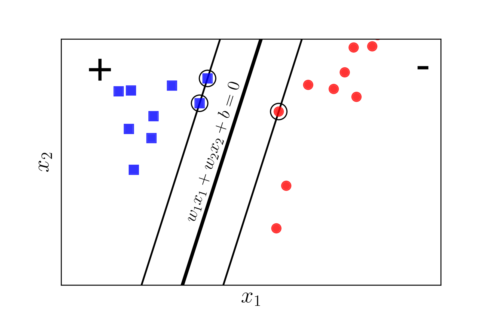
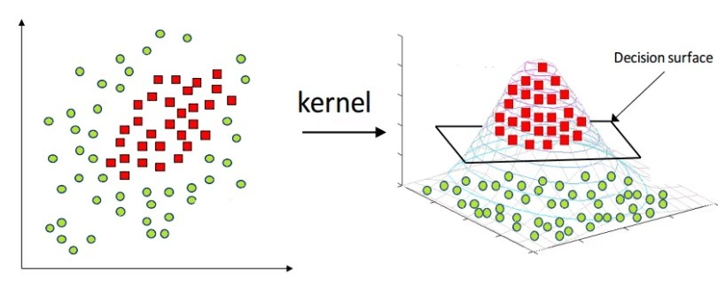
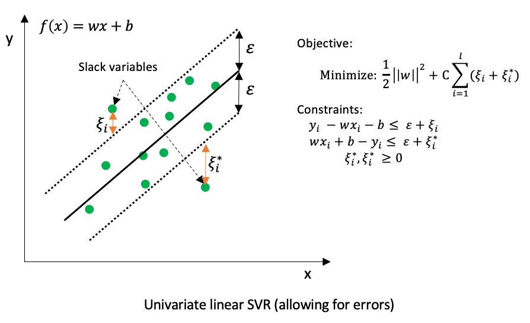
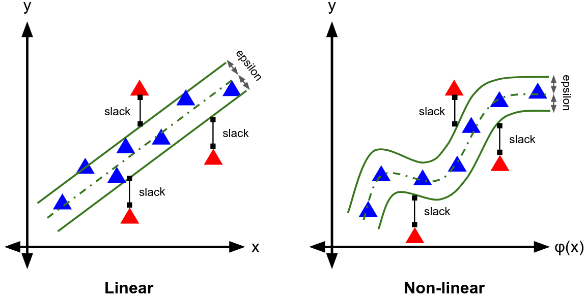

# Chương 6: Máy học và Bài toán Dự báo (Phần 1)

> **Môn học:** Phân tích Dữ liệu Kinh doanh (IS403)  
> **Khoa:** Hệ thống Thông tin – Trường Đại học Công nghệ Thông tin (UIT - ĐHQG-HCM)  
> **Giảng viên biên soạn:** ThS. Dương Phi Long (Email: `longdp@uit.edu.vn`)  
> **Tài liệu nguồn:** `DPL_PTDLKD_Chuong 6_Học máy và bài toán dự báo (P1).pdf`  
> **Trọng tâm bài học:** Học máy & Học sâu trong phân tích chuỗi thời gian, Support Vector Machines (SVM) và Support Vector Regression (SVR).

---

## Mục lục bài học
- [1. Tổng quan ML và DL trong Phân tích Chuỗi thời gian](#1-tổng-quan-ml-và-dl-trong-phân-tích-chuỗi-thời-gian)
  - [1.1. Bối cảnh và Khái niệm](#11-bối-cảnh-và-khái-niệm)
  - [1.2. Các phương pháp Machine Learning truyền thống](#12-các-phương-pháp-machine-learning-truyền-thống)
  - [1.3. Các phương pháp Deep Learning hiện đại](#13-các-phương-pháp-deep-learning-hiện-đại)
  - [1.4. Bảng so sánh tổng hợp ML vs DL](#14-bảng-so-sánh-tổng-hợp-ml-vs-dl)
- [2. Nền tảng: Support Vector Machines (SVM)](#2-nền-tảng-support-vector-machines-svm)
  - [2.1. Ý tưởng hình học và Siêu phẳng phân tách](#21-ý-tưởng-hình-học-và-siêu-phẳng-phân-tách)
  - [2.2. Khái niệm Margin và Support Vectors](#22-khái-niệm-margin-và-support-vectors)
  - [2.3. Hard Margin và Soft Margin SVM](#23-hard-margin-và-soft-margin-svm)
    - 📖 *[Giải thích chi tiết: Hàm Mục tiêu Soft Margin](./explanation/Giai_thich_Ham_muc_tieu_Soft_Margin.md)*
  - [2.4. Kernel SVM – Xử lý dữ liệu phi tuyến](#24-kernel-svm--xử-lý-dữ-liệu-phi-tuyến)
    - 📖 *[Giải thích chi tiết: Kernel Trick và Kernel SVM](./explanation/Giai_thich_Kernel_SVM.md)*
  - [2.5. Tối ưu hóa: Primal, Dual Lagrangian và Thuật toán SMO](#25-tối-ưu-hóa-primal-dual-lagrangian-và-thuật-toán-smo)
  - [2.6. Ví dụ giải tay chi tiết](#26-ví-dụ-giải-tay-chi-tiết)
    - [Ví dụ 1: Tuyến tính không sử dụng Kernel](#ví-dụ-1-tuyến-tính-không-sử-dụng-kernel)
    - [Ví dụ 2: Dữ liệu với RBF Kernel](#ví-dụ-2-dữ-liệu-với-rbf-kernel)
- [3. Chuyên sâu: Support Vector Regression (SVR)](#3-chuyên-sâu-support-vector-regression-svr)
  - [3.1. Chuyển từ Phân loại sang Hồi quy chuỗi thời gian](#31-chuyển-từ-phân-loại-sang-hồi-quy-chuỗi-thời-gian)
  - [3.2. Vùng dung sai Epsilon-Tube và Biến độ chùng](#32-vùng-dung-sai-epsilon-tube-và-biến-độ-chùng)
  - [3.3. Xây dựng Bài toán Tối ưu SVR](#33-xây-dựng-bài-toán-tối-ưu-svr)
  - [3.4. Mô hình Hồi quy Phi tuyến và Công thức Dự báo](#34-mô-hình-hồi-quy-phi-tuyến-và-công-thức-dự-báo)
- [4. Ý nghĩa thực tiễn trong Kinh doanh và Hướng phát triển](#4-ý-nghĩa-thực-tiễn-trong-kinh-doanh-và-hướng-phát-triển)

---

## 1. Tổng quan ML và DL trong Phân tích Chuỗi thời gian

### 1.1. Bối cảnh và Khái niệm
Trong kỷ nguyên phân tích dữ liệu kinh doanh, lượng dữ liệu chuỗi thời gian thu thập từ thị trường tài chính, doanh thu bán lẻ, biến động giá cả và cảm biến công nghiệp ngày càng phong phú. Các phương pháp thống kê cổ điển (như OLS, ARIMA, SARIMA) thường phụ thuộc vào các giả định khắt khe về tính tuyến tính hoặc tính dừng của chuỗi.

Việc ứng dụng **Học máy (Machine Learning – ML)** và **Học sâu (Deep Learning – DL)** giúp doanh nghiệp:
- Tự động hóa việc trích xuất quy luật từ dữ liệu quá khứ để dự báo tương lai thay vì lập trình hệ thống tập luật cứng.
- Mô hình hóa chính xác các mối quan hệ phi tuyến tính phức tạp và tương tác nhiều chiều giữa các biến số kinh tế.

---

### 1.2. Các phương pháp Machine Learning truyền thống

> [!NOTE]
> **Những hạn chế cố hữu của Machine Learning trong phân tích chuỗi thời gian:**
> 1. Đòi hỏi kỹ thuật trích xuất đặc trưng thủ công (*Feature Engineering*: tạo biến trễ lag, giá trị trung bình trượt rolling window, các chỉ số mùa vụ).
> 2. Khó xử lý tốt các quan hệ phụ thuộc dài hạn (*Long-term Dependencies*).
> 3. Khó thích nghi khi dữ liệu có độ biến thiên và tính chất phi tuyến phức tạp.

Các thuật toán ML thông dụng:
1. **Hồi quy tuyến tính (Linear Regression):**
   - Dự báo giá trị tương lai dựa trên xu hướng tuyến tính của dữ liệu lịch sử.
   - *Ví dụ:* Dự báo doanh thu hàng tháng dựa trên xu hướng tăng trưởng các giai đoạn trước.
2. **Cây quyết định (Decision Tree) và Rừng ngẫu nhiên (Random Forest):**
   - Xây dựng mô hình dạng cây để mô phỏng tương tác phức tạp giữa các thuộc tính đầu vào.
   - Random Forest tổng hợp dự báo của nhiều cây con, giúp kiểm soát và giảm thiểu hiện tượng quá khớp (*Overfitting*).
3. **K-Nearest Neighbors (KNN):**
   - Tìm kiếm $K$ điểm dữ liệu tương đồng nhất trong quá khứ để dự đoán điểm hiện tại.
4. **Support Vector Regression (SVR):**
   - Biến thể của SVM cho bài toán hồi quy, có khả năng mô hình hóa quan hệ phi tuyến với độ chính xác cao nhờ cơ chế không gian Hilbert và hàm Kernel.

---

### 1.3. Các phương pháp Deep Learning hiện đại
Học sâu là nhánh mở rộng của học máy, sử dụng các mạng nơ-ron sâu đa tầng để tự động học các biểu diễn trừu tượng từ dữ liệu đầu vào mà không cần can thiệp thủ công nhiều:

- **Recurrent Neural Network (RNN):**
  - Mạng nơ-ron hồi tiếp cơ bản, duy trì trạng thái ẩn (*Hidden State*) truyền tuần tự từ bước thời gian này sang bước thời gian tiếp theo để "ghi nhớ" thông tin ngắn hạn.
  - *Hạn chế:* Dễ gặp hiện tượng tiêu biến đạo hàm (*Vanishing Gradient*), khiến mô hình nhanh chóng quên thông tin ở các bước thời gian xa trong quá khứ.
- **Long Short-Term Memory (LSTM):**
  - Khắc phục triệt để nhược điểm của RNN nhờ tích hợp cấu trúc trạng thái ô (*Cell State*) và 3 cổng kiểm soát dòng chảy thông tin: Cổng quên (*Forget Gate*), Cổng đầu vào (*Input Gate*) và Cổng đầu ra (*Output Gate*).
  - *Ứng dụng:* Dự báo giá cổ phiếu, xu hướng tỷ giá hối đoái, lưu lượng truy cập và phát hiện bất thường tín hiệu y tế/cảm biến.
- **Gated Recurrent Units (GRU):**
  - Biến thể tối giản của LSTM: gộp trạng thái ô và trạng thái ẩn làm một, chỉ sử dụng 2 cổng (*Reset Gate* và *Update Gate*).
  - Tốc độ huấn luyện nhanh hơn, ít tham số hơn, phù hợp cho bài toán đòi hỏi tính toán thời gian thực hoặc tài nguyên hạn chế.
- **Convolutional Neural Network (CNN 1D):**
  - Áp dụng các bộ lọc tích chập trượt trên trục thời gian để trích xuất các đặc trưng cục bộ (*Local Patterns*); thường kết hợp với LSTM thành kiến trúc lai CNN-LSTM.
- **Transformer:**
  - Kiến trúc hiện đại loại bỏ hoàn toàn cơ chế hồi tiếp tuần tự, thay thế bằng cơ chế **Tự chú ý (Self-Attention)**. Cho phép huấn luyện song song toàn chuỗi và mô hình hóa mối quan hệ giữa mọi điểm dữ liệu bất kể khoảng cách thời gian.

---

### 1.4. Bảng so sánh tổng hợp ML vs DL

| Tiêu chí so sánh | Machine Learning (ML) | Deep Learning (DL) |
| :--- | :--- | :--- |
| **Kỹ thuật trích xuất đặc trưng** | Thủ công (cần hiểu biết sâu về nghiệp vụ kinh doanh) | Tự động học sâu qua các tầng nơ-ron |
| **Kích thước dữ liệu phù hợp** | Dữ liệu vừa và nhỏ ($< 10^5$ bản ghi) | Cần tập dữ liệu lớn để tránh overfitting |
| **Khả năng nhớ dài hạn** | Thấp, phải tạo thêm nhiều thuộc tính trễ | Rất tốt (nhờ Cell State và Attention) |
| **Tài nguyên và Tốc độ** | Chạy nhanh, tài nguyên CPU nhẹ nhàng | Đòi hỏi GPU/TPU với chi phí huấn luyện cao |
| **Tính minh bạch và Diễn giải** | Rõ ràng, dễ chứng minh về mặt toán học | Hộp đen (*Black Box*), khó diễn giải cặn kẽ |

---

## 2. Nền tảng: Support Vector Machines (SVM)

### 2.1. Ý tưởng hình học và Siêu phẳng phân tách
Support Vector Machine (SVM) là thuật toán học có giám sát phổ biến hàng đầu trong bài toán phân loại (*Classification*).

**Ý tưởng cốt lõi:** Trong không gian $d$ chiều biểu diễn bởi vector đặc trưng $\mathbf{x} \in \mathbb{R}^d$, tìm một **siêu phẳng (Hyperplane)** phân cách có số chiều $d-1$:

$$
\mathbf{w}^T \mathbf{x} + b = 0
$$

để phân chia không gian thành các miền khác nhau, mỗi miền chứa trọn vẹn một lớp dữ liệu ($y_i \in \{+1, -1\}$).

  
  
<em>Hình 1: Ý tưởng siêu phẳng phân tách dữ liệu thành các miền trong không gian đặc trưng.</em>

---

### 2.2. Khái niệm Margin và Support Vectors
Có vô số siêu phẳng khả dĩ để phân tách hai lớp dữ liệu. Mục tiêu của SVM là tìm ra siêu phẳng có **lề (Margin) rộng nhất** để cực đại hóa khả năng tổng quát hóa với dữ liệu mới. Thuật toán này do đó còn được gọi là **Maximum Margin Classifier**.

  
  
<em>Hình 2: Phân tách các điểm sao cho Margin từ siêu phẳng đến các support vectors của hai lớp là bằng nhau và lớn nhất có thể.</em>

#### Khoảng cách từ một điểm dữ liệu tới siêu phẳng
Khoảng cách hình học từ điểm $\mathbf{x}_i$ có nhãn $y_i$ đến siêu phẳng $\mathbf{w}^T \mathbf{x} + b = 0$ được tính theo công thức:

$$
d(\mathbf{x}_i) = \frac{|\mathbf{w}^T \mathbf{x}_i + b|}{\|\mathbf{w}\|_2} = \frac{y_i (\mathbf{w}^T \mathbf{x}_i + b)}{\|\mathbf{w}\|_2}
$$

trong đó chuẩn Euclid L2-norm của vector trọng số là:

$$
\|\mathbf{w}\|_2 = \sqrt{\sum_{j=1}^d w_j^2}
$$

  
  
<em>Hình 3: Thiết lập toán học khoảng cách từ điểm dữ liệu đến siêu phẳng phân tách.</em>

#### Support Vectors (Các vector hỗ trợ)
- Là các điểm dữ liệu nằm sát siêu phẳng nhất, nằm chính xác trên các đường biên song song:

$$
\mathbf{w}^T \mathbf{x} + b = \pm 1 \iff y_i (\mathbf{w}^T \mathbf{x}_i + b) = 1
$$

- Các Support Vectors trực tiếp quyết định hướng và vị trí của siêu phẳng tối ưu. Nếu loại bỏ bất kỳ điểm nào ngoài tập Support Vectors, siêu phẳng sẽ hoàn toàn không thay đổi.

  
  
<em>Hình 4: Vị trí của các Support Vectors và khoảng cách biên Margin.</em>

#### Định nghĩa toán học của Margin và Hàm tối ưu
Trong bài giảng (Slide 20, 43), **Margin** được định nghĩa là khoảng cách gần nhất từ một điểm dữ liệu tới siêu phẳng phân tách:

$$
\text{Margin} = \min_{i} d(\mathbf{x}_i) = \frac{1}{\|\mathbf{w}\|}
$$

*(Khoảng cách tổng giữa hai đường biên song song là $\frac{2}{\|\mathbf{w}\|}$).*

Do đó, bài toán tìm siêu phẳng có Margin lớn nhất quy về:

$$
\arg\max_{\mathbf{w}, b} \left( \frac{1}{\|\mathbf{w}\|} \right) \iff \min_{\mathbf{w}, b} \frac{1}{2} \|\mathbf{w}\|^2
$$

thỏa mãn điều kiện toàn bộ dữ liệu nằm đúng phía ngoài biên an toàn:

$$
y_i(\mathbf{w}^T \mathbf{x}_i + b) \ge 1, \quad \forall i = 1, 2, \dots, N
$$

---

### 2.3. Hard Margin và Soft Margin SVM

> [!WARNING]
> **Hạn chế của SVM thuần (Hard Margin):**  
> Hard Margin đòi hỏi toàn bộ dữ liệu phải tách biệt hoàn toàn ($100\%$). Khi tập dữ liệu có nhiễu (*Noise*) hoặc chỉ gần như phân tách tuyến tính (*Almost Linearly Separable*), mô hình Hard Margin sẽ không thể hội tụ.

  
  
<em>Hình 5: Hard Margin thất bại khi dữ liệu xuất hiện nhiễu (a) hoặc gần như phân tách tuyến tính (b).</em>

#### Cơ chế Soft Margin và Biến độ chùng $\xi_i$
Soft Margin bổ sung thêm **biến độ chùng (Slack Variable) $\xi_i \ge 0$**, cho phép một số mẫu vi phạm biên trong giới hạn kiểm soát:
- Điểm nằm an toàn bên ngoài biên: $\xi_i = 0$.
- Điểm nằm trong vùng lề nhưng phân loại đúng: $0 < \xi_i \le 1$.
- Điểm bị phân loại sai: $\xi_i > 1$.

Công thức tính độ vi phạm:

$$
\xi_i = \max\left(0, 1 - y_i(\mathbf{w}^T \mathbf{x}_i + b)\right)
$$

  
  
<em>Hình 6: Phân bố các điểm dữ liệu vi phạm tương ứng với giá trị biến độ chùng $\xi_i$.</em>

#### Hàm mục tiêu Soft Margin (Primal Form):

$$
\min_{\mathbf{w}, b, \boldsymbol{\xi}} \left( \frac{1}{2}\|\mathbf{w}\|^2 + C \sum_{i=1}^N \xi_i \right)
$$

với các ràng buộc:

$$
y_i(\mathbf{w}^T \mathbf{x}_i + b) \ge 1 - \xi_i, \quad \xi_i \ge 0 \quad (\forall i = 1, 2, \dots, N)
$$

> [!TIP]
> 📖 **Đọc thêm bài giải thích chuyên sâu về hàm này:**  
> Nếu bạn muốn hiểu cặn kẽ bản chất toán học, ý nghĩa hình học của từng thành phần $\frac{1}{2}\|\mathbf{w}\|^2$, biến độ chùng $\xi_i$, hệ số phạt $C$ kèm ví dụ tính số cụ thể từng bước, hãy xem tài liệu:  
> 👉 [**Giải thích Chi tiết Hàm Mục tiêu Soft Margin SVM**](./explanation/Giai_thich_Ham_muc_tieu_Soft_Margin.md)

> [!TIP]
> **Ý nghĩa của hằng số phạt $C > 0$:**
> - **$C$ lớn:** Phạt rất nghiêm khắc các điểm vi phạm lề $\implies$ Biên thu hẹp lại, giảm sai số huấn luyện nhưng dễ bị quá khớp (*Overfitting*).
> - **$C$ nhỏ:** Chấp nhận nhiều điểm vi phạm biên hơn $\implies$ Biên mở rộng hơn, mô hình có tính tổng quát hóa cao hơn nhưng có thể bị dưới khớp (*Underfitting*).

---

### 2.4. Kernel SVM – Xử lý dữ liệu phi tuyến

#### Bản chất và Ý tưởng hình học
Khi dữ liệu không thể phân tách tuyến tính trong không gian ban đầu (ví dụ bài toán XOR, vòng tròn đồng tâm), việc tìm một siêu phẳng phẳng là bất khả thi.

Dựa trên **Định lý Cover**, SVM áp dụng **Kernel Trick** để thực hiện ánh xạ phi tuyến dữ liệu từ không gian đặc trưng ban đầu $\mathbf{x} \in \mathbb{R}^d$ lên một không gian mới nhiều chiều hơn $\mathcal{H}$ (Không gian Hilbert):

$$
\mathbf{x} \mapsto \phi(\mathbf{x})
$$

Trong không gian mới này, dữ liệu bị uốn cong sẽ trở nên phân tách tuyến tính được bởi một siêu phẳng phẳng: $\mathbf{w}^T \phi(\mathbf{x}) + b = 0$.

  
  
<em>Hình 7: Minh họa Kernel Trick: (a) Dữ liệu 2D phi tuyến $\implies$ (b) Thêm chiều thứ ba $z = x_1^2 + x_2^2$ tạo thành mặt paraboloid để phân tách bằng siêu phẳng phẳng $\implies$ (c) Chiếu ngược giao tuyến xuống không gian 2D tạo thành đường biên ellipse phân tách hoàn hảo hai lớp.</em>

#### Cơ chế Kernel Trick: Tránh thảm họa số chiều
Thay vì phải tính toán tường minh tọa độ cực lớn (hoặc vô hạn chiều) của vector $\phi(\mathbf{x})$, **Hàm Kernel $K(\mathbf{x}, \mathbf{z})$** cho phép tính trực tiếp giá trị tích vô hướng giữa hai điểm trong không gian mới ngay từ không gian gốc:

$$
K(\mathbf{x}, \mathbf{z}) = \langle \phi(\mathbf{x}), \phi(\mathbf{z}) \rangle = \phi(\mathbf{x})^T \phi(\mathbf{z})
$$

  
  
<em>Hình 8: Hàm Kernel tính trực tiếp tích vô hướng $K(\mathbf{x}, \mathbf{z}) = \langle \phi(\mathbf{x}), \phi(\mathbf{z}) \rangle$ mà không cần tính tường minh tọa độ $\phi(\mathbf{x})$.</em>

> [!TIP]
> 📖 **Đọc thêm bài giải thích chuyên sâu về Kernel SVM:**  
> Bạn muốn hiểu vì sao một hàm đơn giản như RBF lại tương đương với không gian **vô hạn chiều**, cùng ví dụ chứng minh toán học đại số từng bước? Hãy xem tại:  
> 👉 [**Giải thích Chi tiết: Kernel Trick và Kernel SVM**](./explanation/Giai_thich_Kernel_SVM.md)

#### Điều kiện Mercer
Hàm $K(\mathbf{x}, \mathbf{z})$ là một hàm Kernel hợp lệ khi thỏa mãn định lý Mercer:
1. **Tính đối xứng:** $K(\mathbf{x}, \mathbf{z}) = K(\mathbf{z}, \mathbf{x})$.
2. **Ma trận Gram nửa xác định dương (Positive Semi-Definite – PSD):** Với mọi tập điểm, ma trận $K_{ij} = K(\mathbf{x}_i, \mathbf{x}_j)$ thỏa mãn:

$$
\forall \mathbf{v} \in \mathbb{R}^N, \quad \mathbf{v}^T \mathbf{K} \mathbf{v} \ge 0
$$

Tính chất PSD đảm bảo bài toán tối ưu đối ngẫu của SVM luôn là **quy hoạch toàn phương lồi**, cam kết tìm được nghiệm cực trị toàn cục duy nhất (*Global Optimum*).

#### Các hàm Kernel thông dụng

| Loại Kernel | Công thức toán học $K(\mathbf{x}, \mathbf{z})$ | Tham số chính | Đặc điểm & Trường hợp sử dụng |
| :--- | :--- | :---: | :--- |
| **Linear (Tuyến tính)** | $\mathbf{x}^T \mathbf{z}$ | Không có | Phù hợp khi số chiều lớn ($d \gg N$), ví dụ phân loại văn bản, text mining. Tốc độ tính toán nhanh nhất. |
| **Polynomial (Đa thức)** | $(\gamma \mathbf{x}^T \mathbf{z} + r)^d$ | $d, \gamma, r$ | Mô hình hóa tương tác phi tuyến bậc cao giữa các đặc trưng. Bậc $d$ càng cao thì mô hình càng phức tạp và dễ overfitting. |
| **RBF / Gaussian** | $\exp\left(-\gamma \|\mathbf{x} - \mathbf{z}\|^2\right) = \exp\left(-\frac{\|\mathbf{x} - \mathbf{z}\|^2}{2\sigma^2}\right)$ | $\gamma$ (hoặc $\sigma$) | **Phổ biến nhất**. Ánh xạ sang không gian vô hạn chiều, đo lường độ tương đồng giữa hai điểm. Lựa chọn mặc định khi chưa rõ phân bố. |
| **Sigmoid** | $\tanh(\gamma \mathbf{x}^T \mathbf{z} + r)$ | $\gamma, r$ | Mô phỏng mạng nơ-ron Perceptron đơn tầng. Hiệu quả không ổn định và ít được ưu tiên trong thực tế. |

---

### 2.5. Tối ưu hóa: Primal, Dual Lagrangian và Thuật toán SMO

Để giải bài toán tối ưu có ràng buộc bất đẳng thức, phương pháp nhân tử Lagrange được áp dụng:

#### Bước 1: Xây dựng hàm Lagrangian
Đặt các nhân tử Lagrange $\alpha_i \ge 0$ cho nhóm ràng buộc biên và $\beta_i \ge 0$ cho điều kiện $\xi_i \ge 0$:

$$
\mathcal{L}(\mathbf{w}, b, \boldsymbol{\xi}, \boldsymbol{\alpha}, \boldsymbol{\beta}) = \frac{1}{2}\|\mathbf{w}\|^2 + C \sum_{i=1}^N \xi_i + \sum_{i=1}^N \alpha_i \left[ 1 - \xi_i - y_i(\mathbf{w}^T \mathbf{x}_i + b) \right] - \sum_{i=1}^N \beta_i \xi_i
$$

#### Bước 2: Điều kiện tối ưu KKT (Karush-Kuhn-Tucker)
Lấy đạo hàm riêng của $\mathcal{L}$ theo các biến nguyên thủy $(\mathbf{w}, b, \xi_i)$ rồi cho bằng 0:

$$
\frac{\partial \mathcal{L}}{\partial \mathbf{w}} = \mathbf{w} - \sum_{i=1}^N \alpha_i y_i \mathbf{x}_i = 0 \implies \mathbf{w} = \sum_{i=1}^N \alpha_i y_i \mathbf{x}_i
$$

$$
\frac{\partial \mathcal{L}}{\partial b} = -\sum_{i=1}^N \alpha_i y_i = 0 \implies \sum_{i=1}^N \alpha_i y_i = 0
$$

$$
\frac{\partial \mathcal{L}}{\partial \xi_i} = C - \alpha_i - \beta_i = 0 \implies \beta_i = C - \alpha_i
$$

Do $\beta_i \ge 0$ và $\alpha_i \ge 0 \implies 0 \le \alpha_i \le C$.

#### Bước 3: Bài toán Đối ngẫu (Dual Form)
Thay các điều kiện tối ưu ngược lại vào hàm Lagrangian, ta thu được bài toán Quy hoạch toàn phương (Quadratic Programming):

$$
\max_{\boldsymbol{\alpha}} \left( \sum_{i=1}^N \alpha_i - \frac{1}{2} \sum_{i=1}^N \sum_{j=1}^N \alpha_i \alpha_j y_i y_j K(\mathbf{x}_i, \mathbf{x}_j) \right)
$$

thỏa mãn hệ ràng buộc:

$$
0 \le \alpha_i \le C, \quad \forall i = 1, 2, \dots, N
$$

$$
\sum_{i=1}^N \alpha_i y_i = 0
$$

#### Bước 4: Thuật toán SMO (Sequential Minimal Optimization)
Giải trực tiếp bài toán quy hoạch toàn phương với ma trận $N \times N$ rất tốn kém tài nguyên khi $N$ lớn. Thuật toán **SMO** do John Platt (Microsoft, 1998) đề xuất:
- Chia bài toán thành các bài toán con 2 biến: ở mỗi bước chọn một cặp $(\alpha_i, \alpha_j)$ để tối ưu hóa giải tích, trong khi cố định toàn bộ các $\alpha_k$ còn lại.
- Quá trình cập nhật lặp lại đến khi tất cả các biến thỏa mãn điều kiện dừng KKT.

#### Bước 5: Xác định siêu phẳng và hàm quyết định
Sau khi giải được dãy nghiệm $\boldsymbol{\alpha}^*$:
- Vector trọng số:

$$
\mathbf{w} = \sum_{i \in SV} \alpha_i y_i \mathbf{x}_i
$$

- Hệ số chệch $b$ được tính trung bình trên các Support Vectors nằm trên biên ($0 < \alpha_k < C$):

$$
b = \frac{1}{|SV|} \sum_{s \in SV} \left( y_s - \sum_{i=1}^N \alpha_i y_i K(\mathbf{x}_i, \mathbf{x}_s) \right)
$$

- Hàm quyết định phân loại cho mẫu mới $\mathbf{x}_{new}$:

$$
f(\mathbf{x}_{new}) = \sum_{i=1}^N \alpha_i y_i K(\mathbf{x}_i, \mathbf{x}_{new}) + b
$$

$$
\hat{y} = \text{sign}\left(f(\mathbf{x}_{new})\right)
$$

---

### 2.6. Ví dụ giải tay chi tiết

#### Ví dụ 1: Tuyến tính không sử dụng Kernel
Xét tập dữ liệu huấn luyện gồm 3 mẫu trong không gian 2 chiều (Slide 39–43):
- $\mathbf{x}_1 = (1, 0)^T, \quad y_1 = +1$
- $\mathbf{x}_2 = (0, 1)^T, \quad y_2 = +1$
- $\mathbf{x}_3 = (0, 0)^T, \quad y_3 = -1$

**Bước 1: Tính ma trận Gram (tích vô hướng giữa các vector):**

$$
\mathbf{K} = \begin{bmatrix}
\mathbf{x}_1^T \mathbf{x}_1 & \mathbf{x}_1^T \mathbf{x}_2 & \mathbf{x}_1^T \mathbf{x}_3 \\
\mathbf{x}_2^T \mathbf{x}_1 & \mathbf{x}_2^T \mathbf{x}_2 & \mathbf{x}_2^T \mathbf{x}_3 \\
\mathbf{x}_3^T \mathbf{x}_1 & \mathbf{x}_3^T \mathbf{x}_2 & \mathbf{x}_3^T \mathbf{x}_3
\end{bmatrix} = \begin{bmatrix}
1 & 0 & 0 \\
0 & 1 & 0 \\
0 & 0 & 0
\end{bmatrix}
$$

**Bước 2: Ràng buộc đối ngẫu:**

$$
\sum_{i=1}^3 \alpha_i y_i = 0 \iff \alpha_1(1) + \alpha_2(1) + \alpha_3(-1) = 0 \implies \alpha_3 = \alpha_1 + \alpha_2
$$

**Bước 3: Thiết lập hàm mục tiêu đối ngẫu Lagrangian:**

$$
\mathcal{L}_D = \sum_{i=1}^3 \alpha_i - \frac{1}{2} \sum_{i=1}^3 \sum_{j=1}^3 \alpha_i \alpha_j y_i y_j (\mathbf{x}_i^T \mathbf{x}_j)
$$

Thay $\alpha_3 = \alpha_1 + \alpha_2$ và các phần tử ma trận $\mathbf{K}$ vào:

$$
\mathcal{L}_D = (\alpha_1 + \alpha_2 + (\alpha_1 + \alpha_2)) - \frac{1}{2}\left[\alpha_1^2(1) + \alpha_2^2(1)\right] = 2\alpha_1 - \frac{1}{2}\alpha_1^2 + 2\alpha_2 - \frac{1}{2}\alpha_2^2
$$

**Bước 4: Tìm cực đại:**
Lấy đạo hàm riêng theo từng biến:

$$
\frac{\partial \mathcal{L}_D}{\partial \alpha_1} = 2 - \alpha_1 = 0 \implies \alpha_1^* = 2
$$

$$
\frac{\partial \mathcal{L}_D}{\partial \alpha_2} = 2 - \alpha_2 = 0 \implies \alpha_2^* = 2
$$

Từ đó suy ra:

$$
\alpha_3^* = \alpha_1^* + \alpha_2^* = 2 + 2 = 4
$$

Do cả ba nghiệm $\alpha_1^*, \alpha_2^*, \alpha_3^* > 0$, **cả 3 điểm dữ liệu đều là Support Vectors**.

**Bước 5: Xác định vector trọng số $\mathbf{w}$ và hệ số chệch $b$:**

$$
\mathbf{w} = \sum_{i=1}^3 \alpha_i y_i \mathbf{x}_i = 2(1)\begin{pmatrix}1\\0\end{pmatrix} + 2(1)\begin{pmatrix}0\\1\end{pmatrix} + 4(-1)\begin{pmatrix}0\\0\end{pmatrix} = \begin{pmatrix}2\\2\end{pmatrix}
$$

Tính $b$ theo trung bình cộng trên cả 3 Support Vectors:

$$
b = \frac{1}{3} \sum_{s \in SV} \left[ y_s - \sum_{i=1}^3 \alpha_i y_i K(\mathbf{x}_i, \mathbf{x}_s) \right]
$$

- Với $s = 1$: $y_1 - \alpha_1 y_1 K(\mathbf{x}_1, \mathbf{x}_1) = 1 - 2(1)(1) = -1$
- Với $s = 2$: $y_2 - \alpha_2 y_2 K(\mathbf{x}_2, \mathbf{x}_2) = 1 - 2(1)(1) = -1$
- Với $s = 3$: $y_3 - 0 = -1$

$$
b = \frac{1}{3} [(-1) + (-1) + (-1)] = -1
$$

Phương trình siêu phẳng phân tách:

$$
2x_1 + 2x_2 - 1 = 0
$$

**Bước 6: Độ dài chuẩn, Margin và Kiểm tra phân loại:**
- Độ dài vector pháp tuyến: $\|\mathbf{w}\|_2 = \sqrt{2^2 + 2^2} = \sqrt{8} = 2\sqrt{2}$
- Bề rộng Margin theo định nghĩa bài giảng:

$$
\text{Margin} = \frac{1}{\|\mathbf{w}\|} = \frac{1}{2\sqrt{2}} \approx 0.3536
$$

*(Khoảng cách giữa hai đường biên $2x_1 + 2x_2 - 1 = \pm 1$ là $\frac{2}{\|\mathbf{w}\|} \approx 0.7071$)*.

- Hàm phân loại:

$$
y(\mathbf{x}) = \text{sign}(2x_1 + 2x_2 - 1)
$$

- Kiểm tra lại các điểm:
  - $\mathbf{x}_1(1,0): 2(1) + 2(0) - 1 = +1 > 0 \implies \text{Class } +1$ (Chính xác)
  - $\mathbf{x}_2(0,1): 2(0) + 2(1) - 1 = +1 > 0 \implies \text{Class } +1$ (Chính xác)
  - $\mathbf{x}_3(0,0): 2(0) + 2(0) - 1 = -1 < 0 \implies \text{Class } -1$ (Chính xác)

---

#### Ví dụ 2: Dữ liệu với RBF Kernel
Sử dụng cùng 3 điểm dữ liệu trên kết hợp hàm nhân RBF với $\sigma = 1$ ($\gamma = 1$):

$$
K(\mathbf{x}_i, \mathbf{x}_j) = \exp\left(-\frac{\|\mathbf{x}_i - \mathbf{x}_j\|^2}{2}\right)
$$

Tính các giá trị thành phần:
- $K(\mathbf{x}_1, \mathbf{x}_1) = K(\mathbf{x}_2, \mathbf{x}_2) = K(\mathbf{x}_3, \mathbf{x}_3) = \exp(0) = 1$
- $\|\mathbf{x}_1 - \mathbf{x}_2\|^2 = (1-0)^2 + (0-1)^2 = 2 \implies K(\mathbf{x}_1, \mathbf{x}_2) = \exp(-1) \approx 0.3679$
- $\|\mathbf{x}_1 - \mathbf{x}_3\|^2 = 1^2 + 0^2 = 1 \implies K(\mathbf{x}_1, \mathbf{x}_3) = \exp(-0.5) \approx 0.6065$
- $\|\mathbf{x}_2 - \mathbf{x}_3\|^2 = 0^2 + 1^2 = 1 \implies K(\mathbf{x}_2, \mathbf{x}_3) = \exp(-0.5) \approx 0.6065$

Ma trận Gram đối xứng:

$$
\mathbf{K}_{RBF} = \begin{bmatrix}
1 & 0.3679 & 0.6065 \\
0.3679 & 1 & 0.6065 \\
0.6065 & 0.6065 & 1
\end{bmatrix}
$$

Thuật toán SMO sẽ tiếp tục giải hệ phương trình Lagrangian đối ngẫu dựa trên ma trận $\mathbf{K}_{RBF}$ để tìm dãy nghiệm $\boldsymbol{\alpha}^*$ trong không gian phi tuyến.

---

## 3. Chuyên sâu: Support Vector Regression (SVR)

### 3.1. Chuyển từ Phân loại sang Hồi quy chuỗi thời gian
Trong bài toán hồi quy chuỗi thời gian, mục tiêu là tìm kiếm một hàm liên tục $f(\mathbf{x}) = \mathbf{w}^T \mathbf{x} + b$ xấp xỉ tốt nhất các giá trị thực tế $y_i \in \mathbb{R}$.

Thay vì tìm siêu phẳng phân cách hai nửa không gian như SVM, **SVR tìm một siêu phẳng phù hợp nhất nằm bên trong một khoảng sai số chấp nhận được gọi là $\epsilon$-tube**.

  
  
<em>Hình 9: SVR tìm siêu phẳng xấp xỉ liên tục bên trong ống sai số epsilon-tube chấp nhận được.</em>

---

### 3.2. Vùng dung sai Epsilon-Tube và Biến độ chùng

**Nguyên lý $\epsilon$-Tube:**
Xung quanh đường dự báo, ta tạo một "hành lang" có độ rộng $\pm \epsilon$:
- Nếu điểm dữ liệu nằm bên trong ống: $|y_i - \hat{y}_i| \le \epsilon \implies$ Sai số bằng 0, không bị phạt.
- Điểm nằm ngoài ống: Bị phạt tương ứng với khoảng cách vượt ra ngoài biên.

  
  
<em>Hình 10: Minh họa dải $\epsilon$-tube cùng hai biến độ chùng: phạt trên $\xi_i$ và phạt dưới $\xi_i^*$.</em>

#### Hai nhóm biến độ chùng hai phía:
1. **$\xi_i$ (Phạt trên):** Dữ liệu thực tế vượt quá trần của ống:

$$
\xi_i = \max\left(0, y_i - \hat{y}_i - \epsilon\right)
$$

2. **$\xi_i^*$ (Phạt dưới):** Dữ liệu thực tế tụt xuống dưới sàn của ống:

$$
\xi_i^* = \max\left(0, \hat{y}_i - y_i - \epsilon\right)
$$

---

### 3.3. Xây dựng Bài toán Tối ưu SVR

#### 1. Dạng nguyên thủy (Primal Form):

$$
\min_{\mathbf{w}, b, \boldsymbol{\xi}, \boldsymbol{\xi}^*} \left( \frac{1}{2}\|\mathbf{w}\|^2 + C \sum_{i=1}^N (\xi_i + \xi_i^*) \right)
$$

thỏa mãn hệ ràng buộc bất đẳng thức:

$$
\begin{cases}
y_i - \mathbf{w}^T \phi(\mathbf{x}_i) - b \le \epsilon + \xi_i \\
\mathbf{w}^T \phi(\mathbf{x}_i) + b - y_i \le \epsilon + \xi_i^* \\
\xi_i \ge 0, \quad \xi_i^* \ge 0 \quad (\forall i = 1, 2, \dots, N)
\end{cases}
$$

trong đó $C > 0$ là hệ số phạt kiểm soát sự cân bằng giữa độ phẳng của hàm và độ vi phạm ngoài ống.

#### 2. Dạng đối ngẫu (Dual Form):
Sử dụng các nhân tử Lagrange $\alpha_i, \alpha_i^* \ge 0$, bài toán đối ngẫu có dạng:

$$
\max_{\boldsymbol{\alpha}, \boldsymbol{\alpha}^*} \left[ -\frac{1}{2}\sum_{i=1}^N \sum_{j=1}^N (\alpha_i^* - \alpha_i)(\alpha_j^* - \alpha_j) K(\mathbf{x}_i, \mathbf{x}_j) + \sum_{i=1}^N y_i (\alpha_i^* - \alpha_i) - \epsilon \sum_{i=1}^N (\alpha_i + \alpha_i^*) \right]
$$

với ràng buộc:

$$
0 \le \alpha_i, \alpha_i^* \le C, \quad \forall i = 1, 2, \dots, N
$$

$$
\sum_{i=1}^N (\alpha_i^* - \alpha_i) = 0
$$

Thuật toán SMO tiếp tục được áp dụng để xác định dãy nghiệm $(\alpha_i^*, \alpha_i)$.

---

### 3.4. Mô hình Hồi quy Phi tuyến và Công thức Dự báo

Sau khi xác định được các hệ số nhân tử Lagrange:
- Vector trọng số trong không gian Hilbert:

$$
\mathbf{w} = \sum_{i=1}^N (\alpha_i^* - \alpha_i) \phi(\mathbf{x}_i)
$$

- **Hàm dự báo SVR cho điểm dữ liệu mới $\mathbf{x}_{new}$:**

$$
\hat{y}(\mathbf{x}_{new}) = \sum_{i=1}^N (\alpha_i^* - \alpha_i) K(\mathbf{x}_i, \mathbf{x}_{new}) + b
$$

  
  
<em>Hình 11: Mô hình SVR phi tuyến $\hat{y}(\mathbf{x}) = \mathbf{w}^T \phi(\mathbf{x}) + b$ mô phỏng đường cong dự báo được bao bọc bởi dải $\epsilon$-tube.</em>

#### Nhận diện Support Vectors và Tính hệ số chệch $b$:
- **Support Vectors trong SVR:** Là các điểm có $\alpha_i > 0$ hoặc $\alpha_i^* > 0$ (tức là những điểm nằm sát trên đường biên ống hoặc nằm ngoài ống). Các điểm nằm hoàn toàn bên trong ống có $\alpha_i = \alpha_i^* = 0$ và không tham gia vào công thức dự báo.
- **Tính toán hệ số chệch $b$** (Slide 51):
  Xét tập các Support Vectors nằm trên biên ($0 < \alpha_k < C$ hoặc $0 < \alpha_k^* < C$):
  - Đặt $\delta_k = +1$ nếu $0 < \alpha_k < C$ (nằm trên biên trên).
  - Đặt $\delta_k = -1$ nếu $0 < \alpha_k^* < C$ (nằm trên biên dưới).

Công thức tổng quát tính $b$:

$$
b = \frac{1}{|SV|} \sum_{k \in SV} \left[ y_k - \sum_{i=1}^N (\alpha_i^* - \alpha_i) K(\mathbf{x}_i, \mathbf{x}_k) - \delta_k \epsilon \right]
$$

---

## 4. Ý nghĩa thực tiễn trong Kinh doanh và Hướng phát triển

### 4.1. Lợi thế của SVR trong phân tích chuỗi thời gian
1. **Dự báo chuỗi tài chính phi tuyến:** SVR kết hợp với Kernel RBF có khả năng xấp xỉ bất kỳ chuỗi dữ liệu phi tuyến nào mà không đòi hỏi chuỗi phải thỏa mãn giả định phân phối chuẩn.
2. **Kháng nhiễu và hạn chế ngoại lai (*Robustness*):** Nhờ cơ chế tổn thất không nhạy $\epsilon$ và biến phạt bậc nhất, SVR không bị kéo lệch quá đà bởi các điểm ngoại lai (*Outliers*) như phương pháp bình phương tối thiểu OLS.
3. **Hiệu quả trên mẫu dữ liệu vừa và nhỏ:** Khi dữ liệu doanh nghiệp chưa đủ hàng trăm nghìn dòng để huấn luyện mạng sâu (như LSTM, Transformer), SVR là sự lựa chọn tối ưu về độ chính xác và khả năng chống quá khớp.

### 4.2. Bộ ba siêu tham số then chốt cần điều chỉnh trong SVR
- **$C$ (Cost / Penalty):** Cân bằng giữa mức phạt lỗi vi phạm và độ phẳng của hàm dự báo.
- **$\epsilon$ (Epsilon):** Xác định độ rộng của ống dung sai. $\epsilon$ càng lớn thì mô hình càng thưa (*Sparse* - ít support vectors), tăng khả năng tổng quát hóa nhưng có thể làm giảm độ khít chi tiết.
- **$\gamma$ (Gamma trong Kernel RBF):** Điều chỉnh bán kính ảnh hưởng của từng điểm dữ liệu. Cần chọn cẩn thận qua `TimeSeriesSplit` để tránh đường dự báo bị gợn sóng cục bộ quanh tập train.

### 4.3. Hướng tiếp cận tiếp theo trong Phần 2
Sau khi hoàn thành nền tảng về SVM và SVR trong Phần 1, **Chương 6 (Phần 2)** sẽ tiếp tục khám phá:
- Kiến trúc chuyên sâu và huấn luyện mạng nơ-ron hồi tiếp: **RNN, LSTM, GRU**.
- Phát hiện bất thường trong dòng giao dịch kinh doanh (**Anomaly Detection và Isolation Forest**).
