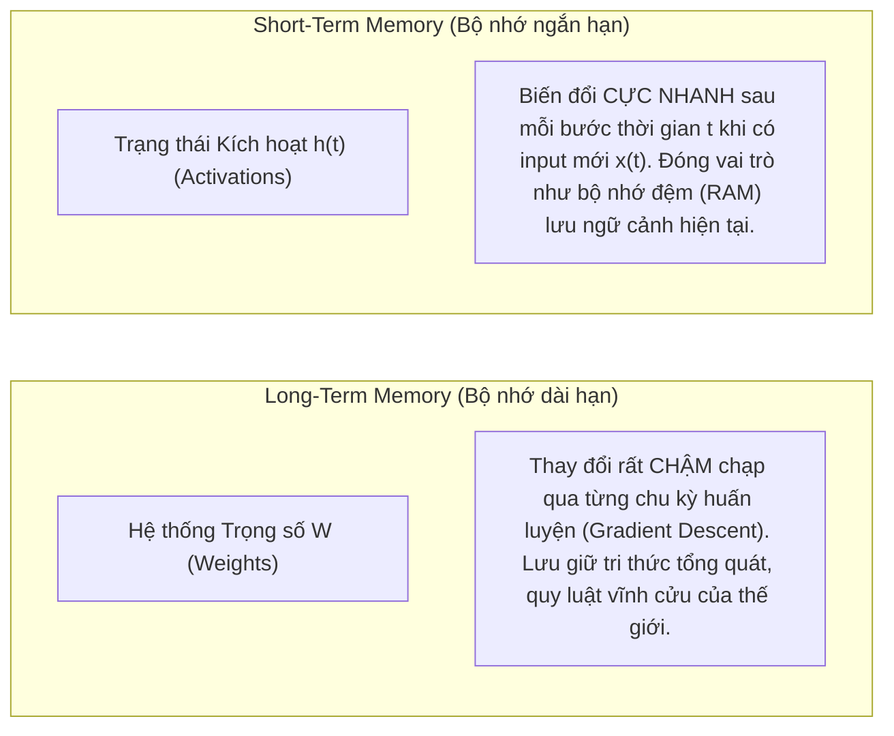

# Bài 1: Bối cảnh Lịch sử, Đặt Vấn đề & Ý Tưởng Sơ Khai Của LSTM

> *"Học cách lưu trữ thông tin qua các khoảng thời gian dài bằng phương pháp lan truyền ngược trong mạng nơ-ron hồi quy mất quá nhiều thời gian, phần lớn là do dòng lỗi bị phân rã và tiêu biến."*  
> — **Hochreiter & Schmidhuber (1997)**

---

## 1. Ẩn dụ Khởi đầu: Trò chơi Tam Sao Thất Bản qua Hành Lang 100 Người

Hãy tưởng tượng bạn đang tham gia một trò chơi truyền tin thì thầm qua một hàng gồm 100 người đứng dọc hành lang:
1. Bạn ghé tai người thứ nhất nói: **"Con mèo lông trắng đang ngủ trên mái nhà"**.
2. Người thứ nhất nghe xong, nhớ mang máng và thì thầm sang tai người thứ hai.
3. Người thứ hai lại thì thầm sang tai người thứ ba...

Điều gì sẽ xảy ra khi thông tin đến tai người thứ 100?
* Nếu mỗi người làm rơi rụng chỉ $5\%$ lượng thông tin (độ chính xác là $0.95$), thì sau 100 người:
  $$0.95^{100} \approx 0.0059 \quad (\text{chỉ còn sót lại } 0.59\% \text{ thông điệp gốc!})$$
* Người thứ 100 có thể sẽ hét lên: **"Con bò đang ăn cỏ"** — một thông điệp hoàn toàn sai lệch!

Tệ hơn nữa: Khi bạn đứng ở cuối hàng và quát lên với người thứ 100: *"Sai bét rồi, trừ điểm!"*, bạn muốn gửi tín hiệu sửa lỗi này ngược trở lại đầu hàng để người thứ nhất rút kinh nghiệm. Nhưng tiếng quát mắng sửa lỗi đó đi ngược trở lại qua 100 người cũng bị yếu dần đi tương tự: đến tai người thứ 50 thì chỉ còn là tiếng muỗi kêu, và người thứ nhất **hoàn toàn không nghe thấy gì để mà sửa!**

Đây chính là bi kịch kinh điển của mạng nơ-ron hồi quy (Recurrent Neural Networks - RNN) trước năm 1997.

---

## 2. Phân biệt: Bộ Nhớ Ngắn Hạn vs. Bộ Nhớ Dài Hạn trong Mạng Nơ-ron

Trong phần giới thiệu (Section 1), Hochreiter và Schmidhuber đưa ra một định nghĩa rất triết lý và sâu sắc về hai loại "bộ nhớ" trong mạng nơ-ron:

* **Long-Term Memory (Bộ nhớ dài hạn):** Được mã hóa trong **các trọng số kết nối ($W$)**. Chúng thay đổi rất chậm sau mỗi đợt cập nhật gradient. Nó giống như những kinh nghiệm sống lâu năm trong não bộ bạn.
* **Short-Term Memory (Bộ nhớ ngắn hạn):** Được thể hiện qua **các tín hiệu kích hoạt ($h_t$)** chạy trong các vòng lặp phản hồi (feedback connections). Nó giống như trí nhớ tạm thời: bạn vừa đọc một số điện thoại và đang nhẩm trong đầu để bấm số.

### Nhu cầu thực tế:
Có rất nhiều bài toán đòi hỏi mạng phải giữ một thông tin trong "bộ nhớ ngắn hạn" suốt một khoảng thời gian dài mà không được phép quên:
- **Xử lý tiếng nói & Ngôn ngữ tự nhiên:** Từ đầu câu quyết định ý nghĩa của từ cuối câu ("Mặc dù trời mưa rất to nhưng...").
- **Điều khiển phi-Markovian (Non-Markovian Control):** Hành động tối ưu hiện tại phụ thuộc vào một sự kiện đã xảy ra từ 500 bước trước.
- **Sáng tác âm nhạc:** Giai điệu ở đoạn điệp khúc cần lặp lại hoặc phối hợp với chủ đề ở khúc dạo đầu.

---

## 3. Vì sao các thuật toán cũ (BPTT, RTRL) bị bất lực?

Trước khi LSTM ra đời, người ta huấn luyện mạng RNN bằng hai thuật toán chính:
1. **BPTT (Backpropagation Through Time):** Trải phẳng mạng nơ-ron qua các bước thời gian rồi dùng thuật toán lan truyền ngược thông thường.
2. **RTRL (Real-Time Recurrent Learning):** Tính đạo hàm của trạng thái theo trọng số tại từng bước thời gian theo thời gian thực.

Dù cách tiếp cận khác nhau, cả hai thuật toán đều phải đối mặt với một bức tường toán học: **Dòng lỗi lan truyền ngược theo thời gian (Error flow backwards in time)**.

Khi lỗi truyền ngược qua $T$ bước thời gian, nó phải liên tục bị nhân với:
1. Ma trận trọng số hồi quy $W$.
2. Đạo hàm của hàm kích hoạt phi tuyến tính $f'(\cdot)$ (thường là Sigmoid hoặc Tanh).

Hochreiter (ngay từ luận án tốt nghiệp năm 1991 của mình) đã chỉ ra rằng dòng lỗi này chỉ có thể rơi vào hai trường hợp cực đoan:
* **Trường hợp 1 (Nổ Gradient - Exploding Gradient):** Tín hiệu lỗi tăng theo cấp số nhân, làm trọng số dao động dữ dội và tràn số (NaN).
* **Trường hợp 2 (Tiêu biến Gradient - Vanishing Gradient):** Tín hiệu lỗi teo nhỏ về 0 theo hàm mũ.

Trong thực tế, **Vanishing Gradient xảy ra ở 99% các trường hợp**, khiến mạng RNN thông thường trở nên "mất trí nhớ": nó chỉ có thể học được các mối liên hệ cách nhau tối đa 5 đến 10 bước thời gian!

---

## 4. Tại sao cái tên lại là "Long Short-Term Memory"?

Tên gọi **Long Short-Term Memory** nghe có vẻ mâu thuẫn (Long = Dài, Short-Term = Ngắn hạn). Nhưng đây là một cái tên thiên tài phản ánh chính xác mục tiêu thiết kế:

> 💡 **Bản chất tên gọi:**  
> LSTM là một cơ chế giúp **bộ nhớ ngắn hạn (Short-Term Memory)** có thể tồn tại **trong một khoảng thời gian dài (Long intervals)** mà không bị phai mờ!

Nó không phải biến đổi trọng số vĩnh cửu, mà là tạo ra một "két sắt bảo mật" để các tín hiệu kích hoạt tạm thời có thể được bảo tồn nguyên vẹn qua hàng nghìn bước thời gian.

---

## 5. Tóm tắt Ý tưởng Sơ khai của LSTM (Remedy)

Để chống lại sự tiêu biến lỗi, Hochreiter & Schmidhuber đưa ra một giải pháp mang tính cách mạng gồm hai thành phần:

1. **Vòng lặp bảo toàn lỗi (Constant Error Carrousel - CEC):**
   Thay vì nhân với một ma trận trọng số $W$ có thể làm tăng hoặc giảm tín hiệu, ta nhốt lỗi vào một vòng lặp kín với **trọng số tự thân đúng bằng $1.0$** và hàm kích hoạt hoàn toàn tuyến tính. Lỗi quay trong vòng tròn này mãi mãi mà không tăng cũng không giảm!
2. **Các cổng đóng mở bằng phép nhân (Multiplicative Gates):**
   Nếu cứ giữ thông tin mãi mãi thì bộ nhớ sẽ bị quá tải bởi rác. Vì vậy, nhóm tác giả bổ sung thêm các "người gác cổng":
   - **Input Gate (Cổng vào):** Học cách quyết định khi nào thì mở cửa cho thông tin mới chui vào vòng lặp CEC.
   - **Output Gate (Cổng ra):** Học cách quyết định khi nào thì cho phép thông tin trong CEC phát tín hiệu ra bên ngoài để ảnh hưởng đến mạng.

Ở bài tiếp theo, chúng ta sẽ cùng mổ xẻ chi tiết toán học của hiện tượng Vanishing Gradient để thấy được tại sao phương pháp này lại kỳ diệu đến vậy.
