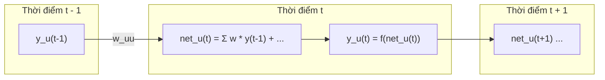

# Bài 2: Giải Phẫu Toán Học Hiện Tượng Vanishing & Exploding Gradient

> Trong mục 2 của bài báo ("CONSTANT ERROR FLOW: LIMITS OF CONVENTIONAL METHODS"), Hochreiter & Schmidhuber đã tóm lược lại phát hiện chấn động từ luận án năm 1991 của Hochreiter. Đây là nền tảng lý thuyết bắt buộc phải hiểu trước khi chạm vào kiến trúc LSTM.

---

## 1. Ẩn dụ Trực Quan: Chiếc Máy Photocopy & Phép Nhân Liên Tiếp

Hãy tưởng tượng bạn có một tờ văn bản quan trọng. Bạn mang đi photocopy:
* **Tình huống A (Vanishing - Mờ dần):** Máy photocopy hơi cũ, mỗi lần sao chụp thì mực in bị nhạt đi chỉ còn $90\%$ độ đậm ($0.9$).
  - Bản chụp thứ 1: còn $0.9$
  - Bản chụp thứ 2: lấy bản chụp 1 nhân tiếp $0.9 = 0.81$
  - Bản chụp thứ 10: $0.9^{10} \approx 0.35$ (chữ bắt đầu mờ tịt)
  - Bản chụp thứ 50: $0.9^{50} \approx 0.005$ (tờ giấy trắng tinh hoàn toàn!).
* **Tình huống B (Exploding - Nổ mực):** Máy photocopy bị lỗi cảm biến tương phản, mỗi lần copy lại khuếch đại độ tương phản lên $1.1$ lần.
  - Bản chụp thứ 50: $1.1^{50} \approx 117.4$ (toàn bộ trang giấy biến thành một mảng mực đen kịt, vấy bẩn toàn bộ!).

Toán học của mạng nơ-ron hồi quy khi lan truyền ngược qua thời gian cũng y hệt như việc bạn cho tín hiệu lỗi chạy qua chiếc máy photocopy này liên tục $T$ lần.

---

## 2. Mô Hình Toán Học Của Mạng RNN Thông Thường

Xét một mạng nơ-ron hồi quy thông thường với các nơ-ron ẩn. Tại bước thời gian $t$:
* Đầu vào tổng hợp trước kích hoạt của nơ-ron $u$ là:
  $$net_u(t) = \sum_m w_{um} y_m(t-1) + \sum_k w_{uk} x_k(t)$$
* Tín hiệu đầu ra sau kích hoạt của nơ-ron $u$ là:
  $$y_u(t) = f_u(net_u(t))$$
  Trong đó $f_u$ là hàm kích hoạt phi tuyến tính (thường là Sigmoid hoặc Hyperbolic Tangent - Tanh).

---

## 3. Quy Tắc Dây Chuyền (Chain Rule) Khi Lan Truyền Lỗi Ngược Thời Gian

Giả sử tại bước thời gian cuối cùng $T$, mạng sinh ra một sai số $E(T)$ tại nơ-ron đầu ra $k$. Ta muốn tính xem sai số này đóng góp bao nhiêu vào việc điều chỉnh trọng số $w$ kết nối tới nơ-ron ẩn $u$ tại một thời điểm rất xa trong quá khứ ($t \ll T$).

Tín hiệu lỗi tại nơ-ron $u$ ở thời điểm $t$ được định nghĩa là:
$$\vartheta_u(t) = -\frac{\partial E}{\partial net_u(t)}$$

Theo quy tắc dây chuyền của giải tích nhiều biến, lỗi từ bước thời gian sau ($t+1$) truyền ngược về bước thời gian trước ($t$) thông qua tất cả các đường đi có thể:
$$\vartheta_j(t) = f'_j(net_j(t)) \sum_i w_{ij} \vartheta_i(t+1)$$

Bây giờ, nếu ta truy vết dòng lỗi này từ thời điểm $T$ ngược về thời điểm $t$ (với độ trễ $q = T - t$ bước), công thức trở thành tích của một chuỗi các phần tử:

$$\frac{\partial \vartheta_u(t)}{\partial \vartheta_v(T)} = \sum_{l_1} \dots \sum_{l_{q-1}} \prod_{m=1}^q f'_{l_m}(net_{l_m}(t+m)) \, w_{l_m l_{m-1}}$$

> ⚠️ **Hệ thức then chốt:**  
> Tín hiệu lỗi bị nhân liên tiếp bởi biểu thức hệ số truyền lỗi:
> $$\text{Hệ số co giãn lỗi} \approx \prod_{m=1}^{T-t} f'(\cdot) \cdot W$$

---

## 4. Tại Sao Lại Bị Tiêu Biến (Vanishing)?

Hãy nhìn kỹ vào hai thành phần của tích số trên:

### Thành phần 1: Đạo hàm của hàm kích hoạt $f'(\cdot)$
Các mạng nơ-ron truyền thống sử dụng hàm kích hoạt **Sigmoid (logistic)**:
$$f(x) = \frac{1}{1 + e^{-x}}$$
Đạo hàm của hàm Sigmoid có dạng:
$$f'(x) = f(x)(1 - f(x))$$

Đặc tính toán học của hàm này:
- Giá trị lớn nhất của $f'(x)$ đạt được khi $x = 0$, và giá trị cực đại đó chỉ bằng:
  $$\max f'(x) = 0.5 \times (1 - 0.5) = 0.25$$
- Luôn luôn thỏa mãn: **$0 \le f'(x) \le 0.25$**.

Ngay cả khi bạn dùng hàm **Tanh**, đạo hàm cực đại cũng chỉ là:
$$f'_{\text{tanh}}(x) = 1 - \tanh^2(x) \le 1.0$$
(và phần lớn thời gian giá trị thực tế của nó nằm trong khoảng $0.1 \sim 0.5$).

### Thành phần 2: Trọng số kết nối $w$
- Nếu $|w \cdot f'| < 1$: Tích của chuỗi $q$ phần tử sẽ suy giảm theo hàm mũ về $0$:
  $$(< 1)^q \xrightarrow{q \to \infty} 0$$
- Ví dụ cụ thể: Giả sử $f' \approx 0.25$ và trọng số $|w| \approx 1$. Khi đó hệ số truyền lỗi mỗi bước là $0.25$.  
  Chỉ sau $10$ bước thời gian:
  $$0.25^{10} \approx 9.5 \times 10^{-7} \approx 0.00000095$$
  Tín hiệu đạo hàm giảm đi **hơn 1 triệu lần**!  
  Mạng nơ-ron coi như không còn nhận được bất kỳ tín hiệu sửa sai nào từ tương lai.

---

## 5. Tại Sao Lại Bị Nổ (Exploding)?

Vậy nếu ta khởi tạo trọng số thật lớn để bù lại thì sao? Giả sử ta chọn trọng số $|w| = 10$ sao cho $|w \cdot f'| > 1$.

Điều gì sẽ xảy ra?
$$(> 1)^q \xrightarrow{q \to \infty} \infty$$
- Tín hiệu lỗi tăng theo cấp số nhân.
- Sau một vài bước lan truyền ngược, đạo hàm trở thành các số khổng lồ ($10^6, 10^{12}$).
- Các bước nhảy gradient cập nhật trọng số sẽ trở nên cực kỳ hỗn loạn, làm trọng số nhảy vọt qua lại giữa các cực trị (oscillations) và cuối cùng dẫn đến lỗi tràn số máy tính (`NaN` - Not a Number).

---

## 6. Kết Luận Toán Học Của Hochreiter (Định lý 1991)

Trong bài báo, các tác giả đã đúc kết lại điều kiện để dòng lỗi **không bị tiêu biến cũng không bị nổ** (Constant Error Flow):
Hệ số truyền lỗi tổng quát qua thời gian phải thỏa mãn:

$$\frac{\partial net_j(t+1)}{\partial net_j(t)} = f'_j(net_j(t)) \cdot w_{jj} = 1.0$$

Điều này đặt ra một bài toán hóc búa cho các mạng hồi quy thông thường:
1. Đạo hàm $f'_j(net_j(t))$ là một đại lượng động, thay đổi liên tục theo đầu vào $net_j(t)$.
2. Muốn tích số $f'_j \cdot w_{jj}$ luôn bằng đúng $1.0$ ở mọi thời điểm $t$ là điều **bất khả thi** nếu dùng các hàm kích hoạt phi tuyến thông thường như Sigmoid hay Tanh!

Và đây chính là động lực trực tiếp dẫn đến phát minh vĩ đại trong phần tiếp theo: **Constant Error Carrousel (CEC)**.
