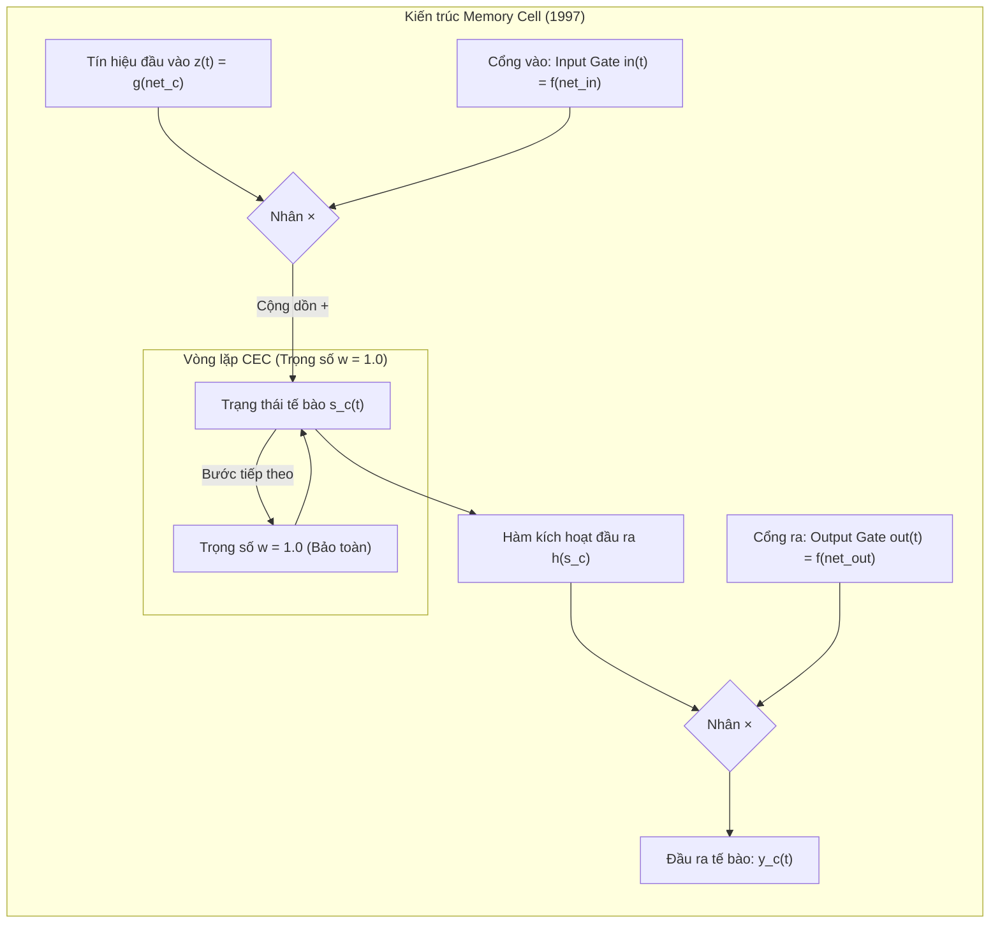

# Bài 3: Kiến Trúc Lõi Của LSTM (1997) – CEC & Các Cổng Nhân Tính

> *"Để duy trì dòng lỗi liên tục, ta tạo ra một đơn vị đặc biệt với kết nối tự phản hồi có trọng số bằng 1.0 và hàm kích hoạt tuyến tính. Ta gọi đơn vị này là Constant Error Carrousel (CEC)."*  
> — **Hochreiter & Schmidhuber (Section 3)**

---

## 1. Ẩn dụ Trực Quan: Chiếc Băng Chuyền Bảo Quản Mẫu Vật (Carrousel)

Hãy tưởng tượng bạn đang quản lý một mẫu vật quý hiếm (thông tin cần nhớ).
* Trong mạng RNN truyền thống, mẫu vật được chuyền tay qua một chuỗi các nhân viên vụng về: mỗi nhân viên lại bóp méo, làm mòn hoặc vấy bẩn mẫu vật một chút trước khi chuyển cho người kế tiếp.
* **Ý tưởng của LSTM:** Bạn đặt mẫu vật lên một **chiếc băng chuyền tròn khép kín (Carrousel)** hoạt động không ma sát và không hao hụt năng lượng.
  - Băng chuyền này quay vòng tròn mãi mãi với vận tốc không đổi ($w = 1.0$).
  - Mẫu vật trên băng chuyền được bảo tồn nguyên vẹn $100\%$ từ ngày này qua tháng khác.

Nhưng nếu chỉ có băng chuyền thì chưa đủ, bạn sẽ gặp phải hai vấn đề lớn:
1. **Làm sao đưa thêm mẫu vật mới vào băng chuyền mà không làm rơi vỡ mẫu vật cũ?** (Vấn đề Input Collision).
2. **Làm sao để người bên ngoài có thể nhìn thấy mẫu vật khi cần thiết mà không làm dừng băng chuyền?** (Vấn đề Output Collision).

Để giải quyết vấn đề này, Hochreiter & Schmidhuber lắp đặt thêm **hai chiếc van điều tiết thông minh (Gates)**: một van ở cửa nạp và một van ở cửa xả.

---

## 2. Chi Tiết Khối Lõi: Constant Error Carrousel (CEC)

Xét một nơ-ron đơn lẻ $c$. Để đảm bảo hệ số truyền lỗi qua thời gian luôn bằng đúng $1.0$:
$$\frac{\partial net_c(t+1)}{\partial net_c(t)} = f'_c(net_c(t)) \cdot w_{cc} = 1.0$$

Hochreiter & Schmidhuber chọn giải pháp triệt để:
1. **Hàm kích hoạt tuyến tính tuyệt đối:**  
   $$f_c(x) = x \implies f'_c(x) = 1.0 \quad \forall x$$
2. **Trọng số tự phản hồi (Self-recurrent weight) cố định bằng đúng 1:**  
   $$w_{cc} = 1.0$$

Khi kết hợp hai điều này:
$$f'_c \cdot w_{cc} = 1.0 \times 1.0 = 1.0 \quad (\text{BẤT DI BẤT DỊCH TẠI MỌI THỜI ĐIỂM!})$$

Trạng thái bên trong này được ký hiệu là $s_c(t)$ (trong văn liệu hiện đại thường gọi là Cell State $C_t$).  
Dòng lỗi đi vào CEC sẽ chạy tuần hoàn mãi mãi mà **không hề bị suy giảm theo hàm mũ, cũng không hề bị bùng nổ!**

---

## 3. Tại Sao Phải Có Các Cổng Nhân Tính (Multiplicative Gates)?

Nếu chỉ có một mình CEC thì mạng nơ-ron sẽ bị hỏng ngay lập tức vì hai xung đột sau:

### 3.1. Xung đột ghi đè (Input Weight Conflict / Input Trouble)
Trong các mạng RNN, một nơ-ron vừa phải làm nhiệm vụ **ghi nhớ** ngữ cảnh cũ, vừa phải tiếp nhận **thông tin mới** từ môi trường.
* Khi có một tín hiệu quan trọng xuất hiện ở bước $t=1$, mạng cần lưu nó lại.
* Nhưng ở các bước $t=2, 3, \dots, 100$, mạng liên tục nhận các tín hiệu rác từ môi trường. Các tín hiệu rác này sẽ liên tục cộng dồn vào làm nhiễu loạn và xóa sạch thông tin quý giá ban đầu!

👉 **Giải pháp - Cổng vào (Input Gate):**
Ta thêm một nơ-ron gác cổng $in$. Khi nơ-ron này đóng (giá trị kích hoạt xấp xỉ $0$), nó sẽ chặn đứng mọi tín hiệu nhiễu bên ngoài không cho chạm vào CEC. Khi có thông tin quan trọng xuất hiện, cổng mở ra ($in \approx 1$) cho phép nạp dữ liệu vào bộ nhớ.

### 3.2. Xung đột trích xuất (Output Weight Conflict / Output Trouble)
Thông tin lưu trong CEC có thể chỉ cần thiết cho đầu ra ở một thời điểm rất xa trong tương lai (ví dụ bước $t=1000$).
* Trong suốt 999 bước trung gian, nếu tế bào nhớ liên tục phát tín hiệu ra ngoài, nó sẽ làm rối loạn các nơ-ron ẩn và nơ-ron đầu ra khác.
* Đầu ra của mạng sẽ bị thiên lệch và không thể thực hiện các tác vụ ngắn hạn khác.

👉 **Giải pháp - Cổng ra (Output Gate):**
Ta thêm một nơ-ron gác cổng $out$. Chừng nào thông tin trong CEC chưa cần dùng đến, cổng ra đóng chặt ($out \approx 0$), giấu kín nội dung bộ nhớ bên trong. Đến đúng thời khắc quyết định, cổng ra mở ($out \approx 1$) để giải phóng tín hiệu.

---

## 4. Các Phương Trình Toán Học Của Tế Bào Nhớ LSTM (Bản Gốc 1997)

Một khối nhớ (Memory Cell) trong bài báo gốc gồm:
- $in$: Cổng vào (Input Gate)
- $out$: Cổng ra (Output Gate)
- $c$: Tế bào nhớ trung tâm chứa CEC (Memory Cell)

### Bước 1: Tính toán cổng vào (Input Gate Activation)
$$net_{in}(t) = \sum_m w_{in, m} \, y_m(t-1)$$
$$y_{in}(t) = f_{in}(net_{in}(t))$$
*(Trong đó $f_{in}$ là hàm Sigmoid nhận giá trị trong đoạn $[0, 1]$)*.

### Bước 2: Tính toán thông tin mới cần nạp (Cell Input)
$$net_c(t) = \sum_m w_{c, m} \, y_m(t-1)$$
$$g(net_c(t))$$
*(Trong đó $g$ là hàm kích hoạt phi tuyến tính, thường là Tanh hoặc Sigmoid, nhận giá trị trong khoảng $[-2, 2]$ hoặc $[-1, 1]$)*.

### Bước 3: Cập nhật trạng thái tế bào nhớ (Cell State Update)
$$s_c(t) = s_c(t-1) + y_{in}(t) \cdot g(net_c(t))$$

> 🔍 **Quan sát cực kỳ quan trọng:**
> Hãy nhìn vào phương trình cập nhật trạng thái $s_c(t)$:
> - Trạng thái cũ $s_c(t-1)$ được giữ nguyên $100\%$ (hệ số trước nó là $1.0$).
> - Thông tin mới $g(net_c(t))$ được kiểm soát bởi cổng vào $y_{in}(t)$.
> - Nếu $y_{in}(t) = 0$, ta có: $s_c(t) = s_c(t-1)$ (Bộ nhớ đóng băng tuyệt đối, giữ nguyên qua thời gian!).

### Bước 4: Tính toán cổng ra (Output Gate Activation)
$$net_{out}(t) = \sum_m w_{out, m} \, y_m(t-1)$$
$$y_{out}(t) = f_{out}(net_{out}(t))$$
*(Với $f_{out}$ là hàm Sigmoid $[0, 1]$)*.

### Bước 5: Tính toán đầu ra cuối cùng của tế bào nhớ (Cell Output)
$$y_c(t) = y_{out}(t) \cdot h(s_c(t))$$
*(Trong đó $h$ là hàm kích hoạt đầu ra phi tuyến tính, thường là Tanh hoặc Sigmoid có miền giá trị được tinh chỉnh)*.

---

## 5. Lưu Ý Lịch Sử Sâu Sắc: Bản Gốc 1997 CHƯA CÓ Forget Gate!

Nếu bạn từng học LSTM qua các thư viện hiện đại như PyTorch hay Keras, bạn sẽ thấy phương trình cập nhật trạng thái luôn có mặt **Forget Gate** ($f_t$):
$$C_t = f_t \odot C_{t-1} + i_t \odot \tilde{C}_t$$

Nhưng trong bài báo gốc năm 1997 này:
$$s_c(t) = 1.0 \times s_c(t-1) + y_{in}(t) \cdot g(net_c(t))$$
**Không hề có $f_t$! Hệ số của $s_c(t-1)$ luôn luôn bằng $1.0$.**

### Tại sao lúc đó các tác giả lại làm như vậy?
Bởi vì mục tiêu sống còn số 1 của bài báo 1997 là **bảo toàn tuyệt đối dòng lỗi không bao giờ tiêu biến** ($1.0 \times \text{lỗi} = \text{lỗi}$). Nếu đưa thêm một số thập phân nhỏ hơn 1 vào (như Forget Gate), về mặt lý thuyết dòng lỗi có thể bị suy giảm trở lại!

### Vậy làm sao mạng xóa được bộ nhớ trong bản 1997?
Trong bản 1997, mạng xử lý các chuỗi hữu hạn có khởi tạo lại (reset) trạng thái ở đầu mỗi epoch/chuỗi.  
Mãi đến năm 2000, học trò của Schmidhuber là **Felix Gers** mới đề xuất thêm **Forget Gate** để giải quyết vấn đề bộ nhớ bị tràn (bão hòa) khi mạng phải chạy trên các chuỗi dài vô tận liên tục.

Ở bài tiếp theo, chúng ta sẽ xem thuật toán huấn luyện và kỹ thuật **Truncated Backprop** độc đáo được cài đặt như thế nào để đạt độ phức tạp siêu tối ưu $O(1)$.
