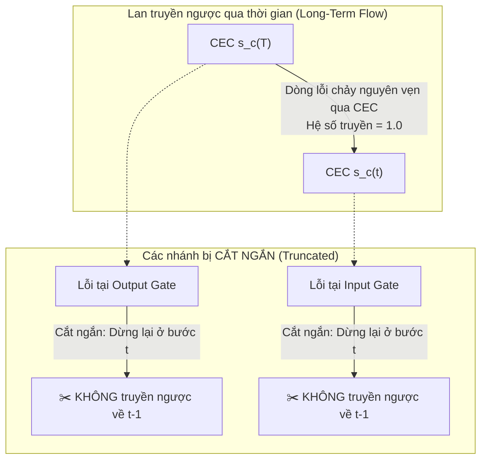

# Bài 4: Thuật Toán Huấn Luyện & Kỹ Thuật Truncated Backprop O(1)

> Trong mục "ALGORITHM DETAILS" (Appendix của bài báo), Hochreiter & Schmidhuber mô tả chi tiết thuật toán lan truyền xuôi và lan truyền ngược của LSTM 1997. Điểm độc đáo nhất nằm ở chỗ: **Họ chủ động cắt ngắn gradient (Truncate) tại các điểm then chốt để thuật toán đạt độ phức tạp $O(1)$ mà không làm mất khả năng nhớ dài hạn!**

---

## 1. Ẩn dụ Trực Quan: Cách Ly Khu Vực Bệnh Viện

Hãy tưởng tượng bạn đang điều hành một bệnh viện:
- Khu vực **Phòng Hồi Sức Cấp Cứu (CEC)**: Là nơi bệnh nhân quan trọng cần được chăm sóc đặc biệt, tín hiệu nhịp tim phải được duy trì liên tục $24/7$ không được phép ngắt quãng.
- Khu vực **Hành lang chung (Các cổng và nơ-ron thông thường)**: Người nhà, khách vãng lai ra vào liên tục.

Nếu có một sự cố xảy ra ở hành lang, bạn có muốn phong tỏa và rà soát ngược lại toàn bộ lịch sử 10.000 ngày của bệnh viện không?  
Chắc chắn là không! Bạn chỉ cần giải quyết sự cố ngay tại thời điểm đó (cục bộ trong $1$ bước thời gian).  
Chỉ riêng **nhịp tim của bệnh nhân trong phòng cấp cứu (CEC)** là cần được bảo toàn dòng thời gian xuyên suốt từ quá khứ đến hiện tại.

Kỹ thuật **Truncated Backpropagation** trong LSTM 1997 hoạt động chính xác theo nguyên lý cách ly này.

---

## 2. Vì Sao Cần Truncated Backpropagation?

Trong mạng RNN thông thường sử dụng BPTT đầy đủ:
- Muốn tính gradient tại bước $T$, bạn phải lưu trữ toàn bộ đồ thị tính toán từ bước $1$ đến bước $T$.
- Chi phí bộ nhớ là $O(T)$ và chi phí tính toán là $O(T)$ cho mỗi bước thời gian.
- Nếu chuỗi dài $10.000$ bước, bộ nhớ RAM thời năm 1997 sẽ bị nổ ngay lập tức, và việc tính toán lan truyền ngược qua $10.000$ bước sẽ cực kỳ tốn kém.

Nếu dùng RTRL (Real-Time Recurrent Learning) để không cần lưu vết thời gian:
- Độ phức tạp không gian và thời gian lại lên tới $O(N^4)$ hoặc $O(N^3)$ với $N$ là số nơ-ron — hoàn toàn bất khả thi cho các mạng có kích thước thực tế.

👉 **Quyết định thiên tài của Hochreiter & Schmidhuber:**  
Họ nhận ra rằng: **Vanishing gradient chỉ là vấn đề sống còn của trạng thái bên trong tế bào nhớ (CEC). Đối với các nơ-ron cổng (Input Gate, Output Gate), ta KHÔNG CẦN phải lan truyền ngược lỗi qua nhiều bước thời gian!**  
Lỗi truyền tới các cổng chỉ cần cập nhật trọng số ngay tại bước thời gian hiện tại rồi **CẮT NGANG (Truncate)**, không cho rò rỉ ngược về các bước thời gian trước đó.

---

## 3. Chi Tiết Thuật Toán Huấn Luyện (Lan Truyền Xuôi & Ngược)

### 3.1. Lan truyền xuôi (Forward Pass)
Tại mỗi bước thời gian $t$:
1. **Tính kích hoạt của các cổng và tế bào nhớ:**
   $$net_{in}(t) = \sum_m w_{in, m} y_m(t-1)$$
   $$y_{in}(t) = f_{in}(net_{in}(t))$$
   
   $$net_c(t) = \sum_m w_{c, m} y_m(t-1)$$
   $$s_c(t) = s_c(t-1) + y_{in}(t) \, g(net_c(t))$$

   $$net_{out}(t) = \sum_m w_{out, m} y_m(t-1)$$
   $$y_{out}(t) = f_{out}(net_{out}(t))$$
   
   $$y_c(t) = y_{out}(t) \, h(s_c(t))$$

2. **Tính toán đầu ra của mạng (Output Units):**
   $$net_k(t) = \sum_m w_{km} y_m(t)$$
   $$y_k(t) = f_k(net_k(t))$$

---

### 3.2. Lan truyền ngược có cắt ngắn (Truncated Backward Pass)

Giả sử tại thời điểm $t$, có tín hiệu mục tiêu (target) $t_k(t)$ tại nơ-ron đầu ra $k$.
Lỗi bình phương tại bước $t$:
$$E(t) = \frac{1}{2} \sum_k (t_k(t) - y_k(t))^2$$

#### Bước A: Lỗi tại nơ-ron đầu ra
$$\vartheta_k(t) = -\frac{\partial E(t)}{\partial net_k(t)} = (t_k(t) - y_k(t)) f'_k(net_k(t))$$
Cập nhật trọng số kết nối tới nơ-ron đầu ra:
$$\Delta w_{km}(t) = \eta \, \vartheta_k(t) \, y_m(t)$$

#### Bước B: Lan truyền lỗi tới Tế bào nhớ và Cổng ra
Lỗi từ các nơ-ron đầu ra truyền về đầu ra của tế bào nhớ $y_c(t)$:
$$\vartheta_c(t) = \sum_k w_{kc} \vartheta_k(t)$$

1. **Cập nhật Cổng ra (Output Gate):**
   Cổng ra quyết định lượng thông tin phóng thích ra ngoài. Đạo hàm theo $net_{out}$:
   $$\vartheta_{out}(t) = f'_{out}(net_{out}(t)) \cdot \sum_c h(s_c(t)) \cdot \vartheta_c(t)$$
   $$\Delta w_{out, m}(t) = \eta \, \vartheta_{out}(t) \, y_m(t-1)$$
   *(Sau bước này, đạo hàm $\vartheta_{out}$ bị **cắt ngắn**, không truyền ngược về $t-1$)*.

2. **Dòng lỗi bên trong Trạng thái tế bào (Internal State Error):**
   Đạo hàm của hàm mất mát theo trạng thái tế bào $s_c$:
   $$e_{s_c}(t) = \left( \frac{\partial y_c(t)}{\partial s_c(t)} \right) \vartheta_c(t) = y_{out}(t) \, h'(s_c(t)) \, \vartheta_c(t)$$

   Bây giờ hãy nhìn vào phương trình đệ quy ngược thời gian của lỗi trạng thái tế bào:
   $$\frac{\partial s_c(t)}{\partial s_c(t-1)} = 1.0$$
   Do đó, dòng lỗi tích lũy bên trong CEC được bảo toàn tuyệt đối:
   $$e_{s_c}(t-1) = e_{s_c}(t) \times 1.0 = e_{s_c}(t)$$

3. **Cập nhật Cổng vào (Input Gate) và Đầu vào tế bào:**
   Để cập nhật các trọng số $w_{in, m}$ và $w_{c, m}$, ta dùng đạo hàm tích lũy trực tiếp từ trạng thái tế bào:
   $$\Delta w_{c, m}(t) = \eta \sum_{\tau \le t} e_{s_c}(\tau) \, y_{in}(\tau) \, g'(net_c(\tau)) \, y_m(\tau-1)$$
   $$\Delta w_{in, m}(t) = \eta \sum_{\tau \le t} e_{s_c}(\tau) \, g(net_c(\tau)) \, f'_{in}(net_{in}(\tau)) \, y_m(\tau-1)$$

---

## 4. Chứng Minh Độ Phức Tạp: Cục Bộ Cả Về Không Gian & Thời Gian (Local in Space and Time)

Một trong những thành tựu kỹ thuật vĩ đại nhất của LSTM 1997 là đặc tính:
> **Computational complexity per time step and weight is $O(1)$.**

| Thuật toán | Độ phức tạp thời gian mỗi bước | Bộ nhớ cần thiết (Không gian) | Khả năng nhớ bước dài |
|---|---|---|---|
| **BPTT chuẩn** | $O(W \cdot T)$ (phụ thuộc độ dài chuỗi $T$) | $O(N \cdot T)$ (phải lưu toàn bộ lịch sử) | Rất kém ($< 10$ bước) do Vanishing Gradient |
| **RTRL chuẩn** | $O(N^4)$ hoặc $O(N^2 \cdot W)$ | $O(N^3)$ | Rất kém ($< 10$ bước) |
| **LSTM (1997)** | **$O(W)$** (hoàn toàn độc lập với $T$!) | **$O(W)$** (chỉ lưu vết các biến tích lũy cục bộ) | **Vô địch ($> 1.000$ bước)** |

### Tại sao đạt được điều này?
1. **Cục bộ về không gian (Local in space):** Mỗi nơ-ron và trọng số chỉ cần thông tin từ các nơ-ron kết nối trực tiếp với nó, không cần biết cấu trúc toàn cục của mạng.
2. **Cục bộ về thời gian (Local in time):** Nhờ cơ chế cắt ngắn gradient ngoài CEC, thuật toán có thể cập nhật trọng số trực tuyến ngay sau mỗi bước thời gian ($t$) mà **không cần phải đợi hết chuỗi mới chạy ngược lại**. Bộ nhớ RAM không bao giờ bị tăng theo độ dài chuỗi!

Ở bài tiếp theo, chúng ta sẽ chiêm ngưỡng màn trình diễn ngoạn mục của LSTM qua 6 thí nghiệm kinh điển đè bẹp mọi đối thủ thời bấy giờ.
