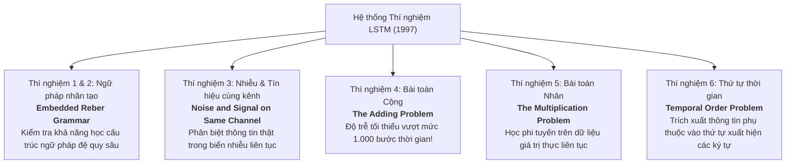
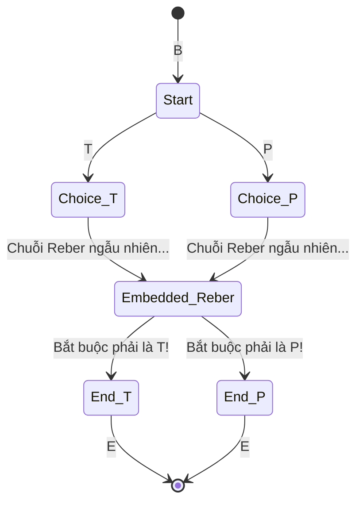
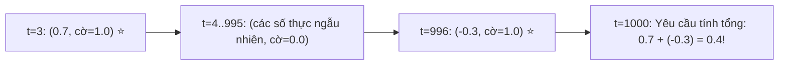

# Bài 5: Các Thí Nghiệm Kinh Điển Trong Bài Báo Gốc 1997

> Để chứng minh tính ưu việt tuyệt đối của kiến trúc mới, Hochreiter & Schmidhuber đã thiết kế một chuỗi 6 nhóm thí nghiệm cực kỳ khắt khe (Section 5: EXPERIMENTS). Tất cả đều là những bài toán mà các thuật toán RNN thời đó (BPTT, RTRL, Elman Nets, Cascade-Correlation) phải "bó tay chịu trói".

---

## 1. Bản Đồ Tổng Quan Các Thí Nghiệm

---

## 2. Thí Nghiệm 1 & 2: Ngữ Pháp Nhúng Reber (Embedded Reber Grammar)

### Ẩn dụ: Nhớ cấu trúc mở ngoặc - đóng ngoặc
Hãy tưởng tượng một biểu thức toán học có rất nhiều ngoặc lồng nhau:
`( [ { ... hàng trăm phép tính ngẫu nhiên bên trong ... } ] )`
Bạn phải nhớ rằng ký tự mở đầu là dấu mở ngoặc tròn `(` thì ký tự kết thúc cuối cùng bắt buộc phải là dấu đóng ngoặc tròn `)`.

### Thiết kế bài toán Reber Grammar
Một đồ thị trạng thái sinh ra các chuỗi ký tự hợp lệ tuân theo ngữ pháp nghiêm ngặt (các ký tự: $B, T, S, X, X, V, P, E$).
Trong bài toán **Embedded Reber Grammar**, một chuỗi Reber hoàn chỉnh được nhúng vào giữa hai ký tự đặc biệt:
- Bắt đầu: `B - T - [Chuỗi Reber ngẫu nhiên] - T - E`
- Hoặc: `B - P - [Chuỗi Reber ngẫu nhiên] - P - E`

Mạng phải nhớ ký tự thứ hai (`T` hay `P`) qua hàng chục bước sinh ký tự ngẫu nhiên ở giữa để dự đoán đúng ký tự áp chót.

### Kết quả đối đầu:
* **RTRL, Elman Nets, BPTT:** Thất bại hoàn toàn hoặc cần hàng triệu chuỗi để hội tụ một phần.
* **Recurrent Cascade-Correlation:** Cần trung bình $24.000$ chuỗi.
* **LSTM:** Học hoàn hảo chỉ sau khoảng **$20.000 \sim 30.000$** chuỗi thử nghiệm, và quan trọng nhất là **đạt tỷ lệ thành công 100/100 lần chạy!**

---

## 3. Thí Nghiệm 4: Bài Toán Cộng (The Adding Problem) – Mốc Son 1.000 Bước Thời Gian!

Đây là thí nghiệm mang tính biểu tượng đã làm nên tên tuổi vĩnh cửu của LSTM.

### Thiết kế bài toán
Mỗi bước thời gian $t$, mạng nhận một vector 2 chiều:
1. Chiều thứ nhất: Một số thực liên tục $x_1(t) \in [-1.0, 1.0]$ ngẫu nhiên (nhiễu liên tục).
2. Chiều thứ hai: Một dấu cờ đánh dấu (marker) $x_2(t) \in \{-1.0, 0.0, 1.0\}$.
   - Bình thường $x_2(t) = 0.0$.
   - Trong suốt chuỗi dài $T$ bước, **chỉ có đúng 2 thời điểm** cờ được bật lên $x_2(t) = 1.0$:
     - Vị trí 1: ngẫu nhiên trong 10 bước đầu tiên ($t \in [1, 10]$).
     - Vị trí 2: ngẫu nhiên ở nửa cuối chuỗi.

🎯 **Nhiệm vụ:** Ở bước cuối cùng $T$, mạng phải tính tổng của hai số thực tại hai vị trí được đánh dấu:
$$Target = X^{(1)} + X^{(2)}$$

### Độ trễ (Time Lag):
Tác giả thử nghiệm với độ dài chuỗi $T = 100$, rồi đẩy lên $T = 500$, và đỉnh cao là:
$$T = 1.000 \text{ bước thời gian!}$$

### Kết quả:
* **Các thuật toán truyền thống (BPTT, RTRL):**
  - Không thể học nổi dù chỉ $T = 100$. Mô hình nhanh chóng bỏ cuộc và chỉ học được giải pháp ngây thơ: luôn đoán giá trị trung bình là $0.0$ (khi đó Mean Squared Error kẹt cứng ở mức $0.176$).
* **LSTM:**
  - Giải quyết bài toán gọn gàng ngay cả với $T = 1.000$ bước!
  - Cổng vào (Input Gate) học được cách **đóng chặt $998$ lần** để chặn mọi số thực nhiễu bên ngoài, và **chỉ mở đúng $2$ lần** khi cờ $x_2 = 1.0$ xuất hiện.
  - Vòng lặp CEC bảo toàn giá trị cộng dồn qua suốt $1.000$ bước mà không mất đi một chữ số thập phân nào!

---

## 4. Thí Nghiệm 5 & 6: Bài Toán Nhân & Thứ Tự Thời Gian (Temporal Order)

### Bài toán nhân (Multiplication Problem)
Tương tự bài toán cộng, nhưng ở bước cuối cùng mạng phải xuất ra:
$$Target = X^{(1)} \times X^{(2)}$$
Bài toán này khó hơn vì quan hệ giữa hai đầu vào là phi tuyến tính nghiêm ngặt. LSTM vẫn học thành công vượt trội trong khi các đối thủ hoàn toàn thất bại.

### Bài toán thứ tự thời gian (Temporal Order Task)
Một bài toán phân loại chuỗi tinh tế:
- Chuỗi dài hàng trăm bước chỉ gồm các ký tự rác $\{a, b, c, d\}$.
- Giữa chuỗi có xuất hiện hai ký tự đặc biệt $X$ hoặc $Y$ tại hai vị trí cách nhau rất xa.
- Có 4 lớp đầu ra tùy thuộc vào **thứ tự xuất hiện**:
  1. $X \dots X \implies \text{Lớp } Q$
  2. $X \dots Y \implies \text{Lớp } R$
  3. $Y \dots X \implies \text{Lớp } S$
  4. $Y \dots Y \implies \text{Lớp } U$

LSTM giải quyết bài toán này với độ trễ hàng trăm bước một cách dễ dàng, chứng minh khả năng ghi nhớ không chỉ thông tin tĩnh mà cả **thứ tự thời gian tương đối (Relative Temporal Order)** của các sự kiện.

---

## 5. Bảng Tổng Kết So Sánh Lịch Sử (Từ Bảng Kết Quả Trong Bài Báo)

| Tác vụ thí nghiệm | Thuật toán BPTT | Thuật toán RTRL | Neural Sequence Chunking | **LSTM (1997)** |
|---|---|---|---|---|
| **Embedded Reber** | Thất bại ($> 10^6$ chuỗi) | Thất bại / Rất chậm | Học được ($> 10^5$) | **Thắng áp đảo ($2 \times 10^4$)** |
| **Noise on same channel** | Bất lực | Bất lực | Bất lực | **Thành công 100%** |
| **Adding ($T=100$)** | Kẹt ở MSE = 0.176 | Kẹt ở MSE = 0.176 | Không áp dụng được | **Thành công hoàn hảo** |
| **Adding ($T=1000$)** | Hoàn toàn bất khả thi | Hoàn toàn bất khả thi | Hoàn toàn bất khả thi | **Thành công (Giải quyết nhẹ nhàng)** |
| **Temporal Order ($T=100$)**| Thất bại hoàn toàn | Thất bại hoàn toàn | Thất bại | **Hội tụ sau vài chục nghìn bước** |

Những kết quả này vào năm 1997 là một cơn địa chấn thực sự trong cộng đồng nghiên cứu mạng nơ-ron, chứng minh rằng mạng hồi quy hoàn toàn có thể vượt qua rào cản thời gian nếu được trang bị kiến trúc cổng thích hợp.
