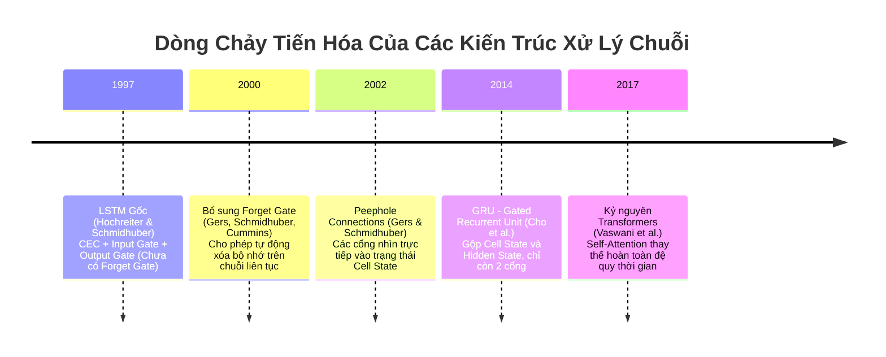
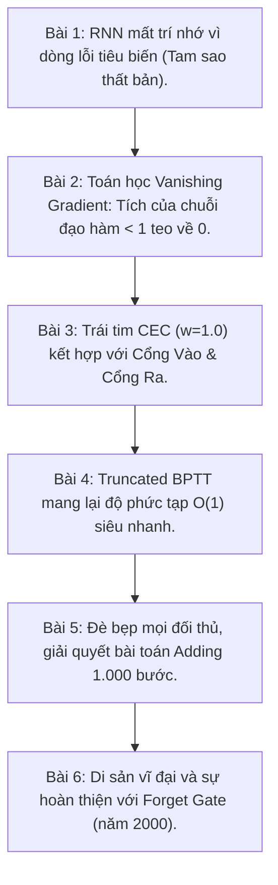

# Bài 6: So Sánh LSTM 1997 Gốc vs. LSTM Hiện Đại & Các Hạn Chế Thực Tế

> Trong mục "DISCUSSION" và "CONCLUSION" của bài báo, Hochreiter & Schmidhuber đã rất trung thực chỉ ra các giới hạn lý thuyết của phiên bản năm 1997. Hiểu được các hạn chế này sẽ giúp bạn hiểu tại sao kiến trúc LSTM mà chúng ta dùng trong PyTorch/TensorFlow ngày nay lại có hình dạng như hiện tại.

---

## 1. Bản Đồ Tiến Hóa: Từ LSTM 1997 Đến Transformers Ngày Nay

---

## 2. So Sánh Đối Đầu: LSTM 1997 Gốc vs. LSTM Chuẩn Hiện Đại

Hãy đặt hai phiên bản cạnh nhau để thấy rõ từng cải tiến:

| Thành phần | LSTM 1997 (Bài Báo Gốc) | LSTM Chuẩn Hiện Đại (Sau năm 2000) |
|---|---|---|
| **Cổng Quên (Forget Gate)** | ❌ **KHÔNG CÓ** (Hệ số giữ lại luôn cố định bằng $1.0$) | ✅ **BẮT BUỘC CÓ** ($f_t = \sigma(W_f x_t + U_f h_{t-1} + b_f)$) |
| **Cập nhật Cell State** | $s_c(t) = s_c(t-1) + y_{in}(t) \cdot g(net_c(t))$ | $C_t = f_t \odot C_{t-1} + i_t \odot \tilde{C}_t$ |
| **Cổng Vào (Input Gate)** | $y_{in}(t) = f_{in}(net_{in}(t))$ | $i_t = \sigma(W_i x_t + U_i h_{t-1} + b_i)$ |
| **Cổng Ra (Output Gate)** | $y_{out}(t) = f_{out}(net_{out}(t))$ | $o_t = \sigma(W_o x_t + U_o h_{t-1} + b_o)$ |
| **Đầu ra ẩn (Hidden state)** | $y_c(t) = y_{out}(t) \cdot h(s_c(t))$ | $h_t = o_t \odot \tanh(C_t)$ |
| **Cách xử lý chuỗi dài vô tận** | Phải reset trạng thái thủ công ở đầu mỗi chuỗi | Tự động quên thông tin cũ không còn phù hợp |
| **Backpropagation** | Truncated Backprop (cắt ngắn gradient ngoài CEC) | Full BPTT (trên cửa sổ trượt n bước) |

---

## 3. Vì Sao Bản 1997 Phải Bổ Sung Forget Gate (Năm 2000)?

### Vấn đề: Hiện tượng "Bão hòa bộ nhớ" (State Saturation)
Hãy nhìn vào phương trình của bản 1997:
$$s_c(t) = s_c(t-1) + \text{thông tin mới nạp}$$
Bởi vì hệ số trước $s_c(t-1)$ luôn bằng $1.0$:
- Mỗi khi có thông tin mới được nạp vào, giá trị $s_c(t)$ sẽ **chỉ có thể tăng dần hoặc giảm dần mà không bao giờ quay về 0**.
- Nếu mạng phải xử lý một luồng dữ liệu liên tục không có điểm dừng (ví dụ: dữ liệu cảm biến chạy $24/7$ suốt nhiều tháng):
  Giá trị của $s_c(t)$ sẽ dần dần tiến tới vô cực ($+\infty$ hoặc $-\infty$).
- Khi $s_c(t)$ quá lớn, hàm kích hoạt đầu ra $h(s_c(t))$ (như Tanh) sẽ bị rơi vào vùng bão hòa bằng phẳng, khiến đạo hàm $h'$ bằng 0 và mạng bị "đơ"!

👉 **Học trò Felix Gers đã giải cứu bài toán:**  
Năm 2000, Felix Gers đề xuất thay hệ số cố định $1.0$ bằng một cổng học được: **Forget Gate ($f_t \in [0, 1]$)**.  
- Khi $f_t \approx 1$: Hoạt động y hệt như bản gốc 1997 (bảo toàn trọn vẹn lỗi).
- Khi $f_t \approx 0$: Tế bào chủ động xóa sạch bộ nhớ cũ để bắt đầu một chu kỳ mới mà không cần can thiệp thủ công từ bên ngoài!

---

## 4. Hạn Chế Thực Tế Của Bản Gốc (Được Thảo Luận Trong Section 6)

Trong mục "LIMITATIONS OF LSTM", Hochreiter & Schmidhuber đã trung thực thừa nhận những bài toán mà bản 1997 chưa thể giải quyết tốt:

### 4.1. Bài toán XOR trễ sâu (Strongly Delayed XOR Problem)
Giả sử ta cần tính:
$$Target = X_1 \oplus X_2$$
với $X_1$ và $X_2$ nằm cách nhau rất xa trong chuỗi.
* Bản chất của bài toán XOR là **không thể phân rã tuyến tính (Non-decomposable)**:
  - Bạn không thể giảm một phần sai số bằng cách chỉ nhớ mỗi $X_1$.
  - Trừ khi bạn nhớ được **cả hai số cùng một lúc**, sai số mới giảm; nếu chỉ nhớ một số thì việc đoán mò không đem lại lợi ích gì cho hàm mất mát.
* Vì thuật toán cắt ngắn gradient (Truncated Backprop) dựa vào tín hiệu cải thiện từng bước, mạng LSTM 1997 rất khó tự mò mẫm ra lời giải cho bài toán này nếu không có thêm các nơ-ron ẩn phụ trợ.

### 4.2. Không giải quyết được các bài toán cần "Đọc ngẫu nhiên" (Random Access Memory)
LSTM lưu trữ thông tin dưới dạng một giá trị tổng dồn liên tục trong tế bào nhớ:
- Nó hoạt động giống như một **ngăn xếp (Stack)** hoặc **băng từ cassette**: muốn đọc thông tin cũ, bạn phải tua qua thời gian.
- Nó không có cơ chế "con trỏ" để nhảy thẳng đến vị trí cụ thể trong quá khứ như kiến trúc Neural Turing Machine (2014) hay cơ chế **Self-Attention** trong Transformers (2017).

---

## 5. Di Sản Vĩ Đại Của Bài Báo 1997

Bất chấp những hạn chế ban đầu, bài báo "Long Short-Term Memory" năm 1997 của Hochreiter & Schmidhuber là một tượng đài bất hủ:
1. **Lần đầu tiên trong lịch sử:** Chứng minh bằng thực nghiệm và giải tích rằng một mạng nơ-ron nhân tạo có thể học được các mối liên hệ cách nhau hơn **1.000 bước thời gian**.
2. **Khai sinh triết lý "Cổng" (Gating Mechanism):** Ý tưởng dùng phép nhân giữa các nơ-ron để điều khiển dòng thông tin sau này đã trở thành nền tảng cho hàng loạt kiến trúc đỉnh cao: GRU, Highway Networks, ResNet (Skip Connections), và chính bản thân cơ chế Attention.
3. **Thúc đẩy cuộc cách mạng AI thập niên 2010:** Trước khi Transformers ra đời, chính LSTM là động cơ cốt lõi đứng sau Google Translate, Siri của Apple, nhận dạng giọng nói của Google Voice, và tạo sinh phụ đề video.

---

## 📚 Tóm tắt Toàn Bộ 6 Bài Học

Hy vọng bộ tài liệu này đã mang lại cho bạn cái nhìn sâu sắc, trong sáng và trọn vẹn nhất về một trong những phát minh vĩ đại nhất của trí tuệ nhân tạo hiện đại!
