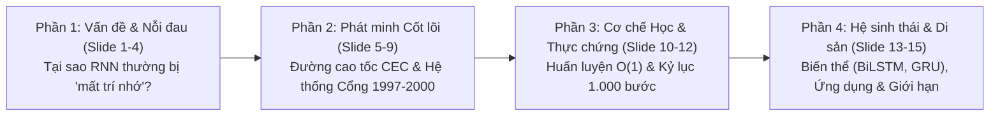

# Kế Hoạch & Ý Tưởng Slide Báo Cáo Team: Giải Mã LSTM (Đúng 15 Trang)

Tài liệu này tổng hợp và thiết kế kịch bản trình bày **15 slide hoàn chỉnh** để báo cáo cho team kỹ thuật/nghiên cứu, kết hợp hài hòa từ 3 nguồn cốt lõi:
1. **Bộ tài liệu nền tảng theo kỹ thuật Feynman:** [PTDLKD/LSTM/explanation](https://github.com/snowflake-vibing/KnowledgeLibrary/tree/main/PTDLKD/LSTM/explanation) (Bài báo gốc Hochreiter & Schmidhuber 1997).
2. **Trực giác cốt lõi (Video Podcast):** *What is LSTM?* ([YouTube `hcKsSOQolWc`](https://www.youtube.com/watch?v=hcKsSOQolWc)) — truyền đạt nhanh bản chất kiến trúc và cơ chế cổng.
3. **Bản đồ sư phạm chuẩn mực (Tutorial Paper):** *Understanding LSTM — a tutorial into LSTM-RNNs* ([arXiv:1909.09586](https://arxiv.org/pdf/1909.09586), Ralf C. Staudemeyer & Eric Rothstein Morris, 2019) — chuẩn hóa ký hiệu, thuật toán lai (Hybrid BPTT + RTRL), Forget Gate, biến thể (BiLSTM, Stacked, Grid, GRU) và ứng dụng.

---

## 🎯 Mạch Kể Chuyện Tổng Thể (Storytelling Arc)

Thay vì liệt kê công thức khô khan, bài thuyết trình 15 trang đi theo một câu chuyện có cao trào, thắt nút và mở nút:

* **Thời lượng dự kiến:** 15–20 phút (trung bình ~1 phút/slide).
* **Phong cách:** Trực quan trước, toán học chứng minh ngay sau (Feynman Technique) — giúp cả thành viên mới lẫn người làm sâu về toán đều nắm bắt trọn vẹn.

---

## 📊 Chi Tiết Kịch Bản Từng Slide (15/15 Trang)

### Slide 1: Trang Bìa (Title Slide) — "Long Short-Term Memory: Làm Sao Để Mạng Nơ-ron Không Bị Mất Trí Nhớ?"
* **Nội dung hiển thị:**
  - Tiêu đề chính lớn, phụ đề: *Từ bài báo nền tảng 1997 đến Tutorial chuẩn hóa hiện đại*.
  - Nguồn tham khảo nhanh (3 biểu tượng: Paper 1997, arXiv:1909.09586, Podcast).
  - Tên người báo cáo & ngày báo cáo.
* **Hình ảnh/Visual:** Một hình minh họa ẩn dụ tối giản: Bộ não có một chiếc két sắt hoặc băng chuyền phát sáng.
* **Speaker Notes (Lời dẫn):** *"Hôm nay mình sẽ cùng mọi người giải phẫu một kiến trúc đã thống trị AI xử lý chuỗi suốt hai thập kỷ trước kỷ nguyên Transformer: LSTM. Nhưng thay vì nhồi công thức, mình sẽ trả lời một câu hỏi duy nhất: Làm sao dạy cho một mạng nơ-ron biết nhớ qua 1.000 bước thời gian?"*

---

### Slide 2: Bối Cảnh & Phân Biệt Bộ Nhớ — Short-Term vs. Long-Term Memory
* **Nội dung hiển thị:**
  - Định nghĩa nhanh mạng hồi quy (RNN): Đầu ra bước trước quay lại làm đầu vào bước sau.
  - Bảng so sánh 2 loại trí nhớ trong Neural Network:
    - **Long-Term Memory:** Nằm ở **Weights ($W$)** — thay đổi rất chậm qua các epoch.
    - **Short-Term Memory:** Nằm ở **Activations ($h_t$)** — thay đổi liên tục theo từng bước thời gian $t$.
  - Giải thích cái tên tưởng như nghịch lý: **"Long Short-Term Memory"** = Kéo dài tuổi thọ cho bộ nhớ ngắn hạn.
* **Hình ảnh/Visual:** Sơ đồ 2 cột đối chiếu Weights (Bê tông cố định chậm) vs. Activations (Bảng viết xóa liên tục).
* **Speaker Notes:** *"Cái tên LSTM nghe khá mâu thuẫn, nhưng thực chất nó giải quyết đúng một bài toán: giữ cho bộ nhớ tạm thời (activations) sống sót được qua khoảng thời gian dài (long intervals)."*

---

### Slide 3: Bi Kịch Của RNN Truyền Thống — Ẩn Dụ "Tam Sao Thất Bản" & "Máy Photocopy"
* **Nội dung hiển thị:**
  - Ví dụ thực tế về sự phụ thuộc xa (Long-term dependency): *"Tôi sinh ra ở **Pháp** ... (20 câu sau) ... nên tôi nói tiếng **___**."*
  - **Ẩn dụ 1 (Truyền tin thì thầm):** Qua 100 người, mỗi người rơi rụng 5% $\implies 0.95^{100} \approx 0.59\%$.
  - **Ẩn dụ 2 (Chiếc máy photocopy mờ dần):** Sao chụp 50 lần $\implies$ tờ giấy trắng tinh (Vanishing) hoặc đen kịt tràn mực (Exploding).
* **Hình ảnh/Visual:** Thanh tiến trình mức tín hiệu giảm dần từ 100% ở $t=1$ xuống còn $0.00\%$ ở $t=20$.
* **Speaker Notes:** *"Nếu chỉ giữ 5-10 từ gần nhất, RNN thường làm rất tốt. Nhưng hễ khoảng cách xa hơn 10 bước, nó quên sạch ngữ cảnh ban đầu."*

---

### Slide 4: Giải Phẫu Toán Học — Tại Sao Gradient Lại Tiêu Biến Hoặc Nổ? (Hochreiter 1991)
* **Nội dung hiển thị:**
  - Công thức truyền lỗi ngược thời gian qua $q$ bước (Chain rule từ Section 7 của arXiv:1909.09586):
    $$\frac{\partial \vartheta_u(t)}{\partial \vartheta_v(T)} \propto \prod_{m=1}^{q} f'(net_{l_m}) \cdot w$$
  - Highlight con số chết người của hàm Sigmoid: $0 \le f'(x) \le \mathbf{0.25}$.
  - Hai kịch bản cực đoan:
    - $|w \cdot f'| < 1 \implies \text{Tiêu biến theo hàm mũ } (0.25^{10} \approx 10^{-6})$.
    - $|w \cdot f'| > 1 \implies \text{Nổ tung } (\text{NaN})$.
  - **Phương trình vàng cần đạt:** $f'_c \cdot w_{cc} = \mathbf{1.0}$.
* **Hình ảnh/Visual:** Đồ thị hàm Sigmoid và đường cong đạo hàm của nó (đỉnh chạm đúng mức $0.25$).
* **Speaker Notes:** *"Đây không phải lỗi code, mà là bức tường toán học. Mỗi bước truyền ngược, lỗi bị nhân với tối đa 0.25. Chỉ sau 10 bước, tín hiệu sửa lỗi nhỏ đi hơn 1 triệu lần."*

---

### Slide 5: Phát Minh Cốt Lõi — Constant Error Carrousel (CEC)
* **Nội dung hiển thị:**
  - **Ý tưởng thiên tài:** Làm sao để tích số $f'_c \cdot w_{cc}$ luôn bằng $1.0$?
    1. Đặt hàm kích hoạt tuyến tính tuyệt đối: $f_c(x) = x \implies f'_c(x) = \mathbf{1.0}$.
    2. Cố định cứng trọng số tự phản hồi: $w_{cc} = \mathbf{1.0}$.
  - **Kết quả:** Tạo ra **Đường cao tốc bảo toàn lỗi (CEC / Cell State)** — nơi không có Weight hay Bias làm nhiễu trực tiếp.
  - Phân biệt rõ phép toán trên đường CEC: **Phép cộng từng phần tử (`+`)** và **Phép nhân từng phần tử (`⊙`)**, không phải nhân ma trận!
* **Hình ảnh/Visual:** Sơ đồ vòng tròn khép kín có chữ $w=1.0$ bên trong, đối chiếu với đường cao tốc không trạm thu phí.
* **Speaker Notes:** *"Nhiều bạn thắc mắc vì sao trên đường Long-term lại không gắn Weight và Bias. Chính vì KHÔNG gắn Weight nên đạo hàm qua phép cộng luôn bằng 1.0 — biến đường này thành sợi dây siêu dẫn đưa lỗi về tận bước đầu tiên."*

---

### Slide 6: Tại Sao Cần "Cổng" (Gates)? — Xung Đột Ghi Đè & Trích Xuất
* **Nội dung hiển thị:**
  - Nếu chỉ có mình CEC trơ trọi, mạng sẽ gặp 2 xung đột (từ Section 8.2 của arXiv:1909.09586):
    1. **Input Weight Conflict:** Thông tin rác ở mọi bước liên tục tràn vào ghi đè lên ký ức quý giá.
    2. **Output Weight Conflict:** Ký ức chưa cần dùng lại phát ra ngoài làm nhiễu các nơ-ron khác.
  - **Ẩn dụ "Căn nhà kho":**
    - **Input Gate (Cửa nạp hàng):** Đóng khi gặp rác ($\approx 0$), mở khi gặp tin quan trọng ($\approx 1$).
    - **Output Gate (Cửa xuất hàng):** Giấu kín khi chưa cần ($\approx 0$), mở cửa xuất hàng đúng thời điểm ($\approx 1$).
* **Hình ảnh/Visual:** Sơ đồ 2 cánh cửa (Sigmoid $0 \to 1$) chặn ở đầu vào và đầu ra của nhà kho CEC.
* **Speaker Notes:** *"Input Gate trả lời: 'Có nên GHI NHỚ thông tin mới này không?'. Còn Output Gate trả lời: 'Trong đống ký ức đang giữ, có nên NÓI RA lúc này không?'."*

---

### Slide 7: Giải Phẫu Tế Bào Nhớ Gốc 1997 vs. Bản Nâng Cấp Năm 2000 (Forget Gate)
* **Nội dung hiển thị:**
  - **Sự thật lịch sử ít ai biết:** LSTM gốc năm 1997 **KHÔNG CÓ Forget Gate** ($s_c(t) = 1.0 \cdot s_c(t-1) + i_t \cdot g$).
  - **Vấn đề khi chạy chuỗi vô tận:** Giá trị $s_c(t)$ cứ cộng dồn mãi không bao giờ xả $\implies$ **Bão hòa bộ nhớ (State Saturation)** làm hàm $\tanh$ bị đơ.
  - **Bước ngoặt năm 2000 (Gers et al.):** Thay số `1.0` cố định bằng **Forget Gate ($f_t$)** — "Chiếc tẩy / Núm xoay âm lượng" để chủ động quên khi đổi ngữ cảnh.
* **Hình ảnh/Visual:** Đặt 2 sơ đồ cạnh nhau: Kiến trúc 1997 (2 cổng) và Kiến trúc 2000 (3 cổng, highlight Forget Gate bằng màu đỏ/vàng).
* **Speaker Notes:** *"Nếu học qua PyTorch hay Keras, ai cũng thấy 3 cổng. Nhưng ở bản gốc 1997 chưa hề có Forget Gate vì tác giả sợ hệ số nhỏ hơn 1 sẽ làm hỏng dòng lỗi. Phải đến 3 năm sau, học trò của Schmidhuber mới giải quyết triệt để chuyện tràn bộ nhớ."*

---

### Slide 8: Một Bước Chạy Xuôi Hoàn Chỉnh (Forward Pass Qua 4 Khối)
* **Nội dung hiển thị:**
  - Đi qua 4 khối tính toán của 1 Cell LSTM hiện đại (kèm đồ thị Sigmoid / Tanh):
    1. **Forget Gate ($f_t$):** $\sigma(W_f [h_{t-1}, x_t] + b_f)$ $\to$ Giữ/quên bao nhiêu % cũ?
    2. **Input Gate ($i_t$) + Candidate ($\tilde{C}_t$):** Chọn cái gì mới và nạp bao nhiêu %?
    3. **Cập nhật Cell State ($C_t$):** $C_t = (f_t \odot C_{t-1}) + (i_t \odot \tilde{C}_t)$.
    4. **Output Gate ($o_t$):** $h_t = o_t \odot \tanh(C_t)$ $\to$ Xuất gì ra làm Short-term mới?
  - Gắn ví dụ minh họa bằng con số cụ thể (hoặc câu chuyện *"Tom... Tuy nhiên, Mary..."*).
* **Hình ảnh/Visual:** Sơ đồ 4 khối chuẩn (tương tự sơ đồ có các hộp `* W`, `+ b` và `Multi`, `Sum` trên đường xanh lá).
* **Speaker Notes:** *"Ở slide này mình đi chậm qua đúng 4 nhịp thở của một ô LSTM tại thời điểm t: Tẩy cái cũ -> Nạp cái mới -> Trộn vào đường cao tốc -> Chốt đầu ra."*

---

### Slide 9: Trọng Số Các Cổng Lấy Ở Đâu Ra? (Vòng Lặp Huấn Luyện)
* **Nội dung hiển thị:**
  - Giải đáp thắc mắc kinh điển của người mới: *"Các con số `2.70`, `1.63`, `0.62` ở đâu ra? Có phải xác định xong mới vào LSTM không?"*
  - Trả lời trực diện: **Không!** Chính LSTM là cỗ máy chứa các trọng số đó, chúng tiến hóa qua vòng lặp khép kín:
    - Khởi tạo ngẫu nhiên (riêng bias Forget Gate thường đặt $\approx 1.0$ để mặc định là nhớ).
    - Chạy xuôi (Forward) $\to$ Đo lỗi (Loss) $\to$ Lan truyền ngược (Backward) $\to$ Nhào nặn Weight/Bias từng chút một (Gradient Descent).
  - **Ẩn dụ:** Tập lái xe ô tô (Training) vs. Lái xe ra đường thật với kỹ năng đã đóng băng (Inference).
* **Hình ảnh/Visual:** Vòng lặp khép kín 4 bước Training vs. Đường thẳng 1 chiều lúc Inference.
* **Speaker Notes:** *"Con người không gán tay các con số trọng số. Chúng ta chỉ dựng khung cửa, còn việc khi nào mở cửa nào, mở bao nhiêu phần trăm là do thuật toán tự rút kinh nghiệm qua hàng triệu lần sai và sửa."*

---

### Slide 10: Bí Mật Thuật Toán Huấn Luyện Lai — Truncated Backprop & Độ Phức Tạp $O(1)$
* **Nội dung hiển thị:**
  - Từ Section 9 của arXiv:1909.09586 & Appendix 1997: Vì sao chạy dài 1.000 bước thời năm 1997 mà máy tính không hết RAM?
  - **Hybrid Learning Approach:**
    - Dùng **BPTT** cho các thành phần sau Cell.
    - Dùng **RTRL cục bộ** cho trạng thái bên trong Cell.
    - **Cắt ngắn Gradient (Truncate):** Chủ động cắt đứt nhánh lỗi muốn truyền ngược ra ngoài qua các cổng Input/Output tại bước $t$, chỉ giữ duy nhất dòng lỗi chảy xuyên thời gian bên trong đường CEC!
  - **Bảng so sánh độ phức tạp:** BPTT đầy đủ $O(W \cdot T)$ vs. RTRL $O(N^4)$ vs. LSTM 1997 **$O(1)$** cho mỗi trọng số và mỗi bước thời gian.
* **Hình ảnh/Visual:** Sơ đồ dấu kéo cắt `✂️` ngay tại đường hồi tiếp của Input Gate và Output Gate, trong khi đường CEC vẫn sáng rực chảy thẳng về quá khứ.
* **Speaker Notes:** *"Đây là mẹo kỹ thuật cực thông minh của bài báo 1997: cách ly khu vực hành lang (các cổng) để xử lý tại chỗ, chỉ giữ đường dây cấp cứu CEC chạy xuyên suốt lịch sử."*

---

### Slide 11: Thử Thách Thực Nghiệm (Phần 1) — Embedded Reber Grammar & Nhiễu Liên Tục
* **Nội dung hiển thị:**
  - Tổng quan bộ thí nghiệm tra tấn trí nhớ năm 1997:
    1. **Embedded Reber Grammar:** Phải nhớ ký tự mở đầu (`T` hay `P`) xuyên qua một mê cung sinh ký tự ngẫu nhiên ở giữa để đóng đúng ký tự ở cuối.
    2. **Noise & Signal on Same Channel:** Tín hiệu thật và nhiễu rác trộn lẫn chung trên một kênh đầu vào liên tục.
  - Kết quả thực tế: BPTT, Elman, RTRL thất bại hoặc kẹt cứng; **LSTM đạt độ chính xác 100/100 lần chạy** và hội tụ nhanh hơn gấp nhiều lần.
* **Hình ảnh/Visual:** Sơ đồ máy trạng thái `B -> T -> [Mê cung Reber] -> T -> E`.
* **Speaker Notes:** *"Nó giống hệt việc bạn mở một dấu ngoặc đơn ở đầu trang code, viết 50 dòng code ngẫu nhiên ở giữa, và máy phải nhớ chính xác để đóng đúng dấu ngoặc đơn đó ở cuối trang."*

---

### Slide 12: Đỉnh Cao Thực Nghiệm (Phần 2) — The Adding Problem (Kỷ Lục 1.000 Bước!)
* **Nội dung hiển thị:**
  - Thiết kế bài toán cộng trễ siêu dài (**The Adding Problem**):
    - Đầu vào dài $T = 1.000$ bước chứa toàn số thực ngẫu nhiên nhiễu.
    - Chỉ có đúng **2 thời điểm** được đánh dấu cờ $= 1.0$ (1 ở rất đầu, 1 ở rất cuối).
    - Yêu cầu ở bước $1000$: Xuất ra đúng tổng $X^{(1)} + X^{(2)}$.
  - Cách LSTM giải: Input Gate đóng chặt $998$ lần, mở đúng $2$ lần; CEC cộng dồn và giữ nguyên giá trị qua $1.000$ bước.
  - **Kết quả đối đầu:** BPTT / RTRL bỏ cuộc hoàn toàn ngay từ $T=100$ (kẹt ở đoán mò $0.0$, MSE = $0.176$); LSTM giải quyết nhẹ nhàng ở $T > 1.000$!
* **Hình ảnh/Visual:** Dòng thời gian dài $t=1 \dots 1000$ với 2 ngôi sao sáng ở 2 đầu, và biểu đồ cột so sánh tỷ lệ thành công.
* **Speaker Notes:** *"Trước năm 1997, nhớ được 10 bước đã là kỳ tích. Bài toán Adding với độ dài hơn 1.000 bước là cú đấm khẳng định vị thế tuyệt đối của LSTM."*

---

### Slide 13: Các Biến Thể Tiến Hóa Của LSTM (Từ Section 10 — arXiv:1909.09586)
* **Nội dung hiển thị:**
  - Giới thiệu các biến thể quan trọng để team biết cách chọn cho bài toán thực tế:
    1. **Peephole Connections (2002):** Cho phép các cổng "nhìn lén" trực tiếp vào giá trị Cell State bên trong.
    2. **Bidirectional LSTM (BiLSTM):** Đọc cả từ trái qua phải (quá khứ) lẫn từ phải qua trái (tương lai) — cực mạnh cho dịch máy, gán nhãn từ loại.
    3. **Stacked / Grid LSTM:** Xếp chồng nhiều tầng LSTM lên nhau để học đặc trưng trừu tượng ở mức cao hơn.
    4. **GRU (Gated Recurrent Unit - 2014):** Rút gọn chỉ còn 2 cổng (**Reset** & **Update**), gộp Cell State vào Hidden State — nhẹ hơn, nhanh hơn trên tập dữ liệu vừa phải.
* **Hình ảnh/Visual:** 4 sơ đồ mini cạnh nhau minh họa: 1 chiều vs. 2 chiều (BiLSTM) vs. Xếp tầng (Stacked) vs. GRU (2 cổng).
* **Speaker Notes:** *"Khi làm dự án thực tế với dữ liệu chuỗi thời gian hoặc văn bản vừa phải, team có thể cân nhắc GRU để tiết kiệm thời gian train mà hiệu năng thường tương đương LSTM."*

---

### Slide 14: Ứng Dụng Thực Tế & Các Hạn Chế Chí Mạng Cần Biết
* **Nội dung hiển thị:**
  - **Ứng dụng vang dội (Section 11):** Nhận dạng giọng nói (CTC + LSTM), chữ viết tay, dịch máy (Google Translate thế hệ 2016), dự báo chuỗi thời gian (Time Series Forecasting).
  - **3 Hạn chế thực tế của LSTM (bắt buộc phải nói khi báo cáo kỹ thuật):**
    1. **Không thể song song hóa qua thời gian:** Bước $t$ bắt buộc phải đợi bước $t-1$ tính xong $\implies$ chậm khi train chuỗi siêu dài trên GPU hiện đại.
    2. **Bài toán không thể phân rã tuyến tính (Strongly Delayed XOR):** Nếu chỉ nhớ 1 đầu vào mà không làm giảm sai số từng bước, Truncated LSTM rất khó học.
    3. **Không truy cập ngẫu nhiên (No Random Access):** Muốn đọc thông tin cũ phải truyền tuần tự qua từng bước thời gian, dễ nghẽn cổ chai ở vector cố định.
* **Hình ảnh/Visual:** Cột bên trái: Các icon ứng dụng; Cột bên phải: 3 biển báo cảnh báo về tốc độ tuần tự và nghẽn cổ chai bộ nhớ.
* **Speaker Notes:** *"Biết điểm mạnh thôi chưa đủ, nắm rõ 3 điểm yếu này giúp team hiểu tại sao khi chuỗi quá dài hoặc cần song song hóa GPU tối đa, người ta lại chuyển sang TCN, TiDE hay Transformers."*

---

### Slide 15: Tổng Kết & Thảo Luận — Di Sản Của LSTM Trong Kỷ Nguyên AI Hiện Đại
* **Nội dung hiển thị:**
  - **3 Takeaway cốt lõi mang về:**
    1. **CEC ($w=1.0$, tuyến tính):** Giải quyết triệt để Vanishing Gradient qua phép cộng.
    2. **Cơ chế Cổng (Gating Mechanism):** Ý tưởng điều tiết dòng thông tin bằng phép nhân đã trở thành DNA cho cả ResNet (Skip Connections), Highway Networks và Attention sau này.
    3. **Khi nào team nên dùng LSTM hôm nay?** Dữ liệu chuỗi có quy mô vừa, tài nguyên phần cứng hạn chế, bài toán streaming thời gian thực (cập nhật từng bước $O(1)$ nhẹ nhàng hơn Transformer $O(T^2)$).
  - Kêu gọi Q&A & Thảo luận áp dụng vào bài toán dự báo hiện tại của team (như so sánh với TiDE / Linear models).
* **Hình ảnh/Visual:** Dòng chảy lịch sử ngắn gọn: `RNN (1986) -> LSTM (1997) -> GRU (2014) -> Transformer (2017) -> TiDE / Modern Forecasting`.
* **Speaker Notes:** *"Dù hôm nay chúng ta có Transformers hay các mô hình MLP hiện đại như TiDE cho chuỗi thời gian, triết lý đóng-mở cổng và đường cao tốc bảo toàn gradient của LSTM năm 1997 vẫn là một trong những ý tưởng đẹp nhất lịch sử Deep Learning. Cảm ơn mọi người, mình xin nhận câu hỏi thảo luận!"*

---

## 💡 Gợi Ý Thiết Kế Nhanh Khi Lên Slide (Canva / PowerPoint / Beamer)
1. **Quy tắc 1 thông điệp / slide:** Đừng nhồi toàn bộ công thức của Slide 8 lên cùng một trang với Slide 4. Hãy để hình sơ đồ chiếm 60% diện tích.
2. **Mã màu nhất quán xuyên suốt 15 trang:**
   - **Màu Xanh Lá:** Luôn dùng cho đường **Long-term / CEC ($C_t$)** (Đường cao tốc bảo toàn).
   - **Màu Đỏ / Cam:** Dùng cho **Short-term ($h_t$)** hoặc **Forget Gate** (Cảnh báo/Can thiệp).
   - **Màu Xanh Dương:** Dùng cho **Input / Dữ liệu mới**.
3. **Thứ tự nói hiệu quả:** Với mỗi slide có toán học (Slide 4, 5, 8, 10), luôn nói câu **ẩn dụ trước** trong 15 giây đầu, rồi mới chiếu công thức để team thấy *"À, toán học nó viết lại đúng cái ý vừa nãy!"*.
