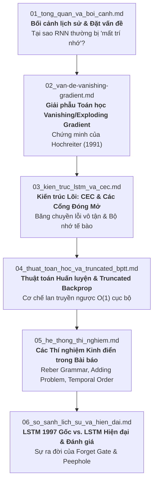

# Mục lục Hệ thống Tài liệu Giải thích Bài báo LSTM (1997) theo Kỹ thuật Feynman

Chào mừng bạn đến với bộ tài liệu giải phẫu chi tiết bài báo khoa học kinh điển:
> **"Long Short-Term Memory"** (1997)  
> *Tác giả:* Sepp Hochreiter & Jürgen Schmidhuber  
> *Tạp chí:* Neural Computation 9(8): 1735–1780.

---

## 🎯 Triết lý biên soạn: Kỹ thuật Feynman (Feynman Technique)
Bộ tài liệu này được biên soạn nhằm biến một công trình nghiên cứu toán học - thần kinh phức tạp bậc nhất lịch sử AI thành những khái niệm trực quan, dễ nhớ, dễ hiểu cho bất kỳ ai có nền tảng toán cơ bản:
1. **Khái niệm đơn giản hóa:** Không ẩn mình sau các ký hiệu bí truyền; mọi ký hiệu đều được dịch sang ngôn ngữ đời thường.
2. **Ẩn dụ trực quan:** Sử dụng các hình tượng sống động (hành lang truyền tin, băng chuyền carrousel, các van khóa nước, chiếc máy photocopy bị mờ dần).
3. **Mổ xẻ bản chất toán học:** Không bỏ qua đạo hàm hay ma trận, nhưng giải thích rõ *tại sao đạo hàm lại bị nổ / biến mất*, và *tại sao một vòng lặp tự thân với trọng số đúng bằng 1.0 lại giải quyết được triệt để bài toán*.
4. **Đối chiếu lịch sử:** Làm rõ LSTM 1997 gốc khác gì so với phiên bản LSTM hiện đại (Pytorch/TensorFlow ngày nay).

---

## 📚 Danh mục các tập tài liệu chuyên sâu

Các tài liệu được chia thành 6 phần tương ứng với các chặng đường phát triển trong bài báo:

### 1. [01_tong_quan_va_boi_canh.md](file:///D:/PTDLKD/LSTM/explanation/01_tong_quan_va_boi_canh.md)
* **Ý tưởng cốt lõi:** Tại sao mạng RNN thông thường (Elman, Jordan) có khả năng lý thuyết rất mạnh nhưng thực tế lại không nhớ nổi quá 10 bước thời gian?
* **Khái niệm then chốt:** Bộ nhớ ngắn hạn (Short-term memory qua activations) vs. Bộ nhớ dài hạn (Long-term memory qua weights), bài toán độ trễ dài (Long minimal time lags).
* **Ẩn dụ:** Trò chơi truyền tin thì thầm qua 100 người.

### 2. [02_van-de-vanishing-gradient.md](file:///D:/PTDLKD/LSTM/explanation/02_van-de-vanishing-gradient.md)
* **Giải phẫu toán học chi tiết:** Mô hình hóa toán học của Hochreiter (1991) về sự lan truyền lỗi ngược thời gian.
* **Quy tắc dây chuyền (Chain rule) qua $n$ bước:** Tích của ma trận Jacobi và đạo hàm hàm kích hoạt $f'$.
* **Hậu quả:** Exponential decay (Tiêu biến theo hàm mũ) vs. Blow-up (Bùng nổ dao động).

### 3. [03_kien_truc_lstm_va_cec.md](file:///D:/PTDLKD/LSTM/explanation/03_kien_truc_lstm_va_cec.md)
* **Trái tim của LSTM:** *Constant Error Carrousel (CEC)* - Băng chuyền bảo toàn tín hiệu lỗi vô tận.
* **Memory Cell & Gates:** Cơ chế cổng nhân tính (Multiplicative Input Gate & Output Gate).
* **Lưu ý lịch sử cực quan trọng:** Bản gốc 1997 **chưa có Forget Gate**! Tại sao lúc đó chưa cần và tại sao sau này lại phải thêm vào?

### 4. [04_thuat_toan_hoc_va_truncated_bptt.md](file:///D:/PTDLKD/LSTM/explanation/04_thuat_toan_hoc_va_truncated_bptt.md)
* **Thuật toán lan truyền xuôi (Forward Pass):** Các phương trình trạng thái tế bào.
* **Thuật toán lan truyền ngược (Backward Pass):** Tại sao Hochreiter & Schmidhuber lại chọn **cắt ngắn gradient (Truncated Gradient)** ngoài phạm vi CEC?
* **Độ phức tạp tính toán:** Chứng minh độ phức tạp cục bộ $O(1)$ cho mỗi trọng số và mỗi bước thời gian.

### 5. [05_he_thong_thi_nghiem.md](file:///D:/PTDLKD/LSTM/explanation/05_he_thong_thi_nghiem.md)
* **Thí nghiệm 1 - 2:** Ngữ pháp nhúng Reber (Embedded Reber Grammar) & chuỗi có nhiễu ngẫu nhiên.
* **Thí nghiệm 3:** Tín hiệu và nhiễu cùng nằm trên một kênh liên tục.
* **Thí nghiệm 4:** Bài toán cộng (The Adding Problem) với độ trễ lên tới hơn 1.000 bước.
* **Thí nghiệm 5 - 6:** Bài toán nhân (Multiplication) và Thứ tự thời gian (Temporal Order Task).
* **Bảng đối đầu:** LSTM đè bẹp RTRL, BPTT, Elman Nets, Recurrent Cascade-Correlation ra sao?

### 6. [06_so_sanh_lich_su_va_hien_dai.md](file:///D:/PTDLKD/LSTM/explanation/06_so_sanh_lich_su_va_hien_dai.md)
* **Sự tiến hóa:**
  - Năm 1997: Input Gate + Output Gate + CEC (Hochreiter & Schmidhuber).
  - Năm 2000: Bổ sung **Forget Gate** (Gers, Schmidhuber & Cummins).
  - Năm 2002: Thêm liên kết nhìn lén **Peephole Connections** (Gers & Schmidhuber).
  - Năm 2014: Rút gọn thành **GRU (Gated Recurrent Unit)** (Cho et al.).
* **Hạn chế thực sự của LSTM gốc:** Bài toán XOR trễ sâu (Strongly delayed XOR problem) và hiện tượng bão hòa trạng thái tế bào.
* **Tầm nhìn tương lai:** Từ LSTM đến Attention và Transformers.
