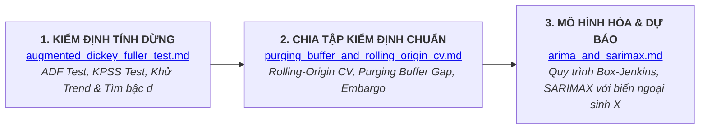

# Thư Mục Giải Thích Chuyên Sâu (PTDLKD Explanations Hub)

Thư mục này chứa các tài liệu phân tích kỹ thuật chuyên sâu (Deep-dive Explanations), bóc tách các khái niệm then chốt, nền tảng toán học, cạm bẫy mô hình và kỹ thuật triển khai thực chiến trong chuyên ngành **Phân Tích Dữ Liệu Kinh Doanh (Business Data Analytics - PTDLKD)**.

---

## DANH MỤC CÁC CHUYÊN ĐỀ PHÂN TÍCH

| STT | Chuyên Đề Phân Tích | File Tài Liệu | Trọng Tâm Kiến Thức Cốt Lõi |
| :---: | :--- | :--- | :--- |
| **01** | **Chiến Lược Phân Chia Dữ Liệu Chuỗi Thời Gian** | [purging_buffer_and_rolling_origin_cv.md](purging_buffer_and_rolling_origin_cv.md) | • Bản chất sụp đổ của giả định I.I.D • Cạm bẫy rò rỉ dữ liệu (Look-ahead Bias / Silent Leakage) • Rolling-Origin CV: Expanding Window vs Sliding Window • Kỹ thuật Purging Buffer (Gap) & Embargo của Marcos López de Prado • Cài đặt mã nguồn Python chuẩn mực Scikit-Learn |
| **02** | **Kiểm Định Tính Dừng: Augmented Dickey-Fuller (ADF)** | [augmented_dickey_fuller_test.md](augmented_dickey_fuller_test.md) | • Tính dừng yếu & Hiểm họa hồi quy giả mạo (Spurious Regression) • Bản chất toán học của Nghiệm đơn vị (Unit Root $\rho = 1$) • Phân phối phi chuẩn Dickey-Fuller và 3 biến thể phương trình ADF • Tiêu chí ra quyết định: ADF Statistic vs Critical Values vs p-value • Ma trận đối chuẩn ADF vs KPSS Test và Pipeline tự động hóa sai phân $d$ |
| **03** | **Mô Hình Kinh Điển: ARIMA & SARIMAX** | [arima_and_sarimax.md](arima_and_sarimax.md) | • Bóc tách toán học 3 thành phần $\text{AR}(p)$, $\text{I}(d)$, $\text{MA}(q)$ • Quy trình 4 bước Box-Jenkins chuẩn mực (Nhận dạng qua ACF/PACF) • Mở rộng mùa vụ $\text{SARIMA}(p,d,q)(P,D,Q)_s$ • Đỉnh cao $\text{SARIMAX}$: Hồi quy tuyến tính với sai số chuỗi thời gian • Pipeline thực chiến bằng `pmdarima` (`auto_arima`) và `statsmodels` |

---

## BẢN ĐỒ LỘ TRÌNH HỌC TẬP & NGHIÊN CỨU

---

> 💡 **Mục đích:** Cung cấp tài liệu tham khảo chi tiết, có tính ứng dụng cao dành cho sinh viên, kỹ sư dữ liệu và chuyên gia phân tích trong việc thiết kế các hệ thống học máy chuỗi thời gian bền vững, loại bỏ các kết quả đo lường ảo tưởng trước khi triển khai vào môi trường sản xuất (Production).
