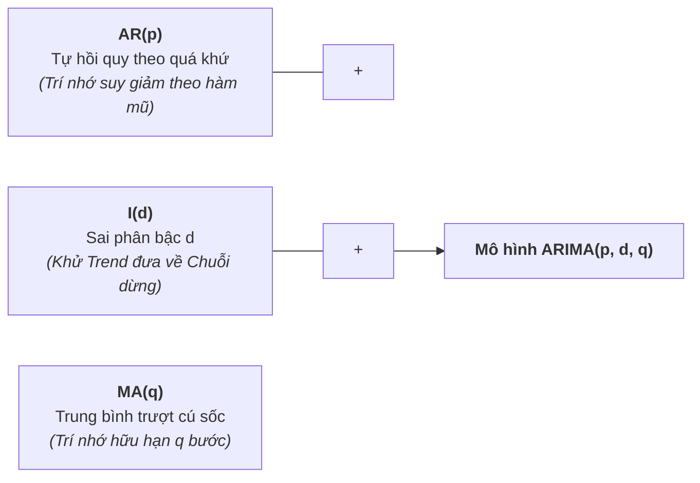
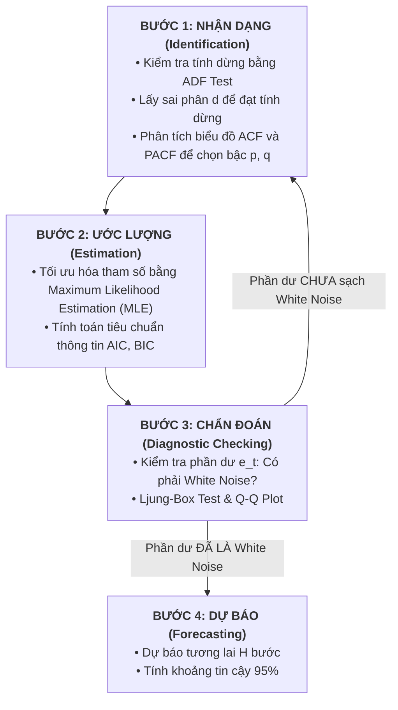
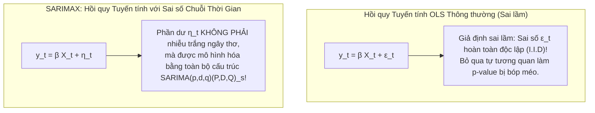

# Mô Hình ARIMA & SARIMAX: Từ Bản Chất Toán Học, Phương Pháp Box-Jenkins Đến Thực Chiến Doanh Nghiệp

Tài liệu này giải thích chi tiết, toàn diện về mặt **toán học, nguyên lý cấu tạo, quy trình Box-Jenkins 4 bước chuẩn mực** và **cách triển khai thực chiến** của hai mô hình kinh điển nhất trong phân tích chuỗi thời gian: **ARIMA (Autoregressive Integrated Moving Average)** và **SARIMAX (Seasonal AutoRegressive Integrated Moving Average with eXogenous factors)**.

---

## MỤC LỤC CHI TIẾT

```mermaid
mindmap
  root((ARIMA & SARIMAX))
    1. Cấu Trúc Toán Học
      Thành phần AR(p) Tự hồi quy
      Thành phần I(d) Tích hợp Sai phân
      Thành phần MA(q) Trung bình trượt
      Toán tử trễ Lag Operator L
    2. Quy Trình Box-Jenkins
      Bước 1: Nhận dạng Identification (ACF & PACF)
      Bước 2: Ước lượng Estimation (MLE)
      Bước 3: Chẩn đoán Diagnostic (Ljung-Box)
      Bước 4: Dự báo Forecasting
    3. Mở Rộng SARIMA
      Chu kỳ mùa vụ s
      Toán tử sai phân mùa vụ (1 - L^s)^D
      Bộ tham số (P, D, Q)_s
    4. Đỉnh Cao SARIMAX
      Tích hợp biến ngoại sinh X
      Hồi quy sai số chuỗi thời gian
    5. Cài Đặt Python Thực Chiến
      Quy trình auto_arima chuẩn mực
      Chẩn đoán phần dư plot_diagnostics
    6. Khi Nào Nên & Không Nên Dùng
```

---

# 1. BẢN CHẤT & CẤU TRÚC TOÁN HỌC CỦA HỌ MÔ HÌNH ARIMA

Mô hình $\text{ARIMA}(p, d, q)$ được cấu thành từ 3 viên gạch độc lập:



---

### 1.1. Thành phần AR(p) – Autoregressive (Tự hồi quy)
Giả định rằng giá trị hiện tại $y_t$ là một tổ hợp tuyến tính của $p$ giá trị quan sát trong quá khứ cộng thêm một cú sốc ngẫu nhiên $\epsilon_t$:
$$y_t = c + \phi_1 y_{t-1} + \phi_2 y_{t-2} + \dots + \phi_p y_{t-p} + \epsilon_t = c + \sum_{i=1}^p \phi_i y_{t-i} + \epsilon_t$$

* **Toán tử trễ (Lag Operator $L$):** Định nghĩa $L^k y_t = y_{t-k}$. Ta viết lại thành dạng đa thức:
  $$\Phi(L) y_t = c + \epsilon_t \quad \text{với } \Phi(L) = 1 - \sum_{i=1}^p \phi_i L^i$$
* **Điều kiện dừng của AR(p):** Mọi nghiệm của phương trình đặc trưng $\Phi(z) = 0$ bắt buộc phải **nằm ngoài đường tròn đơn vị** trong mặt phẳng phức ($|z| > 1$). Với mô hình đơn giản AR(1), điều kiện này tương đương $|\phi_1| < 1$.

---

### 1.2. Thành phần I(d) – Integrated (Tích hợp / Sai phân)
Nếu chuỗi $y_t$ không dừng (có Trend hoặc Unit Root), ta không thể áp dụng trực tiếp mô hình ARMA. Ta phải lấy **sai phân bậc $d$**:
* Sai phân bậc 1 ($d=1$): $\Delta y_t = y_t - y_{t-1} = (1 - L) y_t$ (khử xu hướng tuyến tính).
* Sai phân bậc 2 ($d=2$): $\Delta^2 y_t = \Delta(\Delta y_t) = (1 - L)^2 y_t$ (khử xu hướng bậc hai / parabol).
* Sai phân bậc $d$: $w_t = (1 - L)^d y_t$ đạt trạng thái dừng yếu.

---

### 1.3. Thành phần MA(q) – Moving Average (Trung bình trượt)
Khác với AR(p) nhìn vào giá trị quá khứ, $\text{MA}(q)$ mô hình hóa giá trị hiện tại theo **các cú sốc sai số (White Noise Shocks) trong quá khứ**:
$$y_t = \mu + \epsilon_t + \theta_1 \epsilon_{t-1} + \theta_2 \epsilon_{t-2} + \dots + \theta_q \epsilon_{t-q} = \mu + \epsilon_t + \sum_{j=1}^q \theta_j \epsilon_{t-j}$$

* Dạng đa thức trễ:
  $$y_t = \mu + \Theta(L) \epsilon_t \quad \text{với } \Theta(L) = 1 + \sum_{j=1}^q \theta_j L^j$$
* **Trí nhớ hữu hạn:** Trong mô hình MA(q), một cú sốc xảy ra tại thời điểm $t$ sẽ ảnh hưởng đến $y_t, y_{t+1}, \dots, y_{t+q}$. Nhưng từ bước $t+q+1$ trở đi, cú sốc này **hoàn toàn biến mất**.
* **Điều kiện khả nghịch (Invertibility):** Mọi nghiệm của đa thức $\Theta(z) = 0$ phải nằm ngoài đường tròn đơn vị. Tính khả nghịch đảm bảo mô hình MA có thể biểu diễn ngược lại thành một mô hình AR vô hạn bước.

---

### 1.4. Phương trình toán học tổng quát $\text{ARIMA}(p, d, q)$
Kết hợp cả 3 thành phần, phương trình hoàn chỉnh của $\text{ARIMA}(p, d, q)$ là:
$$\left(1 - \sum_{i=1}^p \phi_i L^i\right) (1 - L)^d y_t = c + \left(1 + \sum_{j=1}^q \theta_j L^j\right) \epsilon_t$$

---

# 2. PHƯƠNG PHÁP BOX-JENKINS (4 BƯỚC TIÊU CHUẨN VÀNG)

Được phát triển bởi George Box và Gwilym Jenkins (1970), đây là quy trình kinh điển để xây dựng mô hình ARIMA:



---

### Bảng Ma Trận Nhận Dạng Bậc $p$ và $q$ qua ACF & PACF:

Sau khi chuỗi đã được lấy sai phân $d$ để đạt tính dừng, việc phân tích hai biểu đồ **ACF (Hàm tự tương quan)** và **PACF (Hàm tự tương quan riêng phần)** là chìa khóa để xác định bậc $p$ và $q$:

| Mô hình | Hình thái biểu đồ ACF | Hình thái biểu đồ PACF |
|---|---|---|
| **$\text{AR}(p)$** | Suy giảm dần theo hàm mũ hoặc dao động tắt dần hình sin | **Cắt phụt đột ngột về 0 (Cut-off)** ngay sau độ trễ bậc $p$ |
| **$\text{MA}(q)$** | **Cắt phụt đột ngột về 0 (Cut-off)** ngay sau độ trễ bậc $q$ | Suy giảm dần theo hàm mũ hoặc dao động tắt dần hình sin |
| **$\text{ARMA}(p, q)$** | Suy giảm dần bắt đầu sau độ trễ $q$ | Suy giảm dần bắt đầu sau độ trễ $p$ |

---

# 3. MỞ RỘNG MÙA VỤ: MÔ HÌNH SARIMA

Nhiều chuỗi thời gian thực tế có tính chu kỳ lặp lại cố định (**Seasonality $s$**): ví dụ chu kỳ ngày trong tuần ($s=7$), chu kỳ tháng trong năm ($s=12$), chu kỳ 15 phút trong ngày ($s=96$). Mô hình ARIMA thông thường không thể bắt được tương quan ở các khoảng cách xa như vậy.

Mô hình **$\text{SARIMA}(p, d, q)(P, D, Q)_s$** giải quyết bằng cách áp dụng thêm bộ toán tử trễ mùa vụ:
* **$P$ (Seasonal AR):** Tự hồi quy mùa vụ (ví dụ: tháng này phụ thuộc vào cùng tháng này năm ngoái $y_{t-s}$).
* **$D$ (Seasonal Differencing):** Sai phân mùa vụ: $\Delta_s y_t = y_t - y_{t-s} = (1 - L^s) y_t$.
* **$Q$ (Seasonal MA):** Trung bình trượt mùa vụ (cú sốc cùng kỳ mùa trước $\epsilon_{t-s}$).

### Phương trình toán học của SARIMA:
$$\Phi_p(L) \tilde{\Phi}_P(L^s) (1 - L)^d (1 - L^s)^D y_t = c + \Theta_q(L) \tilde{\Theta}_Q(L^s) \epsilon_t$$

Trong đó:
* $\tilde{\Phi}_P(L^s) = 1 - \Phi_1 L^s - \Phi_2 L^{2s} - \dots - \Phi_P L^{Ps}$
* $\tilde{\Theta}_Q(L^s) = 1 + \Theta_1 L^s + \Theta_2 L^{2s} + \dots + \Theta_Q L^{Qs}$

---

# 4. ĐỈNH CAO: MÔ HÌNH SARIMAX (TÍCH HỢP BIẾN NGOẠI SINH)

Trong thực tế kinh doanh, chuỗi thời gian không vận động đơn độc; nó chịu ảnh hưởng mạnh mẽ từ các yếu tố bên ngoài (**Exogenous Variables $X$**):
* Dự báo lượng điện tiêu thụ $\implies$ Cần biến ngoại sinh là **Nhiệt độ môi trường, Độ ẩm**.
* Dự báo doanh thu bán hàng $\implies$ Cần biến ngoại sinh là **Chiến dịch khuyến mãi, Giảm giá, Ngày lễ Tết**.
* Dự báo tỷ giá tiền tệ $\implies$ Cần biến ngoại sinh là **Chênh lệch lãi suất ngân hàng trung ương**.



### Phương trình toán học của SARIMAX:
$$y_t = \sum_{k=1}^K \beta_k X_{k, t} + \eta_t$$
trong đó phần dư $\eta_t$ tuân theo cấu trúc SARIMA:
$$\Phi_p(L) \tilde{\Phi}_P(L^s) (1 - L)^d (1 - L^s)^D \eta_t = \Theta_q(L) \tilde{\Theta}_Q(L^s) \epsilon_t$$

> 💡 **Khác biệt sống còn:** SARIMAX tách biệt bài toán thành 2 phần:
> 1. Hiệu ứng tác động tức thì từ các biến vĩ mô bên ngoài ($\beta X_t$).
> 2. Quán tính tự tương quan nội tại và nhịp điệu mùa vụ của bản thân chuỗi thời gian ($\eta_t$).

---

# 5. HƯỚNG DẪN CÀI ĐẶT THỰC CHIẾN BẰNG PYTHON

Dưới đây là quy trình Python hoàn chỉnh kết hợp thư viện `pmdarima` (tự động dò tìm siêu tham số tối ưu bằng thuật toán Stepwise AIC) và `statsmodels` (ước lượng SARIMAX và chẩn đoán phần dư):

```python
import numpy as np
import pandas as pd
import matplotlib.pyplot as plt
import pmdarima as pm
from statsmodels.tsa.statespace.sarimax import SARIMAX

# ==============================================================================
# 1. TỰ ĐỘNG DÒ TÌM THAM SỐ TỐI ƯU BẰNG AUTO-ARIMA
# ==============================================================================

def find_best_sarimax(y_train, exog_train=None, seasonal_period=7):
    """
    Sử dụng thuật toán tìm kiếm thông minh Stepwise AIC của Hyndman & Khandakar
    để tự động tìm bộ tham số (p, d, q) x (P, D, Q)_s tối ưu
    """
    print("🔍 Đang tự động tìm kiếm mô hình SARIMAX tối ưu theo tiêu chuẩn AIC...")
    auto_model = pm.auto_arima(
        y=y_train,
        X=exog_train,
        start_p=0, max_p=3,
        start_q=0, max_q=3,
        d=None,               # Tự động dùng ADF test để tìm bậc d
        seasonal=True,
        m=seasonal_period,    # Chu kỳ mùa vụ (s = 7 cho tuần)
        start_P=0, max_P=2,
        start_Q=0, max_Q=2,
        D=None,               # Tự động tìm bậc D mùa vụ bằng OCSB/CH test
        trace=True,           # In tiến trình thử nghiệm
        error_action='ignore',
        suppress_warnings=True,
        stepwise=True         # Thuật toán heuristic tìm nhanh không cần brute-force
    )
    print(f"\n🎯 MÔ HÌNH TỐI ƯU NHẤT: {auto_model.order} x {auto_model.seasonal_order}")
    print(f"Giá trị AIC nhỏ nhất : {auto_model.aic():.2f}")
    return auto_model

# ==============================================================================
# 2. HUẤN LUYỆN VÀ CHẨN ĐOÁN MÔ HÌNH CHUYÊN SÂU
# ==============================================================================

def fit_and_diagnose(y_train, exog_train, order, seasonal_order):
    """
    Huấn luyện mô hình SARIMAX và vẽ 4 biểu đồ chẩn đoán phần dư chuẩn mực
    """
    model = SARIMAX(
        endog=y_train,
        exog=exog_train,
        order=order,
        seasonal_order=seasonal_order,
        enforce_stationarity=False,
        enforce_invertibility=False
    )
    results = model.fit(disp=False)
    
    # In bảng tóm tắt hệ số thống kê và kiểm định Ljung-Box
    print(results.summary())
    
    # Vẽ 4 biểu đồ chẩn đoán phần dư (Residual Diagnostics)
    # 1. Standardized residuals: Kiểm tra phương sai cố định
    # 2. Histogram & KDE: Kiểm tra phân phối chuẩn N(0, 1)
    # 3. Normal Q-Q Plot: Các điểm phải bám sát đường thẳng 45 độ
    # 4. Correlogram (ACF của phần dư): Không có cột nào vượt vạch xanh 95%
    fig = results.plot_diagnostics(figsize=(14, 8))
    plt.tight_layout()
    plt.show()
    
    return results

# ==============================================================================
# 3. DỰ BÁO TƯƠNG LAI VỚI BIẾN NGOẠI SINH
# ==============================================================================

def forecast_future(fitted_model, steps=14, exog_future=None):
    """
    Dự báo tương lai H bước kèm khoảng tin cậy 95%
    """
    forecast_res = fitted_model.get_forecast(steps=steps, exog=exog_future)
    mean_forecast = forecast_res.predicted_mean
    conf_int = forecast_res.conf_int(alpha=0.05) # Khoảng tin cậy 95%
    
    return mean_forecast, conf_int
```

---

# 6. KHI NÀO NÊN VÀ KHÔNG NÊN DÙNG ARIMA/SARIMAX?

```mermaid
flowchart TD
    Start["Bắt đầu Lựa chọn Mô hình Dự báo"] --> Q1{"Dữ liệu nhiều hay ít?<br>Quan hệ biến thiên ra sao?"}
    
    Q1 -->|Dữ liệu < 5.000 điểm, quan hệ tuyến tính, cần giải thích toán học minh bạch| YES["✅ NÊN DÙNG ARIMA / SARIMAX<br>• Cực nhanh, tính toán giải tích<br>• Có khoảng tin cậy 95% chuẩn mực<br>• Rất mạnh trên dữ liệu có mùa vụ đơn"]
    
    Q1 -->|Dữ liệu phi tuyến phức tạp, có hàng trăm biến danh mục| NO1["❌ NÊN CHUYỂN SANG LightGBM / XGBoost<br>• Xử lý tốt biến danh mục categorical<br>• Bắt tốt tương quan phi tuyến phức tạp"]
    
    Q1 -->|Chuỗi đa mùa vụ phức tạp (Ví dụ: phụ tải điện s=24 và s=168 cùng lúc)| NO2["❌ NÊN CHUYỂN SANG MSTL / Prophet / PatchTST<br>• SARIMAX bị nổ tham số khi s > 50"]
```

### Bảng Đánh Giá Ưu & Nhược Điểm Thực Tế:

| Tiêu chí | Điểm mạnh (Pros) | Hạn chế (Cons) |
|---|---|---|
| **Cơ sở Toán học** | Cực kỳ vững chắc (Kinh tế lượng thế kỷ 20), được chứng minh bằng định lý toán học chặt chẽ. | Chỉ mô hình hóa được quan hệ **tuyến tính (Linear)**. Bất lực trước các đột biến phi tuyến. |
| **Dung lượng Dữ liệu** | Hoạt động xuất sắc trên tập dữ liệu nhỏ ($N = 50 - 500$ điểm) mà Deep Learning bị overfit. | Không thể tự động trích xuất đặc trưng từ kho dữ liệu khổng lồ hàng triệu điểm. |
| **Tốc độ Huấn luyện** | Rất nhanh (chỉ mất vài giây trên CPU thông thường). | Khi chu kỳ mùa vụ quá lớn ($s = 365$ hoặc $s = 96$), ma trận tính toán bị nghẽn và chạy rất chậm. |
| **Khả năng Diễn giải** | **Hộp trắng 100%:** Mỗi hệ số $\phi_i, \theta_j, \beta_k$ đều có ý nghĩa kinh tế và $p\text{-value}$ rõ ràng. | Không hỗ trợ tự động học biểu diễn (Representation Learning). |
