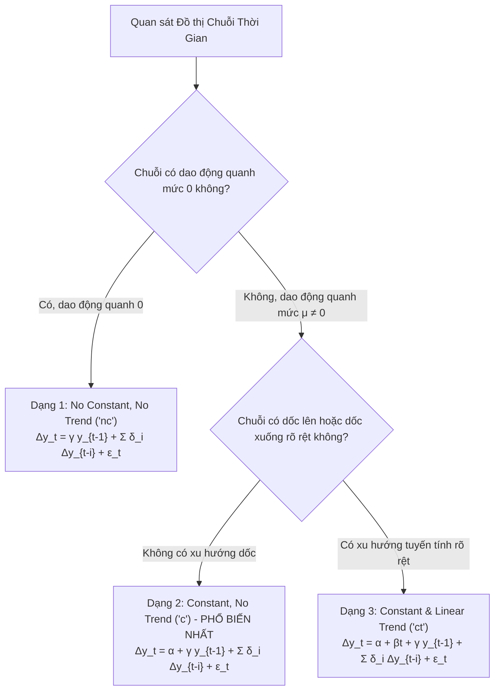
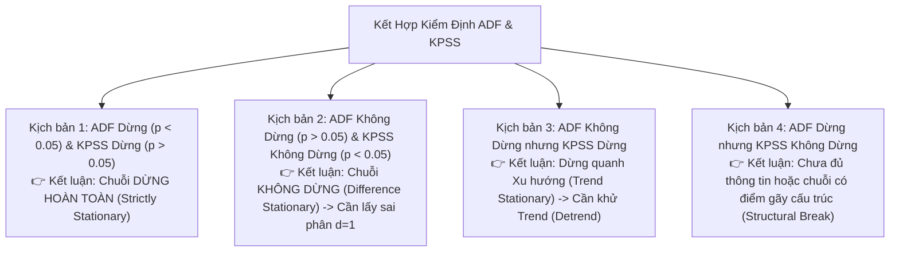

# Kiểm Định Augmented Dickey-Fuller (ADF Test): Nguyên Lý Toán Học, Cơ Chế & Ứng Dụng Thực Chiến

Tài liệu này giải thích chi tiết, chuyên sâu từ nền tảng toán học đến thực nghiệm ứng dụng của **Kiểm định Augmented Dickey-Fuller (ADF Test)** — công cụ tiêu chuẩn vàng trong kinh tế lượng và khoa học dữ liệu để kiểm tra **Tính dừng (Stationarity)** và **Hiện tượng Nghiệm đơn vị (Unit Root)** của chuỗi thời gian.

---

## MỤC LỤC CHI TIẾT

```mermaid
mindmap
  root((Kiểm định ADF))
    1. Bản Chất Toán Học
      Tại sao cần Tính dừng?
      Hiểm họa Hồi quy Giả mạo (Spurious)
      Nghiệm đơn vị (Unit Root)
    2. Từ Dickey-Fuller đến ADF
      Mô hình AR(1) cơ sở
      Phân phối phi chuẩn Dickey-Fuller
      Mở rộng AR(p) cho tự tương quan cao
    3. 3 Dạng Phương Trình ADF
      No Constant, No Trend
      Constant, No Trend
      Constant & Linear Trend
    4. Quy Trình Ra Quyết Định
      Giả thuyết H0 vs H1
      Test Statistic vs Critical Values
      Quy tắc p-value
    5. So Sánh ADF vs KPSS
      Cặp kiểm định chéo đối ngẫu
      Ma trận 4 kịch bản kết luận
    6. Thực Thi Python Thực Chiến
      Code chuẩn statsmodels
      Hàm tự động sai phân hóa d
    7. Cạm Bẫy Thường Gặp
      Chọn sai độ trễ lag
      Hiện tượng Structural Break
```

---

# 1. BẢN CHẤT VẤN ĐỀ: VÌ SAO TÍNH DỪNG LẠI LÀ SỰ SỐNG CÒN?

### 1.1. Tính dừng yếu (Weak Stationarity) là gì?
Một chuỗi thời gian $y_t$ được gọi là **dừng yếu (Covariance / Weakly Stationary)** nếu thỏa mãn 3 điều kiện toán học bất biến theo thời gian:
1. **Kỳ vọng không đổi:**
   $$\mathbb{E}[y_t] = \mu \quad \forall t$$
   *(Chuỗi dao động quanh một mức trung bình cố định, không có xu hướng tăng/giảm dài hạn).*
2. **Phương sai hữu hạn và không đổi:**
   $$\text{Var}(y_t) = \mathbb{E}[(y_t - \mu)^2] = \sigma^2 < \infty \quad \forall t$$
   *(Biên độ dao động không bị bung rộng ra vô cực theo thời gian).*
3. **Hiệp phương sai chỉ phụ thuộc vào độ trễ $k$ (Lag):**
   $$\text{Cov}(y_t, y_{t-k}) = \gamma_k \quad \forall t$$
   *(Mối tương quan giữa hôm nay và $k$ ngày trước chỉ phụ thuộc vào khoảng cách $k$, không phụ thuộc vào mốc thời gian $t$).*

---

### 1.2. Thảm họa Hồi quy Giả mạo (Spurious Regression)
Năm 1974, hai nhà kinh tế lượng đoạt giải Nobel **Clive Granger và Paul Newbold** đã công bố bài báo chấn động: Nếu bạn lấy hai chuỗi thời gian **hoàn toàn không liên quan gì đến nhau** nhưng cả hai đều **không dừng (Non-stationary)** (ví dụ: *Số lượng người dùng Facebook tại Việt Nam* và *Sản lượng cá ngừ đánh bắt tại Nam Cực*):
* Chạy hồi quy tuyến tính OLS thông thường sẽ cho kết quả:
  $$R^2 > 0.95, \quad t\text{-statistic} > 20, \quad p\text{-value} < 0.0001$$
* **Ảo giác nguy hiểm:** Hệ số hồi quy có ý nghĩa thống kê cực kỳ cao, nhưng thực chất mối quan hệ này là **vô nghĩa 100% (Spurious)**. Nguyên nhân là do cả hai chuỗi đều có một xu hướng đi lên theo thời gian (Trend), đánh lừa thuật toán OLS.

> ⚠️ **Quy tắc sống còn:** Trước khi đưa chuỗi thời gian vào mô hình hồi quy, ARIMA, hay VAR, bước đầu tiên bắt buộc phải là **kiểm tra tính dừng**.

---

# 2. TỪ KIỂM ĐỊNH DICKEY-FULLER ĐẾN AUGMENTED DICKEY-FULLER

### 2.1. Bản chất toán học của Nghiệm đơn vị (Unit Root)
Xét một mô hình tự hồi quy bậc nhất **AR(1)**:
$$y_t = \rho y_{t-1} + \epsilon_t \quad (\epsilon_t \sim \text{White Noise})$$

Tùy thuộc vào giá trị của hệ số $\rho$:
* **$|\rho| < 1$ (Chuỗi dừng):** Ảnh hưởng của một cú sốc $\epsilon_t$ sẽ suy giảm dần theo hàm mũ $\rho^k \to 0$ khi $k \to \infty$. Chuỗi luôn quay về mức cân bằng (Mean-reverting).
* **$|\rho| > 1$ (Chuỗi bùng nổ):** Chuỗi phát nổ tiến tới vô cùng.
* **$\rho = 1$ (Nghiệm đơn vị - Unit Root):** Phương trình trở thành **Random Walk (Bước đi ngẫu nhiên)**:
  $$y_t = y_{t-1} + \epsilon_t \implies y_t = y_0 + \sum_{i=1}^t \epsilon_i$$
  * Phương sai của chuỗi là $\text{Var}(y_t) = t \sigma^2 \to \infty$ khi $t \to \infty$.
  * Cú sốc $\epsilon_t$ sẽ **tồn tại vĩnh viễn** trong chuỗi và không bao giờ biến mất (trí nhớ vô hạn). Chuỗi **hoàn toàn không dừng**.

---

### 2.2. Biến đổi phương trình Dickey-Fuller (DF)
Để kiểm tra giả thuyết $\rho = 1$, David Dickey và Wayne Fuller (1979) trừ cả hai vế của phương trình AR(1) cho $y_{t-1}$:
$$y_t - y_{t-1} = \rho y_{t-1} - y_{t-1} + \epsilon_t$$
$$\Delta y_t = (\rho - 1)y_{t-1} + \epsilon_t$$

Đặt $\gamma = \rho - 1$, bài toán kiểm định trở thành:
$$\Delta y_t = \gamma y_{t-1} + \epsilon_t$$

* **Giả thuyết Không ($H_0$):** $\gamma = 0$ (tương đương $\rho = 1 \implies$ **Chuỗi có nghiệm đơn vị, KHÔNG DỪNG**).
* **Giả thuyết Đối ($H_1$):** $\gamma < 0$ (tương đương $\rho < 1 \implies$ **Chuỗi DỪNG**).

> ⚠️ **Vì sao không dùng kiểm định Student t-distribution thông thường?**
> Dưới giả thuyết $H_0$ ($\rho = 1$), thống kê $t = \frac{\hat{\gamma}}{\text{SE}(\hat{\gamma})}$ **không tuân theo phân phối $t$-Student chuẩn**, mà tuân theo phân phối phi chuẩn **Dickey-Fuller (DF distribution)** bị lệch sang bên trái. Do đó, các giá trị tới hạn (Critical Values) của Dickey-Fuller âm sâu hơn nhiều so với phân phối $t$ thông thường (ví dụ: $-2.86$ thay vì $-1.96$ ở mức $5\%$).

---

### 2.3. Bước nâng cấp: Augmented Dickey-Fuller (ADF)
Kiểm định DF cổ điển chỉ đúng khi phần dư $\epsilon_t$ là nhiễu trắng thuần túy (White noise). Nhưng trong thực tế, chuỗi thời gian thường có tự tương quan bậc cao $p$ (quá khứ 2, 3 ngày trước vẫn tác động).

Để khử sạch hiện tượng tự tương quan trong phần dư, mô hình **Augmented Dickey-Fuller (ADF)** bổ sung thêm các số hạng trễ của sai phân $\Delta y_{t-i}$:
$$\Delta y_t = \alpha + \beta t + \gamma y_{t-1} + \sum_{i=1}^p \delta_i \Delta y_{t-i} + \epsilon_t$$

Các số hạng $\sum_{i=1}^p \delta_i \Delta y_{t-i}$ đóng vai trò "hút sạch" mọi tương quan bậc cao, đảm bảo phần dư $\epsilon_t$ trở về trạng thái White Noise chuẩn mực.

---

# 3. BA BIẾN THỂ PHƯƠNG TRÌNH KIỂM ĐỊNH ADF

Khi chạy kiểm định ADF, việc chọn phương trình kiểm định phù hợp với hình thái chuỗi là cực kỳ quan trọng. Có 3 trường hợp:



| Dạng kiểm định | Cấu hình trong Python (`regression=`) | Phương trình toán học | Ngữ cảnh ứng dụng |
|---|---|---|---|
| **1. Không hằng số, không xu hướng** | `'n'` hoặc `'nc'` | $\Delta y_t = \gamma y_{t-1} + \sum_{i=1}^p \delta_i \Delta y_{t-i} + \epsilon_t$ | Chuỗi dao động chặt chẽ quanh mức 0 (ví dụ: chuỗi sai phân lợi suất tài chính) |
| **2. Có hằng số, không xu hướng** | `'c'` *(Mặc định)* | $\Delta y_t = \alpha + \gamma y_{t-1} + \sum_{i=1}^p \delta_i \Delta y_{t-i} + \epsilon_t$ | Chuỗi dao động quanh một mức trung bình khác 0 (ví dụ: nhiệt độ, tỷ lệ thất nghiệp) |
| **3. Có hằng số và xu hướng tuyến tính** | `'ct'` | $\Delta y_t = \alpha + \beta t + \gamma y_{t-1} + \sum_{i=1}^p \delta_i \Delta y_{t-i} + \epsilon_t$ | Chuỗi có xu hướng tăng/giảm dài hạn theo thời gian (ví dụ: GDP, doanh thu bán hàng) |

---

# 4. QUY TRÌNH ĐỌC KẾT QUẢ & RA QUYẾT ĐỊNH

### 4.1. Cặp giả thuyết kiểm định
* **$H_0$ (Null Hypothesis):** $\gamma = 0 \iff$ Chuỗi có nghiệm đơn vị (Unit Root) $\implies$ **Chuỗi KHÔNG DỪNG (Non-Stationary)**.
* **$H_1$ (Alternative Hypothesis):** $\gamma < 0 \iff$ Chuỗi không có nghiệm đơn vị $\implies$ **Chuỗi DỪNG (Stationary)**.

---

### 4.2. Hai tiêu chí ra quyết định (Decision Rules)

```mermaid
flowchart LR
    subgraph Rule1 ["Tiêu chí 1: ADF Statistic vs Critical Values"]
        Stat["ADF Statistic (t-value)"]
        Crit["Critical Value (Mức 5%)"]
        Stat -->|ÂM HƠN (Nằm sâu bên trái)| Rej1["BÁC BỎ H0: Chuỗi DỪNG ✅"]
        Stat -->|LỚN HƠN (Nằm bên phải)| Acc1["CHẤP NHẬN H0: Chuỗi KHÔNG DỪNG ❌"]
    end

    subgraph Rule2 ["Tiêu chí 2: Giá trị p-value"]
        PVal["p-value"]
        PVal -->|p < 0.05| Rej2["BÁC BỎ H0: Chuỗi DỪNG ✅"]
        PVal -->|p >= 0.05| Acc2["CHẤP NHẬN H0: Chuỗi KHÔNG DỪNG ❌"]
    end
```

#### Ví dụ minh họa trực quan:
Giả sử kết quả kiểm định trả về:
* **ADF Statistic:** $-3.45$
* **Critical Values:**
  * $1\%$: $-3.43$
  * $5\%$: $-2.86$
  * $10\%$: $-2.57$
* **p-value:** $0.009$

**Đánh giá:**
1. Theo ADF Statistic: Giá trị $-3.45$ nhỏ hơn (âm hơn) mức $-2.86$ (tại $5\%$) và thậm chí nhỏ hơn cả $-3.43$ (tại $1\%$).
2. Theo p-value: $p = 0.009 < 0.05$.
$\implies$ **Bác bỏ giả thuyết $H_0$ ở mức ý nghĩa $1\%$**. Kết luận: Chuỗi là **Dừng (Stationary)** với độ tin cậy $99\%$.

---

# 5. SO SÁNH ĐỐI NGẪU: ADF TEST VS. KPSS TEST

Trong thực tế chuyên nghiệp, chỉ dùng một mình kiểm định ADF có thể dẫn tới kết luận sai nếu chuỗi có tính dừng xu hướng (Trend Stationary). Các chuyên gia luôn kết hợp **ADF Test** với **KPSS Test (Kwiatkowski–Phillips–Schmidt–Shin)**:

| Tiêu chí | Augmented Dickey-Fuller (ADF) | KPSS Test |
|---|---|---|
| **Giả thuyết $H_0$** | **Chuỗi KHÔNG DỪNG** (Có Unit Root) | **Chuỗi DỪNG** (Stationary) |
| **Giả thuyết $H_1$** | **Chuỗi DỪNG** | **Chuỗi KHÔNG DỪNG** |
| **Triết lý kiểm định** | Tìm bằng chứng để chứng minh chuỗi dừng | Giả định chuỗi dừng cho đến khi chứng minh được điều ngược lại |

---

### Ma trận 4 Kịch bản khi kết hợp ADF và KPSS:



---

# 6. HƯỚNG DẪN CÀI ĐẶT THỰC CHIẾN BẰNG PYTHON

Dưới đây là đoạn mã Python chuẩn mực sử dụng thư viện `statsmodels`, tự động thực hiện kiểm định ADF, diễn giải kết quả và tự động lấy sai phân bậc $d$ cho đến khi chuỗi dừng hoàn toàn:

```python
import numpy as np
import pandas as pd
from statsmodels.tsa.stattools import adfuller, kpss

def check_adfuller(series, title="Chuỗi Dữ Liệu"):
    """
    Thực hiện kiểm định ADF và diễn giải kết quả chi tiết
    """
    series_clean = series.dropna()
    result = adfuller(series_clean, autolag='AIC')
    
    adf_stat = result[0]
    p_value = result[1]
    lags_used = result[2]
    n_obs = result[3]
    critical_values = result[4]
    
    print(f"==================================================")
    print(f" KẾT QUẢ KIỂM ĐỊNH ADF: {title}")
    print(f"==================================================")
    print(f"ADF Statistic       : {adf_stat:.4f}")
    print(f"p-value             : {p_value:.6f}")
    print(f"Số độ trễ sử dụng   : {lags_used}")
    print(f"Số quan sát         : {n_obs}")
    print(f"Giá trị tới hạn (Critical Values):")
    for key, value in critical_values.items():
        print(f"   {key:>4s} : {value:.4f}")
    
    # Kết luận
    is_stationary = p_value < 0.05 and adf_stat < critical_values['5%']
    if is_stationary:
        print(f"\n=> KẾT LUẬN: Bác bỏ H0 (p < 0.05). Chuỗi là DỪNG (Stationary) ở mức 5%!")
    else:
        print(f"\n=> KẾT LUẬN: Chưa đủ bằng chứng bác bỏ H0. Chuỗi KHÔNG DỪNG (Non-Stationary)!")
    print(f"==================================================\n")
    return is_stationary

def make_stationary_pipeline(series, max_diff=2):
    """
    Tự động tìm bậc sai phân d tối thiểu để đưa chuỗi về trạng thái dừng
    """
    current_series = series.copy()
    for d in range(max_diff + 1):
        name = f"Chuỗi gốc (d=0)" if d == 0 else f"Sai phân bậc d={d}"
        is_stat = check_adfuller(current_series, title=name)
        if is_stat:
            print(f"🎯 Thành công! Chuỗi đạt tính dừng tại bậc sai phân d = {d}.")
            return current_series, d
        current_series = current_series.diff().dropna()
        
    print("⚠️ Cảnh báo: Chuỗi vẫn chưa dừng sau khi lấy sai phân tối đa!")
    return current_series, max_diff

# Ví dụ thử nghiệm trên chuỗi Random Walk (Không dừng)
np.random.seed(42)
white_noise = np.random.normal(0, 1, 300)
random_walk = pd.Series(np.cumsum(white_noise), name="Stock_Price")

stationary_series, d_order = make_stationary_pipeline(random_walk)
```

---

# 7. BA CẠM BẪY THỰC TẾ KHI LÀM KIỂM ĐỊNH ADF

1. **Cạm bẫy chọn sai độ trễ (Lag Length Selection):**
   * Nếu chọn số lag quá ít: Phần dư $\epsilon_t$ vẫn còn tự tương quan, làm sai lệch phân phối kiểm định.
   * Nếu chọn số lag quá nhiều: Làm giảm bậc tự do (Degrees of Freedom) và làm suy giảm lực kiểm định (Power of Test).
   * 👉 **Quy tắc chuẩn:** Luôn thiết lập `autolag='AIC'` để thuật toán tự động chọn số lag tối ưu cân bằng giữa độ khớp và độ phức tạp.
2. **Cạm bẫy chọn sai phương trình hồi quy (`regression='c'` vs `'ct'`):**
   * Nếu dữ liệu có Trend dốc lên rõ ràng mà bạn chọn dạng kiểm định không có Trend (`regression='c'`), kiểm định ADF sẽ bị thiên kiến và **rất khó bác bỏ $H_0$** (kết luận nhầm là chuỗi không dừng).
3. **Hiện tượng Điểm Gãy Cấu Trúc (Structural Breaks):**
   * Perron (1989) đã chứng minh: Nếu một chuỗi thực chất là dừng quanh một mức trung bình, nhưng có một cú sốc lớn làm mặt bằng trung bình nhảy vọt sang mức mới (ví dụ: cuộc khủng hoảng tài chính 2008 hoặc đại dịch COVID-19), kiểm định ADF thông thường sẽ **kết luận sai là chuỗi có Unit Root**.
   * 👉 **Giải pháp:** Nếu nghi ngờ có điểm gãy cấu trúc, hãy sử dụng kiểm định **Zivot-Andrews Test** thay cho ADF chuẩn.
