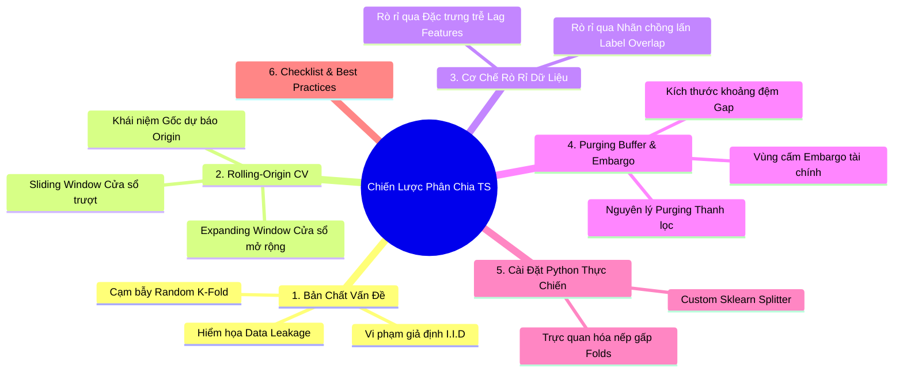
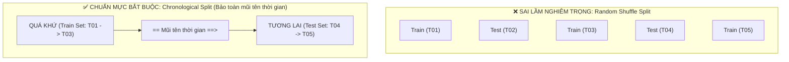
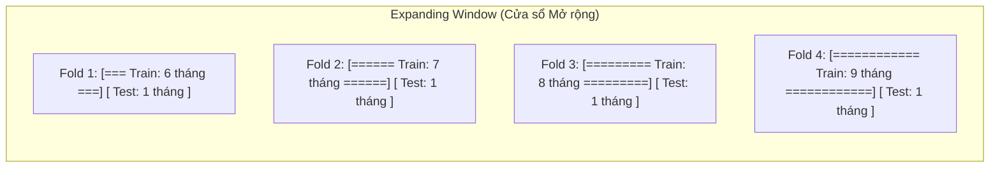
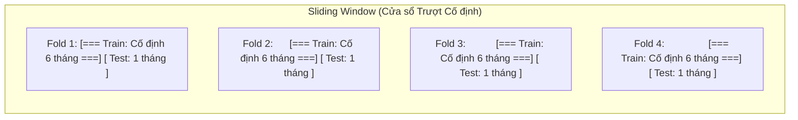
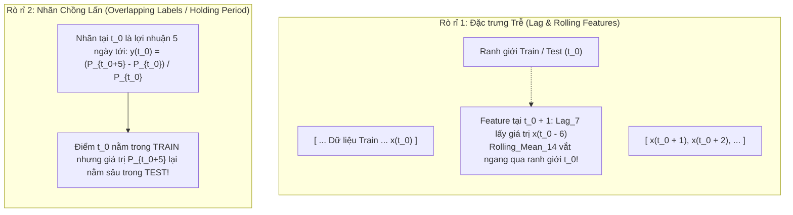
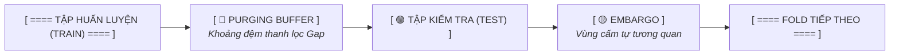

# Chiến Lược Phân Chia Dữ Liệu Chuỗi Thời Gian: Purging Buffer & Rolling-Origin Cross-Validation

Tài liệu này giải thích chi tiết, toàn diện về mặt **toán học, nguyên lý kỹ thuật, nguy cơ rò rỉ dữ liệu (Data Leakage)** và **cách triển khai thực chiến** của hai trụ cột quan trọng nhất trong kiểm định mô hình chuỗi thời gian:
1. **Rolling-Origin Cross-Validation** (Kiểm định chéo dịch chuyển gốc thời gian: Expanding Window & Sliding Window).
2. **Purging Buffer & Embargo** (Khoảng đệm thanh lọc nhãn và vùng cấm tự tương quan).

---

## MỤC LỤC CHI TIẾT



---

# 1. BẢN CHẤT VẤN ĐỀ: VÌ SAO CHUỖI THỜI GIAN CẦN CHIẾN LƯỢC CHIA ĐẶC BIỆT?

### 1.1. Sự sụp đổ của Giả định I.I.D
Trong học máy truyền thống (Tabular ML), hầu hết các thuật toán dựa trên giả định **I.I.D (Independent and Identically Distributed - Độc lập và Cùng phân phối)**:
$$\mathbb{P}(X_1, X_2, \dots, X_N) = \prod_{i=1}^N \mathbb{P}(X_i)$$
Nếu dữ liệu là I.I.D, việc tráo đổi vị trí giữa dòng 1 và dòng 100 hoàn toàn không làm mất đi thông tin thống kê. Kỹ thuật chia ngẫu nhiên **Random K-Fold Cross-Validation** hoạt động hoàn hảo.

Tuy nhiên, trong chuỗi thời gian:
$$X = \{x_1, x_2, \dots, x_T\}$$
* **Tính phụ thuộc thời gian (Temporal Dependence / Autocorrelation):** Điểm $x_t$ phụ thuộc trực tiếp vào các điểm quá khứ $x_{t-1}, x_{t-2}, \dots$.
* **Tính không dừng (Non-stationarity) & Trôi dạt khái niệm (Concept Drift):** Phân phối xác suất của dữ liệu $\mathbb{P}(X_t)$ liên tục dịch chuyển theo thời gian (Trend, Seasonality, biến động kinh tế vĩ mô).

---

### 1.2. Thảm họa Random Split: Hiện tượng Nhìn trước Tương lai (Look-ahead Bias)



> ⚠️ **Hậu quả chết người của Random Split:**
> Khi xáo trộn ngẫu nhiên:
> 1. Mô hình được huấn luyện bằng dữ liệu của **Tháng 3 và Tháng 5** để dự báo cho **Tháng 4**.
> 2. Các đặc trưng thống kê (như `rolling_mean_7` hay xu hướng vĩ mô) của Tháng 5 vô tình "mớm cung" toàn bộ thông tin cho mô hình.
> 3. Điểm số đánh giá trên tập kiểm tra ($R^2$ hay F1-Score) có thể đạt **98% - 99%**. Nhưng khi triển khai vào môi trường sản xuất thực tế, mô hình sẽ **thất bại hoàn toàn** vì trong thực tế chúng ta không bao giờ có dữ liệu của ngày mai để dự báo cho ngày hôm nay!

---

# 2. ROLLING-ORIGIN CROSS-VALIDATION (TIME SERIES CV)

Để kiểm định chéo trong chuỗi thời gian mà không vi phạm nguyên tắc dòng thời gian, GS. Rob J. Hyndman đề xuất kỹ thuật **Rolling-Origin Cross-Validation** (hay còn gọi là *Time Series Split* hoặc *Walk-Forward Validation*).

### 2.1. Khái niệm "Origin" (Gốc dự báo)
* **Origin (Gốc thời gian $t_0$):** Là mốc thời gian hiện tại mà người làm mô hình đang đứng.
* Mọi dữ liệu trước $t_0$ ($t \le t_0$) thuộc về **Quá khứ (In-sample / Train Set)**.
* Mọi dữ liệu sau $t_0$ ($t > t_0$) thuộc về **Tương lai (Out-of-sample / Test Set)** kéo dài trong $H$ bước tiếp theo (Forecast Horizon).
* **Cơ chế dịch chuyển (Rolling):** Sau mỗi lần kiểm định, gốc thời gian $t_0$ được dịch tịnh tiến về phía trước theo một bước nhảy cố định $\Delta t$.

Có hai biến thể cốt lõi của Rolling-Origin: **Expanding Window** và **Sliding Window**.

---

### 2.2. Biến thể 1: Expanding Window (Cửa sổ mở rộng)

Trong Expanding Window, điểm bắt đầu của tập huấn luyện được **ghim cố định (Fixed Start)**, và kích thước tập huấn luyện sẽ **mở rộng dần theo thời gian**.



#### Công thức toán học:
Tại vòng lặp thứ $k \in \{1, \dots, K\}$:
* **Tập huấn luyện (Train):** $\mathcal{D}_{\text{train}}^{(k)} = \{x_1, x_2, \dots, x_{T_0 + (k-1)\Delta t}\}$
* **Tập kiểm tra (Test):** $\mathcal{D}_{\text{test}}^{(k)} = \{x_{T_0 + (k-1)\Delta t + 1}, \dots, x_{T_0 + (k-1)\Delta t + H}\}$

#### Khi nào nên áp dụng Expanding Window?
1. **Dữ liệu khan hiếm hoặc mô hình cần lượng dữ liệu lớn:** Ví dụ các mô hình Deep Learning (PatchTST, LSTM) cần tối đa hóa dữ liệu lịch sử để học các trọng số phức tạp.
2. **Hệ thống có tính chu kỳ mùa vụ dài hạn (Yearly Seasonality):** Cần lịch sử tích lũy nhiều năm để mô hình không quên các đợt sốt mua sắm hàng năm (Tết, Black Friday).
3. **Môi trường vận hành tương đối ổn định:** Không có sự thay đổi đột ngột về cấu trúc kinh tế hoặc công nghệ.

---

### 2.3. Biến thể 2: Sliding Window (Cửa sổ trượt kích thước cố định)

Trong Sliding Window, kích thước tập huấn luyện được **cố định ở một độ dài $W$ (Fixed Window Size)**. Cả điểm bắt đầu và điểm kết thúc của tập Train đều dịch chuyển về phía trước.



#### Công thức toán học:
Tại vòng lặp thứ $k$:
* **Tập huấn luyện (Train):** $\mathcal{D}_{\text{train}}^{(k)} = \{x_{1 + (k-1)\Delta t}, \dots, x_{W + (k-1)\Delta t}\}$
* **Tập kiểm tra (Test):** $\mathcal{D}_{\text{test}}^{(k)} = \{x_{W + (k-1)\Delta t + 1}, \dots, x_{W + (k-1)\Delta t + H}\}$

#### Khi nào nên áp dụng Sliding Window?
1. **Hệ thống có Trôi dạt Khái niệm mạnh (Strong Concept Drift):** Trong các thị trường biến động nhanh (tiền mã hóa Crypto, hành vi mạng xã hội TikTok, thương mại điện tử sau đại dịch), quy luật vận động của 2 năm trước đã hoàn toàn lỗi thời. Việc cố chấp giữ lại dữ liệu cũ chỉ làm mô hình bị "nhiễm độc".
2. **Chi phí tính toán bị giới hạn:** Giữ độ dài cửa sổ $W$ cố định giúp thời gian huấn luyện mỗi fold luôn đồng nhất, không bị tăng dần theo thời gian.

---

# 3. CƠ CHẾ RÒ RỈ DỮ LIỆU NGẦM (SILENT DATA LEAKAGE)

Nhiều kỹ sư dữ liệu tin rằng: *Chỉ cần chia dữ liệu tuần tự theo thời gian (Train ở quá khứ, Test ở tương lai) là đã hoàn toàn an toàn khỏi rò rỉ dữ liệu*. 

> 💥 **Sự thật nguy hiểm:** **Chia theo dòng thời gian thuần túy VẪN CÓ THỂ BỊ RÒ RỈ DỮ LIỆU NGẦM!**

Có hai cơ chế rò rỉ ngầm phổ biến nhất trong thực tế:



### 3.1. Rò rỉ qua Đặc trưng Trễ (Lag / Rolling Statistics Leakage)
Giả sử ta tạo các biến phái sinh:
* `sales_lag_7` (doanh số 7 ngày trước)
* `rolling_mean_14` (trung bình trượt 14 ngày)
* `target_encoding` hoặc các biến chuẩn hóa (`StandardScaler(fit_transform)`)

Nếu bạn chuẩn hóa dữ liệu hoặc tính toán đặc trưng thống kê trên toàn bộ bảng dữ liệu trước khi cắt Train/Test, thông tin về trung bình và phương sai của tập Test đã rò rỉ vào tập Train. Ngay cả khi tính toán cục bộ, các điểm đầu tiên của tập Test vẫn sử dụng các điểm cuối cùng của tập Train để tính toán đặc trưng.

### 3.2. Rò rỉ qua Nhãn Chồng Lấn (Label Overlap trong Tài chính & Dự báo Đa bước)
Đây là phát hiện đột phá của **TS. Marcos López de Prado** (tác giả cuốn sách kinh điển *Advances in Financial Machine Learning*):
* Giả sử bạn xây dựng mô hình dự báo xác suất giá cổ phiếu tăng sau 5 ngày nắm giữ (Holding Period $H = 5$ ngày).
* Nhãn của điểm thời gian $t$ là:
  $$y_t = f(P_t, P_{t+1}, P_{t+2}, P_{t+3}, P_{t+4}, P_{t+5})$$
* Nếu ranh giới phân chia Train/Test nằm tại thời điểm $t_0$:
  * Điểm dữ liệu $t_0 - 2$ thuộc về **Tập Train**.
  * Nhưng nhãn của nó $y_{t_0 - 2}$ lại cần thông tin giá của $P_{(t_0 - 2) + 5} = P_{t_0 + 3}$.
  * Điểm $P_{t_0 + 3}$ **nằm sâu bên trong Tập Test**!
* **Kết quả:** Mô hình Train đã gián tiếp học được nhãn của tập Test $\implies$ Kết quả kiểm định hoàn toàn vô giá trị.

---

# 4. CHIẾN LƯỢC PURGING BUFFER & EMBARGO

Để triệt tiêu hoàn toàn 2 cơ chế rò rỉ dữ liệu ngầm ở trên, kỹ thuật **Purging Buffer** và **Embargo** ra đời.



---

### 4.1. Cơ chế 1: Purging (Thanh lọc nhãn chồng lấn)
* **Khái niệm:** **Purging (Thanh lọc)** là hành động chủ động loại bỏ khỏi tập huấn luyện bất kỳ mẫu dữ liệu nào mà khoảng thời gian quan sát của nhãn bị vắt ngang qua mốc bắt đầu của tập kiểm tra.
* **Quy tắc toán học:** Cho một mẫu $i$ trong tập Train có khoảng thời gian xác định nhãn là $[t_{i, \text{start}}, t_{i, \text{end}}]$. Mẫu $i$ sẽ bị **xóa bỏ (Purged)** nếu:
  $$t_{i, \text{end}} \ge t_{\text{test, start}}$$

---

### 4.2. Cơ chế 2: Purging Buffer (Khoảng đệm Gap)
* Trong các bài toán dự báo thông thường có sử dụng biến trễ (Lag features):
  * Giả sử mô hình sử dụng biến trễ lớn nhất là $\text{Max\_Lag} = 14$ ngày.
  * Dự báo trước tương lai $H = 7$ ngày.
* **Khoảng đệm Gap:** Chúng ta chèn một khoảng trống rỗng (Buffer) có độ dài:
  $$\text{Gap} \ge \max(\text{Max\_Lag}, H)$$
  ngay giữa tập Train và tập Test.
* **Tác dụng:** Đảm bảo rằng tập Test không lấy bất kỳ giá trị nào của những ngày sát sườn tập Train, triệt tiêu mọi hiệu ứng ghi nhớ ngắn hạn của các thuật toán phức tạp.

---

### 4.3. Cơ chế 3: Embargo (Vùng cấm sau tập kiểm tra)
* **Khái niệm:** Do các biến tài chính hoặc phụ tải điện có tính tự tương quan kéo dài (Long-memory Autocorrelation), các điểm dữ liệu ngay sau khi kết thúc tập Test vẫn còn lưu giữ "tiếng vang" (echoes) của tập Test.
* Nếu fold tiếp theo sử dụng ngay các điểm này làm tập Train, hiện tượng rò rỉ ngược (Post-test leakage) có thể xảy ra.
* **Kỹ thuật Embargo:** Áp dụng một vùng cấm (thường là $1\% - 5\%$ độ dài chuỗi hoặc một khoảng thời gian cố định $h_{\text{embargo}}$) ngay sau khi tập Test kết thúc. Trong vùng Embargo này, không có bất kỳ mẫu dữ liệu nào được phép đưa vào tập Train của các vòng lặp tiếp theo.

---

# 5. SO SÁNH TOÀN DIỆN CÁC CHIẾN LƯỢC PHÂN CHIA

| Tiêu chí | Random K-Fold | Chronological Split thuần | Rolling-Origin CV (Chuẩn) | Purged & Embargoed Rolling-Origin CV |
|---|---|---|---|---|
| **Bảo toàn mũi tên thời gian** | ❌ Hoàn toàn vi phạm | ✅ Tuân thủ | ✅ Tuân thủ | ✅ Tuân thủ tuyệt đối |
| **Chống rò rỉ Look-ahead Bias** | ❌ Rò rỉ 100% | ⚠️ Nguy cơ rò rỉ qua Lag | ⚠️ Nguy cơ rò rỉ qua Lag | ✅ Triệt tiêu hoàn toàn |
| **Xử lý nhãn chồng lấn (Holding Period)** | ❌ Bị rò rỉ nghiêm trọng | ❌ Không xử lý | ❌ Không xử lý | ✅ Xử lý triệt để qua Purging |
| **Khử tiếng vang tự tương quan** | ❌ Không có | ❌ Không có | ❌ Không có | ✅ Khử sạch qua Embargo |
| **Độ tin cậy của kết quả Backtest** | Ảo tưởng (Rất cao nhưng vô dụng) | Trung bình (Dễ bị overfit cục bộ) | Cao (Chuẩn công nghiệp) | **Cực kỳ cao (Tiêu chuẩn Quỹ Hedge Fund & Y tế)** |
| **Lĩnh vực bắt buộc áp dụng** | Không dùng cho Time Series | Dữ liệu đơn giản, không biến trễ | Bán lẻ FMCG, Năng lượng, IoT | **Tài chính định lượng, Giao dịch thuật toán, ICU y tế** |

---

# 6. HƯỚNG DẪN CÀI ĐẶT THỰC CHIẾN BẰNG PYTHON (PRODUCTION-READY CODE)

Dưới đây là mã nguồn Python hoàn chỉnh xây dựng lớp `PurgedRollingOriginSplit` kế thừa chuẩn `BaseCrossValidator` của thư viện Scikit-Learn, tích hợp đầy đủ **Rolling-Origin, Purging Gap và Embargo**:

```python
import numpy as np
import pandas as pd
import matplotlib.pyplot as plt
from sklearn.model_selection import BaseCrossValidator

class PurgedRollingOriginSplit(BaseCrossValidator):
    """
    Bộ chia tập dữ liệu Chuỗi thời gian chuẩn mực:
    - Hỗ trợ cả Expanding Window và Sliding Window
    - Tích hợp Purging Buffer (Gap) chống rò rỉ biến trễ
    - Tích hợp Embargo chống tự tương quan sau tập test
    """
    def __init__(self, n_splits=5, train_size=None, test_size=30, gap_size=14, embargo_size=5, mode='expanding'):
        super().__init__()
        self.n_splits = n_splits
        self.train_size = train_size      # Độ dài cố định nếu dùng mode='sliding'
        self.test_size = test_size        # Độ dài tập Test (Forecast Horizon H)
        self.gap_size = gap_size          # Khoảng đệm Purging Buffer giữa Train và Test
        self.embargo_size = embargo_size  # Vùng cấm sau tập Test
        self.mode = mode                  # 'expanding' hoặc 'sliding'

    def split(self, X, y=None, groups=None):
        n_samples = len(X)
        step = (n_samples - (self.train_size or self.test_size * 2) - self.gap_size - self.test_size) // (self.n_splits - 1)
        
        if step <= 0:
            raise ValueError("Kích thước dữ liệu quá nhỏ so với số lượng fold và khoảng đệm gap yêu cầu!")

        for i in range(self.n_splits):
            # Tính toán vị trí kết thúc tập train
            if self.mode == 'expanding':
                train_start = 0
                train_end = (self.train_size or self.test_size * 2) + i * step
            elif self.mode == 'sliding':
                if self.train_size is None:
                    raise ValueError("Chế độ 'sliding' bắt buộc phải truyền tham số train_size!")
                train_start = i * step
                train_end = train_start + self.train_size
            else:
                raise ValueError("Mode phải là 'expanding' hoặc 'sliding'")

            # Chèn Purging Buffer: Test bắt đầu sau khoảng Gap
            test_start = train_end + self.gap_size
            test_end = test_start + self.test_size

            if test_end > n_samples:
                break

            train_indices = np.arange(train_start, train_end)
            test_indices = np.arange(test_start, test_end)

            yield train_indices, test_indices

    def get_n_splits(self, X=None, y=None, groups=None):
        return self.n_splits

# ==============================================================================
# MINH HỌA TRỰC QUAN HÓA (VISUALIZATION PIPELINE)
# ==============================================================================

def plot_cv_splits(cv, X, title="Chiến Lược Phân Chia Dữ Liệu"):
    fig, ax = plt.subplots(figsize=(12, 6))
    n_samples = len(X)
    
    for fold, (train_idx, test_idx) in enumerate(cv.split(X)):
        # Vẽ tập Train
        ax.scatter(train_idx, [fold] * len(train_idx), c='royalblue', marker='_', lw=10, label='Train' if fold == 0 else "")
        # Vẽ khoảng đệm Purging Gap
        gap_idx = np.arange(train_idx[-1] + 1, test_idx[0])
        if len(gap_idx) > 0:
            ax.scatter(gap_idx, [fold] * len(gap_idx), c='crimson', marker='_', lw=10, label='Purging Gap (Buffer)' if fold == 0 else "")
        # Vẽ tập Test
        ax.scatter(test_idx, [fold] * len(test_idx), c='limegreen', marker='_', lw=10, label='Test' if fold == 0 else "")
        
    ax.set_yticks(range(cv.n_splits))
    ax.set_yticklabels([f"Fold {i+1}" for i in range(cv.n_splits)])
    ax.set_xlabel("Chỉ số bước thời gian (Timeline Steps)")
    ax.set_ylabel("Các Nếp Gấp Kiểm Định (Folds)")
    ax.set_title(title, fontsize=14, fontweight='bold')
    ax.legend(loc='upper left', bbox_to_anchor=(1, 1))
    ax.grid(axis='x', linestyle='--', alpha=0.5)
    plt.tight_layout()
    plt.show()

# Thử nghiệm trên chuỗi 365 ngày
data = pd.DataFrame({'sales': np.random.randn(365)})
cv_strategy = PurgedRollingOriginSplit(n_splits=5, train_size=120, test_size=30, gap_size=14, mode='expanding')
# plot_cv_splits(cv_strategy, data, "Expanding Window với Purging Buffer Gap = 14 ngày")
```

---

# 7. CHECKLIST THỰC CHIẾN CHO KỸ SƯ DỮ LIỆU (5 CÂU HỎI VÀNG)

Trước khi bắt đầu huấn luyện bất kỳ mô hình chuỗi thời gian nào, hãy tự trả lời 5 câu hỏi sau:

1. [ ] **Bạn có đang dùng `train_test_split(..., shuffle=True)` hoặc `KFold()` không?**
   * *Nếu có:* Dừng lại ngay lập tức! Bạn đang tạo ra một mô hình "nhìn trước tương lai" giả tạo.
2. [ ] **Biến trễ (Lag) lớn nhất của bạn là bao nhiêu bước?**
   * Khoảng đệm `Gap` giữa Train và Test bắt buộc phải **lớn hơn hoặc bằng** độ trễ lớn nhất đó.
3. [ ] **Nhãn của bạn có thời gian nắm giữ (Holding Period) kéo dài qua nhiều bước không?**
   * Trong bài toán tài chính hoặc dự báo tích lũy, bắt buộc phải áp dụng **Purging** để xóa các nhãn bị đè lên tập Test.
4. [ ] **Hệ thống có chịu ảnh hưởng của Concept Drift mạnh không?**
   * Nếu có (thương mại điện tử, thị trường tiền tệ): Chọn **Sliding Window**.
   * Nếu hệ thống ổn định và cần nhớ mùa vụ năm: Chọn **Expanding Window**.
5. [ ] **Quy trình chuẩn hóa (Scaling / Feature Engineering) được đặt ở đâu?**
   * Mọi thao tác `fit()` (như `StandardScaler`, `TargetEncoder`) chỉ được phép tính toán trên tập Train của từng Fold, sau đó mới dùng `transform()` sang tập Test. Tuyệt đối không chuẩn hóa trước khi chia fold.
