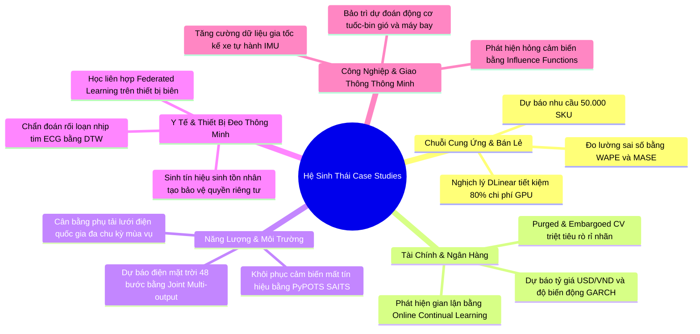

# Hệ Sinh Thái Case Study Thực Tế: Chuỗi Thời Gian (Time Series Real-World Case Studies Hub)

Hệ thống tài liệu này bao gồm bộ sưu tập các **Case Study thực chiến đa ngành (Bán lẻ E-Commerce, Tài chính Ngân hàng, Năng lượng Smart Grid, Công nghiệp IoT, Hàng không và Y tế số)**, được thiết kế song hành $1-1$ với từng file lý thuyết nền tảng trong thư mục [time-series-data-fundamentals-conecpts/](file:///D:/KnowledgeLibrary/PTDLKD/time-series-data-fundamentals-conecpts):

---

## BẢNG TRA CỨU SONG HÀNH (THEORY ↔ CASE STUDY MAPPING)

| STT | File Lý Thuyết Nền Tảng | File Case Study Thực Chiến Song Hành | Các Ngành Công Nghiệp & Ứng Dụng Đại Diện |
| :---: | :--- | :--- | :--- |
| **01** | [general_infomation.md](general_infomation.md) *(Tổng quan, I.I.D, Phân rã, 6 Tasks)* | [case_study_general_information.md](case_study_general_information.md) *(Ứng dụng tổng quan các nguyên lý)* | • Chuỗi cung ứng bán lẻ VinMart/Shopee • Quản lý phụ tải lưới điện quốc gia EVN • Cảnh báo sớm rung nhĩ Apple Watch |
| **02** | [data_generation.md](data_generation.md) *(DGP, Stochastic Process, TimeGAN, Augmentation)* | [case_study_data_generation.md](case_study_data_generation.md) *(Sinh dữ liệu & Tăng cường thực chiến)* | • Stress Testing danh mục ngân hàng đầu tư • Sinh chuỗi ICU nhân tạo bằng TimeGAN / Diffusion-TS • Tăng cường dữ liệu gia tốc kế xe tự hành IMU |
| **03** | [data_valuation.md](data_valuation.md) *(Data Valuation, Shapley, Influence, Pruning)* | [case_study_data_valuation.md](case_study_data_valuation.md) *(Định giá & Cắt tỉa dữ liệu hại)* | • Bắt lỗi cảm biến áp suất bám cặn nhà máy lọc dầu • Nhận diện Concept Drift sau đại dịch tại Shopee • Thị trường dữ liệu giao thông Smart City bằng DVRL |
| **04** | [model.md](model.md) *(ARIMA, GBDT, TCN, PatchTST vs DLinear, Foundation)* | [case_study_model.md](case_study_model.md) *(Thực chiến 5 họ mô hình chuỗi thời gian)* | • Dự báo tỷ giá USD/VND & Biến động bằng GARCH • Minh chứng Nghịch lý DLinear trên 50.000 SKU siêu thị • Zero-shot Auto-scaling Kubernetes bằng Chronos |
| **05** | [learning_paradigm.md](learning_paradigm.md) *(Supervised, SSL TS2Vec, Continual, Federated)* | [case_study_learning_paradigm.md](case_study_learning_paradigm.md) *(Ứng dụng các mô thức học hiện đại)* | • Dự báo điện mặt trời 48 bước bằng Joint Output • Giám sát tuốc-bin máy bay GE bằng Contrastive SSL • Chống quên thảm họa trong phát hiện gian lận thẻ • Học liên hợp (Federated Learning) trên Smartwatch |
| **06** | [evaluation.md](evaluation.md) *(Purged CV, WAPE/MASE, Range-based Anomaly)* | [case_study_evaluation.md](case_study_evaluation.md) *(Kiểm định chuẩn mực & Vạch trần cạm bẫy)* | • Chặn đứng Sharpe Ratio ảo trong quỹ đầu tư định lượng • Vạch trần bẫy MAPE chia cho 0 tại chuỗi 1.500 nhà thuốc • Lật tẩy bẫy Point-Adjusted F1 (98% ảo) trong an ninh SCADA |
| **07** | [repository.md](repository.md) *(Darts, Nixtla, sktime, PyPOTS, ETT, M5 Walmart)* | [case_study_repository.md](case_study_repository.md) *(Làm chủ công cụ & Benchmark quốc tế)* | • Tăng tốc dự báo 50.000 điểm phát điện gấp 40x với Nixtla • Khôi phục 35% dữ liệu thủy văn Mê Kông bằng PyPOTS • Điều khiển tay giả sinh học từ cơ EMG bằng sktime |

---

## BẢN ĐỒ CÁC BÀI TOÁN KINH ĐIỂN ĐƯỢC GIẢI QUYẾT

---

> 🧠 **Kim chỉ nam thực hành:** Mỗi file case study được thiết kế độc lập, có thể đọc riêng rẽ hoặc đối chiếu song song với file lý thuyết tương ứng. Độc giả nên bắt đầu từ [case_study_general_information.md](case_study_general_information.md) để nắm bức tranh toàn cảnh, sau đó đi sâu vào từng kỹ thuật chuyên biệt tùy theo bài toán nghiệp vụ cụ thể.
