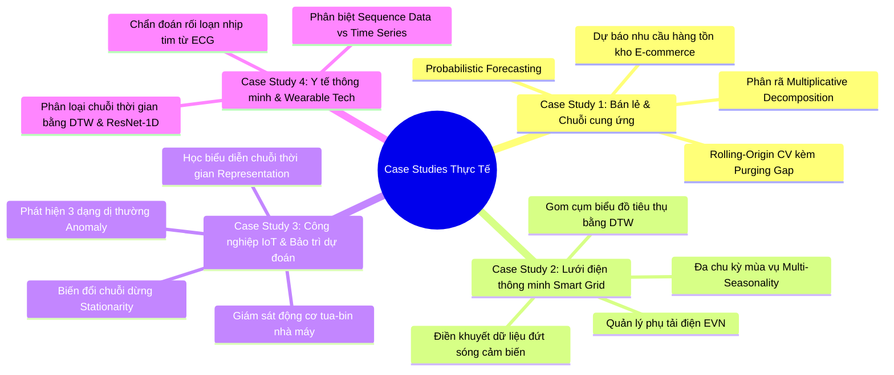
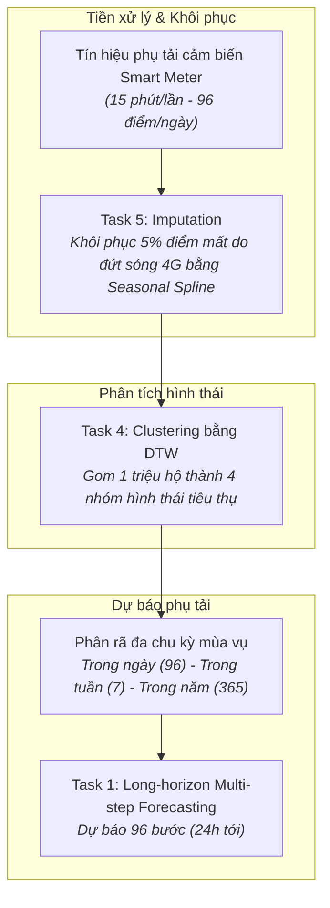
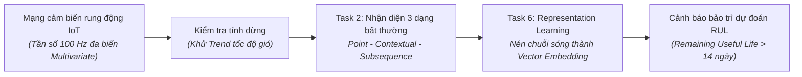
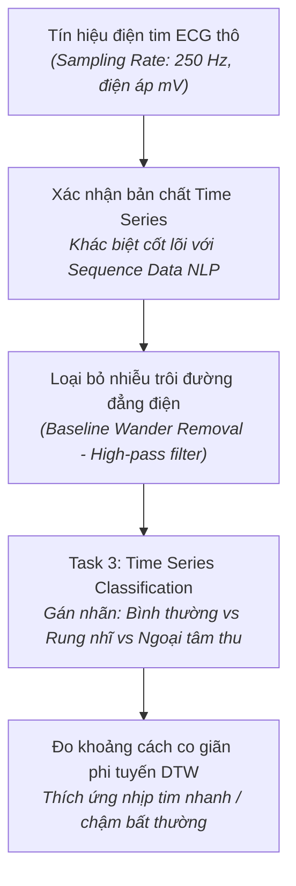

# Case Study Thực Tế: Ứng Dụng Nguyên Lý & Khái Niệm Cốt Lõi Chuỗi Thời Gian (Time Series Fundamentals & Concepts)

Tài liệu này hệ thống hóa các **Case Study thực tế trong công nghiệp (Retail/E-commerce, Năng lượng thông minh, Công nghiệp IoT/Bảo trì dự đoán, và Y tế số)** nhằm minh họa trực quan cách áp dụng toàn bộ các nguyên lý và khái niệm nền tảng đã được trình bày trong [general_infomation.md](general_infomation.md).

---

## MỤC LỤC TỔNG QUAN CÁC CASE STUDY

---

# CASE STUDY 1: Tối ưu hóa tồn kho chuỗi cung ứng E-Commerce (Shopee / VinMart)

### 1.1. Bối cảnh nghiệp vụ & Thách thức
Một hệ thống bán lẻ đa kênh với hơn 500 siêu thị mini cần dự báo nhu cầu tiêu thụ hàng ngày của hơn 10.000 mặt hàng tiêu dùng nhanh (FMCG) trong vòng 14 ngày tới ($H = 14$). Nếu dự báo thiếu, siêu thị sẽ hết hàng (Stock-out) làm mất doanh thu; nếu dự báo thừa, chi phí lưu kho và tỷ lệ hàng hủy do hết hạn sẽ tăng vọt.

---

### 1.2. Áp dụng các Fundamentals & Concepts từ tài liệu

#### A. Khái niệm chuỗi thời gian & Sự vi phạm giả định I.I.D (Mục 1.1 & 1.2)
* **Bản chất dữ liệu:** Mỗi sản phẩm tại mỗi cửa hàng là một chuỗi thời gian độ dài $T$ ngày:
  $$X = \{x_1, x_2, \dots, x_T\} \quad (x_t \in \mathbb{R}^+)$$
* **Tại sao không thể coi là dữ liệu bảng I.I.D?**
  * Doanh số ngày hôm nay $x_t$ phụ thuộc chặt chẽ vào ngày hôm qua $x_{t-1}$ (hiệu ứng tích trữ hàng, hiệu ứng cuối tuần).
  * Xáo trộn ngẫu nhiên thứ tự các ngày sẽ phá hủy hoàn toàn quán tính tiêu dùng và các ngày lễ (Tết Nguyên Đán, Black Friday, Lương về đầu tháng).
  * **Concept Drift:** Hành vi tiêu dùng thay đổi vĩnh viễn sau dịch bệnh hoặc khi có đối thủ cạnh tranh mới mở ngay bên cạnh.

#### B. Phân rã chuỗi thời gian: Lựa chọn Mô hình Nhân tính (Multiplicative Model) (Mục 1.4)
Quan sát thực tế cho thấy: Trong những năm cửa hàng tăng trưởng mạnh (Trend dốc lên), các đợt sốt mua sắm ngày Tết không chỉ tăng thêm một con số cố định $+500$ sản phẩm, mà tăng gấp **$300\%$ so với mức bán trung bình của năm đó**.
* **Công thức áp dụng:**
  $$Y_t = T_t \times S_t \times C_t \times R_t$$
* **Cách thực hiện:**
  1. Lấy $\log$ hai vế để đưa về mô hình cộng tính quen thuộc:
     $$\ln(Y_t) = \ln(T_t) + \ln(S_t) + \ln(C_t) + \ln(R_t)$$
  2. Tách thành phần $S_t$ đại diện cho mùa vụ tuần (thứ 7/CN bán cao gấp đôi thứ 2) và mùa vụ năm (tháng 12 Dương lịch và giáp Tết Âm lịch).

#### C. Chiến lược phân chia dữ liệu: Nghiêm cấm Random Shuffle (Mục 1.5)
* **Hậu quả nếu chia Random Split:** Mô hình học được lượng bán của ngày 15/12 để dự báo cho ngày 14/12. Khi test trên giấy điểm $R^2 = 0.98$, nhưng khi đưa vào vận hành thực tế hệ thống tê liệt vì thiếu hụt hàng tồn kho nghiêm trọng.
* **Quy trình chuẩn hóa áp dụng:**
  1. **Purging Buffer (Khoảng đệm Gap):** Do mô hình sử dụng các đặc trưng trễ (Lag features: `sales_lag_7`, `sales_lag_14`, `rolling_mean_7`), nhóm kỹ thuật thiết lập một khoảng đệm $\text{Gap} = 14$ ngày giữa tập Train và tập Test để triệt tiêu hoàn toàn nguy cơ rò rỉ dữ liệu (Data Leakage).
  2. **Rolling-Origin Cross-Validation:** Cửa sổ trượt mở rộng (Expanding Window):
     * Fold 1: Train từ T01/2023 $\to$ T10/2023, Test 14 ngày đầu T11/2023.
     * Fold 2: Train từ T01/2023 $\to$ T11/2023, Test 14 ngày đầu T12/2023.
     * Fold 3: Train từ T01/2023 $\to$ T12/2023, Test 14 ngày đầu T01/2024 (trúng đợt Tết).

#### D. Tính dừng (Stationarity) (Mục 1.6)
* Dữ liệu bán lẻ có Trend tăng trưởng và Seasonality mạnh $\implies$ Chuỗi **không dừng** ($\mathbb{E}[x_t]$ thay đổi theo thời gian).
* Kiểm định Augmented Dickey-Fuller (ADF Test) cho giá trị $p\text{-value} = 0.42 > 0.05 \implies$ Chuỗi có nghiệm đơn vị (Unit Root).
* **Giải pháp xử lý:** Lấy sai phân mùa vụ (Seasonal Differencing $d=7$) kết hợp sai phân bậc một ($\Delta x_t = x_t - x_{t-1}$) trước khi đưa vào mô hình ARIMA / SARIMAX.

#### E. Nhiệm vụ thực thi: Dự báo xác suất (Probabilistic Forecasting) (Mục 1.7 - Task 1)
Thay vì chỉ đưa ra dự báo điểm (Point Forecast: "Ngày mai bán được 100 gói bánh"), mô hình xuất ra 3 phân vị:
* **Quantile P10 (10%):** 70 gói (dùng cho kịch bản cầu thấp nhất để cắt giảm chi phí kho bãi).
* **Quantile P50 (50% Median):** 100 gói (kịch bản trung bình).
* **Quantile P90 (90%):** 140 gói $\implies$ Doanh nghiệp chuẩn bị tồn kho an toàn bằng mức P90 cho các mặt hàng sinh lời cao để đảm bảo tỷ lệ phục vụ khách hàng (Service Level) đạt $95\%$.

---

# CASE STUDY 2: Quản lý phụ tải lưới điện quốc gia (Smart Grid EVN)

### 2.1. Bối cảnh nghiệp vụ
Trung tâm điều độ hệ thống điện quốc gia cần cân bằng giữa sản lượng phát điện (thủy điện, nhiệt điện, năng lượng tái tạo mặt trời/gió) và công suất tiêu thụ điện (MW) của toàn hệ thống theo chu kỳ 15 phút một lần. Điện năng không thể lưu trữ quy mô lớn với chi phí rẻ; sản xuất thừa gây cháy thiết bị đường dây, sản xuất thiếu gây rã lưới điện diện rộng (Blackout).

---

### 2.2. Áp dụng các Fundamentals & Concepts từ tài liệu

#### A. Tần số lấy mẫu & Khoảng cách thời gian $\Delta t$ mang ý nghĩa vật lý (Mục 1.3)
* Khác với chuỗi từ ngữ trong NLP (khoảng cách giữa các từ không tính bằng phút), khoảng cách $\Delta t = 15\text{ phút}$ của đồng hồ đo điện (Smart Meter) gắn liền với quán tính nhiệt và chu kỳ sinh hoạt xã hội.
* Đo công suất cách nhau 15 phút cho phép phát hiện đỉnh phụ tải (Peak Load) lúc 11h30 trưa và 19h30 tối. Nếu hạ tần số lấy mẫu xuống 1 ngày một lần ($\Delta t = 24\text{h}$), toàn bộ thông tin về giờ cao điểm bị triệt tiêu hoàn toàn.

#### B. Phân rã đa chu kỳ mùa vụ (Multi-Seasonality Decomposition) (Mục 1.4)
Phụ tải điện có tính chất mùa vụ lồng ghép cực kỳ phức tạp:
1. **Chu kỳ hàng ngày ($S_{\text{daily}}$):** Chu kỳ 96 bước (mỗi bước 15 phút), đáy lúc 3h sáng, đỉnh lúc 20h tối.
2. **Chu kỳ hàng tuần ($S_{\text{weekly}}$):** 7 ngày/tuần (thứ 2 đến thứ 6 các khu công nghiệp hoạt động tối đa, thứ 7 và Chủ nhật phụ tải giảm 20%).
3. **Chu kỳ hàng năm ($S_{\text{yearly}}$):** Mùa hè phụ tải điều hòa tăng vọt (Peak Summer), mùa đông miền Bắc phụ tải sưởi ấm.
$\implies$ Áp dụng phương pháp phân rã tiên tiến như **MSTL (Multiple Seasonal-Trend decomposition using LOESS)**.

#### C. Điền khuyết dữ liệu chuỗi thời gian (Imputation) (Mục 1.7 - Task 5)
* **Vấn đề thực tế:** Cảm biến truyền qua sóng 4G/NB-IoT thường xuyên mất kết nối khi có bão hoặc nghẽn mạng, tạo ra các chuỗi dữ liệu rỗng liên tục từ 1 đến 4 tiếng.
* **Tại sao không thể dùng Mean Imputation hoặc Forward Fill thông thường?**
  * Nếu dùng Mean của cả tháng: Sẽ biến đỉnh tiêu thụ 12h trưa thành một đường ngang phẳng lì, làm sai lệch công suất đỉnh.
  * Nếu dùng Forward Fill ($x_t = x_{t-1}$): Đứt mạng lúc 18h tối khi phụ tải đang tăng nhanh sẽ kéo dài một đường thẳng cố định qua cả giờ cao điểm.
* **Giải pháp chuẩn:** Sử dụng thuật toán **Seasonal & Trend Imputation** hoặc **KNN-Impute với khoảng cách DTW**, lấy hình thái tiêu thụ của các ngày cùng thứ tuần trước để đắp vào đoạn bị khuyết, bảo toàn biên độ sóng thực tế.

#### D. Gom cụm biểu đồ phụ tải bằng khoảng cách Dynamic Time Warping (DTW) (Mục 1.7 - Task 4)
* **Mục tiêu:** Phân loại 1.000.000 hộ dùng điện thành các nhóm hành vi để áp dụng biểu giá điện theo giờ (TOU - Time of Use).
* **Tại sao khoảng cách Euclidean thất bại?**
  * Gia đình A nấu cơm lúc 18h30, gia đình B nấu cơm lúc 19h15. Đồ thị phụ tải của hai nhà hoàn toàn giống nhau về hình thái nhưng bị lệch pha 45 phút trên trục hoành.
  * Khoảng cách Euclidean so khớp điểm theo điểm thẳng đứng ($t \leftrightarrow t$) sẽ kết luận hai gia đình này hoàn toàn khác nhau.
* **Giải pháp DTW (Dynamic Time Warping):** Co giãn phi tuyến trục thời gian để so khớp đỉnh sóng của nhà A với đỉnh sóng của nhà B, gom chính xác cả hai vào cụm "Hộ gia đình sinh hoạt giờ tan tầm".

---

# CASE STUDY 3: Bảo trì dự đoán động cơ tua-bin gió trong Công nghiệp IoT

### 3.1. Bối cảnh nghiệp vụ
Một trang trại điện gió ngoài khơi với 80 tua-bin khổng lồ. Chi phí thuê tàu và cần cẩu ra biển sửa chữa một hộp số bị vỡ lên tới hơn $300.000\text{ USD}$ và mất 2 tháng dừng máy. Doanh nghiệp gắn hàng loạt cảm biến rung động (Vibration Accelerometer), cảm biến nhiệt độ ổ trục và áp suất dầu để phát hiện sớm các dấu hiệu hư hại trước khi xảy ra sự cố cơ học từ 2 đến 4 tuần.

---

### 3.2. Áp dụng các Fundamentals & Concepts từ tài liệu

#### A. Chuỗi đa biến (Multivariate Time Series) (Mục 1.1)
Tại mỗi mốc thời gian $t$, quan sát không phải là một số vô hướng mà là một vector nhiều chiều:
$$x_t = [\text{Rung trục X}, \text{Rung trục Y}, \text{Nhiệt độ ổ bi}, \text{Áp suất dầu}, \text{Tốc độ gió}]^T \in \mathbb{R}^5$$
Các thành phần này tương tác vật lý trực tiếp với nhau: Khi tốc độ gió tăng, độ rung trục tăng là hiện tượng bình thường; nhưng tốc độ gió thấp mà độ rung trục tăng cao thì là bất thường cơ học.

#### B. Nhận diện cả 3 dạng bất thường (Anomaly Detection) (Mục 1.7 - Task 2)

| Dạng bất thường | Hiện tượng thực tế trên tua-bin | Phương pháp phát hiện |
|---|---|---|
| **Point Anomaly (Bất thường điểm)** | Cảm biến rung đột ngột vọt lên biên độ $10\text{g}$ trong $1/100$ giây do sét đánh trúng cột sét hoặc xung điện tín hiệu | Lọc ngưỡng động (Z-Score rolling, Median Filter), phân loại là nhiễu đo lường chứ không phải hỏng hóc cơ học |
| **Contextual Anomaly (Bất thường theo ngữ cảnh)** | Nhiệt độ ổ trục là $65^\circ\text{C}$. Mức nhiệt này là hoàn toàn bình thường khi tua-bin chạy hết công suất vào mùa hè ($40^\circ\text{C}$ ngoài trời), nhưng là bất thường báo động đỏ nếu nhiệt độ môi trường ngoài khơi đang là $-5^\circ\text{C}$ mùa đông và gió nhẹ | Đưa biến ngoại sinh (Exogenous variable: nhiệt độ môi trường) vào mô hình hồi quy có điều kiện |
| **Subsequence / Collective Anomaly (Bất thường theo đoạn)** | Từng điểm biên độ rung riêng lẻ đều nằm trong giới hạn an toàn ($< 2\text{g}$), nhưng chuỗi sóng tạo thành hình thái điều hòa bậc cao liên tục trong 15 phút $\implies$ Dấu hiệu một răng cưa trong hộp số đã bị nứt mỏi | Sử dụng thuật toán Matrix Profile, Autoencoder hoặc Dynamic Time Warping đối chiếu với thư viện mẫu sóng lỗi chuẩn |

#### C. Học biểu diễn chuỗi thời gian (Representation Learning) (Mục 1.7 - Task 6)
* Dữ liệu rung động ở tần số $100\text{ Hz}$ tạo ra $8.640.000$ điểm dữ liệu mỗi ngày cho mỗi tua-bin $\implies$ Không thể lưu trữ và so khớp toàn bộ chuỗi nguyên bản trên máy chủ trung tâm.
* **Giải pháp:** Sử dụng mô hình Self-Supervised Learning (như TS2Vec, CoST hoặc WaveNet Encoder) nén từng đoạn sóng 1 giờ thành một vector đặc trưng kích thước cố định $e_t \in \mathbb{R}^{128}$ (Embedding).
* Vector này giữ lại toàn bộ đặc tính phổ tần số của động cơ, cho phép chạy thuật toán phân cụm hoặc tính khoảng cách Cosine cực nhanh để phát hiện sự biến chất của kim loại theo thời gian.

---

# CASE STUDY 4: Chẩn đoán rối loạn nhịp tim từ thiết bị đeo (Apple Watch / ECG)

### 4.1. Bối cảnh nghiệp vụ
Các thiết bị đeo tay thông minh ghi nhận tín hiệu điện tâm đồ đơn đạo trình (Lead-I ECG) để tầm soát sớm hội chứng Rung nhĩ (Atrial Fibrillation - AFib) – nguyên nhân hàng đầu gây đột quỵ não thầm lặng. Tín hiệu thu được từ cổ tay người dùng chuyển động thường xuyên bị rung giật, nhiễu cơ (Electromyogram artifact) và có nhịp tim thay đổi linh hoạt tùy theo việc người dùng đang ngủ, đi bộ hay leo cầu thang.

---

### 4.2. Áp dụng các Fundamentals & Concepts từ tài liệu

#### A. Phân biệt rõ ràng giữa Sequence Data và Time Series (Mục 1.3)
Nhiều kỹ sư AI áp dụng máy móc mô hình Transformer (BERT/GPT) từ bài toán xử lý ngôn ngữ tự nhiên (NLP) sang chuỗi điện tim ECG và nhận kết quả kém:

| Tiêu chí | Sequence Data (Câu văn tiếng Việt) | Time Series Data (Điện tâm đồ ECG) |
|---|---|---|
| **Bản chất phần tử** | Token rời rạc: `["Bệnh", "nhân", "bị", "đau", "ngực"]` | Giá trị điện áp liên tục: $x_t \in [-1.5\text{ mV}, +2.5\text{ mV}]$ |
| **Khoảng cách $\Delta t$** | Vô nghĩa: Khoảng cách giữa chữ "đau" và chữ "ngực" không có đơn vị đo vật lý | Mang ý nghĩa sống còn: Khoảng cách giữa sóng P và phức bộ QRS ($PR\text{ interval} \approx 120 - 200\text{ ms}$). Nếu khoảng cách này giãn dài ra, bệnh nhân bị Block nhĩ thất |
| **Tần số lấy mẫu (Sampling Rate)** | Không có | Bắt buộc cố định ($250\text{ Hz}$ tức $4\text{ ms}$ lấy mẫu một lần). Nếu lấy mẫu không đều do lỗi chip Bluetooth, toàn bộ hình thái sóng P-Q-R-S-T sẽ bị biến dạng |

#### B. Phân loại chuỗi thời gian (Classification) & Khắc phục nhịp tim biến thiên bằng DTW (Mục 1.7 - Task 3)
* **Thách thức:** Khi bệnh nhân nghỉ ngơi, nhịp tim là 60 bpm (khoảng cách giữa hai đỉnh R là $1.0\text{s}$). Khi bệnh nhân đi bộ, nhịp tim tăng lên 100 bpm (khoảng cách giữa hai đỉnh R rút ngắn còn $0.6\text{s}$). Tuy nhiên, cả hai trạng thái đều là nhịp xoang bình thường.
* Nếu dùng khoảng cách Euclidean: Thuật toán sẽ báo hai đoạn sóng này hoàn toàn lệch pha và phán đoán sai thành bệnh lý.
* **Áp dụng Dynamic Time Warping (DTW):** Cho phép co rút trục thời gian của chu kỳ 60 bpm để khớp với chu kỳ 100 bpm, sau đó so sánh hình dạng sóng P và phức bộ QRS. Nếu sóng P biến mất và xuất hiện sóng $f$ lăn tăn $\implies$ Kết luận chính xác là **Rung nhĩ (AFib)**.

---

# TỔNG KẾT SO SÁNH MA TRẬN ỨNG DỤNG THỰC TẾ

Bảng dưới đây ánh xạ trực tiếp các khái niệm trong `general_infomation.md` vào 4 Case Study công nghiệp:

| Khái niệm trong `general_infomation.md` | Bán lẻ (E-Commerce) | Lưới điện (Smart Grid) | Bảo trì tua-bin (Industrial IoT) | Y tế số (ECG Healthcare) |
|---|---|---|---|---|
| **Loại chuỗi** | Đơn biến hoặc đa biến kết hợp giá/khuyến mãi | Chuỗi đơn biến (tổng phụ tải) hoặc hàng triệu chuỗi song song | Chuỗi đa biến cao cấp ($d \ge 5$ cảm biến vật lý) | Chuỗi liên tục biên độ thấp, tần số lấy mẫu cao ($250\text{ Hz}$) |
| **Mô hình phân rã chính** | **Multiplicative** ($Y = T \times S \times C \times R$) do biên độ vụ mùa tăng theo quy mô | **Multi-Seasonality (MSTL)** kết hợp chu kỳ 96 bước, 7 ngày và 365 ngày | Tách Trend thoái hóa vòng bi ra khỏi biến động tải gió | Khử nhiễu nhịp thở (Baseline wander) để lộ sóng điện tim thuần khiết |
| **Chiến lược chia dữ liệu** | **Rolling-Origin CV** có chèn **Purging Gap** 14 ngày | **Chronological Split** tuần tự theo tháng nóng/lạnh | **Time-based Split** chia theo vòng đời máy từ mới đến khi hỏng | Chia theo **Bệnh nhân (Patient-level Split)**, không cắt ngang một nhịp tim |
| **Xử lý tính dừng** | Lấy sai phân mùa vụ ($d=7$) và logarit | Khử thành phần mùa vụ kép (Deseasonalize) | Tính vi phân gia tốc rung và biến đổi Fourier/Wavelet | Chuỗi sóng tương đối dừng yếu trong các khoảng 10 giây đo yên tĩnh |
| **Tasks chuỗi thời gian chủ đạo** | **Task 1: Forecasting** (Probabilistic Quantiles P10-P90) | **Task 4: Clustering** (DTW) & **Task 5: Imputation** (Spline) | **Task 2: Anomaly Detection** & **Task 6: Representation** | **Task 3: Classification** (Nhận diện bệnh bằng DTW & CNN-1D) |

---

> 💡 **Lời khuyên thực chiến cho Kỹ sư dữ liệu:**
> 1. Khi tiếp cận bất kỳ bài toán chuỗi thời gian nào, bước đầu tiên không phải là chọn model (ARIMA, XGBoost hay Transformer), mà là **vẽ đồ thị dữ liệu lên màn hình** để xác định dạng phân rã (Cộng tính hay Nhân tính) và kiểm tra tính dừng.
> 2. Hãy luôn kiểm tra tính toàn vẹn của trục thời gian: có bị khuyết điểm hay không, tần số lấy mẫu $\Delta t$ có cố định hay không, và **tuyệt đối không bao giờ để hàm `train_test_split(..., shuffle=True)` xuất hiện trong mã nguồn**.
