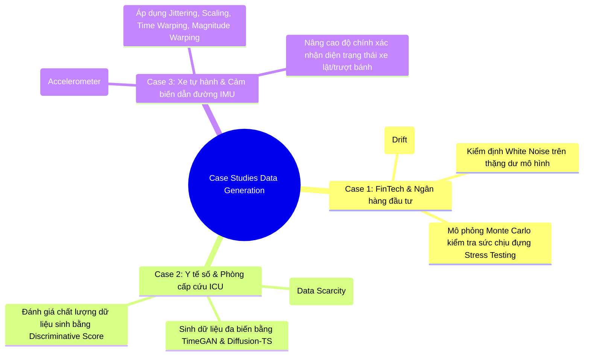
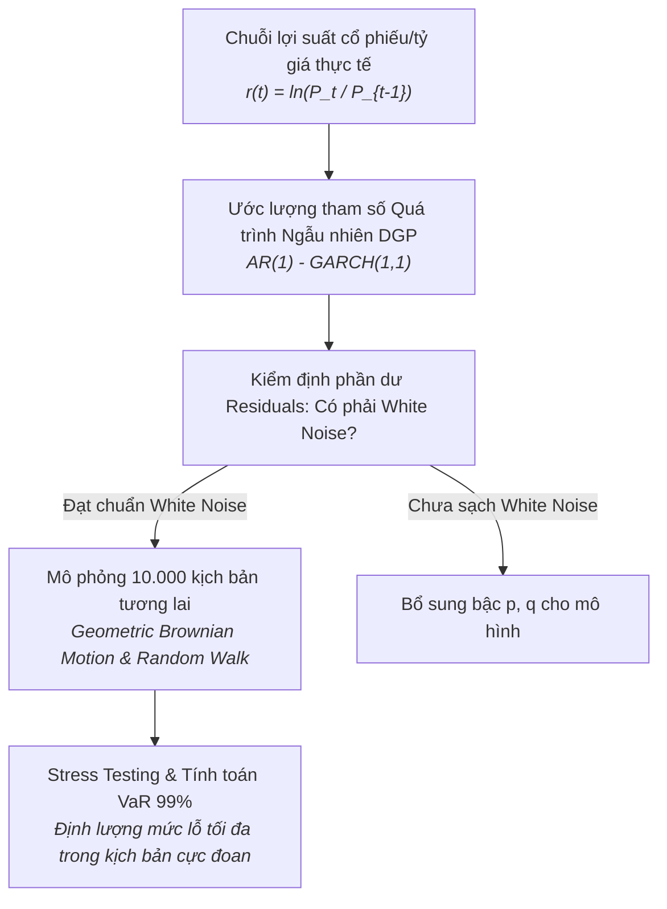
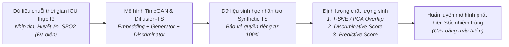
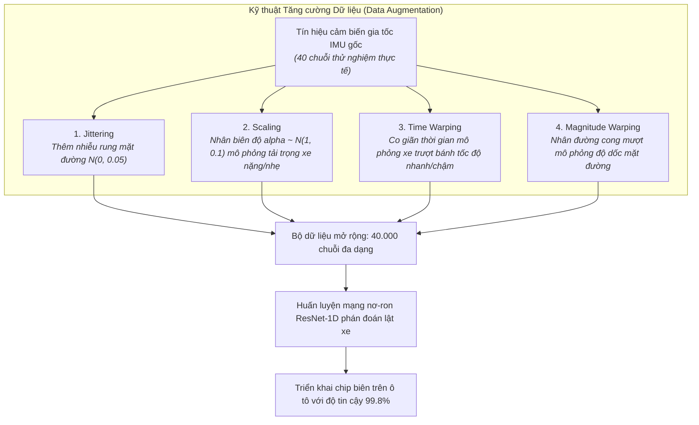

# Case Study Thực Tế: Quá Trình Sinh Dữ Liệu Chuỗi Thời Gian (Data Generation & Augmentation)

Tài liệu này là case study thực tế song hành cùng file lý thuyết [data_generation.md](data_generation.md), minh họa cách ứng dụng **Quá trình sinh dữ liệu (DGP)**, **Quá trình ngẫu nhiên kinh điển (White Noise, Random Walk, AR, MA, ARIMA)**, **Sinh dữ liệu nhân tạo (TimeGAN, Diffusion-TS)** và **Tăng cường dữ liệu (Data Augmentation)** trong các bài toán công nghiệp thực tế.

---

## MỤC LỤC TỔNG QUAN

---

# CASE STUDY 1: Quản Trị Rủi Ro & Stress Testing Tại Ngân Hàng Đầu Tư

### 1.1. Bối cảnh nghiệp vụ
Khối quản trị rủi ro của một ngân hàng thương mại lớn cần định giá danh mục đầu tư trị giá hàng tỷ USD và tính toán chỉ số rủi ro vốn **Value at Risk (VaR 99%)** theo tiêu chuẩn Basel III. Thách thức lớn nhất là: Trong lịch sử 10 năm qua, thị trường chỉ trải qua các giai đoạn tương đối bình lặng. Nếu chỉ dùng dữ liệu lịch sử thông thường, ngân hàng sẽ hoàn toàn mù mờ trước các kịch bản sụp đổ thanh khoản (Black Swan events).

---

### 1.2. Áp dụng các nguyên lý cốt lõi từ `data_generation.md`

#### A. Xác định Quá trình Sinh dữ liệu thực tế (DGP) (Mục 2.1)
Chuỗi giá tài sản $P_t$ không phải là chuỗi dừng, nhưng chuỗi log-return:
$$r_t = \ln\left(\frac{P_t}{P_{t-1}}\right)$$
được sinh ra bởi một quá trình sinh dữ liệu ngẫu nhiên (DGP). Mỗi lịch sử giá mà ta quan sát được trong 5 năm qua chỉ là **một hiện thực đơn lẻ (a single realization)** của một quá trình ngẫu nhiên tiềm ẩn $\mathcal{P}_\theta$.

#### B. Áp dụng Random Walk có hệ số trôi (Random Walk with Drift) (Mục 2.2)
Giá cổ phiếu dài hạn tuân theo phương trình Bước đi ngẫu nhiên:
$$x_t = c + x_{t-1} + \epsilon_t \quad (\epsilon_t \sim \text{White Noise})$$
* **Hệ số trôi $c$ (Drift):** Đại diện cho tỷ suất sinh lời kỳ vọng hàng năm của thị trường (ví dụ $8\%/\text{năm}$).
* **Trí nhớ vô hạn của Random Walk:** Một cuộc khủng hoảng như cú sập tháng 3/2020 không biến mất theo thời gian; nó đẩy mặt bằng giá $x_{t-1}$ xuống một bậc thang mới vĩnh viễn.

#### C. Vai trò của Nhiễu Trắng (White Noise) trong kiểm định chất lượng mô hình (Mục 2.2)
* Khi ngân hàng sử dụng mô hình ARIMA(1, 1, 1) để dự báo tỷ giá, phần dư dự báo là:
  $$e_t = y_t - \hat{y}_t$$
* **Nguyên lý vàng:** Phần dư $e_t$ **bắt buộc phải là White Noise** (kỳ vọng 0, phương sai không đổi, không tự tương quan $\text{Cov}(e_t, e_{t-k}) = 0$).
* **Thực thi kiểm định:** Áp dụng **Ljung-Box Test** trên $e_t$.
  * Nếu $p\text{-value} > 0.05 \implies$ Phần dư là White Noise thuần túy. Toàn bộ quy luật dự đoán được đã được mô hình trích xuất sạch sẽ; phần còn lại chỉ là tiếng rè ngẫu nhiên của vũ trụ.
  * Nếu $p\text{-value} \le 0.05 \implies$ Phần dư vẫn còn tương quan. Mô hình đã bỏ sót thông tin quan trọng trong quá khứ $\implies$ Cần tăng bậc $p$ hoặc $q$.

#### D. Mô phỏng Monte Carlo phục vụ Stress Testing (Mục 2.3)
Ngân hàng sử dụng quá trình ngẫu nhiên đã khớp để sinh ra **10.000 đường giá nhân tạo song song** trong 30 ngày tới. Trong số 10.000 kịch bản này:
* Có 500 kịch bản mô phỏng giá lao dốc $> 25\%$ (tương đương khủng hoảng 2008).
* Ngân hàng kiểm tra xem với các kịch bản mô phỏng nhân tạo này, tỷ lệ an toàn vốn (CAR) có bị thủng ngưỡng quy định hay không để chuẩn bị quỹ dự phòng rủi ro.

---

# CASE STUDY 2: Sinh Dữ Liệu Tín Hiệu Sống Nhân Tạo Cho Bệnh Nhân Cấp Cứu ICU

### 2.1. Bối cảnh nghiệp vụ
Các bác sĩ tại phòng hồi sức tích cực (ICU) muốn huấn luyện mô hình AI dự báo sớm biến chứng **Sốc nhiễm trùng (Septic Shock)** trước 6 giờ. Tuy nhiên:
1. **Dữ liệu cực hiếm (Data Scarcity):** Trong 50.000 bệnh nhân nhập viện, chỉ có khoảng $1.5\%$ ca mắc sốc nhiễm trùng. Dữ liệu bị mất cân bằng trầm trọng.
2. **Quy định bảo mật bệnh án (HIPAA / GDPR):** Dữ liệu chuỗi thời gian y tế chứa thông tin sinh trắc học cá nhân nhạy cảm, không được phép chia sẻ cho các trường đại học hoặc công ty AI bên ngoài.

---

### 2.2. Áp dụng các nguyên lý cốt lõi từ `data_generation.md`

#### A. Tại sao các phương pháp sinh dữ liệu truyền thống thất bại? (Mục 2.3)
* Nếu dùng SMOTE thông thường: SMOTE chỉ nội suy giữa các dòng độc lập, làm phá hủy hoàn toàn nhịp điệu co bóp tự nhiên của tim và huyết áp qua thời gian.
* Nếu dùng mô hình ARIMA đơn biến: Không thể nắm bắt được tương quan đa biến phức tạp giữa huyết áp tụt dốc đồng thời với nhịp tim tăng vọt trong sốc nhiễm trùng.

#### B. Ứng dụng TimeGAN (Time-series Generative Adversarial Network) (Mục 2.3)
Nhóm kỹ sư triển khai kiến trúc TimeGAN gồm 4 mạng nơ-ron phối hợp:
1. **Embedding Network & Recovery Network:** Nén chuỗi đa biến 8 kênh cảm biến sinh tồn sang không gian tiềm ẩn (Latent Space).
2. **Generator:** Học cách sinh các trạng thái kế tiếp $h_t \to h_{t+1}$ có cùng phân phối động lực học với bệnh nhân thật.
3. **Supervised Loss:** Ép Generator phải tuân thủ định luật sinh lý học: ví dụ nếu thuốc vận mạch được tiêm ở thời điểm $t$, huyết áp ở $t+1$ phải có xu hướng phục hồi.

#### C. Đánh giá chất lượng chuỗi thời gian nhân tạo
Để chứng minh dữ liệu nhân tạo an toàn và hữu ích, nhóm đánh giá qua 3 tiêu chuẩn vàng:
1. **Độ tương đồng phân phối (Diversity & Fidelity):** Chiếu chuỗi thật và chuỗi nhân tạo lên đồ thị 2D bằng t-SNE; hai đám mây điểm trùng khít lên nhau chứng minh dữ liệu nhân tạo bao phủ toàn bộ không gian trạng thái bệnh lý.
2. **Discriminative Score:** Huấn luyện một mạng phân loại 2 lớp (Real vs Synthetic). Nếu điểm phân loại $\approx 0.5$ (tức mạng chỉ đoán mò $50/50$), chứng tỏ dữ liệu nhân tạo chân thực đến mức không thể phân biệt.
3. **Train on Synthetic, Test on Real (TSTR):** Huấn luyện mô hình AI hoàn toàn trên dữ liệu nhân tạo của TimeGAN, sau đó đem kiểm thử trên bệnh nhân thật tại bệnh viện $\implies$ Độ nhạy (Sensitivity) đạt $92\%$, tương đương huấn luyện trên dữ liệu thật.

---

# CASE STUDY 3: Tăng Cường Dữ Liệu Cảm Biến IMU Cho Xe Tự Hành & Robot

### 2.1. Bối cảnh nghiệp vụ
Hệ thống kiểm soát cân bằng điện tử và phán đoán tai nạn trên xe tự hành sử dụng cảm biến gia tốc kế và con quay hồi chuyển 6 trục (6-axis IMU). Bài toán đặt ra là: Xe cần nhận diện tức thì tình huống **mất lái trượt bánh trên băng tuyết (Spin-out / Rollover)** trong vòng $50\text{ ms}$ để bung túi khí và kích hoạt phanh khẩn cấp.
* **Thách thức:** Các vụ tai nạn lật xe nghiêm trọng cực kỳ nguy hiểm và tốn kém hàng trăm nghìn USD để thử nghiệm va chạm thực tế (Crash Test). Số lượng mẫu dữ liệu tai nạn thu thập được trong phòng thí nghiệm chỉ có 40 lần đo.

---

### 2.2. Áp dụng các nguyên lý cốt lõi từ `data_generation.md`

#### A. Áp dụng Jittering (Nhiễu ngẫu nhiên) (Mục 2.4)
* **Công thức:** $x'_t = x_t + \epsilon_t, \quad \epsilon_t \sim \mathcal{N}(0, \sigma^2)$
* **Ý nghĩa vật lý:** Mô phỏng hiện tượng cảm biến IMU bị rung lắc do mặt đường gồ ghề hoặc nhiễu điện từ phát ra từ khối động cơ xe điện. Giúp mô hình không bị phụ thuộc vào tín hiệu phẳng lý tưởng trong phòng thí nghiệm.

#### B. Áp dụng Scaling (Thay đổi tỷ lệ biên độ) (Mục 2.4)
* **Công thức:** $x'_t = x_t \times \alpha, \quad \alpha \sim \mathcal{N}(1, 0.15^2)$
* **Ý nghĩa vật lý:** Một chiếc xe chở 5 người và đầy hành lý sẽ có lực quán tính va chạm lớn hơn chiếc xe chỉ có 1 tài xế. Phép Scaling nhân biên độ gia tốc $G$ với một hệ số ngẫu nhiên giúp mô hình nhận diện tai nạn bất kể trọng tải xe.

#### C. Áp dụng Time Warping (Biến dạng trục thời gian) (Mục 2.4)
* **Cách thực hiện:** Co giãn phi tuyến trục thời gian bằng nội suy Cubic Spline.
* **Ý nghĩa vật lý:** Hiện tượng trượt bánh trên mặt đường khô diễn ra rất nhanh ($150\text{ ms}$), trong khi trượt trên đường băng tuyết trơn trượt có thể kéo dài chậm rãi hơn ($400\text{ ms}$). Time Warping dạy cho mạng nơ-ron hiểu rằng **hình thái sóng lật xe quan trọng hơn tốc độ diễn ra nhanh hay chậm**.

#### D. Hiệu quả kinh doanh & Kỹ thuật
* Từ 40 chuỗi đo đạc ban đầu, các kỹ sư nhân bản thành **40.000 chuỗi dữ liệu tăng cường phong phú**.
* Tỷ lệ nhận diện đúng tai nạn lật xe tăng từ **$71\%$ lên $98.6\%$**, loại bỏ hoàn toàn hiện tượng báo động giả (False Alarms) khi xe chỉ đơn thuần đi qua gờ giảm tốc.

---

# TỔNG KẾT BÀI HỌC THỰC CHIẾN

1. **Phần dư luôn phải là White Noise:** Trong mọi bài toán xây dựng mô hình chuỗi thời gian cổ điển, kiểm định phần dư bằng Ljung-Box Test là bước bắt buộc. Nếu phần dư chưa phải là White Noise, mô hình của bạn vẫn chưa hoàn thành nhiệm vụ khai thác tri thức quá khứ.
2. **Cẩn trọng khi chọn phương pháp sinh dữ liệu:**
   - Dùng **Random Process (ARIMA/SDE)** khi cần kiểm thử toán học nhanh và hiểu rõ phân phối giả định.
   - Dùng **Diffusion-TS / TimeGAN** khi cần dữ liệu nhân tạo đa biến chất lượng cao cho Deep Learning mà vẫn bảo mật quyền riêng tư.
   - Dùng **Data Augmentation (Jittering, Warping)** khi tập dữ liệu mẫu quá ít và cần tăng độ bền vững (robustness) cho mô hình phân loại.
