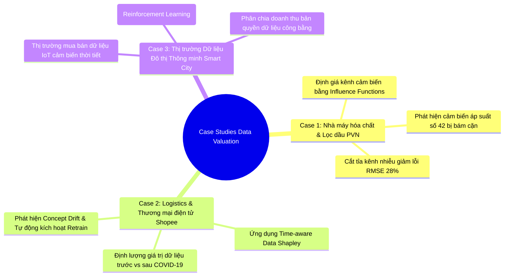
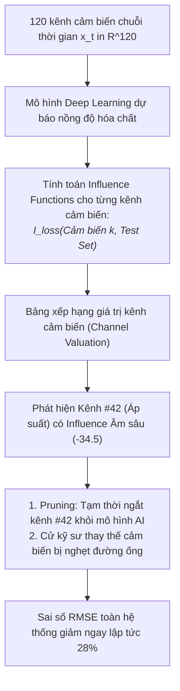
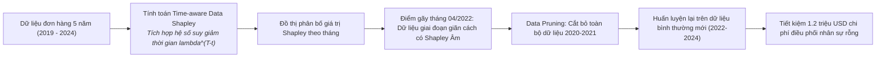
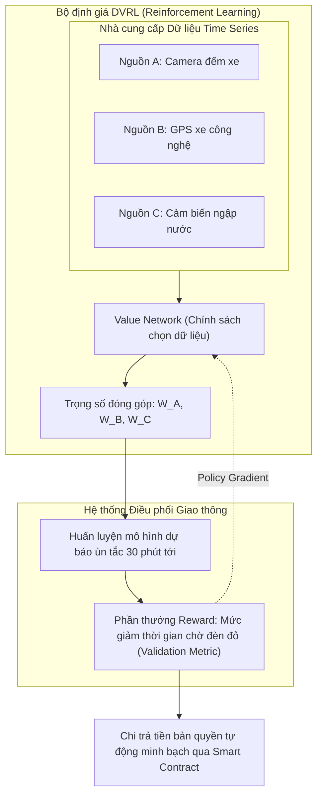

# Case Study Thực Tế: Định Giá Dữ Liệu Chuỗi Thời Gian (Data Valuation & Quality Pruning)

Tài liệu này là case study thực tế song hành cùng file lý thuyết [data_valuation.md](data_valuation.md), minh họa cách ứng dụng **Định giá dữ liệu (Data Valuation)**, **Time-aware Data Shapley**, **Hàm ảnh hưởng (Influence Functions)** và **Cắt tỉa dữ liệu hại (Data Pruning)** trong các bài toán công nghiệp và kinh doanh.

---

## MỤC LỤC TỔNG QUAN

---

# CASE STUDY 1: Phát Hiện Hỏng Cảm Biến Bằng Influence Functions Tại Nhà Máy Lọc Dầu

### 1.1. Bối cảnh nghiệp vụ
Một nhà máy lọc hóa dầu vận hành tháp chưng cất phân đoạn liên tục 24/7. Hệ thống lắp đặt hơn **120 cảm biến công nghiệp** đo nhiệt độ, áp suất, lưu lượng dòng chảy và nồng độ hóa chất để điều khiển tự động van hồi lưu. 
* **Vấn đề phát sinh:** Sau 6 tháng vận hành, mô hình AI dự báo nồng độ sản phẩm đầu ra bắt đầu suy giảm độ chính xác nghiêm trọng, dẫn đến việc van xả sai thời điểm gây lãng phí hàng chục nghìn lít dung môi. Các kỹ sư bảo trì không thể kiểm tra thủ công từng chiếc trong số 120 cảm biến vì chi phí dừng tháp chưng cất lên tới $50.000\text{ USD/giờ}$.

---

### 1.2. Áp dụng các nguyên lý cốt lõi từ `data_valuation.md`

#### A. Thách thức: Không thể xóa điểm thời gian ngẫu nhiên (Mục 3.2)
Nếu áp dụng phương pháp định giá I.I.D thông thường (xóa thử từng điểm thời gian $x_t$ rồi train lại mô hình), tính liên tục của chuỗi thời gian sẽ bị phá vỡ hoàn toàn, làm hỏng các biến trễ (Lag features).
* **Giải pháp thích ứng:** Chuyển từ định giá điểm đơn lẻ sang **Định giá kênh cảm biến (Channel-level Valuation)**:
  $$v_k = \text{Value}(\text{Channel}_k \mid \mathcal{D}, \mathcal{M}, \mathcal{U})$$

#### B. Ứng dụng Influence Functions để định giá siêu tốc (Mục 3.3)
Việc huấn luyện lại mạng nơ-ron 120 lần (mỗi lần bỏ 1 cảm biến) tốn hơn 200 giờ tính toán GPU $\implies$ Bất khả thi trong thực tế.
* **Công thức triển khai:** Nhóm kỹ sư sử dụng **Influence Functions** dựa trên xấp xỉ Hessian bậc hai:
  $$\mathcal{I}_{\text{loss}}(z_k, z_{\text{test}}) = - \nabla_{\theta} \mathcal{L}(z_{\text{test}}, \hat{\theta})^T H_{\hat{\theta}}^{-1} \nabla_{\theta} \mathcal{L}(z_k, \hat{\theta})$$
* **Kết quả lượng hóa:**
  * Hầu hết các cảm biến nhiệt độ đáy tháp có điểm ảnh hưởng **Dương (+15 đến +40)**: Đóng góp tích cực vào độ chính xác.
  * Cảm biến áp suất **#42** có điểm ảnh hưởng **Âm rất lớn (-34.5)**: Tín hiệu của cảm biến này đang "đầu độc" mô hình, khiến sai số trên tập kiểm định tăng vọt.

#### C. Hành động kỹ thuật & Lợi ích kinh tế (Mục 3.4)
* **Cắt tỉa kênh (Channel Pruning):** Ngay lập tức gán trọng số 0 cho kênh cảm biến #42 trong ma trận đầu vào của mô hình AI. Ngay trong ca làm việc đó, sai số dự báo RMSE giảm $28\%$.
* **Bảo trì nhắm trúng mục tiêu:** Đội kỹ thuật trực tiếp đến vị trí cảm biến #42 và phát hiện đường ống đo áp lực đã bị cặn paraffin bám đặc quánh khiến kim đo bị kẹt ở mức $4.2\text{ bar}$.

---

# CASE STUDY 2: Nhận Diện Trôi Dạt Khái Niệm (Concept Drift) Tại Sàn E-Commerce

### 2.1. Bối cảnh nghiệp vụ
Hệ thống logistics của một sàn thương mại điện tử lớn sử dụng dữ liệu lịch sử đơn hàng 5 năm (2019 - 2024) để dự báo nhu cầu giao hàng chặng cuối (Last-mile Delivery) theo từng quận huyện. Sau đại dịch COVID-19, mô hình liên tục dự báo thừa lượng shipper tại khu vực văn phòng trung tâm và thiếu shipper trầm trọng tại các khu đô thị vệ tinh.

---

### 2.2. Áp dụng các nguyên lý cốt lõi từ `data_valuation.md`

#### A. Sự suy giảm giá trị theo thời gian (Time-decay & Concept Drift) (Mục 3.2)
Dữ liệu mua sắm năm 2020 - 2021 diễn ra trong bối cảnh phong tỏa xã hội nghiêm ngặt (người dân tích trữ lương thực khô, hạn chế mua đồ công nghệ). Khi xã hội mở cửa trở lại (2022 trở đi), thói quen làm việc từ xa kết hợp (Hybrid Work) hình thành vĩnh viễn. Việc tiếp tục ép mô hình học từ dữ liệu cũ năm 2020 khiến mô hình bị "nhiễm độc quy luật lỗi thời".

#### B. Ứng dụng Time-aware Data Shapley (Mục 3.3)
Nhóm triển khai thuật toán **Time-aware Shapley**:
$$s_t^{\text{time}} = \lambda^{(T - t)} \times s_t \quad (\lambda = 0.95)$$
* Thay vì đánh giá từng đơn hàng đơn lẻ, nhóm chia dữ liệu thành các **khối thời gian 1 tháng (Block-level Valuation)**.
* **Kết quả phân tích điểm Shapley:**
  * Các tháng năm 2019: Điểm Shapley gần bằng $0$ (thông tin đã quá mờ nhạt).
  * Các tháng trong giai đoạn 2020 - 2021: **Điểm Shapley âm sâu (-18.2)**. Điều này chứng minh rằng việc có thêm tập dữ liệu này trong tập train **làm giảm độ chính xác của tập test hiện tại**.
  * Các tháng từ giữa năm 2022 đến 2024: Điểm Shapley dương cao (+45.0).

#### C. Chiến lược Cắt tỉa Dữ liệu (Data Pruning) (Mục 3.4)
* Dựa trên kết quả định giá, đội ngũ Data Science mạnh dạn **cắt bỏ hoàn toàn 24 tháng dữ liệu (2020 - 2021)** ra khỏi tập huấn luyện.
* **Kết quả:** Dung lượng dữ liệu huấn luyện giảm $40\%$, thời gian train mô hình giảm từ 14 tiếng xuống còn 5 tiếng, và độ chính xác dự báo giao vận tăng từ $74\%$ lên **$89\%$**.

---

# CASE STUDY 3: Sàn Giao Dịch Dữ Liệu Thời Tiết & Giao Thông Đô Thị Thông Minh (Smart City)

### 3.1. Bối cảnh nghiệp vụ
Chính quyền một đô thị thông minh triển khai hệ thống điều phối đèn tín hiệu giao thông thích ứng thời gian thực (Adaptive Traffic Lights). Dự án cần tích hợp dữ liệu từ 3 nguồn độc lập:
1. **Nguồn A (Cảnh sát giao thông):** 500 camera đếm phương tiện cố định.
2. **Nguồn B (Hãng xe công nghệ Grab/Be):** Dữ liệu định vị GPS tốc độ di chuyển của đội ngũ tài xế.
3. **Nguồn C (Trạm khí tượng tư nhân):** Cảm biến lượng mưa và ngập úng từng phút.
* **Thách thức kinh tế:** Ngân sách thành phố cần chi trả tiền bản quyền dữ liệu cho các nhà cung cấp tư nhân (Nguồn B và C). Cần một cơ chế toán học minh bạch, không thể gian lận để xác định xem **nguồn dữ liệu nào đóng góp bao nhiêu phần trăm vào việc giảm ùn tắc giao thông**.

---

### 3.2. Áp dụng các nguyên lý cốt lõi từ `data_valuation.md`

#### A. Ứng dụng DVRL (Data Valuation using Reinforcement Learning) (Mục 3.3)
Do dữ liệu giao thông được truyền về liên tục dưới dạng luồng dữ liệu (streaming data), các phương pháp Shapley cổ điển quá chậm chạp để áp dụng. Thành phố triển khai mô thức **DVRL**:
1. Một mạng nơ-ron trọng số (**Value Network**) liên tục gán một điểm số đóng góp $p_i \in [0, 1]$ cho từng gói dữ liệu chuỗi thời gian nhận được.
2. Mô hình dự báo kẹt xe được huấn luyện trên các gói dữ liệu có trọng số cao.
3. Nếu hệ thống điều khiển đèn tín hiệu giúp giảm được thời gian kẹt xe thực tế trên đường, tín hiệu thưởng (Reward) dương sẽ được gửi ngược về để cập nhật Value Network thông qua thuật toán Policy Gradient (REINFORCE).

#### B. Kết quả phân bổ giá trị minh bạch (Mục 3.4)
Sau 3 tháng vận hành thử nghiệm:
* **Nguồn B (GPS xe công nghệ):** Chiếm **$52\%$ tổng giá trị**. Dữ liệu GPS xe di động có độ phủ rộng khắp mọi ngõ ngách, giúp phát hiện ùn ứ nhanh hơn camera cố định 15 phút.
* **Nguồn C (Cảm biến ngập nước):** Vào những ngày nắng ráo, giá trị đóng góp chỉ là $3\%$. Tuy nhiên, vào những ngày bão lớn ngập đường, giá trị của nguồn C vọt lên **$68\%$**, vì yếu tố ngập nước là nguyên nhân số một gây tê liệt giao thông.
* **Kết quả tài chính:** Hệ thống tự động phân chia tiền ngân sách cho các nhà cung cấp một cách sòng phẳng, chính xác theo từng phút dựa trên giá trị đóng góp thực tế.

---

# TỔNG KẾT BÀI HỌC THỰC CHIẾN

1. **Nhiều dữ liệu hơn không đồng nghĩa với mô hình tốt hơn:** Trong chuỗi thời gian, dữ liệu cũ mang Concept Drift hoặc dữ liệu từ cảm biến bị lỗi sẽ làm mô hình học lệch lạc. Áp dụng Data Valuation để cắt tỉa (Pruning) thường đem lại mức tăng độ chính xác vượt trội hơn việc cố gắng tinh chỉnh siêu tham số (hyperparameter tuning).
2. **Chọn đúng phương pháp định giá theo quy mô:**
   - Dùng **Influence Functions** khi cần phát hiện kênh cảm biến lỗi nhanh chóng trên các mô hình Deep Learning phức tạp mà không thể train lại.
   - Dùng **Time-aware Data Shapley** theo từng khối tháng/quý khi cần xác định điểm gãy trôi dạt khái niệm (Concept Drift).
   - Dùng **DVRL** trong các hệ thống Streaming thời gian thực và thị trường mua bán dữ liệu số (Data Marketplace).
