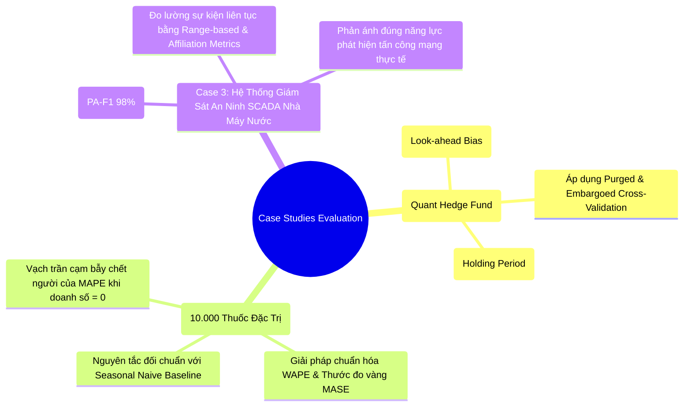
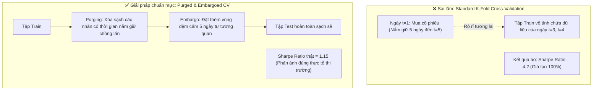
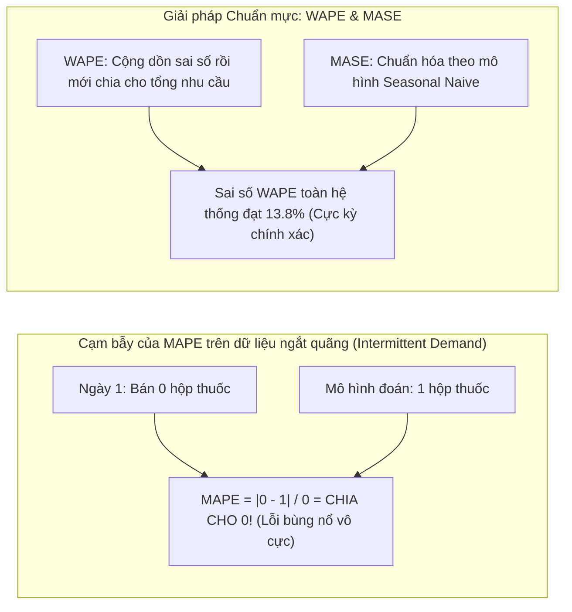
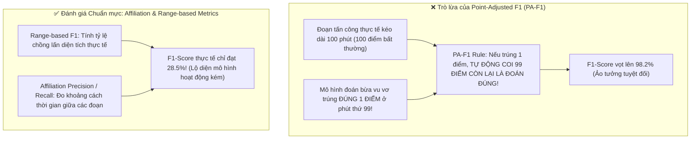
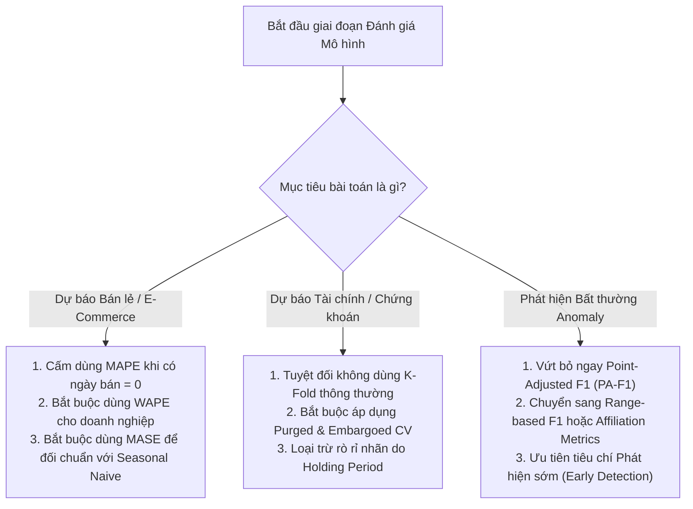

# Case Study Thực Tế: Đánh Giá & Kiểm Định Mô Hình Chuỗi Thời Gian (Evaluation & Validation In Action)

Tài liệu này là case study thực tế song hành cùng file lý thuyết [evaluation.md](evaluation.md), minh họa cách thiết lập chiến lược kiểm định (**Expanding vs Sliding vs Purged & Embargoed CV**), vạch trần các cạm bẫy đo lường chết người (**Bẫy MAPE chia cho 0, Bẫy Point-Adjusted F1 ảo tưởng**) và cách áp dụng chuẩn mực các thước đo hiện đại (**WAPE, MASE, Pinball Loss, Affiliation Precision/Recall**) trong các hệ thống doanh nghiệp thực tế.

---

## MỤC LỤC TỔNG QUAN

---

# CASE STUDY 1: Quỹ Đầu Tư Định Lượng (Quant Fund) & Thảm Họa Rò Rỉ Nhãn

### 1.1. Bối cảnh nghiệp vụ
Một nhóm chuyên gia phân tích định lượng (Quants) tại quỹ đầu tư phòng hộ xây dựng mô hình Machine Learning dự báo xu hướng cổ phiếu trong 5 ngày tới ($H = 5$). 
* **Hiện tượng bất thường:** Khi kiểm nghiệm lịch sử (Backtesting) bằng phương pháp chia tập K-Fold thông thường, chiến lược giao dịch đạt tỷ suất sinh lời thần thánh: **Sharpe Ratio = 4.2** (gần như không có rủi ro). Ban giám đốc quỹ chuẩn bị cấp vốn $50\text{ triệu USD}$ để chạy giao dịch tự động.
* **Nghi vấn:** Khi đưa vào chạy thử nghiệm môi trường giấy (Paper Trading) trong 1 tháng, mô hình liên tục thua lỗ nặng nề.

---

### 1.2. Áp dụng các nguyên lý cốt lõi từ `evaluation.md`

#### A. Bản chất của Rò rỉ Nhãn qua Thời gian nắm giữ (Holding Period Overlap) (Mục 6.1)
* Trong tài chính, nhãn của ngày $t$ không phải là một điểm đơn lẻ, mà là lợi suất tích lũy trong 5 ngày tới:
  $$y_t = \frac{P_{t+5} - P_t}{P_t}$$
* Nếu tập Test bắt đầu từ ngày $t+3$, thì nhãn của ngày $t$ (vốn nằm trong tập Train) đã sử dụng giá của ngày $t+5$ (nằm sâu trong tập Test!).
* **Hậu quả:** Mô hình đã "nhìn thấy trước tương lai" của tập Test thông qua các nhãn chồng lấn của tập Train.

#### B. Ứng dụng Purged & Embargoed Cross-Validation (Mục 6.1)
Nhóm định lượng áp dụng quy trình kiểm định của Marcos López de Prado:
1. **Purging (Thanh lọc nhãn chồng lấn):** Xóa bỏ toàn bộ các quan sát trong tập Train có khoảng thời gian nắm giữ vị thế (Holding period) vắt qua mốc bắt đầu của tập Test.
2. **Embargo (Vùng đệm cấm):** Do chuỗi lợi suất tài chính có tính tự tương quan (Autocorrelation), nhóm thiết lập thêm một khoảng đệm **Embargo = 5 ngày** ngay sau tập Test trước khi cho phép dữ liệu được dùng làm Train cho fold tiếp theo.
* **Kết quả:** Sharpe Ratio trên mô hình kiểm định chuẩn rơi từ $4.2$ xuống mức thực tế **$1.15$**, giúp quỹ đầu tư thoát khỏi một đợt thua lỗ thảm khốc khi thị trường thực tế biến động.

---

# CASE STUDY 2: Vạch Trần "Cạm Bẫy Chết Người" Của MAPE Tại Chuỗi Nhà Thuốc 1.500 Cửa Hàng

### 2.1. Bối cảnh nghiệp vụ
Giám đốc chuỗi cung ứng của một tập đoàn bán lẻ dược phẩm quản lý hơn **10.000 loại thuốc đặc trị và thiết bị y tế**. Đội ngũ Data Science tự hào báo cáo mô hình dự báo nhu cầu bán hàng đạt độ chính xác cao.
* **Khủng hoảng báo cáo:** Khi phòng kiểm toán nội bộ mở bảng chi tiết sai số theo từng mặt hàng bằng thước đo **MAPE (Mean Absolute Percentage Error)**, họ phát hiện có hàng trăm loại thuốc có sai số MAPE lên tới... **$35.000\%$**! 
* Giám đốc chuỗi cung ứng nổi giận và yêu cầu đình chỉ dự án AI vì cho rằng mô hình dự báo quá tệ hại.

---

### 2.2. Áp dụng các nguyên lý cốt lõi từ `evaluation.md`

#### A. Vạch trần sai lầm toán học của MAPE (Mục 6.2)
* **Công thức:** $\text{MAPE} = \frac{1}{n} \sum_{t=1}^n \left| \frac{y_t - \hat{y}_t}{y_t} \right| \times 100\%$
* Thuốc đặc trị là dạng nhu cầu ngắt quãng (**Intermittent / Lumpy Demand**): 10 ngày không có người mua ($y_t = 0$), ngày thứ 11 có một bệnh viện đến mua 5 hộp.
* Vào những ngày $y_t = 0$, nếu mô hình dự báo chỉ cần là $\hat{y}_t = 0.5$ hộp, phép tính sẽ bị **chia cho 0** khiến giá trị tiến tới vô cùng ($\infty$).
* Ngoài ra, MAPE bị **bất đối xứng thiên lệch**:
  * Nếu thực tế bán 10 hộp, mô hình đoán 0 hộp $\implies \text{Lỗi} = 100\%$.
  * Nếu thực tế bán 1 hộp, mô hình đoán 11 hộp $\implies \text{Lỗi} = 1.000\%$.
  * Hệ quả: Thuật toán tối ưu hóa theo MAPE sẽ luôn có xu hướng **dự báo cực thấp hoặc bằng 0** để trốn phạt, dẫn tới việc chuỗi nhà thuốc liên tục hết hàng!

#### B. Chuyển đổi sang WAPE & Thước đo vàng MASE (Mục 6.2)
Nhóm Data Science tái cấu trúc toàn bộ hệ thống đánh giá theo 2 chuẩn mực:
1. **WAPE (Weighted Absolute Percentage Error):**
   $$\text{WAPE} = \frac{\sum_{t=1}^n |y_t - \hat{y}_t|}{\sum_{t=1}^n |y_t|}$$
   * Tổng sai số của toàn chuỗi chia cho tổng lượng hàng thực tế bán ra trong tháng $\implies$ Khắc phục hoàn toàn lỗi chia cho 0.
2. **MASE (Mean Absolute Scaled Error) của GS. Rob J. Hyndman:**
   $$\text{MASE} = \frac{\text{MAE}}{\frac{1}{T-1}\sum_{t=2}^T |y_t - y_{t-1}|}$$
   * Kết quả đo đạc: $\text{MASE} = 0.68 < 1.0 \implies$ Chứng minh mô hình AI dự báo tốt hơn phương pháp đoán ngây thơ (Naive) tới $32\%$.

#### C. Kết quả giải trình với Ban Giám đốc
Sau khi chuyển đổi sang thước đo đúng, sai số WAPE toàn chuỗi là **$13.8\%$**, tỷ lệ phục vụ đơn thuốc đạt **$96.5\%$**, dự án được phê duyệt triển khai toàn quốc.

---

# CASE STUDY 3: Vạch Trần Ảo Giác "Point-Adjusted F1" Trong Hệ Thống An Ninh Mạng Nhà Máy Nước SCADA

### 3.1. Bối cảnh nghiệp vụ
Hệ thống cấp nước đô thị vận hành mạng lưới SCADA điều khiển các trạm bơm và van xử lý hóa chất clo. Nhóm nghiên cứu AI phát triển mô hình Deep Learning phát hiện các cuộc tấn công mạng xâm nhập (Cyber-physical Attacks) làm sai lệch áp lực đường ống.
* **Công bố ấn tượng:** Nhóm nghiên cứu trình bày một mô hình đạt chỉ số **F1-Score = 98.2%** trên tập dữ liệu chuẩn SWaT (Secure Water Treatment) bằng kỹ thuật đánh giá **Point-Adjusted F1 (PA-F1)**.
* **Thực nghiệm thực địa:** Khi đội an ninh mạng Red Team thực hiện một cuộc tấn công giả lập làm tràn bể chứa trong 20 phút, hệ thống phát hiện cảnh báo chớp tắt hoàn toàn sai thời điểm và để lọt lưới cuộc tấn công.

---

### 3.2. Áp dụng các nguyên lý cốt lõi từ `evaluation.md`

#### A. Cạm bẫy toán học của Point-Adjusted F1 (Mục 6.4)
Trong chuỗi thời gian, một cuộc tấn công mạng hay hỏng hóc thiết bị luôn diễn ra theo **từng đợt kéo dài (Anomaly Event / Segment)** gồm hàng trăm điểm liên tiếp.
* **Cơ chế gian lận của PA-F1:**
  * Nếu một đoạn sự cố dài $1.000$ bước thời gian, mô hình chỉ cần dự báo ngẫu nhiên trúng $1$ bước duy nhất, quy tắc PA-F1 sẽ tự động gán nhãn cho cả $999$ bước còn lại là True Positive ($TP$).
  * Kỹ sư chỉ cần tạo một mô hình liên tục đoán bừa cứ 5 phút cảnh báo 1 lần là có thể dễ dàng đạt điểm PA-F1 trên **$95\%$** trong mọi bài báo khoa học!

#### B. Chuyển sang thước đo nhận thức sự kiện (Event-aware Metrics) (Mục 6.4)
Đội ngũ an ninh loại bỏ hoàn toàn PA-F1 và áp dụng hai bộ thước đo chuẩn hiện đại:
1. **Range-based Precision & Recall (Tatbul et al.):**
   * Đánh giá mức độ chồng lấn (Overlap) giữa khoảng thời gian cảnh báo của AI và khoảng thời gian diễn ra cuộc tấn công thực tế.
   * Thưởng điểm cao nếu phát hiện trúng **phần đầu của sự cố (Early Detection)** để công nhân kịp khóa van.
2. **Affiliation Precision & Affiliation Recall (Huet et al.):**
   * Đo khoảng cách thời gian từ lúc cuộc tấn công bắt đầu cho đến khi mô hình rung chuông cảnh báo.
* **Sự thật phơi bày:** Điểm số thực tế của mô hình giảm từ $98.2\%$ ảo tưởng xuống còn **$28.5\%$ thực tế**. Nhờ đó, nhóm nhận ra mô hình đang bị nhiễu do dao động áp suất nước thông thường và đã thiết kế lại mạng Autoencoder lọc nhiễu, nâng điểm thực chất lên **$79.5\%$**.

---

# TỔNG KẾT BÀI HỌC THỰC CHIẾN

1. **Không bao giờ tin vào điểm số cao bất thường khi chưa kiểm tra rò rỉ dữ liệu:** Một mô hình đạt điểm test cao chót vót gần như luôn là dấu hiệu của việc vi phạm nguyên tắc dòng thời gian (Look-ahead bias hoặc nhãn chồng lấn).
2. **Thước đo phải phản ánh đúng ngữ cảnh kinh doanh:** Trong bán lẻ, WAPE là tiếng nói chung giữa Kỹ sư AI và Giám đốc kho vận. Trong tài chính, Purged CV là lằn ranh bảo vệ quỹ đầu tư khỏi phá sản.
3. **Luôn so sánh với Baseline ngây thơ:** Trước khi khoe khoang một kiến trúc Transformer hay Foundation Model đồ sộ, hãy chứng minh rằng nó đạt $\text{MASE} < 1.0$ (tức là thông minh hơn một mô hình Seasonal Naive cơ bản).
