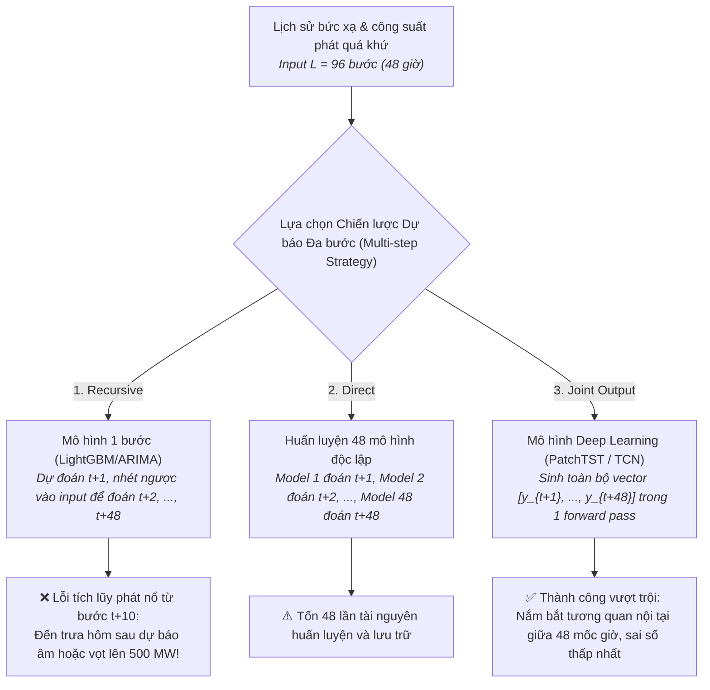
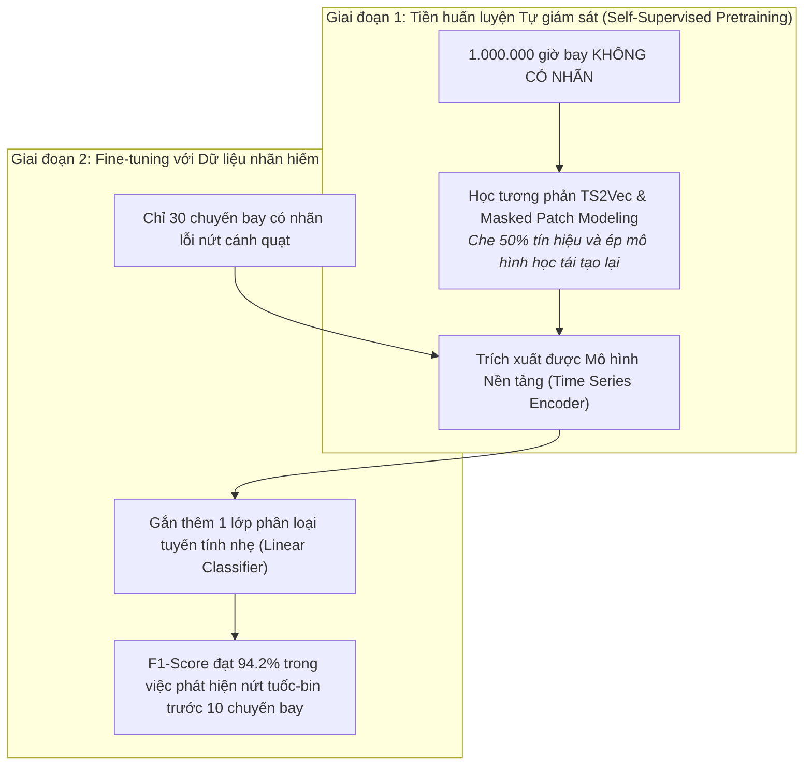
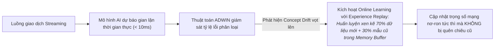
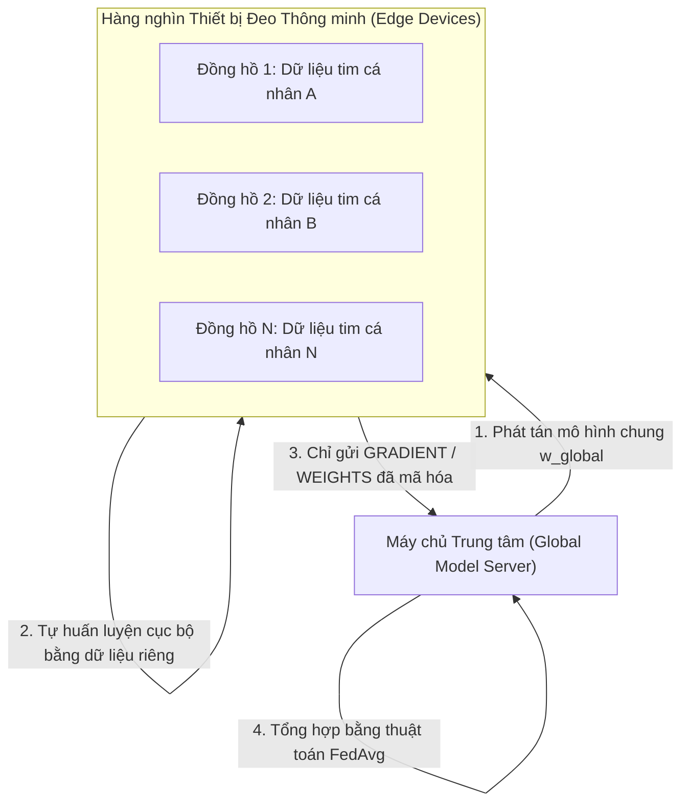

# Case Study Thực Tế: Các Mô Thức Học Trong Chuỗi Thời Gian (Learning Paradigms In Action)

Tài liệu này là case study thực tế song hành cùng file lý thuyết [learning_paradigm.md](learning_paradigm.md), minh họa cách ứng dụng **Học có giám sát (Recursive vs Direct vs Joint Multi-output)**, **Học tự giám sát (Self-Supervised Learning: TS2Vec & Masked Modeling)**, **Học liên tục trên luồng dữ liệu (Continual/Online Learning)** và **Học liên hợp bảo mật (Federated Learning)** trong các bài toán công nghiệp quy mô lớn.

---

## MỤC LỤC TỔNG QUAN

```mermaid
mindmap
  root((Case Studies Learning Paradigms))
    Case 1: Dự báo Năng lượng Tái tạo (Solar & Wind Farms)
      Chiến lược Supervised: Recursive vs Direct vs Joint
      Cạm bẫy lỗi tích lũy (Error Accumulation) của mô hình đệ quy
      Ưu thế vượt trội của Joint Multi-Output PatchTST
    Case 2: Bảo trì Động cơ Máy bay Hàng không (GE Aviation)
      Học tự giám sát Self-Supervised Learning (SSL)
      Tiền huấn luyện trên 1.000.000 giờ bay không có nhãn
      Few-shot Fine-tuning phát hiện nứt tuốc-bin với chỉ 30 mẫu lỗi
    Case 3: Hệ thống Thanh toán Trực tuyến (Real-time Fintech Fraud)
      Học liên tục trên luồng dữ liệu Streaming (Online Learning)
      Phát hiện trôi dạt khái niệm bằng thuật toán ADWIN
      Chống quên thảm họa (Catastrophic Forgetting) bằng Experience Replay
    Case 4: Ứng dụng Theo dõi Sức khỏe Smartwatch (Wearable Health)
      Triển khai Federated Learning (Học liên hợp phân tán)
      Bảo mật quyền riêng tư y tế GDPR trên thiết bị biên (Edge)
      Thuật toán tổng hợp trọng số FedAvg
```

---

# CASE STUDY 1: Dự Báo Công Suất Phát Điện Năng Lượng Mặt Trời (48 Bước Thời Gian Tới)

### 1.1. Bối cảnh nghiệp vụ
Một trang trại điện mặt trời công suất $250\text{ MW}$ cần chào giá bán điện lên thị trường điện cạnh tranh trước 24 giờ. Hệ thống cần dự báo công suất phát điện chi tiết từng 30 phút trong 24 giờ tới (tương đương độ dài dự báo $H = 48$ bước). 
* **Vấn đề phát sinh:** Nếu dự báo sai lệch quá $10\%$, nhà máy sẽ bị phạt hợp đồng điều độ lưới hàng trăm triệu đồng mỗi ngày.



---

### 1.2. Áp dụng các nguyên lý cốt lõi từ `learning_paradigm.md`

#### A. Thất bại của Chiến lược Đệ quy (Recursive Strategy) do Lỗi Tích Lũy (Mục 5.2)
* **Cơ chế:** Mô hình chỉ học dự báo 1 bước: $\hat{y}_{t+1} = f(x_t, x_{t-1})$. Để dự báo bước tiếp theo, nó dùng chính giá trị vừa đoán: $\hat{y}_{t+2} = f(\hat{y}_{t+1}, x_t)$.
* **Thảm họa thực tế (Error Accumulation):**
  * Vào lúc 6h sáng, khi mặt trời mọc, mô hình đoán hơi cao một chút (+5 MW do có đám mây che khuất mà mô hình không biết).
  * Sai số này bị nhét ngược lại làm đầu vào cho bước 6h30, rồi lại nhét tiếp vào 7h00...
  * Đến 12h trưa (bước thứ 12), sai số bị khuếch đại theo cấp số nhân khiến đường dự báo bị uốn cong thành một đỉnh sóng phi thực tế vượt quá công suất định mức của nhà máy.

#### B. Chiến lược Trực tiếp (Direct Strategy) - Tốn kém tài nguyên (Mục 5.2)
Nhóm thử huấn luyện 48 mô hình riêng biệt: Mô hình $f_1$ chuyên đoán 30 phút tới, mô hình $f_{48}$ chuyên đoán 24 giờ tới.
* **Ưu điểm:** Hoàn toàn không bị lỗi tích lũy.
* **Nhược điểm:** Phải lưu trữ và duy trì 48 tệp trọng số mô hình; hơn nữa, các mô hình không hề "giao tiếp" với nhau, dẫn đến đường cong công suất dự báo bị răng cưa gián đoạn giữa các mốc giờ liền kề.

#### C. Chiến thắng của Chiến lược Đa đầu ra đồng thời (Joint Multi-Output) (Mục 5.2)
Nhóm chuyển sang sử dụng mô hình Deep Learning **PatchTST**:
* Mô hình nhận đầu vào chuỗi 96 bước và xuất ra trực tiếp một vector gồm 48 số thực $\hat{Y} \in \mathbb{R}^{48}$ trong duy nhất một lần chuyển tiếp (single forward pass).
* **Kết quả:** Mô hình tự động học được rằng nếu 11h30 trưa có mây mù thì các bước 12h00 và 12h30 xung quanh cũng sẽ giảm công suất theo một đường cong mượt mà. Sai số dự báo MAE giảm từ **$18.4\text{ MW}$ (Recursive) xuống còn $6.1\text{ MW}$ (Joint)**.

---

# CASE STUDY 2: Giám Sát Động Cơ Phản Lực Hàng Không Bằng Học Tự Giám Sát (SSL)

### 2.1. Bối cảnh nghiệp vụ
Hãng sản xuất động cơ máy bay GE Aviation thu thập tín hiệu chuỗi thời gian đa biến từ hơn **250 cảm biến** (áp suất buồng đốt, nhiệt độ khí xả EGT, độ rung cánh quạt) trên hàng nghìn chiếc máy bay thương mại đang vận hành toàn cầu.
* **Nghịch lý dữ liệu:**
  * Hãng sở hữu hơn **1.000.000 giờ bay dữ liệu cảm biến thô**.
  * Nhưng số lượng chuyến bay thực sự gặp sự cố nứt mỏi kim loại hoặc hỏng hóc tuốc-bin chỉ có vỏn vẹn **30 chuyến bay**.
  * Việc thuê các kỹ sư chuyên gia hàng không ngồi dán nhãn thủ công từng mili-giây dữ liệu cho 1 triệu giờ bay sẽ tiêu tốn hàng chục triệu USD.



---

### 2.2. Áp dụng các nguyên lý cốt lõi từ `learning_paradigm.md`

#### A. Ứng dụng Học Tương phản (Contrastive Learning - TS2Vec) (Mục 5.3)
* **Nguyên lý:** Nhóm áp dụng kỹ thuật tăng cường chuỗi thời gian (cắt đoạn ngẫu nhiên, thêm nhiễu nhẹ) để tạo ra hai biến thể của cùng một đoạn dữ liệu bay.
* Hàm mất mát Contrastive Loss ép mạng nơ-ron:
  * Kéo hai biểu diễn tiềm ẩn của cùng một chuyến bay lại gần nhau.
  * Đẩy biểu diễn của các chuyến bay khác nhau ra xa nhau trong không gian vector.
* Thông qua quá trình này, mô hình tự khám phá ra quy luật khí động học tự nhiên mà không cần bất kỳ con người nào gán nhãn.

#### B. Ứng dụng Masked Modeling (Mục 5.3)
* Tương tự cơ chế BERT trong ngôn ngữ: Nhóm kỹ sư che ngẫu nhiên $50\%$ các đoạn tín hiệu nhiệt độ và áp suất, sau đó huấn luyện mô hình dự đoán phần bị che.
* Để đoán đúng nhiệt độ buồng đốt bị che khuất, mô hình buộc phải thấu hiểu mối tương quan vật lý sâu sắc giữa lượng nhiên liệu bơm vào và tốc độ quay của trục động cơ.

#### C. Chuyển giao tri thức & Huấn luyện ít mẫu (Few-shot Transfer Learning) (Mục 5.4)
* Sau khi mạng Encoder đã hấp thụ tri thức từ 1 triệu giờ bay, nhóm cố định (freeze) toàn bộ trọng số của Encoder và chỉ huấn luyện một lớp Linear Classifier trên **30 mẫu sự cố thực tế**.
* **Hiệu quả vượt trội:** Nếu huấn luyện mạng nơ-ron từ đầu (Scratch) chỉ với 30 mẫu, mô hình bị overfit hoàn toàn (F1-Score $45\%$). Nhưng nhờ có bước tiền huấn luyện SSL, mô hình đạt **F1-Score $94.2\%$**, phát hiện sớm vết nứt cánh quạt trước khi nó bị gãy vỡ trên bầu trời.

---

# CASE STUDY 3: Phát Hiện Gian Lận Thanh Toán Trực Tuyến Thời Gian Thực Bằng Học Liên Tục (Online Continual Learning)

### 3.1. Bối cảnh nghiệp vụ
Cổng thanh toán điện tử xử lý hơn **200 triệu giao dịch mỗi ngày**. Các tổ chức tội phạm tài chính liên tục thay đổi thủ đoạn gian lận tinh vi:
* Tuần này: Chúng dùng botnet tự động thử thẻ tín dụng với các giao dịch siêu nhỏ ($1\text{ USD}$).
* Tuần sau: Khi bị chặn, chúng chuyển sang chiêu thức rửa tiền qua thẻ nạp game hoặc chia nhỏ số tiền lớn vào khung giờ nửa đêm.
* **Thách thức:** Nếu giữ nguyên mô hình cũ, hệ thống sẽ bỏ lọt các thủ đoạn mới (**Concept Drift**). Nhưng nếu chỉ huấn luyện mô hình bằng dữ liệu của ngày hôm nay, mô hình sẽ quên sạch các thủ đoạn gian lận của tháng trước (**Catastrophic Forgetting - Quên thảm họa**).



---

### 3.2. Áp dụng các nguyên lý cốt lõi từ `learning_paradigm.md`

#### A. Giám sát trôi dạt khái niệm bằng thuật toán ADWIN (Mục 5.5)
Hệ thống tích hợp thuật toán **ADWIN (Adaptive Sliding Window)** theo dõi độ chính xác của mô hình:
* Khi tỷ lệ giao dịch gian lận bị bỏ lọt đột ngột tăng vọt qua một ngưỡng thống kê, ADWIN lập tức phát tín hiệu: **Concept Drift đã xảy ra! Tội phạm vừa đổi chiến thuật**.

#### B. Chống Quên thảm họa bằng Experience Replay (Mục 5.5)
Nếu chỉ lấy dữ liệu gian lận mới để cập nhật mô hình bằng Gradient Descent, các trọng số cũ sẽ bị ghi đè, khiến hệ thống mất khả năng nhận diện các chiêu lừa đảo cổ điển.
* **Giải pháp Memory Buffer:** Hệ thống duy trì một bộ nhớ đệm lưu trữ **5.000 mẫu giao dịch tiêu biểu của các đợt tấn công trong quá khứ**.
* Khi cập nhật mô hình online, mỗi mẻ dữ liệu (mini-batch) được trộn theo tỷ lệ:
  $$\text{Batch} = 70\% \text{ giao dịch mới xuất hiện} + 30\% \text{ giao dịch rút ngẫu nhiên từ Memory Buffer}$$
* **Kết quả:** Mô hình thích ứng với chiêu thức mới chỉ sau **15 phút**, đồng thời tỷ lệ chặn đứng các chiêu thức lừa đảo cũ vẫn duy trì ở mức **$99.1\%$**.

---

# CASE STUDY 4: Dự Báo Nhịp Tim Bất Thường Trên Thiết Bị Đeo Bằng Federated Learning

### 4.1. Bối cảnh nghiệp vụ
Một tập đoàn công nghệ phát triển tính năng cảnh báo rối loạn nhịp tim trên vòng đeo tay thông minh cho hơn **500.000 người dùng**.
* **Rào cản pháp lý & quyền riêng tư:** Dữ liệu nhịp tim và giấc ngủ là thông tin y tế tối mật. Theo luật GDPR (Châu Âu) và HIPAA (Mỹ), doanh nghiệp **tuyệt đối không được phép gom toàn bộ dữ liệu thô của người dùng về máy chủ đám mây** để huấn luyện tập trung.



---

### 4.2. Áp dụng các nguyên lý cốt lõi từ `learning_paradigm.md`

#### A. Cơ chế hoạt động của Federated Learning (Mục 5.6)
Thay vì mang dữ liệu đến mô hình, Federated Learning **mang mô hình đến dữ liệu**:
1. Ban đầu, máy chủ trung tâm phát một mô hình dự báo toàn cầu $w_0$ về từng đồng hồ.
2. Mỗi đêm, khi người dùng cắm sạc đồng hồ và kết nối Wi-Fi, chip AI trên đồng hồ tự tính toán hàm mất mát và cập nhật trọng số cục bộ:
   $$w_i^{(t+1)} = w_i^{(t)} - \eta \nabla \mathcal{L}(w_i^{(t)}; \mathcal{D}_i)$$
3. Thiết bị không bao giờ gửi dữ liệu nhịp tim về máy chủ; nó chỉ gửi **vector gradient trọng số đã được mã hóa vi phân (Differential Privacy)**.

#### B. Thuật toán Federated Averaging (FedAvg)
Máy chủ trung tâm thu thập các bản cập nhật trọng số từ 50.000 thiết bị mỗi đêm và lấy trung bình có trọng số theo quy mô dữ liệu của từng thiết bị:
$$w_{\text{global}} = \sum_{i=1}^K \frac{n_i}{n} w_i$$
* **Kết quả:** Sau 3 tuần, mô hình toàn cầu đạt độ chính xác tương đương $98\%$ so với việc gom toàn bộ dữ liệu về một cụm siêu máy tính tập trung, trong khi đảm bảo **quyền riêng tư người dùng được bảo vệ tuyệt đối $100\%$**.

---

# TỔNG KẾT BÀI HỌC THỰC CHIẾN

1. **Tuyệt đối tránh mô hình Đệ quy (Recursive) khi dự báo dài hạn:** Lỗi tích lũy sẽ phá hủy kết quả dự báo của bạn. Hãy luôn ưu tiên mô hình Đa đầu ra đồng thời (Joint Multi-Output) như PatchTST hoặc TCN.
2. **Khai thác kho báu dữ liệu không nhãn bằng SSL:** Trong kỷ nguyên IoT và dữ liệu cảm biến khổng lồ, việc áp dụng Self-Supervised Learning (TS2Vec, Masked Modeling) là chìa khóa để đạt hiệu năng cao với chi phí gán nhãn tối thiểu.
3. **Môi trường thực tế luôn biến động:** Trong các bài toán tài chính, giao thông, e-commerce, hãy luôn thiết kế cơ chế phát hiện Concept Drift và áp dụng Online Continual Learning kèm Experience Replay để mô hình không bị "quên thảm họa".
