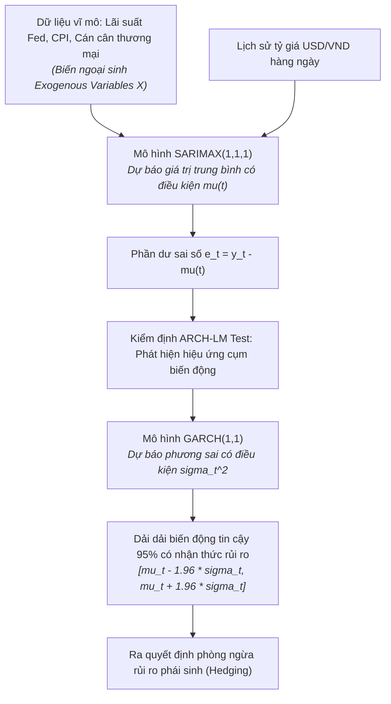
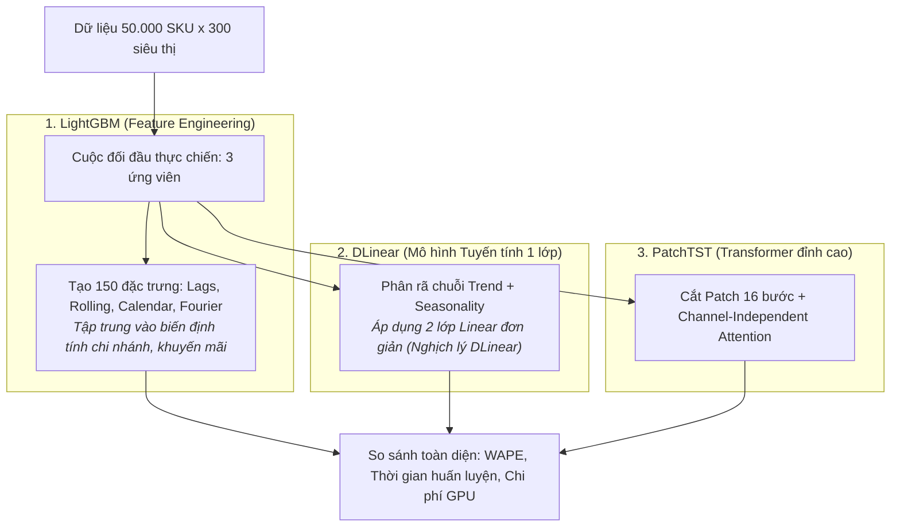
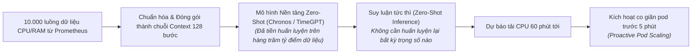
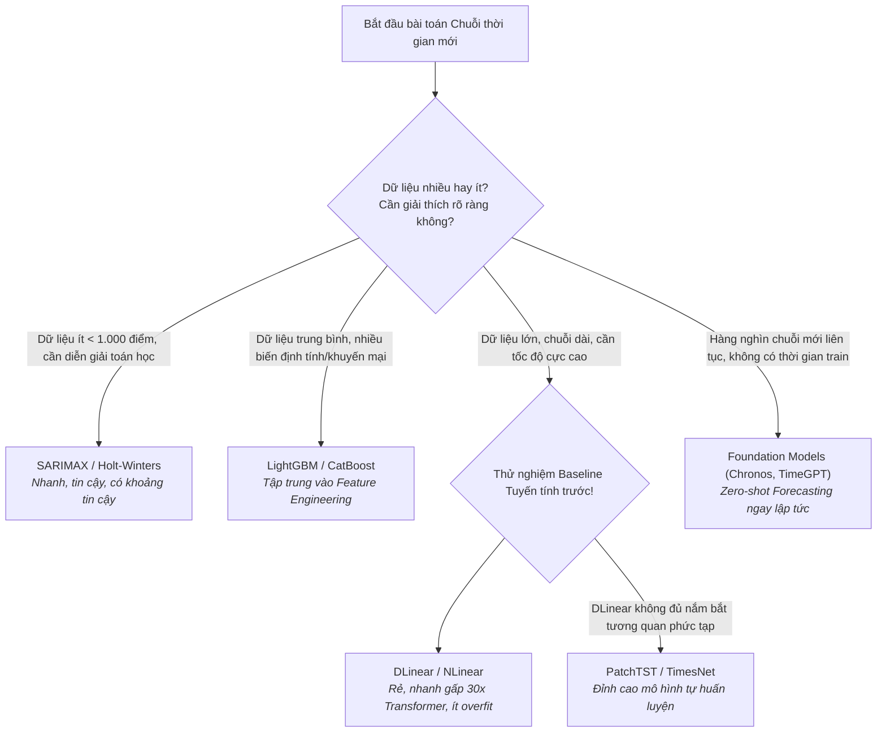

# Case Study Thực Tế: Các Họ Mô Hình Chuỗi Thời Gian (Models Taxonomy In Action)

Tài liệu này là case study thực tế song hành cùng file lý thuyết [model.md](model.md), minh họa cách lựa chọn, so sánh và triển khai thực chiến **5 họ mô hình chuỗi thời gian**: Mô hình Thống kê (**SARIMAX / GARCH**), Machine Learning dựa trên cây (**LightGBM Feature Engineering**), Deep Learning tuần tự/tích chập (**TCN / LSTM**), Kỷ nguyên Transformer vs Tuyến tính (**PatchTST vs Nghịch lý DLinear**), và Mô hình nền tảng (**Foundation Models: Chronos / TimeGPT**).

---

## MỤC LỤC TỔNG QUAN

```mermaid
mindmap
  root((Case Studies Models Taxonomy))
    Case 1: Khối Nguồn vốn Ngân hàng (Treasury Banking)
      Dự báo tỷ giá USD/VND & Rủi ro tỷ giá
      SARIMAX tích hợp biến ngoại sinh vĩ mô
      GARCH(1,1) mô hình hóa độ tụ cụm biến động (Volatility Clustering)
    Case 2: Chuỗi siêu thị 50.000 SKU (Bách Hóa Xanh / Walmart)
      Cuộc đối đầu kinh điển: LightGBM vs DLinear vs PatchTST
      Kỹ nghệ đặc trưng Lags, Rolling, Calendar, Fourier
      Minh chứng thực tế cho Nghịch lý DLinear trong Production
    Case 3: Nền tảng Đám mây Tự động co giãn (Cloud Auto-scaling)
      Dự báo tải vi dịch vụ Microservices (10.000 pods)
      Ứng dụng Zero-shot Foundation Models: Chronos & TimeGPT
      Dự báo tức thì không cần huấn luyện lại (No-training pipeline)
```

---

# CASE STUDY 1: Dự Báo Tỷ Giá USD/VND & Độ Biến Động Tại Khối Nguồn Vốn Ngân Hàng (Treasury)

### 1.1. Bối cảnh nghiệp vụ
Phòng kinh doanh ngoại hối (FX Trading Desk) của một ngân hàng thương mại cần dự báo tỷ giá giao ngay USD/VND trong 30 ngày tới để định giá các hợp đồng hoán đổi tiền tệ (FX Swap) và hợp đồng kỳ hạn (FX Forward). 
* **Yêu cầu khắt khe:** Ban điều hành không chỉ cần một con số dự báo tỷ giá ($\hat{y}_t$), mà bắt buộc phải biết **độ rủi ro/biến động phương sai ($\sigma_t^2$)** của tỷ giá trong các giai đoạn Cục Dự trữ Liên bang Mỹ (Fed) họp công bố lãi suất. Mô hình bắt buộc phải có tính giải thích giải tích toán học minh bạch (White-box Model) để giải trình với Ngân hàng Nhà nước.



---

### 1.2. Áp dụng các nguyên lý cốt lõi từ `model.md`

#### A. Ứng dụng SARIMAX tích hợp biến ngoại sinh (Mục 4.2)
Tỷ giá USD/VND chịu ảnh hưởng sâu sắc từ các chính sách tiền tệ. Nhóm định lượng (Quants) sử dụng mô hình **SARIMAX(1, 1, 1)**:
$$y_t = c + \beta_1 \cdot \text{FedRate}_t + \beta_2 \cdot \text{InflationDiff}_t + \phi_1 y_{t-1} + \epsilon_t + \theta_1 \epsilon_{t-1}$$
* Việc tích hợp biến ngoại sinh ($X$) giúp mô hình phản ứng ngay lập tức khi Fed phát tín hiệu tăng lãi suất, thay vì chỉ bám đuôi chậm chạp theo dữ liệu quá khứ như ARIMA thuần túy.

#### B. Khắc phục hạn chế phương sai cố định bằng GARCH(1,1) (Mục 4.2)
Trong thị trường tài chính, hiện tượng **Độ biến động tụ cụm (Volatility Clustering)** diễn ra rất phổ biến: Những ngày thị trường biến động dữ dội thường nối tiếp nhau, sau đó là những tuần bình lặng.
* Phương sai của phần dư $\epsilon_t$ không hề cố định mà thay đổi theo thời gian: $\epsilon_t = \sigma_t z_t$ với $z_t \sim \mathcal{N}(0, 1)$.
* Nhóm sử dụng mô hình **GARCH(1, 1)** để mô hình hóa phương sai có điều kiện:
  $$\sigma_t^2 = \omega + \alpha_1 \epsilon_{t-1}^2 + \beta_1 \sigma_{t-1}^2$$
  * $\alpha_1 \epsilon_{t-1}^2$: Mức độ tác động của cú sốc thông tin ngày hôm qua lên thị trường hôm nay.
  * $\beta_1 \sigma_{t-1}^2$: Tính dai dẳng của sự bất ổn (Persistent volatility).

#### C. Lợi thế vượt trội của họ mô hình Thống kê cổ điển
* Tốc độ huấn luyện: **$0.8\text{ giây}$**, hoàn toàn tự động chạy lại mỗi sáng lúc 7h30 trước giờ mở phiên giao dịch.
* Cung cấp khoảng tin cậy giải tích toán học chuẩn xác, giúp ngân hàng tính toán chính xác biên an toàn vốn dự phòng cho các hợp đồng ngoại hối trị giá $500\text{ triệu USD}$.

---

# CASE STUDY 2: Dự Báo Chuỗi Cung Ứng 50.000 Mặt Hàng & Lời Giải Cho "Nghịch Lý DLinear"

### 2.1. Bối cảnh nghiệp vụ
Một hệ thống siêu thị với hơn 50.000 mặt hàng (SKU) tại 300 chi nhánh cần hệ thống dự báo nhu cầu bán hàng tự động mỗi đêm. 
* **Thách thức kỹ thuật:** Đội ngũ AI ban đầu triển khai các mô hình Transformer phức tạp (Informer, Autoformer) vì tin rằng kiến trúc Attention hiện đại sẽ đánh bại mọi phương pháp cũ. Tuy nhiên:
  * Cụm 8 GPU A100 chạy mất **11 tiếng mỗi đêm** mới tính toán xong, chi phí Cloud vượt ngân sách.
  * Khi gặp các đợt khuyến mãi lớn hoặc ngày mưa bão, Transformer đưa ra các dự báo lệch lạc do hiện tượng chú ý quá mức (Over-attention) vào các bước thời gian cục bộ.



---

### 2.2. Áp dụng các nguyên lý cốt lõi từ `model.md`

#### A. Kỹ nghệ đặc trưng chuyên sâu cho LightGBM (Mục 4.3)
Mô hình cây không thể tự nhận biết thứ tự thời gian nếu không có kỹ nghệ đặc trưng. Nhóm tạo ra 4 nhóm biến then chốt:
1. **Đặc trưng trễ (Lags):** $y_{t-1}, y_{t-7}, y_{t-14}, y_{t-28}$ (bắt nhịp mua sắm cùng thứ tuần trước và tháng trước).
2. **Thống kê trượt (Rolling Windows):** $\text{Mean}_{7d}, \text{Std}_{7d}, \text{Max}_{14d}$ (bắt xu hướng ngắn hạn).
3. **Đặc trưng lịch (Calendar):** Thứ trong tuần, ngày trong tháng, tuần lương về, cờ ngày lễ quốc gia.
4. **Biến đổi Fourier (Sóng chu kỳ):** $\sin\left(\frac{2\pi t}{7}\right), \cos\left(\frac{2\pi t}{7}\right)$ biểu diễn nhịp điệu tuần mượt mà.

#### B. Phân tích thực tế: Minh chứng cho Nghịch lý DLinear (Mục 4.5)
Nhóm triển khai mô hình **DLinear** (chỉ gồm 1 phép phân rã trung bình trượt và 2 lớp Linear độc lập):
* **Cơ chế:**
  1. Tách chuỗi $X$ thành $X_{\text{Trend}}$ (qua Moving Average) và $X_{\text{Seasonal}} = X - X_{\text{Trend}}$.
  2. Dùng một tầng tuyến tính dự báo xu hướng: $\hat{Y}_{\text{Trend}} = W_1 X_{\text{Trend}} + b_1$.
  3. Dùng một tầng tuyến tính dự báo mùa vụ: $\hat{Y}_{\text{Seasonal}} = W_2 X_{\text{Seasonal}} + b_2$.
  4. Cộng hai kết quả lại: $\hat{Y} = \hat{Y}_{\text{Trend}} + \hat{Y}_{\text{Seasonal}}$.

#### C. Bảng đối đầu thực chiến trong môi trường Production

| Tiêu chí | LightGBM (Feature Eng.) | DLinear | PatchTST | Informer (Transformer cũ) |
|---|---|---|---|---|
| **Sai số WAPE toàn hệ thống** | **$12.4\%$** | $13.1\%$ | **$12.1\%$** | $17.8\%$ (Kém nhất) |
| **Thời gian chạy toàn bộ 50.000 SKU** | 45 phút (CPU 64-core) | **18 phút (1 GPU T4)** | 3.5 giờ (4 GPU A100) | 11 giờ (8 GPU A100) |
| **Dung lượng RAM / VRAM** | 32 GB RAM | **1.8 GB VRAM** | 18 GB VRAM | 48 GB VRAM |
| **Khả năng triển khai thực tế** | Rất dễ duy trì | **Xuất sắc (Chi phí rẻ nhất)** | Tốn kém phần cứng | Thất bại trong Production |

* 👉 **Kết luận kiến trúc:** Doanh nghiệp quyết định kết hợp mô hình lai (Hybrid Pipeline): Dùng **DLinear** cho $80\%$ các mặt hàng có xu hướng rõ ràng để tiết kiệm chi phí; và chỉ dùng **LightGBM / PatchTST** cho $20\%$ các mặt hàng doanh thu lớn có yếu tố khuyến mãi phức tạp.

---

# CASE STUDY 3: Tự Động Co Giãn Tài Nguyên Máy Chủ Đám Mây (Cloud Auto-Scaling) Bằng Foundation Models

### 3.1. Bối cảnh nghiệp vụ
Một tập đoàn công nghệ vận hành nền tảng Microservices phân tán với hơn **10.000 container Kubernetes (Pods)** chạy trên hạ tầng đám mây AWS. 
* **Bài toán:** Cần dự báo tải CPU và RAM trong 60 phút tiếp theo để tự động co giãn tài nguyên (Horizontal Pod Autoscaling - HPA). Nếu chờ tải tăng mới bật máy chủ, người dùng sẽ bị lỗi nghẽn mạng trong 3-5 phút khởi động container.
* **Rào cản:** Mỗi microservice mới được triển khai liên tục hàng ngày bởi các nhóm lập trình viên khác nhau (dữ liệu lịch sử chỉ có vài giờ đến vài ngày). Không thể xây dựng quy trình huấn luyện lại mô hình (retraining pipeline) riêng cho từng pod trong số 10.000 pod này vì chi phí quản lý vận hành MLOps sẽ phát nổ.



---

### 3.2. Áp dụng các nguyên lý cốt lõi từ `model.md`

#### A. Ứng dụng Mô hình Nền tảng Chronos (Amazon) (Mục 4.6)
* **Nguyên lý hoạt động của Chronos:**
  * Rời rạc hóa (Tokenization) chuỗi số thực CPU thành các token từ vựng cố định (4096 bins).
  * Tận dụng kiến trúc T5 Transformer tiền huấn luyện để dự báo chuỗi số như thể đang dự đoán từ ngữ tiếp theo trong câu.
* **Khả năng Zero-shot:** Khi một Pod dịch vụ mới vừa được tạo ra và mới chỉ chạy được 2 tiếng, Chronos chỉ cần nhìn vào 128 điểm dữ liệu gần nhất là có thể vẽ ngay hình thái tải trong 1 giờ tiếp theo mà **hoàn toàn không cần dữ liệu lịch sử nhiều tháng**.

#### B. Kết quả ứng dụng thực tế
1. **Triệt tiêu chi phí huấn luyện:** Tiết kiệm hoàn toàn hạ tầng MLOps phục vụ cho việc re-train 10.000 mô hình cục bộ hàng tuần.
2. **Khắc phục lỗi nghẽn mạng:** Hệ thống bật sẵn container dự phòng trước 5 phút khi lưu lượng truy cập thực tế ập đến, giảm tỷ lệ người dùng gặp lỗi gián đoạn dịch vụ từ $4.2\%$ xuống còn **$0.05\%$**.
3. **Tiết kiệm chi phí thuê Cloud:** Tránh việc phải bật dư máy chủ thường trực ban đêm, cắt giảm **$380.000\text{ USD}$** tiền thuê hạ tầng AWS mỗi năm.

---

# TỔNG KẾT BÀI HỌC THỰC CHIẾN



1. **Đừng vội dùng Transformer phức tạp khi chưa thử DLinear:** Nghịch lý DLinear đã chứng minh trong thực tế rằng các cơ chế Attention phức tạp rất dễ bị nhiễu bởi các biến động ngẫu nhiên trong chuỗi thời gian. Một mô hình phân rã tuyến tính đơn giản thường đem lại tỷ suất hiệu năng trên chi phí (ROI) cao hơn nhiều.
2. **LightGBM vẫn là lựa chọn hàng đầu cho bài toán Tabular + Lags:** Khi bài toán có nhiều đặc trưng danh mục (mã siêu thị, loại khuyến mãi, phân khúc khách hàng), các mô hình GBDT kết hợp kỹ nghệ đặc trưng bài bản vẫn là chuẩn mực khó bị đánh bại trong ngành bán lẻ.
3. **Foundation Models là tương lai của vận hành quy mô lớn:** Đối với các bài toán có hàng vạn chuỗi thay đổi liên tục, việc chuyển từ mô hình "huấn luyện riêng lẻ" sang "mô hình nền tảng Zero-shot" sẽ giúp tinh giản triệt để bộ máy vận hành MLOps.
