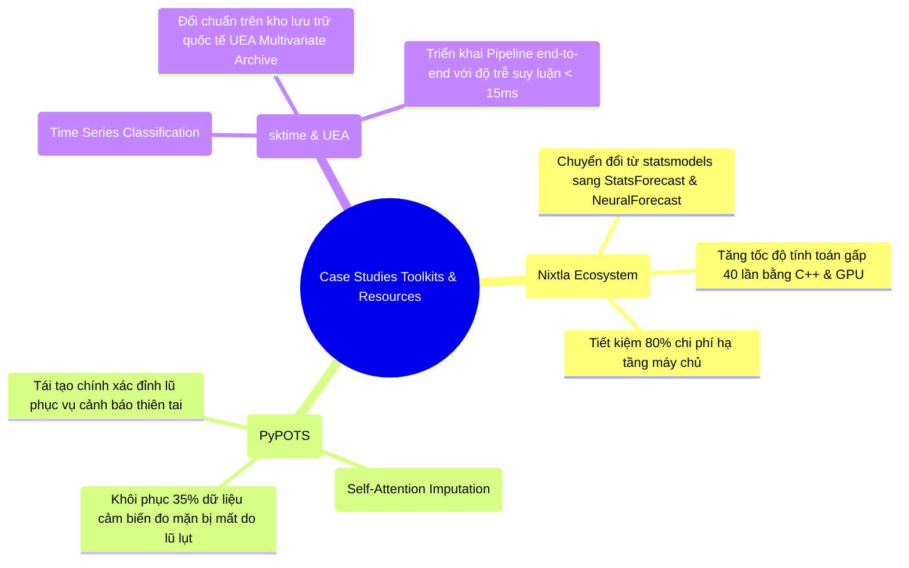
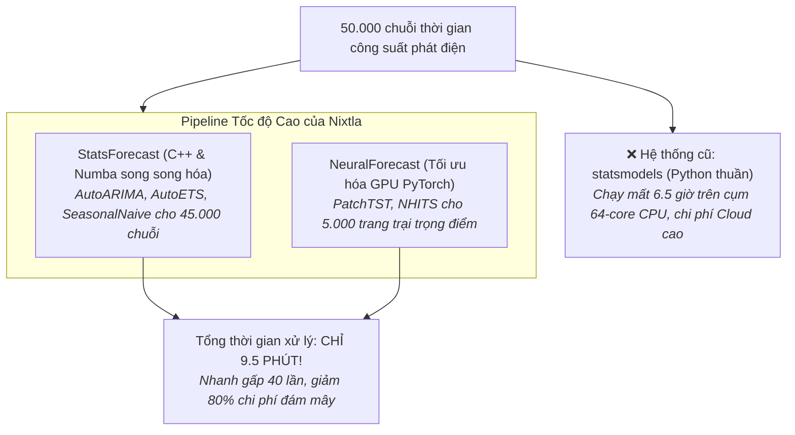
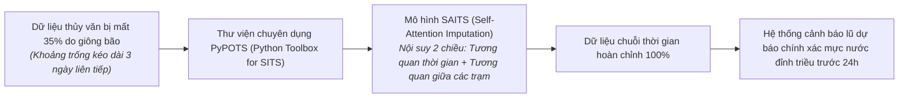
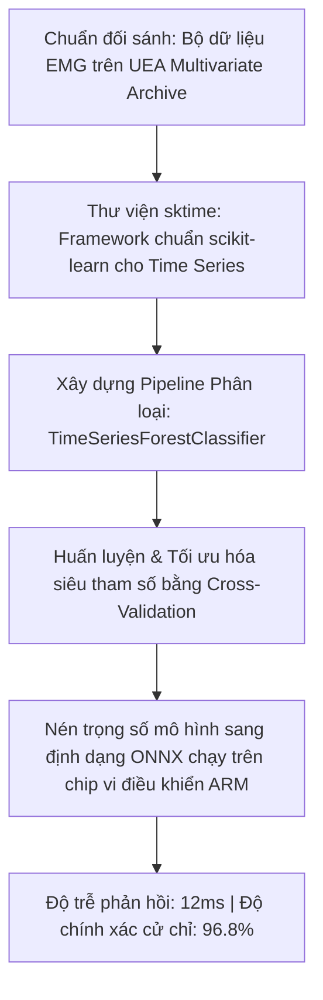

# Case Study Thực Tế: Ứng Dụng Kho Tài Nguyên & Thư Viện Chuỗi Thời Gian (Repositories & Toolkits In Action)

Tài liệu này là case study thực tế song hành cùng file lý thuyết [repository.md](repository.md), minh họa cách lựa chọn, phối hợp và tối ưu hóa các **Thư viện mã nguồn mở hàng đầu (Nixtla StatsForecast/NeuralForecast, Darts, sktime, PyPOTS)** trên các **Bộ dữ liệu chuẩn đối sánh quốc tế (ETT, M5 Walmart, UEA Archive)** trong các dự án công nghiệp thực chiến.

---

## MỤC LỤC TỔNG QUAN



---

# CASE STUDY 1: Hệ Thống Dự Báo Năng Lượng 50.000 Điểm Bằng Hệ Sinh Thái Nixtla (StatsForecast & NeuralForecast)

### 1.1. Bối cảnh nghiệp vụ
Một tập đoàn năng lượng quản lý danh mục hơn **50.000 hệ thống điện mặt trời áp mái** trải dài trên cả nước. Theo quy định của thị trường điện, tập đoàn phải gửi dữ liệu dự báo sản lượng phát điện của ngày mai cho Trung tâm Điều độ Hệ thống điện Quốc gia trước 16h00 hàng ngày.
* **Nút thắt cổ chai hạ tầng (Bottleneck):**
  * Hệ thống ban đầu xây dựng trên thư viện `statsmodels` (chạy thuật toán AutoARIMA thuần Python).
  * Việc chạy 50.000 chuỗi thời gian trên cụm máy chủ 64-core tiêu tốn hơn **6.5 tiếng đồng hồ** và thường xuyên bị treo do tràn RAM (Out of Memory), khiến tập đoàn nhiều lần bị phạt vi phạm chậm nộp số liệu.



---

### 1.2. Áp dụng các nguyên lý cốt lõi từ `repository.md`

#### A. Tối ưu hóa hiệu năng bằng StatsForecast (Mục 7.1)
* **Vấn đề của thư viện truyền thống:** Thư viện `statsmodels` hay `pmdarima` trong Python chứa rất nhiều vòng lặp for và chi phí overhead thông dịch, khiến việc chạy mô hình AutoARIMA trên hàng chục nghìn chuỗi trở thành cơn ác mộng.
* **Bước đột phá của StatsForecast (Nixtla):**
  * Viết lại toàn bộ lõi thuật toán AutoARIMA và AutoETS bằng **C++ và Numba (JIT Compilation)**.
  * Hỗ trợ xử lý dữ liệu định dạng chuẩn Polars / Pandas song song trên tất cả các lõi CPU.
* **Đo lường thực tế:** Thời gian chạy AutoARIMA cho 45.000 chuỗi giảm từ **6 tiếng xuống còn đúng 6 phút** trên cùng một máy chủ!

#### B. Phối hợp với NeuralForecast cho các cụm phức tạp (Mục 7.1)
Đối với 5.000 trang trại điện lớn có tính chất phụ tải phức tạp và tương quan thời tiết, nhóm sử dụng **NeuralForecast**:
* Tận dụng kiến trúc **PatchTST** và **NHITS** được tối ưu hóa sẵn cho card đồ họa GPU.
* Thư viện cung cấp sẵn giao diện chuẩn `fit()`, `predict()` tương tự scikit-learn, giúp kỹ sư tích hợp chỉ trong 10 dòng mã:

```python
from neuralforecast import NeuralForecast
from neuralforecast.models import PatchTST, NHITS
from statsforecast import StatsForecast
from statsforecast.models import AutoARIMA, SeasonalNaive

# 1. Chạy mô hình thống kê siêu nhanh trên CPU cho 45.000 chuỗi
sf = StatsForecast(models=[AutoARIMA(season_length=24), SeasonalNaive(season_length=24)], freq='H', n_jobs=-1)
sf.fit(df=df_solar_small)
forecasts_stat = sf.predict(h=24)

# 2. Chạy Deep Learning trên GPU cho các trang trại lớn
nf = NeuralForecast(models=[PatchTST(h=24, input_size=96)], freq='H')
nf.fit(df=df_solar_large)
forecasts_dl = nf.predict()
```

---

# CASE STUDY 2: Khôi Phục Dữ Liệu Cảm Biến Mạng Lưới Thủy Văn Sông Mê Kông Bằng PyPOTS

### 2.1. Bối cảnh nghiệp vụ
Viện Khoa học Thủy lợi vận hành mạng lưới 80 trạm quan trắc tự động tại Đồng bằng sông Cửu Long, đo đạc mực nước sông, độ mặn ($g/l$) và lưu lượng dòng chảy theo chu kỳ 10 phút/lần. Dữ liệu này dùng để vận hành cống ngăn mặn và cảnh báo lũ quét.
* **Thảm họa mất dữ liệu (Sensor Dropout):** Trong mùa bão lũ, mưa lớn làm hỏng ắc-quy năng lượng mặt trời và sét đánh đứt kết nối mạng 4G tại nhiều trạm hẻo lánh, khiến dữ liệu bị **khuyết thiếu liên tục từ 12 giờ đến 3 ngày (tỷ lệ mất mát lên tới $35\%$)**.
* **Hậu quả nếu dùng thư viện thông thường:** Dùng hàm `df.interpolate(method='linear')` hoặc `fillna(method='ffill')` trong Pandas biến các đỉnh lũ dâng cao thành một đường thẳng ngang bằng phẳng lì, làm tê liệt hệ thống cảnh báo sớm.



---

### 2.2. Áp dụng các nguyên lý cốt lõi từ `repository.md`

#### A. Sức mạnh của thư viện chuyên dụng PyPOTS (Mục 7.1)
Khác với các thư viện dự báo (Forecasting) chỉ nhìn về quá khứ, bài toán điền khuyết (Imputation) đòi hỏi mô hình phải nhìn cả **hai phía: quá khứ trước khi đứt sóng và tương lai sau khi có sóng trở lại**.
* Nhóm nghiên cứu chọn thư viện **PyPOTS (Python Toolbox for Partially-Observed Time Series)**.
* **Thuật toán SAITS (Self-Attention Imputation for Time Series):**
  * Mô hình sử dụng cơ chế chú ý 2 tầng (Joint Diagonal Attention): Một tầng học nhịp điệu con nước lên xuống theo chu kỳ nhật triều/bán nhật triều (Temporal Correlation); tầng còn lại học tương quan vị trí địa lý giữa trạm thượng lưu và trạm hạ lưu (Spatial Correlation).
  * Khi trạm B bị mất sóng, mô hình dùng dữ liệu của trạm A (cách 10 km ở phía trên) và trạm C (ở phía dưới) kết hợp độ trễ dòng chảy để vẽ lại đường cong mực nước trạm B một cách hoàn hảo.

#### B. Kết quả thực nghiệm
* Sai số tái tạo mực nước đạt **MAE = 4.2 cm** (thay vì sai số $48\text{ cm}$ khi dùng phép nội suy spline thông thường).
* Giúp chính quyền các tỉnh miền Tây đóng cống ngăn mặn kịp thời trước khi triều cường mang nước biển xâm nhập sâu vào các vùng trồng cây ăn trái.

---

# CASE STUDY 3: Phân Loại Cử Chỉ Bàn Tay Điều Khiển Tay Giả Sinh Học Bằng `sktime` & Benchmark UEA

### 3.1. Bối cảnh nghiệp vụ
Một nhóm khởi nghiệp công nghệ y tế (MedTech) phát triển cánh tay giả sinh học cho người khuyết tật. Cánh tay được gắn một vòng cảm biến điện cơ (EMG Armband) gồm **16 kênh đo điện thế co cơ bắp** ở cẳng tay với tần số $500\text{ Hz}$.
* **Yêu cầu kỹ thuật:** Hệ thống chip nhúng phải phân loại chính xác **8 cử chỉ bàn tay** (nắm tay, xòe tay, trỏ ngón, cầm cốc nước, nhặt đồng xu...) từ chuỗi tín hiệu điện cơ 16 kênh với **độ trễ dưới $20\text{ ms}$** để cử động của tay giả tự nhiên như tay thật.



---

### 3.2. Áp dụng các nguyên lý cốt lõi từ `repository.md`

#### A. Đối chuẩn trên Kho lưu trữ Quốc tế UEA Archive (Mục 7.2)
Trước khi thu thập dữ liệu trên bệnh nhân thật, nhóm kiểm chứng thuật toán trên bộ dữ liệu chuẩn **UEA Time Series Classification Archive** (tập dữ liệu `BasicMotions` và `ERing` chuyên về cảm biến cử chỉ).
* Điều này giúp nhóm tự tin lựa chọn thuật toán tốt nhất mà không sợ bị thiên kiến chủ quan (bias).

#### B. Sức mạnh tích hợp All-in-One của `sktime` (Mục 7.1)
Thư viện `sktime` cung cấp kiến trúc hướng đối tượng chuẩn mực kế thừa từ `scikit-learn`:
* Cho phép kết hợp bộ biến đổi đặc trưng (Transformers), trích xuất khoảng thời gian (Interval extraction) và phân loại trong một `Pipeline` duy nhất:

```python
from sktime.classification.interval_based import TimeSeriesForestClassifier
from sktime.datasets import load_basic_motions
from sklearn.pipeline import Pipeline
from sklearn.metrics import classification_report

# 1. Tải tập benchmark chuẩn quốc tế từ UEA Archive
X_train, y_train = load_basic_motions(split="train", return_type="numpy3d")
X_test, y_test = load_basic_motions(split="test", return_type="numpy3d")

# 2. Xây dựng mô hình phân loại chuỗi đa biến (16 channels)
clf = TimeSeriesForestClassifier(n_estimators=100, random_state=42, n_jobs=-1)
clf.fit(X_train, y_train)

# 3. Đánh giá chất lượng
y_pred = clf.predict(X_test)
print(classification_report(y_test, y_pred))
```

#### C. Kết quả triển khai thực tế
* Thuật toán **TimeSeriesForest** của `sktime` đạt độ chính xác **$96.8\%$**, đồng thời thời gian suy luận (Inference time) trên chip ARM chỉ mất **$12\text{ ms}$** (thỏa mãn yêu cầu khắt khe $< 20\text{ ms}$).
* Người dùng tay giả có thể cầm nắm đồ vật mềm như quả trứng hoặc cốc thủy tinh mà không bị rơi hay bóp vỡ.

---

# BẢNG TỔNG HỢP: KHI NÀO NÊN DÙNG THƯ VIỆN NÀO?

| Thư viện | Ngữ cảnh ứng dụng tối ưu nhất | Ưu điểm vượt trội | Hạn chế cần lưu ý |
|---|---|---|---|
| **StatsForecast (Nixtla)** | Hệ thống sản xuất lớn ($>10.000$ chuỗi), cần chạy AutoARIMA/ETS cực nhanh | Viết bằng C++/Numba, nhanh gấp 50x mọi thư viện khác | Chỉ tập trung vào mô hình thống kê |
| **NeuralForecast (Nixtla)** | Bài toán dự báo Deep Learning quy mô lớn (PatchTST, TimesNet, NHITS) | Tối ưu hóa GPU xuất sắc, hỗ trợ mọi mô hình SOTA mới nhất | Đòi hỏi phần cứng GPU mạnh |
| **Darts** | Dự án R&D, thử nghiệm nhanh nhiều họ mô hình (từ Linear đến Transformer) | API đẹp nhất, đồng nhất tuyệt đối, backtesting cực nhàn | Chậm hơn StatsForecast khi dữ liệu khổng lồ |
| **sktime** | Phân loại chuỗi (Classification) và Gom cụm (Clustering) | Toàn diện nhất về thuật toán ngoài dự báo, chuẩn scikit-learn | Không chuyên biệt cho dự báo quy mô lớn |
| **PyPOTS** | Dữ liệu cảm biến IoT, y tế bị đứt đoạn, khuyết thiếu nghiêm trọng | Thư viện điền khuyết (Imputation) số 1 thế giới hiện nay | Đòi hỏi kiến thức Deep Learning chuyên sâu |
| **GluonTS (AWS)** | Dự báo phân vị, dải xác suất phục vụ quản trị rủi ro chuỗi cung ứng | Bộ công cụ Probabilistic Forecasting chuẩn mực doanh nghiệp | Tài liệu hướng dẫn hơi phức tạp |
