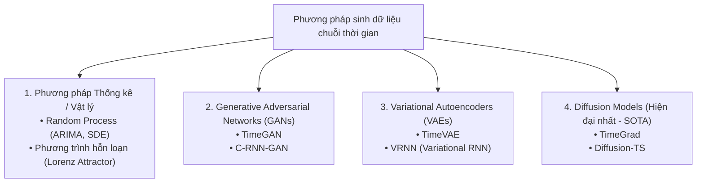
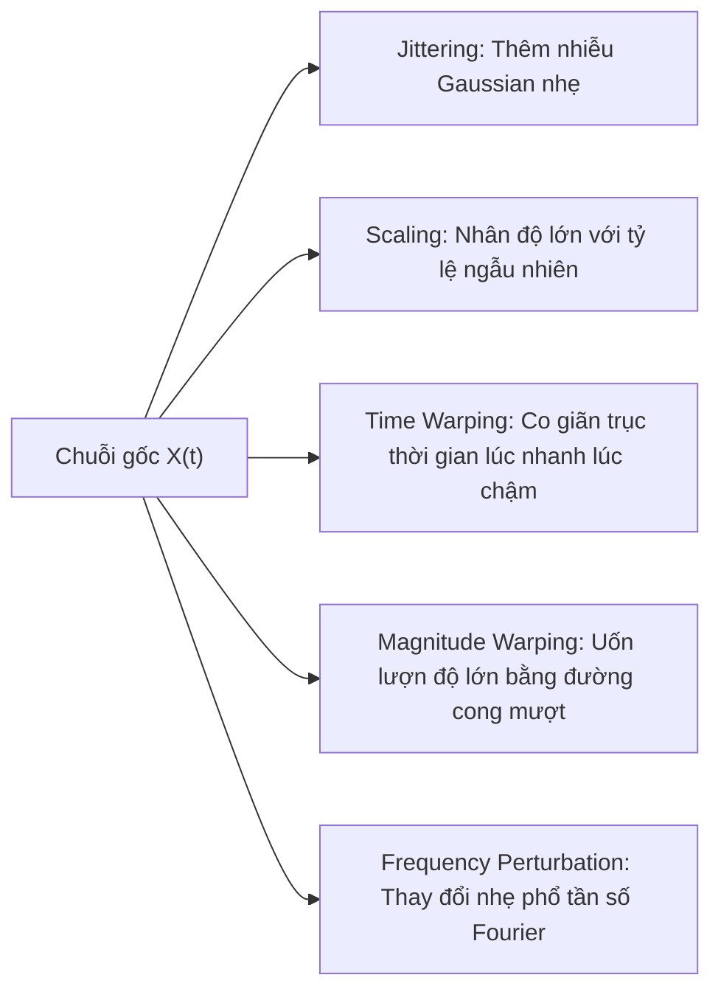

# 2. Quá trình sinh dữ liệu chuỗi thời gian (Data Generation)

---

## 2.1. Quá trình sinh dữ liệu (Data Generating Process – DGP) là gì?

> 🧠 **Ý tưởng cốt lõi:** Một chuỗi thời gian mà chúng ta thu thập được trong thực tế chỉ là **một kết quả cụ thể (a single realization)** của một **quá trình ngẫu nhiên tiềm ẩn (underlying stochastic process)**. Giống như việc bạn tung xúc xắc 10 lần và ghi lại chuỗi kết quả: chuỗi số bạn thấy chỉ là một trong vô số khả năng mà quá trình tung xúc xắc có thể tạo ra.

Mục tiêu của phân tích chuỗi thời gian là đi ngược từ dữ liệu quan sát được để tìm ra bản chất của DGP:
$$\{x_1, x_2, \dots, x_T\} \sim \mathcal{P}_{\theta}(X)$$

---

## 2.2. Các quá trình ngẫu nhiên kinh điển (Classical Stochastic Processes)

### 1. Nhiễu trắng (White Noise)
Nhiễu trắng là viên gạch nền tảng của mọi mô hình chuỗi thời gian. Một chuỗi $\epsilon_t$ được gọi là nhiễu trắng nếu:
1. Kỳ vọng bằng 0: $\mathbb{E}[\epsilon_t] = 0$.
2. Phương sai không đổi: $\text{Var}(\epsilon_t) = \sigma^2$.
3. Không tự tương quan qua thời gian: $\text{Cov}(\epsilon_t, \epsilon_s) = 0 \quad \forall t \neq s$.

> 🎭 **Ẩn dụ:** Tiếng rè rè của chiếc radio không bắt được sóng. Mọi âm thanh đều là ngẫu nhiên thuần túy, quá khứ không giúp bạn đoán trước được giây tiếp theo sẽ phát ra âm thanh gì.

### 2. Bước đi ngẫu nhiên (Random Walk)
Được định nghĩa bởi công thức:
$$x_t = x_{t-1} + \epsilon_t \quad \text{với } \epsilon_t \text{ là White Noise}$$

Nếu có thêm hệ số trôi (drift $c$):
$$x_t = c + x_{t-1} + \epsilon_t$$

> 🎭 **Ẩn dụ:** Người say bước đi trên vỉa hè. Bước chân tiếp theo $x_t$ phụ thuộc hoàn toàn vào vị trí hiện tại $x_{t-1}$, cộng thêm một bước ngẫu nhiên lảo đảo $\epsilon_t$. Random Walk có **trí nhớ vô hạn**: một cú sốc ở thời điểm quá khứ sẽ lưu lại mãi mãi trong chuỗi (không bao giờ quay về giá trị trung bình). Đây là mô hình cơ sở cho lý thuyết thị trường hiệu quả (giá cổ phiếu).

### 3. Quá trình Tự hồi quy: AR(p) (Autoregressive Process)
Giá trị hiện tại là tổ hợp tuyến tính của $p$ giá trị trong quá khứ cộng thêm nhiễu trắng:
$$x_t = c + \phi_1 x_{t-1} + \phi_2 x_{t-2} + \dots + \phi_p x_{t-p} + \epsilon_t = c + \sum_{i=1}^p \phi_i x_{t-i} + \epsilon_t$$

- **AR(1):** $x_t = c + \phi_1 x_{t-1} + \epsilon_t$.
  - Nếu $|\phi_1| < 1$: Chuỗi là dừng, có xu hướng hồi phục về giá trị trung bình (mean-reverting).
  - Nếu $|\phi_1| = 1$: Chuỗi trở thành Random Walk (không dừng).
  - Nếu $|\phi_1| > 1$: Chuỗi bùng nổ (nổ tiến tới vô cực).

### 4. Quá trình Trung bình trượt: MA(q) (Moving Average Process)
Giá trị hiện tại phụ thuộc vào các cú sốc (nhiễu) trong quá khứ:
$$x_t = \mu + \epsilon_t + \theta_1 \epsilon_{t-1} + \dots + \theta_q \epsilon_{t-q} = \mu + \epsilon_t + \sum_{j=1}^q \theta_j \epsilon_{t-j}$$

- Khác với AR (trí nhớ suy giảm dần theo hàm mũ), mô hình MA có **trí nhớ hữu hạn**: sau đúng $q$ bước thời gian, ảnh hưởng của một cú sốc $\epsilon_t$ sẽ biến mất hoàn toàn.

### 5. ARMA và ARIMA
- **ARMA(p, q):** Kết hợp cả tự hồi quy và trung bình trượt:
  $$x_t = c + \sum_{i=1}^p \phi_i x_{t-i} + \epsilon_t + \sum_{j=1}^q \theta_j \epsilon_{t-j}$$
- **ARIMA(p, d, q):** Thêm chữ **I (Integrated - Tích hợp)**: thực hiện lấy sai phân bậc $d$ trước khi áp dụng mô hình ARMA nhằm đưa chuỗi về trạng thái dừng:
  $$(1 - \sum_{i=1}^p \phi_i L^i)(1 - L)^d x_t = c + (1 + \sum_{j=1}^q \theta_j L^j)\epsilon_t$$
  *(với $L$ là toán tử trễ: $L x_t = x_{t-1}$)*.

---

## 2.3. Sinh dữ liệu nhân tạo & Mô phỏng (Synthetic Time Series Generation)

Tại sao cần sinh dữ liệu chuỗi thời gian nhân tạo?
1. **Thiếu dữ liệu (Data Scarcity):** Nhiều miền ứng dụng (y tế, sự cố nhà máy hạt nhân) có rất ít dữ liệu lịch sử hoặc dữ liệu bất thường.
2. **Bảo mật quyền riêng tư (Privacy):** Sinh dữ liệu nhân tạo thay thế dữ liệu giao dịch tài chính nhạy cảm hoặc hồ sơ sức khỏe cá nhân.
3. **Thử nghiệm áp lực (Stress Testing):** Tạo các kịch bản cực đoan chưa từng xảy ra trong lịch sử để kiểm tra độ bền của hệ thống.

### 1. TimeGAN (Time-series Generative Adversarial Network)
Mô hình đột phá kết hợp giữa kiến trúc Autoencoder và GAN truyền thống:
- Sử dụng **Embedding Network** và **Recovery Network** để ánh xạ không gian chuỗi thời gian sang không gian tiềm ẩn (latent space).
- Bên trong latent space, **Generator** học cách sinh ra các trạng thái tuần tự sao cho **Discriminator** không phân biệt được với chuỗi thật.
- Áp dụng thêm **Supervised Loss** theo từng bước bước nhảy thời gian ($t \to t+1$) để ép Generator bảo tồn đúng động lực học thời gian (temporal dynamics).

### 2. Diffusion Models cho Chuỗi thời gian (Diffusion-TS, TimeGrad)
- Tương tự như Stable Diffusion sinh ảnh: Mô hình dần dần thêm nhiễu Gaussian vào chuỗi thời gian qua $K$ bước (Forward Process), sau đó huấn luyện một mạng nơ-ron học cách **khử nhiễu từng bước ngược lại (Reverse Process)** để tạo ra chuỗi dữ liệu mới mượt mà và chân thực.
- Ưu điểm: Ổn định khi huấn luyện hơn GAN, không bị sụp đổ mode (mode collapse), chất lượng dữ liệu sinh ra tiệm cận dữ liệu thực.

---

## 2.4. Tăng cường dữ liệu chuỗi thời gian (Data Augmentation)

Khi tập dữ liệu quá nhỏ, ta có thể áp dụng các biến đổi bảo toàn ngữ nghĩa:

| Kỹ thuật | Cách thực hiện | Khi nào áp dụng |
|---|---|---|
| **Jittering** | $x'_t = x_t + \epsilon_t, \quad \epsilon_t \sim \mathcal{N}(0, \sigma^2)$ | Mô phỏng cảm biến bị rung hoặc có nhiễu đo đạc |
| **Scaling** | $x'_t = x_t \times \alpha, \quad \alpha \sim \mathcal{N}(1, \sigma^2)$ | Tăng giảm cường độ tín hiệu mà không đổi dạng sóng |
| **Time Warping** | Bóp méo trục thời gian bằng cách nội suy phi tuyến | Nhận diện hành vi con người (cùng cử chỉ nhưng lúc nhanh lúc chậm) |
| **Magnitude Warping** | Nhân chuỗi với một đường cong spline mượt ngẫu nhiên | Mô phỏng xu hướng thay đổi chậm của môi trường |
| **Window Slicing** | Cắt các đoạn trích ngẫu nhiên từ chuỗi dài | Huấn luyện mô hình phân loại chuỗi con |
