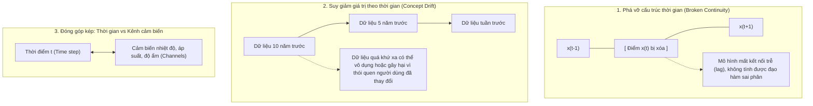
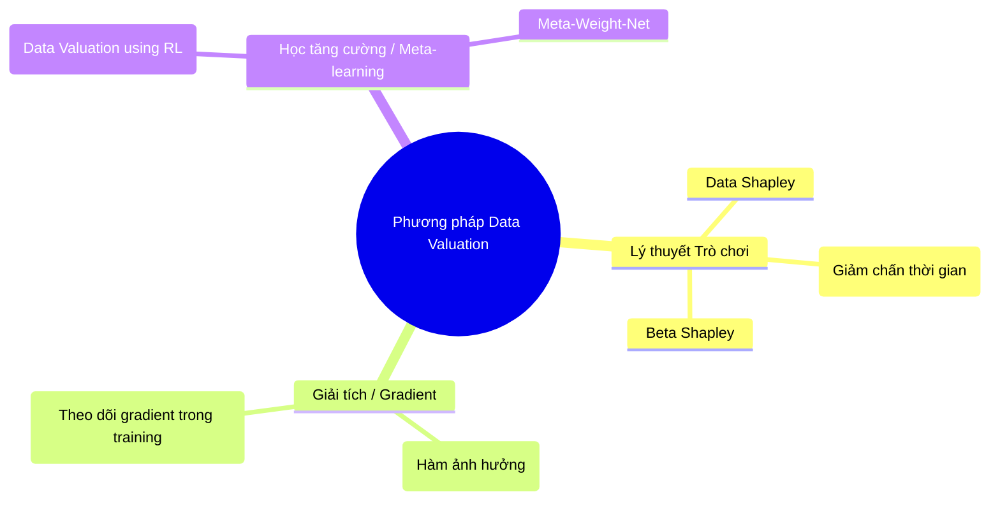

# 3. Định giá dữ liệu chuỗi thời gian (Data Valuation)

---

## 3.1. Định giá dữ liệu (Data Valuation) là gì?

> 🧠 **Ý tưởng cốt lõi:** Không phải mọi điểm dữ liệu đều có giá trị như nhau. Một số điểm dữ liệu giúp mô hình dự báo cực kỳ chuẩn xác, nhưng cũng có những điểm dữ liệu bị nhiễu, lỗi cảm biến hoặc đã quá lỗi thời làm mô hình học lệch lạc. **Data Valuation** là phương pháp lượng hóa bằng con số xem **mỗi điểm dữ liệu, mỗi đoạn chuỗi con (subsequence) hoặc mỗi cảm biến (channel) đóng góp bao nhiêu phần trăm vào thành công của mô hình**.

$$v_i = \text{Value}(z_i \mid \mathcal{D}, \mathcal{M}, \mathcal{U})$$
Trong đó $v_i$ là giá trị của mẫu dữ liệu $z_i$, $\mathcal{D}$ là tập dữ liệu huấn luyện, $\mathcal{M}$ là mô hình, và $\mathcal{U}$ là thước đo hiệu năng (Utility function, ví dụ: mức giảm lỗi RMSE).

---

## 3.2. Vì sao định giá dữ liệu Chuỗi thời gian khó hơn nhiều so với dữ liệu I.I.D?

Trong dữ liệu độc lập (I.I.D), việc loại bỏ điểm dữ liệu thứ $i$ không ảnh hưởng gì tới các điểm dữ liệu khác. Nhưng trong chuỗi thời gian:

1. **Tính phụ thuộc thứ tự (Temporal Interdependence):** Điểm $x_t$ không đứng một mình; nó là đầu vào của $x_{t+1}, x_{t+2}, \dots$. Xóa $x_t$ sẽ làm hỏng cấu trúc cửa sổ trượt (sliding window) của các điểm phía sau.
2. **Sự suy giảm giá trị theo thời gian (Time-decay / Non-stationarity):** Giá trị của dữ liệu cổ phiếu năm 2000 rất khác với dữ liệu tuần trước. Một mô hình huấn luyện trên dữ liệu quá xa có thể bị "nhiễm độc" bởi các quy luật đã lỗi thời.
3. **Độ phân giải và cấu trúc khối (Block-level Valuation):** Định giá từng điểm rời rạc (point-wise) thường ít ý nghĩa bằng việc định giá cả một **khối thời gian (segment/window)** hoặc một **kênh cảm biến cụ thể (sensor channel)**.

---

## 3.3. Các phương pháp định giá dữ liệu chuỗi thời gian chính

### 1. Time-aware Data Shapley (Giá trị Shapley có nhận thức thời gian)
Dựa trên lý thuyết trò chơi hợp tác của Lloyd Shapley (giải Nobel kinh tế). Trong đó, mỗi mẩu dữ liệu là một "người chơi", mục tiêu là chia đều phần thưởng dựa trên đóng góp cận biên (marginal contribution):

$$s_i = \sum_{S \subseteq \mathcal{D} \setminus \{i\}} \frac{|S|!(|\mathcal{D}| - |S| - 1)!}{|\mathcal{D}|!} \Big[ \mathcal{U}(S \cup \{i\}) - \mathcal{U}(S) \Big]$$

- **Cải tiến cho chuỗi thời gian (Time-aware Shapley):** Thay vì xét mọi tập con ngẫu nhiên $S$, ta chỉ xét các tập con **bảo toàn tính liên tục của thời gian**, và tích hợp thêm trọng số suy giảm thời gian (Time-decay weight) $\lambda^{(T - t)}$:
  $$s_t^{\text{time}} = \lambda^{(T - t)} \times s_t$$
  *(Dữ liệu gần hiện tại hơn có tiềm năng được gán trọng số cao hơn nếu môi trường có sự thay đổi).*

### 2. Influence Functions (Hàm ảnh hưởng bậc hai)
Dùng xấp xỉ Hessian để tính toán nhanh xem: nếu ta tăng trọng số của một bước thời gian $z_t$ lên một lượng vô cùng nhỏ $\epsilon$, thì hàm mất mát trên tập kiểm thử $\mathcal{L}(z_{\text{test}}, \hat{\theta})$ sẽ thay đổi như thế nào mà **không cần huấn luyện lại mô hình từ đầu**:

$$\mathcal{I}_{\text{loss}}(z_t, z_{\text{test}}) = - \nabla_{\theta} \mathcal{L}(z_{\text{test}}, \hat{\theta})^T H_{\hat{\theta}}^{-1} \nabla_{\theta} \mathcal{L}(z_t, \hat{\theta})$$
Trong đó $H_{\hat{\theta}}$ là ma trận Hessian của toàn bộ hàm mất mát huấn luyện.

### 3. DVRL (Data Valuation using Reinforcement Learning)
- Huấn luyện một mạng chính sách (Value Network) nhận đầu vào là đoạn chuỗi thời gian $\{x_{t-k}, \dots, x_t\}$ và trả ra một xác suất lựa chọn $p \in [0, 1]$.
- Mô hình dự báo chuỗi thời gian chính được huấn luyện trên các mẫu được chọn.
- Phần thưởng (Reward) từ độ chính xác trên tập validation được truyền ngược lại để cập nhật Value Network thông qua thuật toán Policy Gradient (REINFORCE).

---

## 3.4. Ứng dụng thực tiễn của Data Valuation trong Time Series

| Ứng dụng | Cách thức triển khai | Lợi ích thu được |
|---|---|---|
| **Dọn dẹp dữ liệu (Data Pruning)** | Loại bỏ 10-20% các đoạn chuỗi thời gian có điểm Valuation âm (dữ liệu hại) | Tăng độ chính xác dự báo (giảm RMSE), giảm thời gian huấn luyện |
| **Phát hiện hỏng cảm biến** | Kênh cảm biến nào có điểm Valuation giảm đột ngột về 0 hoặc âm | Cảnh báo bảo trì thiết bị IoT ngay lập tức trước khi hệ thống sập |
| **Phát hiện trôi dạt khái niệm (Concept Drift)** | Theo dõi điểm Shapley trung bình của dữ liệu theo từng tháng/quý | Biết chính xác thời điểm cần retrain lại mô hình (khi dữ liệu cũ mất giá) |
| **Chợ dữ liệu (Data Marketplace)** | Định giá dữ liệu IoT giao thông/thời tiết để chia tiền bản quyền cho nhà cung cấp | Tạo cơ chế định giá sòng phẳng, minh bạch cho nền kinh tế dữ liệu |
