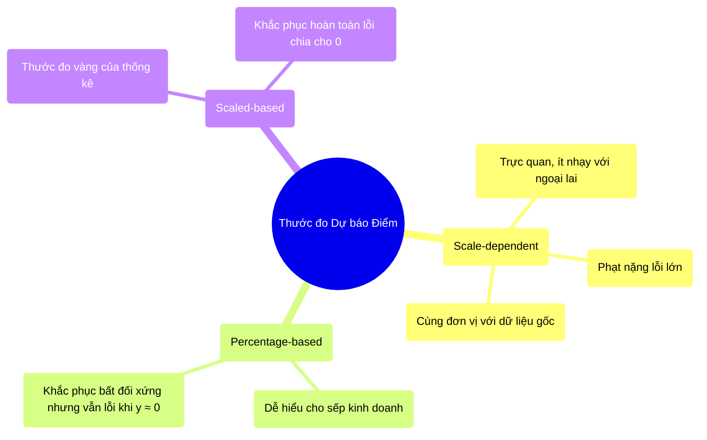
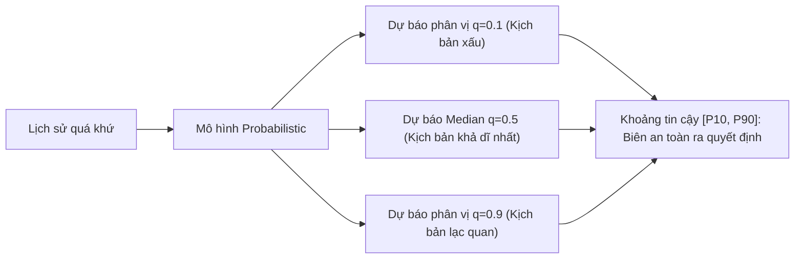

# 6. Đánh giá Mô hình Chuỗi thời gian (Evaluation & Validation)

---

## 6.1. Chiến lược chia dữ liệu (Data Splitting Strategy)

> ⚠️ **Quy tắc sống còn:** **Tuyệt đối KHÔNG ĐƯỢC dùng Random K-Fold Cross-Validation thông thường!**
> Nếu bạn xáo trộn ngẫu nhiên dữ liệu chuỗi thời gian, mô hình sẽ sử dụng thông tin của **ngày mai** để dự đoán kết quả của **ngày hôm nay** (hiện tượng **Data Leakage / Look-ahead Bias**). Kết quả kiểm thử sẽ cao chót vót một cách giả tạo, nhưng khi triển khai thực tế mô hình sẽ thất bại thảm hại.

### 3 phương pháp chia tập kiểm định chuẩn mực:

```mermaid
flowchart TD
    subgraph Expanding ["1. Expanding Window (Cửa sổ mở rộng / Rolling-Origin)"]
        direction TB
        E1["Split 1: [--- Train 70% ---] [ Test 10% ]                  "]
        E2["Split 2: [------ Train 80% ------] [ Test 10% ]           "]
        E3["Split 3: [--------- Train 90% ---------] [ Test 10% ]    "]
    end

    subgraph Sliding ["2. Sliding Window (Cửa sổ trượt có kích thước cố định)"]
        direction TB
        S1["Split 1: [--- Train 60d ---] [ Test 14d ]                 "]
        S2["Split 2:      [--- Train 60d ---] [ Test 14d ]            "]
        S3["Split 3:           [--- Train 60d ---] [ Test 14d ]       "]
    end

    subgraph Purged ["3. Purged & Embargoed Cross-Validation (Dành cho tài chính)"]
        direction TB
        P1["[ Train ] ---> [ Xóa nhãn chồng lấn (Purge) ] ---> [ Embargo ] ---> [ Test ]"]
    end
```

1. **Expanding Window (Rolling-Origin):** Giữ nguyên điểm bắt đầu, mở rộng tập huấn luyện dần theo thời gian. Phù hợp nhất khi mô hình cần học toàn bộ lịch sử tích lũy.
2. **Sliding Window:** Cửa sổ huấn luyện có kích thước cố định (ví dụ luôn chỉ học 90 ngày gần nhất). Phù hợp khi hệ thống có **Concept Drift mạnh** và dữ liệu quá khứ xa không còn giá trị.
3. **Purged & Embargoed CV:** Do Marcos López de Prado phát minh cho tài chính. Loại bỏ hiện tượng rò rỉ nhãn do các khoảng thời gian nắm giữ vị thế (holding period) bị chồng lấn qua ranh giới giữa train và test.

---

## 6.2. Các độ đo Dự báo Điểm (Point Forecasting Metrics)

Cho $y_t$ là giá trị thực tế, $\hat{y}_t$ là giá trị dự báo tại thời điểm $t$, $n$ là số điểm dự báo:

### 1. Nhóm thước đo theo thang đo gốc (Scale-dependent)
- **MAE (Mean Absolute Error):**
  $$\text{MAE} = \frac{1}{n} \sum_{t=1}^n |y_t - \hat{y}_t|$$
  *Đặc điểm:* Cùng đơn vị đo với chuỗi gốc, dễ giải thích, bền vững với điểm ngoại lai.
- **RMSE (Root Mean Squared Error):**
  $$\text{RMSE} = \sqrt{\frac{1}{n} \sum_{t=1}^n (y_t - \hat{y}_t)^2}$$
  *Đặc điểm:* Do có bình phương nên phạt rất nặng các sai số lớn. Rất thích hợp khi sai số lớn mang lại hậu quả nghiêm trọng (như sập lưới điện).

### 2. Nhóm thước đo tỷ lệ phần trăm (Percentage errors)
- **MAPE (Mean Absolute Percentage Error):**
  $$\text{MAPE} = \frac{1}{n} \sum_{t=1}^n \left| \frac{y_t - \hat{y}_t}{y_t} \right| \times 100\%$$
  - ⚠️ **Cái bẫy chết người:** Khi giá trị thực tế $y_t = 0$ (hoặc rất gần 0, như lượng hàng bán vào những ngày ế ẩm), MAPE sẽ bị chia cho 0 và **bùng nổ tiến tới vô cùng**! Ngoài ra, MAPE phạt bất đối xứng: phạt nặng khi dự đoán quá cao hơn là dự đoán quá thấp.
- **WAPE (Weighted Absolute Percentage Error) / Normalized Deviation (ND):**
  $$\text{WAPE} = \frac{\sum_{t=1}^n |y_t - \hat{y}_t|}{\sum_{t=1}^n |y_t|}$$
  - 👉 **Khuyên dùng trong thực tế bán lẻ / thương mại điện tử:** Cộng gộp toàn bộ sai số rồi mới chia cho tổng nhu cầu, giải quyết triệt để lỗi chia cho 0 của từng ngày đơn lẻ!

### 3. Thước đo vàng của giới Thống kê: MASE (Mean Absolute Scaled Error)
Được đề xuất bởi GS. Rob J. Hyndman:
$$\text{MASE} = \frac{\text{MAE}}{\frac{1}{T-1} \sum_{t=2}^T |y_t - y_{t-1}|}$$

- **Ý nghĩa trực quan:** Mẫu số chính là MAE của mô hình cơ sở ngây thơ (**Naive Forecast** - lấy hôm nay đoán cho ngày mai) trên tập huấn luyện.
  - $\text{MASE} < 1$: Mô hình của bạn **tốt hơn** phương pháp đoán ngây thơ.
  - $\text{MASE} > 1$: Mô hình phức tạp của bạn **còn tệ hơn** một đứa trẻ đoán giá ngày mai bằng giá hôm nay!

---

## 6.3. Các độ đo Dự báo Xác suất (Probabilistic Forecasting Metrics)

Dự báo tương lai vốn dĩ bất định. Thay vì chỉ đưa ra một con số duy nhất ($\hat{y}$), các mô hình hiện đại dự báo một dải phân phối xác suất hoặc các khoảng phân vị (Quantiles $q \in (0, 1)$):

1. **Pinball Loss (Quantile Loss):** Thước đo đánh giá độ chính xác khi dự báo một phân vị $q$:
   $$L_q(y, \hat{y}_q) = \max \Big( q(y - \hat{y}_q), (1 - q)(\hat{y}_q - y) \Big)$$
2. **CRPS (Continuous Ranked Probability Score):** Đánh giá toàn bộ hàm phân phối tích lũy dự báo $F$ so với giá trị thực tế $y$:
   $$\text{CRPS}(F, y) = \int_{-\infty}^{\infty} \Big( F(z) - \mathbb{I}(z \ge y) \Big)^2 dz$$
   *(CRPS là dạng tổng quát hóa của MAE sang không gian xác suất).*

---

## 6.4. Đánh giá bài toán Phát hiện bất thường (Anomaly Detection)

Trong chuỗi thời gian, sự bất thường thường diễn ra theo **từng đợt liên tục (contiguous segment / anomaly event)** chứ không phải một điểm đơn lẻ.

### Cạm bẫy "Point-Adjusted F1" (PA-F1)
Nhiều bài báo khoa học sử dụng kỹ thuật điều chỉnh: *Nếu mô hình phát hiện trúng ít nhất 1 điểm bất thường trong cả đoạn sự cố, toàn bộ đoạn sự cố đó được xem như đã được phát hiện đúng (tất cả đều tính là True Positive)*.

> ⚠️ **Hậu quả:** Chỉ cần mô hình đoán bừa một vài điểm rải rác, PA-F1 có thể vọt lên **95-99%** một cách ảo tưởng, dù thực chất mô hình hoàn toàn vô dụng ngoài đời.
> 
> 👉 **Giải pháp chuẩn hiện đại:** Sử dụng các thước đo nhận thức sự kiện:
> - **Affiliation Precision & Affiliation Recall:** Đo khoảng cách thời gian giữa đoạn dự đoán và đoạn thực tế.
> - **Range-based Precision / Recall:** Tính phần giao diện tích (overlap) giữa các đoạn.

---

## 6.5. Nguyên tắc Baseline: Đừng bao giờ bỏ qua Mô hình Ngây thơ

Trước khi triển khai bất kỳ mô hình Deep Learning hay Foundation Model phức tạp nào, bạn bắt buộc phải so sánh với các Baseline đơn giản:

| Mô hình Baseline | Công thức | Trường hợp ứng dụng |
|---|---|---|
| **Naive (Persistence)** | $\hat{y}_{t+h} = y_t$ | Chuỗi bước đi ngẫu nhiên (giá chứng khoán, tỷ giá) |
| **Seasonal Naive** | $\hat{y}_{t+h} = y_{t+h - s}$ | Chuỗi có tính mùa vụ mạnh (lấy giá trị đúng thời điểm này tuần trước/năm trước) |
| **Average Forecast** | $\hat{y}_{t+h} = \bar{y} = \frac{1}{t}\sum_{i=1}^t y_i$ | Chuỗi dao động quanh giá trị trung bình ổn định |
| **Drift Forecast** | $\hat{y}_{t+h} = y_t + h \left(\frac{y_t - y_1}{t - 1}\right)$ | Chuỗi có xu hướng tăng/giảm tuyến tính rõ rệt |

> 💡 **Bài học xương máu:** Trong các cuộc thi chuỗi thời gian quốc tế (như M4, M5 Competition), nhiều mô hình Machine Learning đồ sộ vẫn bị đánh bại bởi mô hình **Seasonal Naive** kết hợp làm mượt số liệu cơ bản.
