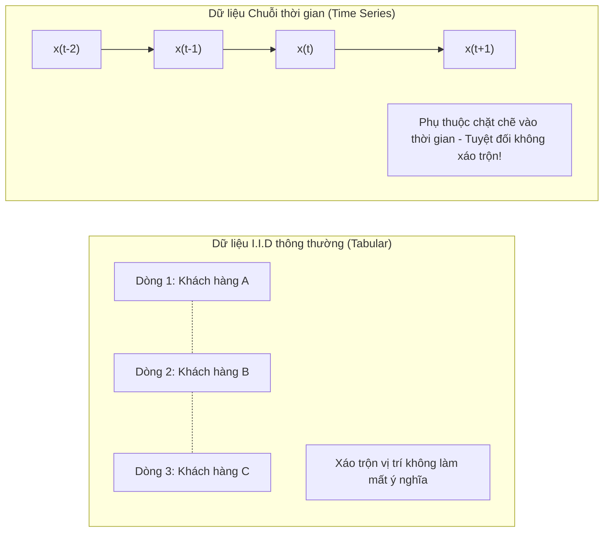
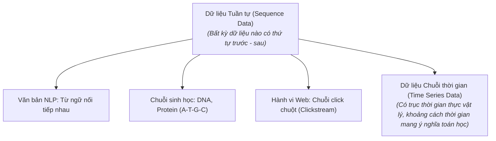
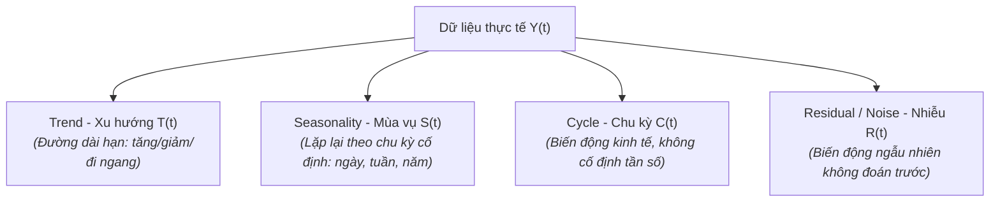
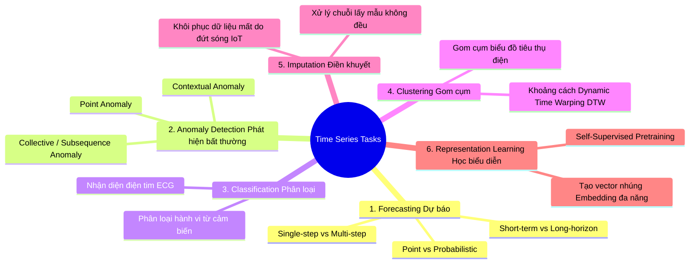

# 1. Tổng quan về Dữ liệu Chuỗi thời gian (General Information)

---

## 1.1. Chuỗi thời gian (Time Series) là gì?

> 🧠 **Ý tưởng cốt lõi:** Chuỗi thời gian là một tập hợp các quan sát được ghi nhận theo **thứ tự thời gian liên tiếp**. Trong thế giới thực, hầu như mọi thứ vận động đều tạo ra dữ liệu chuỗi thời gian: nhịp tim từng giây, giá cổ phiếu từng phút, nhiệt độ từng giờ, hay doanh thu bán hàng từng tháng.

Về mặt toán học, một chuỗi thời gian độ dài $T$ được biểu diễn dưới dạng:

$$X = \{x_1, x_2, \dots, x_T\} \quad \text{hoặc} \quad X = \{x(t)\}_{t=1}^T$$

Trong đó $x_t \in \mathbb{R}^d$ là giá trị quan sát tại thời điểm $t$ ($d=1$ cho chuỗi đơn biến - Univariate, $d > 1$ cho chuỗi đa biến - Multivariate).

---

## 1.2. Time Series vs. Dữ liệu bảng thông thường (I.I.D)

Hầu hết các thuật toán Machine Learning truyền thống (hồi quy tuyến tính, Random Forest thông thường) đều dựa trên giả định **I.I.D (Independent and Identically Distributed - Độc lập và Cùng phân phối)**: các dòng dữ liệu hoàn toàn độc lập với nhau.

Chuỗi thời gian **vi phạm hoàn toàn giả định này**:

| Tiêu chí | Dữ liệu bảng thông thường (I.I.D) | Dữ liệu chuỗi thời gian (Time Series) |
|---|---|---|
| **Thứ tự quan sát** | Không quan trọng (có thể shuffle ngẫu nhiên) | Bắt buộc phải bảo toàn nghiêm ngặt trật tự thời gian |
| **Mối liên hệ giữa các điểm** | Độc lập thống kê với nhau | Phụ thuộc lẫn nhau (Temporal Dependence / Autocorrelation) |
| **Phân phối dữ liệu** | Thường giả định cố định theo thời gian | Thường xuyên biến đổi (Non-stationarity, Trend, Seasonality, Concept Drift) |

---

## 1.3. Time Series vs. Sequence Data (Dữ liệu tuần tự tổng quát)

Nhiều người thường nhầm lẫn giữa **Sequence Data (Dữ liệu tuần tự)** và **Time Series Data (Dữ liệu chuỗi thời gian)**. 

> 💡 **Mối quan hệ:** **Mọi Time Series đều là Sequence Data, nhưng không phải mọi Sequence Data đều là Time Series.**

### So sánh chi tiết sự khác biệt:

| Đặc tính | Dữ liệu tuần tự tổng quát (Sequence Data) | Dữ liệu chuỗi thời gian (Time Series Data) |
|---|---|---|
| **Yếu tố thời gian** | Chỉ cần có **thứ tự trước - sau** (Order), không nhất thiết gắn với đồng hồ thực tế | Gắn liền với **trục thời gian vật lý thực tế** ($t_1, t_2, \dots$ có ngày, giờ, phút, giây) |
| **Khoảng cách giữa các bước ($\Delta t$)** | Không có khái niệm khoảng cách thời gian (khoảng cách giữa từ "Học" và từ "Máy" trong câu không tính bằng giây) | Khoảng cách thời gian $\Delta t$ mang **ý nghĩa quyết định** (đo nhiệt độ cách nhau 1 giây rất khác cách nhau 1 ngày) |
| **Bản chất giá trị** | Phần lớn là **ký hiệu rời rạc (Discrete tokens)**: từ ngữ, mã amino acid, ID trang web | Thường là **giá trị số liên tục (Continuous numerical values)**: điện áp, nhiệt độ, áp suất, tỷ giá |
| **Quy luật chi phối** | Ngữ pháp, cấu trúc cú pháp, xác suất chuyển trạng thái | Động lực học vật lý, quán tính, xu hướng dài hạn (Trend) và chu kỳ lặp lại (Seasonality) |
| **Tần số lấy mẫu (Sampling Rate)** | Thường không áp dụng | Cực kỳ quan trọng: Lấy mẫu đều đặn (Equispaced / Regular) hoặc bất quy tắc (Irregularly sampled) |

---

## 1.4. Phân rã chuỗi thời gian (Time Series Decomposition)

Mọi chuỗi thời gian phức tạp trong thực tế thường được cấu thành từ 4 thành phần cơ bản:

### Hai dạng mô hình phân rã chính:
1. **Mô hình cộng tính (Additive Model):**
   $$Y_t = T_t + S_t + C_t + R_t$$
   *Áp dụng khi:* Biên độ dao động mùa vụ **không đổi** khi xu hướng tăng lên.
2. **Mô hình nhân tính (Multiplicative Model):**
   $$Y_t = T_t \times S_t \times C_t \times R_t$$
   *Áp dụng khi:* Biên độ mùa vụ **tăng theo tỷ lệ thuận** với sự tăng trưởng của xu hướng (ví dụ: doanh số ngày Tết luôn tăng thêm 30% so với mức trung bình của năm đó).

---

## 1.5. Phân chia dữ liệu trong Chuỗi thời gian (Data Partitioning)

> ⚠️ **Quy tắc bất di bất dịch:** **Tuyệt đối KHÔNG ĐƯỢC dùng Random Shuffle khi chia tập Train / Validation / Test!**

Nếu xáo trộn ngẫu nhiên, mô hình sẽ dùng thông tin của ngày mai để học cách dự đoán hôm nay (**Look-ahead Bias / Data Leakage**). Kết quả đánh giá trên giấy sẽ cao ngất ngưởng, nhưng khi triển khai thực tế mô hình sẽ thất bại hoàn toàn.

```mermaid
flowchart TD
    subgraph Wrong ["❌ CÁCH CHIA SAI: Random Split (Gây rò rỉ dữ liệu)"]
        direction LR
        W1["Train"] ~~~ W2["Test"] ~~~ W3["Train"] ~~~ W4["Test"] ~~~ W5["Train"]
    end

    subgraph Correct1 ["✅ CÁCH CHIA ĐÚNG 1: Chronological Split (Theo dòng thời gian)"]
        direction LR
        C1["Train Set (70% đầu)"] --> GAP["[Khoảng đệm Gap]"] --> C2["Val Set (15%)"] --> C3["Test Set (15% cuối)"]
    end

    subgraph Correct2 ["✅ CÁCH CHIA ĐÚNG 2: Rolling-Origin / Expanding Window Cross-Validation"]
        direction TB
        F1["Lần 1: [--- Train ---] [ Test ]"]
        F2["Lần 2: [------ Train ------] [ Test ]"]
        F3["Lần 3: [--------- Train ---------] [ Test ]"]
    end
```

### Các chiến lược phân chia chuẩn mực:
1. **Chronological Split (Phân chia tuần tự):** Lấy dữ liệu của các mốc thời gian quá khứ làm Train, mốc trung gian làm Validation, và phần thời gian mới nhất trong tương lai làm Test.
2. **Kỹ thuật khoảng đệm (Gap / Purging Buffer):** Chèn một khoảng trống nhỏ giữa Train và Test. Mục đích: Đảm bảo các đặc trưng trễ (Lag features, ví dụ lag 7 ngày) của tập Test không vô tình sử dụng đúng các nhãn thực tế của những ngày cuối cùng trong tập Train.
3. **Time Series Cross-Validation (Rolling-Origin):** Đóng vai trò tương tự K-Fold nhưng luôn tuân thủ nguyên tắc: **Tập Train luôn nằm trước tập Test**. Cửa sổ huấn luyện được mở rộng dần theo thời gian (Expanding Window) hoặc trượt tịnh tiến về phía trước (Sliding Window).

---

## 1.6. Tính dừng (Stationarity) – Nền tảng phân tích thống kê

Một chuỗi thời gian được gọi là **dừng yếu (Weakly Stationary)** nếu các đặc tính thống kê cơ bản không đổi theo thời gian:
1. **Kỳ vọng không đổi:** $\mathbb{E}[x_t] = \mu \quad \forall t$ (không có xu hướng dốc lên hay dốc xuống).
2. **Phương sai hữu hạn và không đổi:** $\text{Var}(x_t) = \sigma^2 < \infty \quad \forall t$.
3. **Hiệp phương sai chỉ phụ thuộc độ trễ $k$:** $\text{Cov}(x_t, x_{t+k}) = \gamma(k)$, không phụ thuộc vào mốc thời gian cụ thể $t$.

> 🎭 **Ẩn dụ:** Bắn súng vào tấm bia đứng yên (chuỗi dừng) thì dễ ngắm bắn hơn rất nhiều so với tấm bia vừa di chuyển liên tục lên trên vừa rung lắc dữ dội (chuỗi không dừng). Hầu hết các mô hình thống kê (ARIMA) đều yêu cầu biến đổi chuỗi về dạng dừng (bằng cách lấy sai phân $\Delta x_t = x_t - x_{t-1}$ hoặc lấy logarit) trước khi huấn luyện.

---

## 1.7. Các bài toán chính trong Chuỗi thời gian (Time-Series Tasks)

Cộng đồng Machine Learning phân loại các bài toán chuỗi thời gian thành 6 nhánh chính:

### 1. Dự báo chuỗi thời gian (Time Series Forecasting)
- **Mục tiêu:** Cho trước lịch sử quan sát $X = \{x_1, \dots, x_t\}$, dự đoán giá trị tương lai trong $H$ bước tiếp theo: $\{x_{t+1}, \dots, x_{t+H}\}$.
- **Phân nhánh:**
  - *Dự báo điểm (Point Forecasting):* Trả về một con số duy nhất khả dĩ nhất tại mỗi mốc tương lai.
  - *Dự báo xác suất (Probabilistic Forecasting):* Trả về dải phân phối hoặc các khoảng tin cậy (ví dụ: khoảng dao động 90% của nhu cầu điện), giúp doanh nghiệp quản trị rủi ro an toàn.
  - *Dự báo ngắn hạn (Short-term) vs Siêu dài hạn (Long-horizon forecasting).*

### 2. Phát hiện bất thường (Anomaly Detection)
- **Mục tiêu:** Nhận diện các mẫu dữ liệu đi chệch khỏi quy luật bình thường của hệ thống.
- **3 dạng bất thường cốt lõi:**
  - **Bất thường điểm (Point Anomaly):** Một giá trị đột biến vọt lên bất ngờ (CPU đột ngột tải 100% trong 1 giây).
  - **Bất thường theo ngữ cảnh (Contextual Anomaly):** Nhiệt độ 35°C là bình thường vào buổi trưa mùa hè, nhưng là bất thường nghiêm trọng nếu xuất hiện vào lúc nửa đêm mùa đông.
  - **Bất thường theo đoạn (Collective/Subsequence Anomaly):** Từng điểm riêng lẻ đều bình thường, nhưng khi ghép thành chuỗi sóng thì tạo nên hình mẫu dị thường (ví dụ: dấu hiệu rung lắc trước khi động cơ máy bay hỏng).

### 3. Phân loại chuỗi thời gian (Time Series Classification)
- **Mục tiêu:** Gán nhãn danh mục cho cả một đoạn chuỗi thời gian hoàn chỉnh: $f: X \to y \in \{C_1, \dots, C_k\}$.
- **Ví dụ điển hình:**
  - Y tế: Tín hiệu điện tâm đồ (ECG) $\to$ Nhịp xoang bình thường, Rung nhĩ hay Thiếu máu cơ tim.
  - IoT: Gia tốc kế trên điện thoại $\to$ Người dùng đang đi bộ, chạy bộ hay đi xe buýt.
- **Thách thức:** Hai chuỗi cùng một hành vi có thể có tốc độ nhanh chậm khác nhau $\implies$ Cần dùng các thước đo khoảng cách phi tuyến như **Dynamic Time Warping (DTW)** thay cho khoảng cách Euclidean thông thường.

### 4. Gom cụm chuỗi thời gian (Time Series Clustering)
- **Mục tiêu:** Nhóm các chuỗi thời gian có hình thái vận động (shape pattern) tương tự nhau vào cùng một cụm mà không cần nhãn giám sát.
- **Ví dụ:** Phân cụm hàng triệu hộ gia đình dựa trên biểu đồ tiêu thụ điện 24 giờ để đưa ra các gói cước bán điện phù hợp.

### 5. Điền khuyết dữ liệu (Time Series Imputation)
- **Mục tiêu:** Khôi phục các giá trị bị mất mát (missing values) do cảm biến bị mất nguồn, đứt kết nối mạng không dây hoặc lỗi ghi nhận.
- **Khác biệt:** Không thể chỉ đơn giản thay thế bằng giá trị trung bình (Mean); thuật toán điền khuyết phải tôn trọng tính liên tục của xu hướng và nhịp điệu mùa vụ xung quanh điểm bị mất.

### 6. Học biểu diễn chuỗi thời gian (Representation Learning)
- **Mục tiêu:** Huấn luyện mô hình nén một chuỗi thời gian dài phức tạp thành một vector đặc trưng kích thước cố định (Embedding) mang đầy đủ thông tin ngữ nghĩa.
- **Ứng dụng:** Vector này có thể dùng làm đầu vào cho bất kỳ mô hình downstream nào (tìm kiếm chuỗi thời gian tương đồng, truy vấn cơ sở dữ liệu nhanh, phát hiện gian lận).
