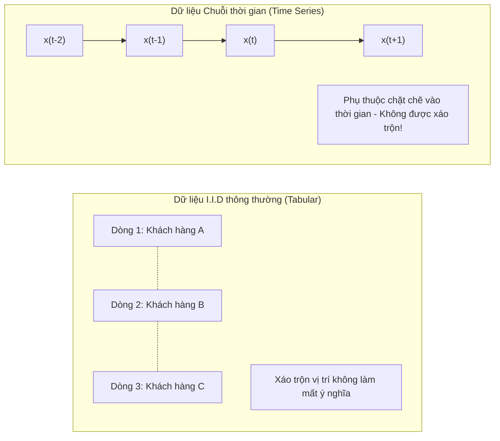
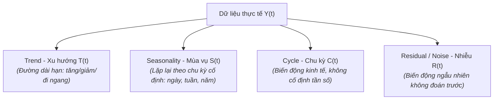
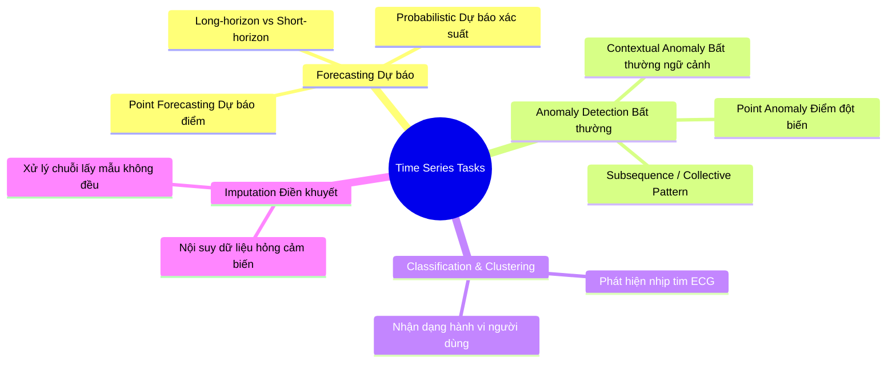

# 1. Tổng quan về Dữ liệu Chuỗi thời gian (General Information)

---

## 1.1. Chuỗi thời gian (Time Series) là gì?

> 🧠 **Ý tưởng cốt lõi:** Chuỗi thời gian là một tập hợp các quan sát được ghi nhận theo **thứ tự thời gian liên tiếp**. Trong thế giới thực, hầu như mọi thứ vận động đều tạo ra dữ liệu chuỗi thời gian: nhịp tim từng giây, giá cổ phiếu từng phút, nhiệt độ từng giờ, hay doanh thu bán hàng từng tháng.

Về mặt toán học, một chuỗi thời gian độ dài $T$ được biểu diễn dưới dạng:

$$X = \{x_1, x_2, \dots, x_T\} \quad \text{hoặc} \quad X = \{x(t)\}_{t=1}^T$$

Trong đó $x_t \in \mathbb{R}^d$ là giá trị quan sát tại thời điểm $t$ ($d=1$ cho chuỗi đơn biến, $d > 1$ cho chuỗi đa biến).

---

## 1.2. Điểm khác biệt sống còn: Time Series vs. Dữ liệu bảng thông thường (I.I.D)

Hầu hết các thuật toán Machine Learning truyền thống đều dựa trên giả định **I.I.D (Independent and Identically Distributed - Độc lập và Cùng phân phối)**: các dòng dữ liệu hoàn toàn độc lập, bạn xáo trộn (shuffle) thứ tự các dòng thì mô hình vẫn học bình thường.

Chuỗi thời gian **vi phạm hoàn toàn giả định này**:

| Tiêu chí so sánh | Dữ liệu bảng (I.I.D) | Dữ liệu chuỗi thời gian (Time Series) |
|---|---|---|
| **Thứ tự quan sát** | Không quan trọng (có thể shuffle) | Bắt buộc phải bảo toàn trật tự thời gian |
| **Mối liên hệ giữa các điểm** | Giả định độc lập với nhau | Phụ thuộc lẫn nhau (Temporal Dependence / Autocorrelation) |
| **Phân phối dữ liệu** | Thường giả định không đổi | Thường xuyên biến đổi theo thời gian (Non-stationarity, Concept Drift) |
| **Chia tập Train / Test** | Random K-Fold Cross Validation | Rolling-Window / Temporal Split (không được nhìn trước tương lai) |

---

## 1.3. Phân rã chuỗi thời gian (Time Series Decomposition)

Mọi chuỗi thời gian phức tạp trong thực tế thường là sự kết hợp của 4 thành phần cơ bản:

### Hai dạng mô hình phân rã chính:

1. **Mô hình cộng tính (Additive Model):**
   $$Y_t = T_t + S_t + C_t + R_t$$
   *Khi nào dùng?* Khi biên độ dao động mùa vụ **không đổi** theo độ lớn của xu hướng (ví dụ: lượng điện tiêu thụ tăng thêm 50 kWh mỗi mùa hè, bất kể mức tiêu thụ cơ sở là bao nhiêu).

2. **Mô hình nhân tính (Multiplicative Model):**
   $$Y_t = T_t \times S_t \times C_t \times R_t$$
   *Khi nào dùng?* Khi biên độ mùa vụ **tăng theo tỷ lệ thuận** với xu hướng (ví dụ: doanh thu công ty tăng trưởng mạnh, đợt Tết luôn tăng thêm 30% so với mức trung bình của năm đó).

> 💡 **Mẹo chuyển đổi:** Lấy logarit tự nhiên của mô hình nhân tính sẽ đưa về mô hình cộng tính:
> $$\log(Y_t) = \log(T_t) + \log(S_t) + \log(C_t) + \log(R_t)$$

---

## 1.4. Tính dừng (Stationarity) – Trọng tâm của phân tích chuỗi thời gian

### Tính dừng là gì?
Một chuỗi thời gian được gọi là **dừng yếu (Weakly Stationary / Covariance Stationary)** nếu các tính chất thống kê của nó không thay đổi theo thời gian:
1. **Kỳ vọng không đổi:** $\mathbb{E}[x_t] = \mu \quad \forall t$ (không có xu hướng tăng/giảm).
2. **Phương sai hữu hạn và không đổi:** $\text{Var}(x_t) = \sigma^2 < \infty \quad \forall t$.
3. **Hiệp phương sai chỉ phụ thuộc vào độ trễ (lag $k$):** $\text{Cov}(x_t, x_{t+k}) = \gamma(k)$, không phụ thuộc vào mốc thời gian $t$.

> 🎭 **Ẩn dụ trực quan:** Hãy tưởng tượng bạn đang tập bắn bia.
> - **Chuỗi dừng:** Tâm bia đứng yên, độ rung tay của bạn ổn định. Bạn có thể tự tin dự đoán các phát bắn tiếp theo sẽ rơi vào đâu.
> - **Chuỗi không dừng:** Tâm bia đang di chuyển liên tục lên trên (có Trend), hoặc mục tiêu rung lắc lúc mạnh lúc yếu thất thường (phương sai đổi). Bạn không thể dùng quy luật của quá khứ để đoán tương lai một cách trực tiếp.

### Cách đưa chuỗi không dừng về chuỗi dừng:
- **Lấy sai phân (Differencing):** $\Delta x_t = x_t - x_{t-1}$ (loại bỏ xu hướng bậc 1).
- **Lấy Logarit:** $\log(x_t)$ (ổn định phương sai).
- **Trừ thành phần mùa vụ (Seasonal Differencing):** $\Delta_s x_t = x_t - x_{t-s}$.

### Kiểm định tính dừng phổ biến:
- **ADF Test (Augmented Dickey-Fuller):** Giả thuyết $H_0$ là chuỗi có nghiệm đơn vị (không dừng). $p\text{-value} < 0.05 \implies$ Bác bỏ $H_0$, chuỗi là dừng.
- **KPSS Test:** Giả thuyết $H_0$ là chuỗi là dừng. $p\text{-value} < 0.05 \implies$ Bác bỏ $H_0$, chuỗi không dừng.

---

## 1.5. Tự tương quan (Autocorrelation)

- **ACF (Autocorrelation Function - Hàm tự tương quan):** Đo lường mức độ tương quan tuyến tính giữa $x_t$ và giá trị quá khứ trễ $k$ bước $x_{t-k}$:
  $$\rho_k = \frac{\text{Cov}(x_t, x_{t-k})}{\sqrt{\text{Var}(x_t)\text{Var}(x_{t-k})}}$$
- **PACF (Partial Autocorrelation Function - Tự tương quan từng phần):** Đo lường tương quan giữa $x_t$ và $x_{t-k}$ sau khi đã **loại bỏ ảnh hưởng** của tất cả các bước trễ trung gian $\{x_{t-1}, x_{t-2}, \dots, x_{t-k+1}\}$.

---

## 1.6. Phân loại bài toán trong Time Series

1. **Forecasting (Dự báo):** Cho trước $\{x_1, \dots, x_T\}$, dự đoán giá trị tương lai $\{x_{T+1}, \dots, x_{T+H}\}$ với horizon $H$.
2. **Anomaly Detection (Phát hiện bất thường):** Phát hiện các điểm dữ liệu hoặc chuỗi con khác thường so với quy luật vận động chuẩn (phát hiện gian lận, lỗi máy móc công nghiệp).
3. **Classification (Phân loại):** Gán nhãn cho cả một đoạn chuỗi thời gian (ví dụ: đo điện tâm đồ ECG $\to$ Tim bình thường hay Rối loạn nhịp tim).
4. **Imputation (Điền khuyết):** Khôi phục lại các điểm dữ liệu bị mất do lỗi đường truyền cảm biến mà vẫn bảo toàn tính phụ thuộc thời gian.
