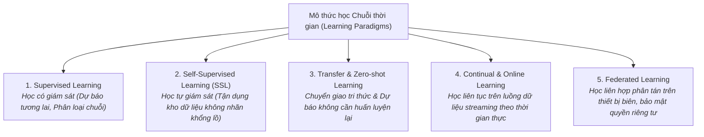
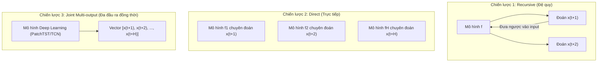
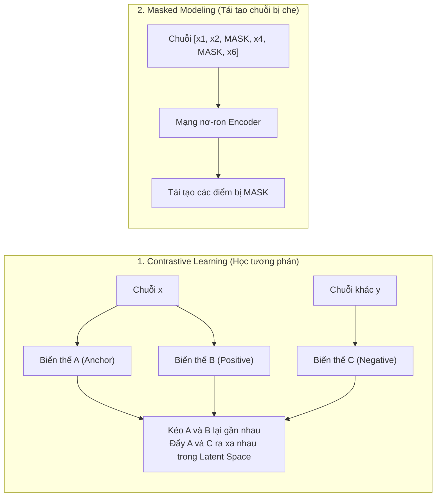
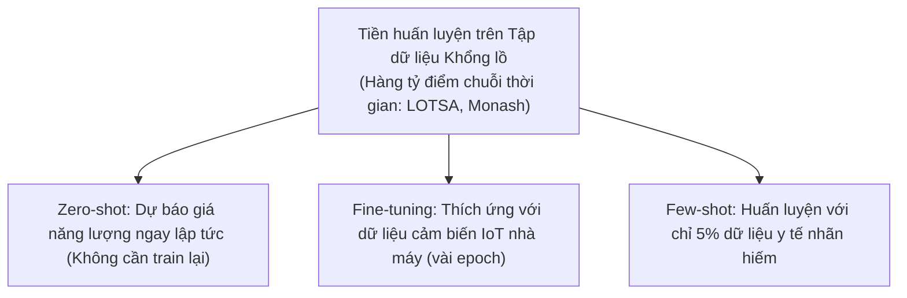
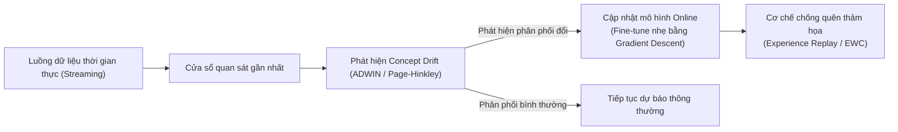

# 5. Các mô thức học trong Chuỗi thời gian (Learning Paradigms)

---

## 5.1. Tổng quan các mô thức học

Dữ liệu chuỗi thời gian xuất hiện trong nhiều bối cảnh khác nhau: từ dữ liệu có nhãn sẵn sàng, dữ liệu chưa có nhãn trôi nổi từ hàng triệu cảm biến IoT, cho đến các luồng dữ liệu thời gian thực biến đổi không ngừng. Do đó, các mô thức học (Learning Paradigms) trong Time Series cũng rất đa dạng:

---

## 5.2. Mô thức 1: Supervised Learning (Học có giám sát)

Trong bài toán dự báo tương lai (Forecasting), đầu vào là lịch sử độ dài $L$: $X = [x_{t-L+1}, \dots, x_t]$, mục tiêu là dự báo $H$ bước tiếp theo: $Y = [x_{t+1}, \dots, x_{t+H}]$. Có 3 chiến lược thiết kế mô hình:

| Chiến lược | Cơ chế hoạt động | Ưu điểm | Nhược điểm |
|---|---|---|---|
| **Recursive (Đệ quy)** | Huấn luyện 1 mô hình 1 bước ($t+1$). Để đoán $t+2$, lấy giá trị vừa dự đoán nhét ngược lại làm đầu vào | Tiết kiệm chi phí huấn luyện (chỉ 1 mô hình duy nhất) | **Lỗi tích lũy (Error Accumulation):** Đoán sai $t+1$ sẽ làm hỏng hoàn toàn $t+2, t+3$ |
| **Direct (Trực tiếp)** | Huấn luyện $H$ mô hình độc lập, mỗi mô hình chuyên trách 1 mốc thời gian trong tương lai | Không bị lỗi tích lũy | Tốn tài nguyên (phải train và lưu trữ $H$ mô hình riêng biệt) |
| **Joint / Multi-Output** | Mô hình Deep Learning sinh trực tiếp toàn bộ vector $H$ bước trong một lần chuyển tiếp (forward pass) | Nhanh, nắm bắt được tương quan nội tại giữa các bước tương lai | Đòi hỏi mô hình dung lượng lớn (Deep Learning/Transformers) |

---

## 5.3. Mô thức 2: Self-Supervised Learning (Học tự giám sát)

Trong thực tế, việc gán nhãn cho chuỗi thời gian (như đánh dấu bệnh lý trên biểu đồ điện tim hay sự cố máy bay) cực kỳ đắt đỏ và đòi hỏi chuyên gia y tế/kỹ thuật. Tuy nhiên, dữ liệu thô chưa gắn nhãn lại vô cùng dồi dào. **Self-Supervised Learning (SSL)** biến dữ liệu không nhãn thành bài toán tự học:

### 1. Contrastive Learning (Ví dụ: TS2Vec, CoST)
- **Nguyên lý:** Đưa ra giả định rằng cùng một chuỗi thời gian khi được tăng cường (thêm chút nhiễu hoặc co giãn thời gian) thì bản chất ngữ nghĩa vẫn không đổi.
- **TS2Vec (Time Series to Vector):** Học biểu diễn phổ quát ở cả cấp độ điểm (point-level) và cấp độ chuỗi con (segment-level) thông qua cấu trúc phân cấp (hierarchical contrastive loss).
- **CoST (Contrastive Seasonal-Trend):** Tách chuỗi thành hai nhánh Trend và Seasonality, áp dụng học tương phản riêng biệt ở miền thời gian và miền tần số.

### 2. Masked Autoencoding cho Time Series (PatchTST Pretraining)
- Che đi ngẫu nhiên 40-70% các Patch thời gian.
- Ép mô hình học cách nội suy các Patch bị thiếu dựa vào ngữ cảnh xung quanh.
- Kết quả: Encoder học được cấu trúc toán học sâu sắc của chuỗi thời gian, sau đó có thể mang đi fine-tune cho bất kỳ tác vụ nào (dự báo, phân loại, phát hiện bất thường).

---

## 5.4. Mô thức 3: Transfer Learning & Zero-Shot Forecasting

Khác với quan niệm cũ cho rằng mô hình dự báo thời tiết không thể dùng cho dữ liệu giao thông, các nghiên cứu gần đây chứng minh: **Các hình thái cơ bản của chuỗi thời gian (sóng hình sin, xu hướng mũ, dao động điều hòa) có tính phổ quát rất cao giữa các lĩnh vực**.

- **Zero-Shot Forecasting:** Cung cấp chuỗi ngữ cảnh quá khứ (context), mô hình nền tảng (Foundation Model như Chronos, TimeGPT, MOIRAI) sẽ dự đoán ngay bước tiếp theo mà không cập nhật bất kỳ trọng số nào.

---

## 5.5. Mô thức 4: Continual & Online Learning (Học liên tục trên luồng dữ liệu)

Trong môi trường thực tế (như sàn giao dịch tài chính hoặc hệ sinh thái thương mại điện tử), quy luật vận động của chuỗi thời gian luôn thay đổi theo thời gian (**Concept Drift / Non-stationarity**).

- **Vấn đề cốt lõi:** **Catastrophic Forgetting (Quên thảm họa)** — Khi cập nhật mô hình với dữ liệu mới của hôm nay, mô hình có thể quên sạch các quy luật mùa vụ của năm ngoái.
- **Giải pháp:**
  - **Memory Buffer / Experience Replay:** Lưu trữ một tập nhỏ các đoạn chuỗi đại diện từ quá khứ để huấn luyện xen kẽ với dữ liệu mới.
  - **Elastic Weight Consolidation (EWC):** Bảo vệ các trọng số quan trọng đối với tri thức cũ không bị thay đổi mạnh.

---

## 5.6. Mô thức 5: Federated Learning (Học liên hợp phân tán)

Áp dụng cho các bài toán chuỗi thời gian nhạy cảm (dữ liệu sức khỏe từ đồng hồ thông minh Apple Watch, tiêu thụ năng lượng tại các hộ gia đình):

- **Cách hoạt động:** Dữ liệu chuỗi thời gian được giữ nguyên vẹn trên thiết bị của người dùng (Edge Device). Mỗi thiết bị tự tính toán gradient mô hình cục bộ và chỉ gửi trọng số (weights) đã được mã hóa về máy chủ trung tâm để tổng hợp (Federated Averaging - FedAvg).
- **Lợi ích:** Đạt được mô hình dự báo toàn cầu mạnh mẽ mà vẫn tuân thủ tuyệt đối quy định bảo vệ quyền riêng tư (GDPR).
