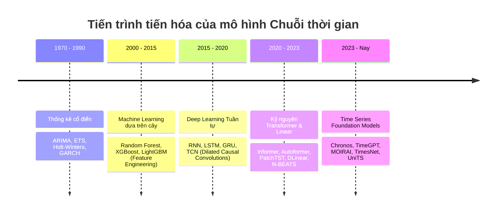
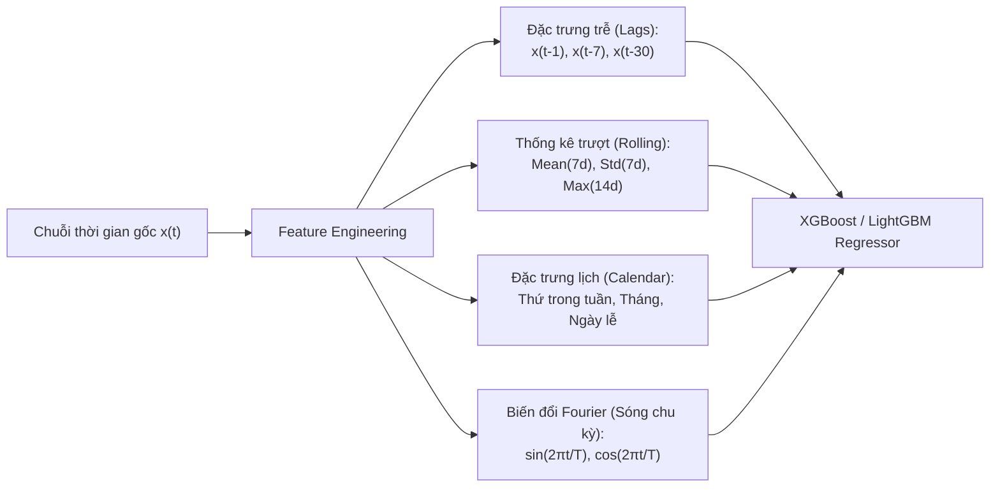
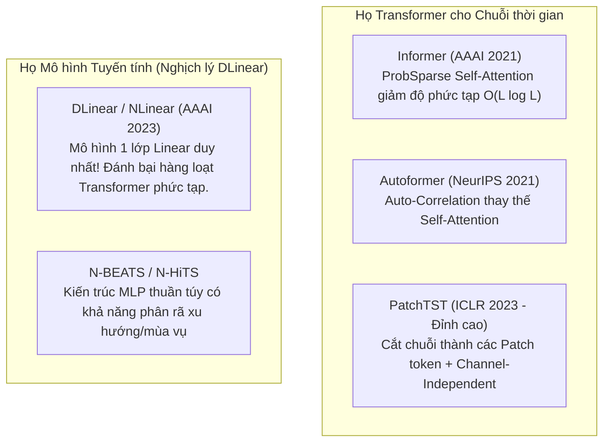

# 4. Các họ mô hình Chuỗi thời gian (Models Taxonomy)

---

## 4.1. Bản đồ tiến hóa của các mô hình Time Series

Từ các phương trình thống kê thế kỷ 20 cho đến các mô hình Foundation Models hàng tỷ tham số ngày nay, bài toán chuỗi thời gian đã trải qua 5 làn sóng công nghệ lớn:

---

## 4.2. Họ 1: Mô hình Thống kê cổ điển (Statistical Models)

### 1. ARIMA & SARIMAX
- **ARIMA(p, d, q):** Mô hình hóa tự tương quan và trung bình trượt sau khi lấy sai phân bậc $d$.
- **SARIMAX:** Mở rộng toàn diện nhất của ARIMA:
  - Thêm mùa vụ: $(P, D, Q)_s$.
  - Thêm biến ngoại sinh (Exogenous variables $X$): các yếu tố bên ngoài hỗ trợ dự báo (ví dụ: nhiệt độ, ngày lễ, chiến dịch khuyến mãi).
- **Ưu điểm:** Cơ sở toán học vững chắc, diễn giải tuyệt vời (có khoảng tin cậy giải tích), chạy siêu nhanh trên tập dữ liệu nhỏ.
- **Nhược điểm:** Chỉ bắt được quan hệ tuyến tính, khó mở rộng lên chuỗi đa biến hàng ngàn kênh.

### 2. Exponential Smoothing (ETS & Holt-Winters)
- Dự báo tương lai bằng trung bình có trọng số của các giá trị quá khứ, trong đó trọng số **suy giảm theo hàm mũ** khi lùi xa về quá khứ.
- **Holt-Winters:** Bổ sung thêm thành phần Xu hướng (Trend) và Mùa vụ (Seasonal).

### 3. GARCH (Dự báo độ biến động - Volatility)
- Dành riêng cho tài chính: Trong thị trường chứng khoán, giá có thể không đoán được, nhưng **độ rủi ro/biến động (phương sai)** có tính chất tụ cụm (Volatility Clustering - những ngày biến động mạnh thường đi liền với nhau). GARCH mô hình hóa phương sai thay đổi có điều kiện.

---

## 4.3. Họ 2: Machine Learning dựa trên cây (GBDT)

Các thuật toán như **LightGBM, XGBoost, CatBoost** không được thiết kế sẵn cho chuỗi thời gian, nhưng lại là **vua trên các bảng xếp hạng thực tế (Kaggle)** nhờ kỹ thuật kỹ nghệ đặc trưng (Feature Engineering):

- **Ưu điểm:** Học cực tốt các mối quan hệ phi tuyến, xử lý tốt biến định tính (categorical), ít bị overfitting hơn Deep Learning khi dữ liệu vừa phải.
- **Nhược điểm:** Không tự động học được biểu diễn thời gian (phụ thuộc hoàn toàn vào tay nghề kỹ sư trích xuất feature), không suy diễn ngoại suy xu hướng tuyến tính (extrapolate trend) tốt nếu giá trị tương lai vượt khỏi biên của tập train.

---

## 4.4. Họ 3: Deep Learning Tuần tự & Tích chập (RNN, LSTM, TCN)

### 1. LSTM & GRU
- Khắc phục lỗi triệt tiêu gradient (vanishing gradient) của RNN bằng các cổng kiểm soát luồng thông tin: **Forget Gate, Input Gate, Output Gate**.
- **Điểm yếu lớn:** Cơ chế tính toán tuần tự từng bước $t \to t+1$ khiến mô hình **không thể song song hóa** trên GPU, huấn luyện rất chậm khi chuỗi dài.

### 2. TCN (Temporal Convolutional Networks)
Thay thế hoàn toàn đệ quy bằng tích chập 1D với 2 cải tiến then chốt:
1. **Causal Convolution (Tích chập nhân quả):** Bộ lọc chỉ nhìn về quá khứ, tuyệt đối không nhìn trước thông tin tương lai.
2. **Dilated Convolution (Tích chập giãn nở):** Tăng trường tiếp nhận (Receptive Field) theo cấp số nhân ($d = 1, 2, 4, 8, \dots$) mà không làm tăng số lượng tham số, cho phép mô hình nhớ được lịch sử hàng nghìn bước mà vẫn tính toán song song cực nhanh.

---

## 4.5. Họ 4: Kỷ nguyên Transformer & Nghịch lý DLinear

### Bước ngoặt PatchTST (Patch Time Series Transformer)
Trước năm 2023, việc áp dụng nguyên bản Transformer (như trong NLP) vào chuỗi thời gian thất bại nặng nề vì **1 điểm thời gian không mang ngữ nghĩa trọn vẹn** như một từ ngữ. PatchTST giải quyết bằng 2 nguyên lý:
1. **Patching:** Gom một cụm liên tiếp các bước thời gian (ví dụ 16 bước) thành 1 "Patch" (tương tự như một từ trong câu). Điều này vừa giảm độ dài chuỗi tính toán vừa bảo toàn ngữ nghĩa cục bộ.
2. **Channel Independence:** Xử lý chuỗi đa biến bằng cách coi mỗi kênh cảm biến như một chuỗi độc lập chia sẻ chung trọng số mô hình, tránh nhiễu chéo giữa các kênh.

### Nghịch lý DLinear (Are Transformers Effective for Time Series?)
Năm 2023, bài báo nổi tiếng của nhóm Đại học Thanh Hoa chỉ ra: Một mô hình tuyến tính đơn giản **DLinear** (chỉ gồm 1 phép phân rã Trend-Seasonality và 2 tầng Linear đơn giản) lại **đánh bại hầu hết các Transformer phức tạp** (Informer, Autoformer) trên tập benchmark kinh điển, với tốc độ nhanh gấp hàng chục lần và tiêu tốn bộ nhớ tối thiểu.

---

## 4.6. Họ 5: Time Series Foundation Models (Mô hình nền tảng)

Tương tự như GPT-4 trong ngôn ngữ hay CLIP trong thị giác, chuỗi thời gian đang bước vào kỷ nguyên **Zero-Shot Forecasting**: Mô hình được tiền huấn luyện trước trên hàng trăm tỷ điểm dữ liệu từ đa lĩnh vực, có khả năng dự báo ngay lập tức trên dữ liệu mới mà không cần huấn luyện lại (No fine-tuning required).

| Mô hình | Đơn vị phát triển | Đặc điểm kiến trúc | Khả năng Zero-shot |
|---|---|---|---|
| **Chronos** | Amazon (2024) | Rời rạc hóa (tokenize) chuỗi số thành các token từ vựng, dùng kiến trúc T5 tiền huấn luyện | Cực kỳ xuất sắc, nắm bắt tốt hình thái chuỗi |
| **TimeGPT** | Nixtla (2023) | Transformer chuyên dụng cho chuỗi thời gian, cung cấp qua API thương mại | Dự báo điểm và dự báo phân vị (Quantile) |
| **MOIRAI** | Salesforce (2024) | Hỗ trợ chuỗi đa biến kích thước bất kỳ (Any-variate), linh hoạt kích thước Patch | SOTA trên tập dữ liệu tổng hợp LOTSA |
| **TimesNet** | Tsinghua Univ | Chuyển đổi chuỗi thời gian 1D sang biểu diễn 2D theo các tần số biến đổi | Đa năng: Dự báo, Phân loại, Điền khuyết, Bất thường |

---

## 4.7. Bảng so sánh tổng quan các họ mô hình

| Tiêu chí | ARIMA / ETS | XGBoost / LightGBM | LSTM / TCN | PatchTST / DLinear | Foundation Models |
|---|---|---|---|---|---|
| **Dung lượng dữ liệu cần** | Rất ít (< 1.000 điểm) | Trung bình ($10^3 - 10^5$) | Lớn ($> 10^5$) | Rất lớn ($> 10^5$) | Không cần train (Zero-shot) |
| **Tốc độ huấn luyện** | Chớp mắt (vài giây) | Rất nhanh (phút) | Chậm (hàng giờ) | Vừa phải / Nhanh (với DLinear) | Sẵn sàng suy luận |
| **Khả năng diễn giải** | Cực kỳ cao | Khá cao (Feature Importance) | Hộp đen (Rất thấp) | Thấp đến trung bình | Hộp đen hoàn toàn |
| **Quan hệ phi tuyến** | Không | Rất tốt | Rất tốt | Cực tốt | Xuất sắc |
| **Mở rộng đa biến ($>100$ kênh)** | Kém | Vừa phải | Tốt | Xuất sắc | Xuất sắc |
