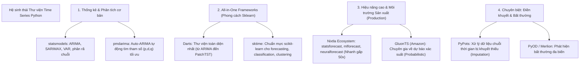
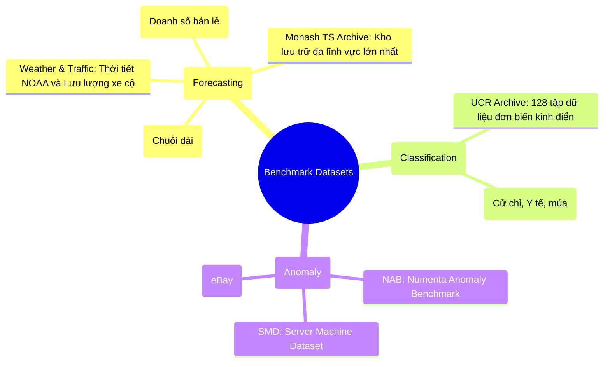

# 7. Kho Tài nguyên & Thư viện Chuỗi thời gian (Repositories & Resources)

---

## 7.1. Các Thư viện Python Mã nguồn mở Hàng đầu

Bản đồ hệ sinh thái thư viện xử lý chuỗi thời gian phân theo nhu cầu sử dụng:



### Bảng so sánh chi tiết các thư viện chính:

| Thư viện | Nhà phát triển | Điểm mạnh nổi bật | GitHub Link |
|---|---|---|---|
| **Darts** | Unit8 | Cực kỳ thân thiện, API đồng nhất, hỗ trợ cả mô hình thống kê lẫn Deep Learning, dễ dàng đánh giá backtesting | [unit8co/darts](https://github.com/unit8co/darts) |
| **NeuralForecast** | Nixtla | Bộ sưu tập Deep Learning đồ sộ (N-BEATS, NHITS, PatchTST, Informer, TimesNet), tối ưu hóa GPU cực nhanh | [Nixtla/neuralforecast](https://github.com/Nixtla/neuralforecast) |
| **StatsForecast** | Nixtla | Cài đặt AutoARIMA, ETS, Theta bằng C++ và Numba, chạy nhanh gấp 20-50 lần thư viện R gốc | [Nixtla/statsforecast](https://github.com/Nixtla/statsforecast) |
| **sktime** | sktime community | Đầy đủ nhất về các bài toán: Phân loại chuỗi (Classification), Gom cụm (Clustering), Biến đổi chuỗi (Transformers) | [sktime/sktime](https://github.com/sktime/sktime) |
| **GluonTS** | Amazon Web Services | Xây dựng riêng cho bài toán dự báo phân vị và dải xác suất (DeepAR, Temporal Fusion Transformer) | [awslabs/gluonts](https://github.com/awslabs/gluonts) |
| **PyPOTS** | PyPOTS dev | Thư viện đầu tiên chuyên dụng cho việc tái tạo và điền dữ liệu khuyết thiếu (SAITS, BRITS) | [WenjieDu/PyPOTS](https://github.com/WenjieDu/PyPOTS) |

---

## 7.2. Các Bộ Dữ liệu Chuẩn đối sánh Quốc tế (Public Benchmark Datasets)

Để kiểm chứng thuật toán hoặc viết bài báo nghiên cứu, cộng đồng sử dụng các kho lưu trữ tiêu chuẩn sau:



1. **Monash Time Series Forecasting Archive:**
   - Kho dữ liệu dự báo toàn diện nhất thế giới với hàng trăm tập dữ liệu từ năng lượng, giao thông, y tế, tài chính.
   - Truy cập: [forecastingdata.org](https://forecastingdata.org/)
2. **UCR / UEA Time Series Archive:**
   - Tiêu chuẩn vàng tuyệt đối để đánh giá các thuật toán phân loại và gom cụm chuỗi thời gian (Time Series Classification/Clustering).
   - Truy cập: [timeseriesclassification.com](https://www.timeseriesclassification.com/)
3. **Bộ dữ liệu ETT (Electricity Transformer Temperature):**
   - Bộ dữ liệu ghi nhận nhiệt độ và tải lượng của máy biến áp điện lực suốt 2 năm (theo chu kỳ 15 phút và 1 giờ).
   - Dùng để kiểm tra khả năng dự báo siêu dài (Long-sequence Time Series Forecasting - LSTF).
4. **M5 Competition Dataset (Kaggle):**
   - Dữ liệu bán hàng phân cấp của tập đoàn Walmart gồm hơn 30.000 sản phẩm tại 10 cửa hàng, chuẩn mực cho bài toán chuỗi thời gian gián đoạn và rời rạc (Intermittent Demand).

---

## 7.3. Tài nguyên Học thuật & Sách Kinh điển (Must-Read)

### 1. Sách giáo khoa "Kinh thánh" miễn phí
- 📖 **Forecasting: Principles and Practice (FPP3)**
  - *Tác giả:* GS. Rob J. Hyndman & George Athanasopoulos.
  - *Đặc điểm:* Cuốn sách gối đầu giường của mọi chuyên gia chuỗi thời gian trên thế giới. Hoàn toàn miễn phí trực tuyến, giải thích cực kỳ trực quan và chuẩn mực.
  - *Đọc tại:* [otexts.com/fpp3/](https://otexts.com/fpp3/)

### 2. Các Bài báo Khảo sát (Survey Papers) bước ngoặt
- **Deep Learning for Time Series Forecasting: A Survey** (Lim & Zohren, 2021) — Tổng kết toàn diện kiến trúc RNN, CNN, Attention áp dụng cho chuỗi thời gian.
- **Are Transformers Effective for Time Series?** (Zeng et al., AAAI 2023) — Bài báo chấn động giới thiệu DLinear, thách thức tính hiệu quả thực sự của Transformer.
- **A Survey on Time Series Foundation Models** (2024) — Toàn cảnh về sự chuyển dịch sang mô hình nền tảng tiền huấn luyện quy mô lớn (Foundation Models).

---

## 7.4. Hướng dẫn Bắt đầu Nhanh (Quick-start Code Snippet)

Ví dụ sử dụng thư viện **NeuralForecast** để dự báo đa chuỗi với mô hình SOTA **PatchTST**:

```python
import pandas as pd
from neuralforecast import NeuralForecast
from neuralforecast.models import PatchTST, NBEATS

# 1. Chuẩn bị dữ liệu định dạng chuẩn: ['unique_id', 'ds', 'y']
# unique_id: mã định danh chuỗi, ds: timestamp, y: giá trị
df = pd.read_csv("https://raw.githubusercontent.com/Nixtla/transfer-learning-time-series/main/datasets/electricity-short.csv")

# 2. Khởi tạo mô hình
horizon = 24  # Dự báo 24 giờ tiếp theo
models = [
    PatchTST(h=horizon, input_size=96, max_steps=100),
    NBEATS(h=horizon, input_size=96, max_steps=100)
]

# 3. Huấn luyện và dự báo
nf = NeuralForecast(models=models, freq='H')
nf.fit(df=df)
forecasts = nf.predict()

print(forecasts.head())
```
